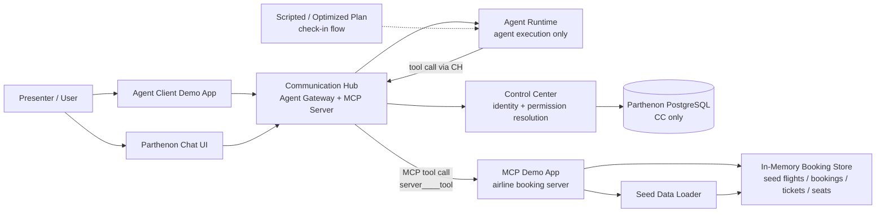

# Architecture: Airline Booking Demo (Scenario-Based MCP Demo)

Scenario-based airline booking demo layered onto the existing MCP demo app. The demo app exposes seven booking tools over MCP, backed by its own in-memory seed data — **no Parthenon database changes**. All top-priority rules hold: three segregated backend services, agents execute only in Agent Runtime, only Control Center touches the database, agents never receive sensitive data (identity tokens are resolved by Control Center and injected by Communication Hub per tool call).

---

## 1. Changed Components

| Component | Change |
|---|---|
| `mcp-demo-app/app/tools.py` | Extended from three greeting tools to the seven airline booking tools (search flights, book ticket, generate payment link, check ticket status, check in passenger, select seat, cancel booking). Write tools enforce confirm-before-write semantics; destructive tools (cancel) are explicitly gated. |
| `mcp-demo-app/app` (new module: booking store) | New in-memory, seed-data-backed store holding fictional flights, bookings, tickets, seats, and payment links. Resets on restart; single-tenant, single-airline, minimal data. |
| `mcp-demo-app/app/registration.py` | Unchanged flow (register slug → trigger tool sync); registers under the airline demo slug so all seven tools sync into the MCP Hub namespace `server____tool`. |
| `mcp-demo-app/app/auth.py` / `routes/mcp.py` | Unchanged MCP protocol surface; tool handlers now dispatch to booking tools instead of greeting tools. |
| Parthenon config (roles/skills/agent type) | Demo agent role extended with grants for the seven booking tools; one multi-tool capability (check-in flow) wrapped as a scripted/optimized plan; a deliberately ungranted tool variant used to demo access denial. |
| `agent-client-demo-app` | No code change expected; existing conversational client already invokes the agent type. Demo flow scripts (operator-run) updated to the booking scenario. |

## 2. New Components

- **In-Memory Booking Store** — fictional flights, bookings, tickets, seat map, payment links; lives entirely inside the MCP demo app process.
- **Seed Data Loader** — deterministic minimal seed on startup; restart = predictable reset.
- **Scripted/Optimized Plan (check-in flow)** — existing script registry capability applied to a multi-tool booking capability; zero-LLM deterministic execution path.

## 3. Integration Points

| Integration | Change |
|---|---|
| MCP Hub registration | Demo app registers under its airline demo slug via existing `POST /api/v1/mcp/servers` + sync flow; seven tools discovered and listed. |
| Tool sync namespace | Tools synced as `server____tool` under the demo slug, tenant-stamped at resolution time (existing wire format unchanged). |
| Agent Runtime invocation | Agents invoke booking tools only through the Communication Hub MCP path; AR never calls the demo app directly. |
| Permission resolution | Every tool call resolved by Control Center against the agent's role/skill grants; ungranted tools (e.g. cancel for a read-only demo role) return a clear access-denied result the agent surfaces to the user. |
| Identity propagation | Per existing pattern: CH injects resolved identity per call; the demo app receives identity context but never tokens or credentials. |
| Script execution | Check-in scripted plan runs sandboxed in Agent Runtime (AR-only execution; CC never executes the sandbox), calling the same booking tools via the normal MCP path. |
| Confirm-before-write | Booking, check-in/seat selection, and cancellation pass through the platform's confirmation intervention before the write tool executes. |
| Agent client demo app | Unchanged integration: client secret / publishable key → CH integration gateway → agent session polling. |

## 4. Data Flow Changes

Representative demo flow: search + book → payment link → check-in (scripted) with seat selection.

```mermaid
sequenceDiagram
    actor U as User
    participant AC as Agent Client Demo App / Chat UI
    participant CH as Communication Hub
    participant AR as Agent Runtime
    participant CC as Control Center
    participant MCP as MCP Demo App (Booking)

    U->>AC: "Find flights SYD→MEL tomorrow and book the cheapest"
    AC->>CH: start agent session
    CH->>AR: execute agent
    AR->>CH: search_flights tool call
    CH->>CC: resolve identity + permission
    CC-->>CH: permitted
    CH->>MCP: server____search_flights
    MCP-->>CH: matching seed flights
    CH-->>AR: results
    AR->>U: booking preview (confirm-before-write)
    U-->>AR: approval
    AR->>CH: book_ticket tool call
    CH->>MCP: server____book_ticket
    MCP->>MCP: store booking (in-memory)
    MCP-->>AR: booking confirmed + reference
    AR->>CH: generate_payment_link
    CH->>MCP: server____generate_payment_link
    MCP-->>AR: (fictional) payment link
    AR->>U: payment link shared
    U->>AR: "Check me in and pick a window seat"
    AR->>CH: scripted check-in plan (zero-LLM)
    CH->>MCP: check_ticket_status → check_in → select_seat
    MCP-->>AR: checked-in, seat assigned
    AR->>U: boarding summary (audit-logged in conversation history)
```

All data the agent sees is fictional seed data; no Parthenon DB writes occur — booking state lives only in the demo app's memory.

## 5. Master Arch Update Instructions

Update `docs/master/architecture/`:

- **`system-overview.md`** — add the airline booking MCP demo app as an example external MCP server integrated via the MCP Hub (slug-namespace tool sync), alongside the existing greeting demo mention; note that demo-scenario state lives in the external demo app, not the Parthenon database.
- **`modules/`** — add or extend a module diagram for the MCP demo app showing the booking store, seed loader, and the seven-tool surface; keep ≤ 15 nodes, Mermaid only.
- Note the scripted/optimized-plan check-in flow as the canonical example of AR-only sandbox execution consuming MCP tools.
- No changes to service-boundary diagrams (three-service segregation, CC-only DB access unchanged).
