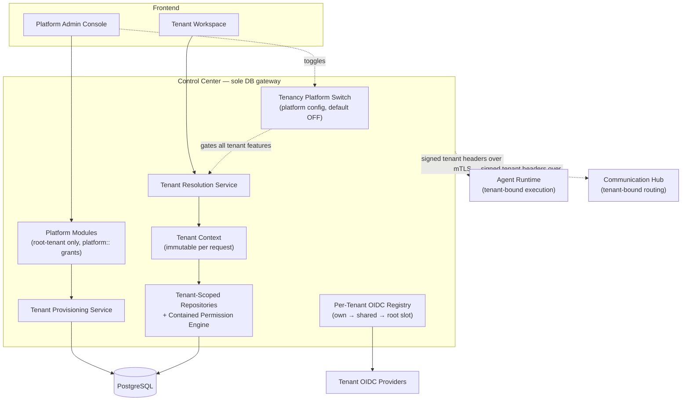
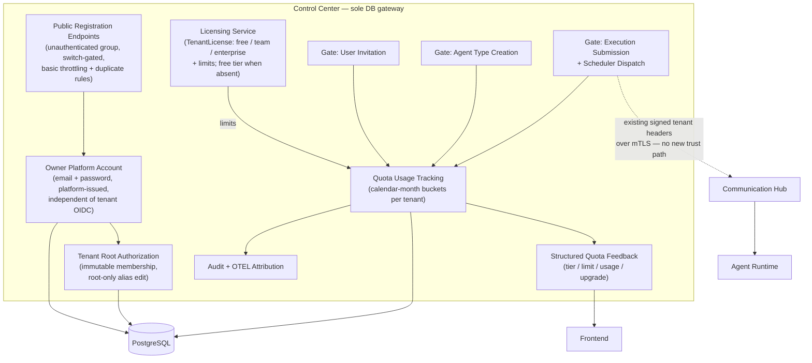
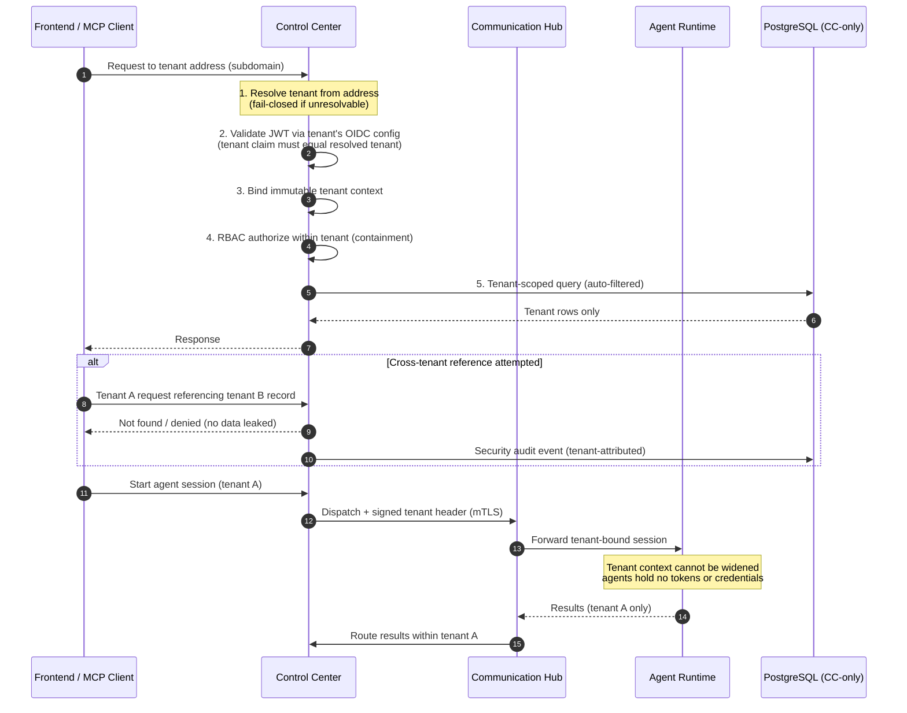
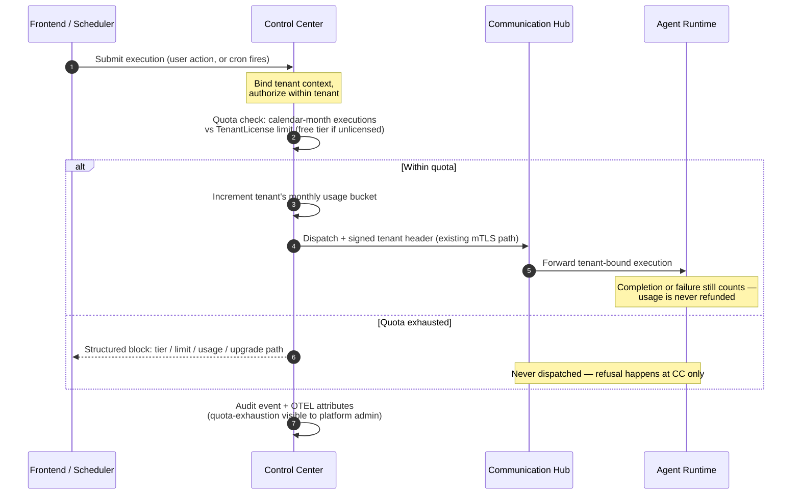

# Architecture: Multi-Tenant Support (SaaS)

One shared deployment serves many organizations (tenants) with hard logical isolation: tenant context is established once per request from a verified source, enforced centrally in Control Center (the sole database gateway), and propagated read-only to Agent Runtime and Communication Hub over mTLS. The platform is self-serve: a visitor registers with a personal email + password (platform-issued account, independent of per-tenant OIDC) and instantly receives a tenant workspace in which they are the immutable tenant root. Growth is governed by license tiers (free / team / enterprise) whose quotas are enforced at Control Center — the single decision point for users, agent types, and monthly executions. Multi-tenancy is disabled by default via a platform switch; single-tenant behavior is preserved through the root tenant (workspace `root`), which hosts platform staff and the migrated legacy global roles.

## 1. Changed Components

**Control Center** — becomes the central tenant enforcement point (it is the only service that touches the database):
- **Tenant context resolution middleware** — establishes the tenant exactly once per request from a verified source (tenant address subdomain, or tenant header for API/MCP clients); **fail-closed**: unresolvable tenant in multi-tenant mode = rejection. Bypassed entirely when the tenancy switch is off; the public registration endpoint group is the only switch-gated exemption.
- **Tenant-scoped repositories & queries** — every read and write automatically filtered by the request's tenant context, regardless of which feature performs it.
- **Tenant-aware permission engine with permission containment** — existing RBAC (resource-type manifest `module::submodule` + wildcards) evaluated *within* the tenant; new tenant-management and license-management resource types registered in both backend and frontend manifests. **Containment invariant**: every permission grant (including wildcards) is evaluated ONLY within the session's resolved tenant — global tenant-less roles are eliminated entirely (the permission engine's global-role collection is removed); legacy pre-tenancy global roles (e.g., system_admin) migrate into the root tenant at adoption. Cross-tenant protection = session tenant + row-level scoping + containment. Also enforces **tenant root protection**: root membership is immutable — no actor can demote or remove the root; attempts are rejected and audited. Tenant alias editing is a **root-only** tenant metadata update.
- **Licensing & quota enforcement (integrated into existing CC paths)** — quota gates wired at three existing integration points: (a) the auth middleware / request dependencies, (b) tenant APIs for user invitation/creation and agent type creation, (c) the execution submission/dispatch path — including the **scheduler, which consults quota at dispatch time** for schedule-triggered executions. Quota usage counting is centralized in CC (sole DB accessor); usage is bucketed per tenant per calendar month; completion or failure of an execution still counts (no refund of in-flight usage).
- **Per-tenant OIDC registry** — the existing global OIDC provider registry becomes a registry keyed by tenant; JWT validation binds the token's tenant claim to the resolved tenant — mismatch = reject. Provider sharing follows own → shared → root slot: a tenant's own configuration, a configuration shared across tenants, or the **root slot** (formerly "system slot") belonging to the root tenant, used when tenancy is off or for platform sign-in.
- **Audit & telemetry** — tenant attribution added to audit logs and OTEL traces; cross-tenant attempts and **quota-exhaustion events** recorded as security/operational events visible to the platform admin.

**Agent Runtime** — execution stays here, strictly tenant-bound:
- Accepts signed tenant context headers from Control Center over existing mTLS; the context is immutable — AR can never widen tenant scope.
- Agent executions use only the owning tenant's skills, tools, model configurations, identities, and permissions.
- Quota decisions are made entirely in CC: over-quota executions are never dispatched, so AR learns of limits only through the existing signed tenant context/headers contract — **no new trust path**.
- No new privileges: still database-free; agents never hold identity tokens or credentials.

**Communication Hub** — routing becomes tenant-aware:
- Agent session dispatch, A2A message broker, MCP protocol server, and tool-call forwarding all scoped to the tenant context received from Control Center; cross-tenant routing is impossible.
- MCP client API keys become tenant-bound: key validation resolves the tenant; keys cannot reach other tenants' resources.
- Per-tool-call identity token injection (performed by Control Center) resolved within the tenant's scope only.
- Receives only quota-cleared dispatches via the existing signed-header contract — refusal happens at CC; no new trust path.

**Frontend** — two distinct surfaces plus public entry:
- **Public registration page** — email + password signup; surfaces validation and duplicate/one-tenant-per-owner errors clearly.
- **Platform admin console** — tenant lifecycle, license/tier assignment, and tenant quota usage; access = session tenant is root **and** the session holds `platform::` permissions (containment model — no separate platform-membership gate); never renders tenant business data.
- **Tenant workspace** — the existing product UI, scoped to the signed-in tenant; shows tier, limits, and current usage; renders structured quota feedback when an action is blocked. The **tenant admin module** is tenant-scoped self-management (alias, identity-provider config, members) reusing the same shared backend modules for every tenant including root.
- Tenant resolution at sign-in: single unified login topology — the workspace address routes to the tenant's OIDC provider or the platform-issued password path; signing in at the root workspace with platform roles leads to the platform console; super-admin **break-glass** remains available at the root workspace sign-in. A tenant picker appears only for users belonging to multiple organizations; one session = one tenant (switching requires fresh sign-in).

## 2. New Components

- **Tenancy platform switch** — platform-level configuration flag owned by Control Center, disabled by default; when off, the deployment defaults to the **root tenant** (one-tenant world): legacy behavior is preserved through the root tenant's own roles, which hold the migrated legacy global roles.
- **Root tenant** — the system tenant becomes the root tenant (workspace `root`): the tenancy adoption path for upgraded deployments and the home of all platform staff. Common modules (permissions, identity-provider configuration, members) are shared by all tenants including root — root is a tenant, not a separate plane.
- **Tenant Resolution Service** — resolves the tenant once per request from the tenant address (subdomain) or tenant header; fail-closed in multi-tenant mode.
- **Tenant Context** — immutable per-request object carrying the tenant identity; propagated to Agent Runtime / Communication Hub as signed headers they cannot alter or widen.
- **Platform modules (root-tenant gated)** — tenant lifecycle (create, suspend, resume, delete), licensing, and tenant overview, gated by `platform::` permission types that exist only in the root tenant's role/policy space. No separate membership gate: a tenant user (even a tenant root) can never hold `platform::` grants because their tenant's role space contains none — **containment, not membership**. Exposes tenant metadata only, never tenant business data. The primary admin contact of a platform-created tenant **becomes its tenant root**.
- **Tenant Provisioning Service** — guided onboarding: create tenant, adopt/seed the workspace, connect the tenant's OIDC provider; also the **root-tenant adoption path** (an upgraded single-tenant deployment's existing organization becomes the root tenant, no reconfiguration; legacy global roles migrate into it).
- **Per-Tenant OIDC Registry** — per-tenant identity provider configuration, discovery, and signing keys; each tenant's credentials are valid only inside that tenant; sharing model own → shared → **root slot** (renamed from "system slot").

New components for self-serve registration and licensing (kept in a separate diagram to respect the node budget):

- **Public Registration Endpoints** — new unauthenticated endpoint group in Control Center (the only one, active only with the tenancy switch on; basic throttling applies). Atomically creates: the tenant, the owner's platform account, and the tenant root membership, then hands off to tenant onboarding. Rejects duplicate emails, invalid input, and users who already own a tenant (**1 owned tenant per user** for now) with clear messages and no partial data.
- **Owner Platform Account** — email + password credential issued by the platform itself; deliberately independent of the per-tenant OIDC registry; unlocks only its own tenant.
- **Tenant Root Authorization** — authorization-layer guard: root membership cannot be changed, demoted, or removed by any actor (tenant admins or platform admin); every attempt is rejected and audited; alias editing is restricted to the root.
- **Licensing Service** — owns TenantLicense: tier (free / team / enterprise) plus limits (max users, max agent types, monthly executions); tenants without an assigned license fall back to the **free tier** by default; license changes take effect immediately.
- **Quota Usage Tracking** — centralized usage counters in CC (the only DB accessor); one bucket per tenant per calendar month; executions counted at submission; completion/failure still counts (in-flight usage never refunded).
- **Structured Quota Feedback** — every blocked action returns tier / limit / current usage / upgrade path, surfaced as-is in the tenant UI (and mirrored in the platform admin overview).

## 3. Integration Points

- **Tenant resolution (new)** — browser requests: tenant address subdomain; API/MCP clients: tenant header; both must agree with the validated token's tenant claim — any mismatch is rejected.
- **Public registration (new)** — unauthenticated endpoint group in CC, gated by the tenancy switch; creates tenant + platform-issued owner account + root membership atomically; duplicate and one-tenant-per-owner rules enforced before any tenant is created.
- **JWT validation (changed)** — signing keys and discovery resolved *per tenant* via the per-tenant OIDC registry; a credential issued by tenant A's provider cannot authenticate to tenant B. Provider sharing: own → shared → root slot; the owner's platform account authenticates outside this registry.
- **Platform console access (new)** — granted purely by containment: session tenant resolved as root + `platform::` permissions held in the root tenant's role space; no separate platform-admin membership check. Super-admin break-glass (platform-issued credential at the root workspace sign-in) remains the emergency path.
- **Legacy role migration (new, adoption-time)** — on tenancy adoption, pre-tenancy global roles (e.g., legacy system_admin) are migrated into the root tenant as ordinary tenant roles; the permission engine's global-role collection is removed thereafter.
- **Tenant root protection (new)** — enforced in the CC authorization layer ahead of every tenant-user mutation: root demotion/removal is impossible for any actor; alias updates are root-only tenant metadata changes.
- **Fail-closed gateway (new)** — in multi-tenant mode, any request without a resolvable tenant context is rejected before reaching any feature logic.
- **Quota enforcement — execution submission (new)** — quota is consulted at CC before dispatch; over-quota submissions are refused at CC and never reach CH/AR; the CC→CH→AR path itself is unchanged.
- **Scheduler dispatch quota consultation (new)** — schedule-triggered executions consult the tenant's monthly execution quota at dispatch time in CC; an exhausted quota skips dispatch and records a quota event.
- **Structured quota error contract (new)** — blocked actions (user invitation, agent type creation, execution submission) return a uniform payload: tier, limit, current usage, upgrade path — consumed by the tenant UI and visible in the platform admin overview.
- **MCP client API keys (changed)** — keys are issued per tenant; validation binds the MCP session to that tenant; tool listing and calls are filtered by tenant permissions.
- **Agent sessions (changed)** — created under a tenant context; dispatched to Agent Runtime with signed tenant headers; results route back within the same tenant only.
- **A2A messaging (changed)** — the broker never routes messages across tenants; agent-to-agent pairs must share the tenant context.
- **Schedules (changed)** — cron jobs are tenant-owned; execution adopts the owning tenant's context end to end, subject to the dispatch-time quota consultation.
- **Inter-service (changed)** — signed tenant context headers ride on the existing mTLS channels; certificate-based authentication unchanged; tenant context is not a credential; quota outcomes travel over this same contract — **no new trust paths**.
- **Audit & OTEL (changed)** — every trace, log, and audit event gains tenant attribution; cross-tenant attempts are security events and quota-exhaustion events are audited + OTEL-attributed, both visible to the platform admin.
- **Single-tenant mode (unchanged)** — switch off: the deployment resolves to the root tenant — one-tenant world; legacy global roles (now root-tenant roles after migration) drive all permissions exactly as before; registration and licensing are bypassed; existing behavior is preserved exactly.

## 4. Data Flow Changes

Execution submission under quota enforcement (user-initiated or schedule-triggered):

**Isolation model — defense in depth (mature multi-tenant patterns):**
- **Single resolution point** — tenant context established once per request from a verified source; never re-derived or trusted from callers.
- **Claim-to-tenant binding** — validated JWT tenant claim must match the resolved tenant; identity is tenant-bound; the owner's platform-issued account is the deliberate exception, valid only in its own tenant.
- **Row-level tenant scoping at the single DB gateway** — isolation enforced where data lives; no service or feature can issue an unscoped query; quota usage counters live behind the same gateway.
- **Single quota decision point** — all quota checks and usage counting happen in Control Center; AR/CH only receive quota-cleared dispatches over the existing signed-header contract.
- **Read-only propagation** — AR/CH receive a signed, immutable tenant context for routing decisions; neither can elevate or cross tenants.
- **Permission containment** — every grant (including wildcards) is evaluated only within the session's resolved tenant; no global tenant-less roles exist (legacy global roles migrated into the root tenant), so a tenant user — even a tenant root — can never hold `platform::` grants.
- **Immutable root** — tenant root protection is enforced at the authorization layer ahead of any mutation; no actor can alter it.
- **Audit everything** — every rejection of a cross-tenant attempt and every quota-exhaustion event is recorded with tenant attribution.

## 5. Master Arch Update Instructions

Update `docs/master/architecture/` when this change is applied:

- **`system-overview.md`** — add multi-tenant mode to the system overview: shared platform with hard logical isolation; tenant context flow (resolve → validate → propagate) across Control Center, Communication Hub, and Agent Runtime; add the self-serve registration flow (public endpoint group → tenant + platform-issued owner account + root membership) and license-tier quota governance (single decision point in CC); note the default-off tenancy switch (deployment defaults to the root tenant — one-tenant world) and the root-tenant adoption path with legacy global-role migration; reconfirm the three top-priority segregation rules are preserved (CC-only DB access now also covers quota counting; AR/CH receive quota outcomes over the existing signed-header contract).
- **`modules/` — new module diagram**: tenant management (Platform modules, Tenant Provisioning Service, per-tenant OIDC registry with own → shared → root slot sharing) inside Control Center.
- **`modules/` — new licensing module diagram**: Licensing Service (TenantLicense tiers + limits), Quota Usage Tracking (calendar-month buckets per tenant), quota gates at user invitation, agent type creation, and execution submission/scheduler dispatch; structured quota feedback to the frontend; quota-exhaustion audit + OTEL attribution.
- **`modules/` — update Control Center diagram**: add tenant resolution middleware, tenant-scoped repositories/queries, tenant-aware permission engine with the containment invariant (session-tenant-only evaluation, no global roles) and tenant root protection, platform modules gated by `platform::` types in the root tenant's role space, and the public registration endpoint group (only unauthenticated group, switch-gated).
- **`modules/` — update Communication Hub diagram**: tenant-bound routing, tenant-bound MCP API keys, scoped A2A broker; receives only quota-cleared dispatches.
- **`modules/` — update Agent Runtime diagram**: read-only tenant context propagation over mTLS; no widening of scope; no quota logic (decisions stay in CC).
- **`modules/` — update auth/identity diagram**: global OIDC provider registry → per-tenant registry (own → shared → root slot, "system" renamed to "root"); JWT tenant-claim validation; platform-issued owner accounts (email + password) as a separate, OIDC-independent credential path; single unified login topology (workspace address → tenant OIDC or platform-issued password; root workspace + platform roles → platform console; super-admin break-glass at root sign-in); legacy global roles migrated into the root tenant.
- **`modules/` — update scheduling diagram**: schedule-triggered executions consult tenant quota at dispatch time in CC before any AR/CH involvement.
- Keep every diagram to max 15 nodes, Mermaid only; reflect tenant attribution in observability/audit components, including quota-exhaustion events.
