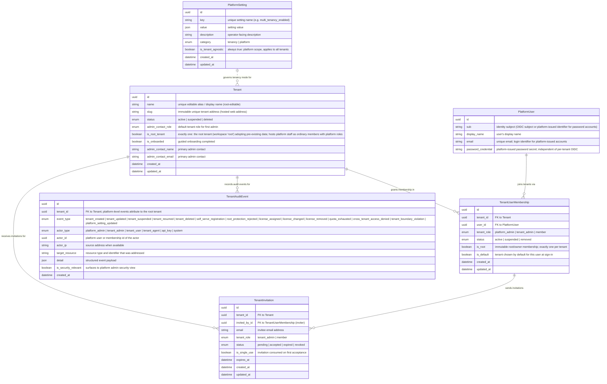
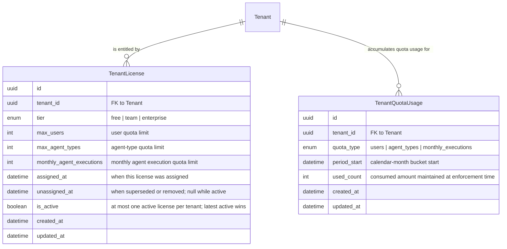

# Data Model: Multi-Tenant Support (SaaS)

Technology-agnostic entity model for opt-in multi-tenancy with self-serve registration and license-based quotas. Multi-tenancy is **disabled by default**: when off, every tenant reference is unused (empty or pointed at the implicit **root tenant**) and the platform behaves exactly as the current single-tenant product. The root tenant (workspace name/address **`root`**) hosts platform staff as ordinary members holding platform roles, and is the adopter of pre-existing data when multi-tenancy is enabled. No schema code here — schema files under `backend/app/db/models/` are the source of truth.

---

## 1. New Entities

### Tenancy Core Entities

### Licensing & Quota Entities

### Entity Notes

- **Tenant** — an organization workspace. `slug` is the immutable unique tenant address users visit (the isolation anchor at sign-in); it never changes after creation, even when the tenant is renamed. `name` is the **editable alias / display name** shown across the tenant workspace (unique among tenants); the tenant root edits it and changes appear immediately without affecting the address. `status` drives lifecycle (create / suspend / resume / delete). Exactly one tenant has `is_root_tenant = true` — the **root tenant**, with workspace name/address **`root`**: the implicit tenant that hosts platform staff as ordinary members with platform roles and adopts all pre-existing data when multi-tenancy is enabled.
- **TenantUserMembership** — a user's presence in a tenant with a tenant-scoped role. One session is bound to exactly one tenant; `is_default` pre-selects the tenant at sign-in for multi-tenant users. `platform_admin` is a platform-level role surfaced through membership: platform staff hold it as **ordinary members of the root tenant** (workspace `root`), so platform governance stays auditable and every platform actor has a concrete tenant membership.
  - **Root rule**: `is_root` marks the tenant's permanent owner (the registrant or platform-created primary admin). Exactly **one root membership per tenant**; it cannot be changed, demoted, or removed by anyone — not by tenant admins, not by the platform admin. Root implies ALL tenant permissions (super-admin within the tenant) regardless of `tenant_role`. Rejected attempts to alter a root membership are recorded as `root_protection_rejected` audit events.
  - **One owned tenant per user**: a user may hold a root membership in **at most one tenant** (business cap fixed at 1 for now; raising it is future work). Duplicate self-serve registrations are blocked with a clear message and leave no partial data.
- **TenantInvitation** — pending user onboarding into a tenant; carries target tenant role and expiry.
- **TenantAuditEvent** — tenant lifecycle actions, licensing actions, quota exhaustion, and security-relevant cross-tenant access attempts (guessed/forged references), visible to the platform admin. Tenant-attributed so audit trails are traceable end to end; platform-level events (tenancy switch, licensing on any tenant) attribute to the **root tenant** and record root-tenant members with platform roles as actors. New event families: `self_serve_registration` (visitor signup created a tenant + root), `root_protection_rejected` (attempt to alter/remove a root membership), `license_assigned` / `license_changed` / `license_removed` (tier and limit changes), `quota_exhausted` (an action blocked at a limit).
- **PlatformSetting** — tenant-agnostic platform configuration store. It is the home of the **`multi_tenancy_enabled`** switch (there is no existing system-settings entity in `backend/app/db/models/`; the only platform sentinels today are `identity_provider_configs` and `identity_provider_setup_state`, both specific to identity providers). Default value: `false`.
- **PlatformUser** — a real-world person, tenant-agnostic; tenant presence is expressed via memberships. For self-serve accounts the platform itself issues an **email + password credential** (independent of any per-tenant OIDC provider); the credential unlocks only the owner's own tenant. `sub` carries the OIDC subject for federated users or a platform-issued identifier for password accounts.
- **TenantLicense** — a tenant's entitlement: tier (`free | team | enterprise`) with its limits (max users, max agent types, monthly agent executions). **Latest active license per tenant wins** (at most one `is_active = true` per tenant; superseded licenses are kept as history with `is_active = false` and `unassigned_at` set). A tenant with **no active license runs on free-tier default limits**, visible to both platform admin and tenant users. Removal of the active license falls the tenant back to free-tier defaults immediately. Only the platform admin assigns/changes/removes licenses; every change is audited.
- **TenantQuotaUsage** — per-tenant, per-quota-type usage record bucketed by calendar month (`period_start` = first day of the bucket). **Unique per (tenant, quota_type, period)**. Usage counters are maintained at enforcement time. See the counting-representation rules below for which quota types actually persist counters vs. derive usage live.

### Quota Counting Representation (per quota type)

| Quota type | Representation | How usage is determined |
|---|---|---|
| `users` | **Derived live** (no counter row) | Count of `TenantUserMembership` rows with `status = active` for the tenant; checked at invite/creation time |
| `agent_types` | **Derived live** (no counter row) | Count of `AgentType` records owned by the tenant; checked at creation time |
| `monthly_executions` | **Maintained counter** (`TenantQuotaUsage` row) | `used_count` incremented once per accepted execution at the enforcement point (submission acceptance); new calendar month starts a fresh bucket, so counters reset automatically |

Rationale: user and agent-type populations are small and already managed through record lifecycles (invitations accepted, memberships removed, agent types created), so deriving counts live can never drift from the records. Executions are high-volume, so enforcement uses the `TenantQuotaUsage` counter rather than scanning execution history per tenant per month. Counting executions at submission acceptance (not completion) guarantees in-flight executions already counted are never double-counted. `TenantQuotaUsage` keeps `quota_type` generic so future counter-based quotas reuse the same entity; in this epic only `monthly_executions` persists rows.

### Self-Serve Registration & Tenant Adoption Note

**Self-serve registration** (one action, all-or-nothing): a visitor registers with a personal email + password → the platform creates the **`PlatformUser`** (platform-issued credential), the **`Tenant`** (slug/address chosen at registration; `name` alias), and the creator's **root `TenantUserMembership`** (`is_root = true`) atomically, then lands the root user in guided onboarding. A user who already owns a root membership is blocked with a "one tenant per user" message; no second tenant and no partial data are created. Duplicate emails and invalid fields are rejected with validation errors.

When multi-tenancy is enabled on an existing deployment, all existing data is **adopted into the single implicit root tenant** (`is_root_tenant = true`, workspace `root`): existing users, roles, agents, MCP servers, skills, SOPs, schedules, model configurations, identity provider configuration, and history continue to work unchanged, and the existing deployment administrator becomes a member of the root tenant with a platform role. Existing `PlatformUser` records receive a `TenantUserMembership` in the root tenant. **Legacy global roles are migrated into the root tenant at adoption/migration**: any pre-tenancy tenant-less `Role` rows (e.g. the wildcard-grant `system_admin` global role) are re-homed in the root tenant's role space — the `Role` entity's tenant reference becomes effectively mandatory for all business roles, and no global (tenant-less) roles remain. Disabling the switch returns to single-tenant behavior with no data loss.

### Permission Containment Invariant

Role and policy grants apply **only within their owning tenant**. Wildcard grants (`agent::*`, `system::*`, `*::*`, etc.) never cross tenant boundaries — a wildcard is a shorthand *within* one tenant's role space, never an escape from it. Platform-level resource grants (`platform::`) exist **only in the root tenant's role space** (workspace `root`), held by root-tenant members with platform roles. No role in a customer tenant can carry `platform::` grants, and no root-tenant role can address another tenant's business data.

---

## 2. Modified Entities

### Tenancy Scoping Semantics

- Nearly every business entity gains a **tenant reference** (FK to `Tenant`).
- While multi-tenancy is **disabled** (default), references stay empty or point at the implicit root tenant; no enforcement is applied and behavior is identical to today.
- During migration on existing deployments, references are **nullable** or defaulted to the root tenant, then resolved by the adoption process (including migration of legacy global roles into the root tenant).
- **Direct tenant reference**: primary business entities (listed below).
- **Scoped via parent**: pure join tables and child/detail records do not carry their own tenant reference — they inherit tenant scope from their parent entity, which is always within a single tenant.

### Registration, Root, Alias & Licensing Adjustments

These tenancy entities already exist in the schema files from the earlier phase of this change; the following adjustments are applied on top of them:

| Entity (file) | Change |
|---|---|
| `Tenant` (tenant.py) | `name` becomes the **editable alias / display name** (stays unique; root-editable) while `slug` is documented as the **immutable tenant address** — uniqueness on both remains enforced, only the alias may change; the existing `is_system_tenant` column is **renamed to `is_root_tenant`** (target state shown in Section 1; applied as a migration, not yet present in the schema files) |
| `TenantUserMembership` (tenant_membership.py) | + `is_root` immutable flag — exactly one per tenant, at most one per user (one owned tenant), cannot be changed/demoted/removed by anyone; root implies all tenant permissions; rejections audited as `root_protection_rejected` |
| `PlatformUser` (platform_user.py) | + platform-issued **email + password credential** for self-serve accounts (independent of per-tenant OIDC); `sub` accepts a platform-issued identifier for password accounts |
| `TenantAuditEvent` (tenant_audit_event.py) | + event types: `self_serve_registration`, `root_protection_rejected`, `license_assigned`, `license_changed`, `license_removed`, `quota_exhausted`; platform-level events attribute to the **root tenant** with root-tenant members holding platform roles as actors |

### Identity & Access

| Entity (file) | Change |
|---|---|
| `Role` (identity.py) | + tenant reference — the legacy **global (tenant-less) role variant is retired**: pre-tenancy global roles (e.g. wildcard `system_admin`) are **migrated into the root tenant** at adoption; for business roles the tenant reference is effectively mandatory |
| `Identity` (identity.py) | + tenant reference |
| `PlatformUser` (platform_user.py) | Stays tenant-agnostic (a real-world person); tenant presence expressed via `TenantUserMembership`; gains platform-issued password credential (see table above) |
| `UserRole` (user_role.py) | scoped via parents (`PlatformUser` + `Role`) |
| `Group` (group.py) | + tenant reference |
| `GroupRole` (group_role.py) | scoped via parents |
| `UserGroup` (user_group.py) | scoped via parents |
| `AccessRequest` (access_request.py) | + tenant reference |
| `AccessRequestBatch` (access_request_batch.py) | + tenant reference |
| `TagDefinition` (tag_definition.py) | + tenant reference |
| `TagValue` (tag_value.py) | scoped via parents |
| `PolicyStatement` (policy_statement.py) | + tenant reference |
| `PolicyAction` (policy_action.py) | + tenant reference |
| `PolicyResource` (policy_resource.py) | + tenant reference |
| `PolicyTagCondition` (policy_tag_condition.py) | scoped via parents |
| `AgentApiKey` (agent_api_key.py) | + tenant reference — API keys belong to a tenant and can never address another tenant's resources |
| `ApiKeyUsageLog` (agent_api_key.py) | scoped via parent (`AgentApiKey`) |
| `IdentityProviderConfig` (identity_provider_config.py) | **+ tenant reference — per-tenant OIDC**: each tenant registers its own provider; sign-in credentials are tenant-bound and a credential issued by tenant A's provider is rejected outside tenant A. The existing `provider_scope` (user/agent) uniqueness becomes per-tenant when multi-tenancy is enabled |
| `IdentityProviderConfigAudit` (identity_provider_config_audit.py) | + tenant reference (follows the config it audits) |
| `Permission` (identity.py) | **Not tenant-scoped** — global catalogue of resource types/actions; grants are tenant-local via roles. Containment invariant: role/policy grants apply only within their owning tenant; wildcards never cross tenants; `platform::` grants exist only in the root tenant's role space |

### Agents

| Entity (file) | Change |
|---|---|
| `AgentRole` (agents.py) | + tenant reference |
| `AgentIdentity` (agents.py) | + tenant reference |
| `ModelConfig` (agents.py) | + tenant reference |
| `AgentType` (agents.py) | + tenant reference — the record whose per-tenant count is the `agent_types` quota basis (derived live) |
| `AgentInstance` (agents.py) | + tenant reference |
| `AgentJob` (agents.py) | + tenant reference |
| `AgentPromptLog` (agents.py) | scoped via parent (`AgentJob`) |
| `AgentPlan` (agents.py) | scoped via parent |
| `AgentA2ASession` (agents.py) | + tenant reference — agent-to-agent messages cannot cross tenants |
| `AgentRunRelationship` (agent_run_relationship.py) | + tenant reference |
| `AgentRoleSOP`, `AgentRoleSkill`, `AgentRoleIdentity`, `AgentRoleMcpSession`, `AgentTypeSopBinding`, `AgentTypeSkillBinding` (agents.py) | scoped via parents |
| `AgentInstanceCertificate`, `CertificateRevocationEntry`, `CertificateValidationLog`, `TokenRefreshLog` (agent_security.py) | scoped via parent (`AgentInstance` / `AgentIdentity`) |

### MCP Hub

| Entity (file) | Change |
|---|---|
| `McpServer` (mcp_hub.py) | + tenant reference |
| `McpSession` (mcp_hub.py) | scoped via parent (`McpServer`) |
| `McpTool` (mcp_hub.py) | scoped via parent (`McpServer`) |
| `ToolPermission` (mcp_hub.py) | scoped via parents |

### Skills & SOPs

| Entity (file) | Change |
|---|---|
| `Skill` (skills.py) | + tenant reference |
| `Sop` (skills.py) | + tenant reference |
| `SkillToolBinding` (skills.py) | scoped via parents |
| `SopStep` (skills.py) | scoped via parent (`Sop`) |
| `SopRecursionValidationCheck` (sop_recursion_validation_check.py) | scoped via parent (`Sop`) |
| `SopRecursionValidationFinding` (sop_recursion_validation_finding.py) | scoped via parents |

### Scheduling

| Entity (file) | Change |
|---|---|
| `ScheduledJob` (scheduling.py) | + tenant reference |
| `JobExecution` (scheduling.py) | scoped via parent (`ScheduledJob`) |

### Conversations, Results & Agent Data

| Entity (file) | Change |
|---|---|
| `ConversationSession` (conversations.py) | + tenant reference |
| `ConversationTurn` (conversations.py) | scoped via parent (`ConversationSession`) |
| `ToolCallRecord` (conversations.py) | scoped via parents |
| `RuntimeToolCall` (tool_calls.py) | + tenant reference |
| `ResultRecord` (results.py) | + tenant reference |
| `AgentDataType` (agent_data_type.py) | + tenant reference |
| `AgentOutput` (agent_output.py) | + tenant reference |
| `AgentData` (agent_data.py) | + tenant reference |
| `ExecutionLogEntry` (session_logs.py) | + tenant reference — tenant-attributed execution records underpin accurate monthly execution metering |

### Interventions & Termination

| Entity (file) | Change |
|---|---|
| `InterveneRequest` (intervene.py) | + tenant reference |
| `InterveneResponse` (intervene.py) | scoped via parent (`InterveneRequest`) |
| `TerminationRequest` (termination_request.py) | + tenant reference |
| `TerminationCascadeOutcome` (termination_cascade_outcome.py) | scoped via parents |

### Notifications

| Entity (file) | Change |
|---|---|
| `NotificationChannel` (notifications.py) | + tenant reference |
| `RecipientGroup` (notifications.py) | + tenant reference |
| `NotificationLog` (notifications.py) | + tenant reference |
| `NotificationEvent` (notifications.py) | + tenant reference |
| `ChannelProperty` (notifications.py) | scoped via parent (`NotificationChannel`) |
| `GroupChannelMapping` (notifications.py) | scoped via parents |

### Model Governance

| Entity (file) | Change |
|---|---|
| `ModelGuardrailConfiguration` (model_guardrail_configuration.py) | + tenant reference |
| `ModelAvailability` (model_availability.py) | + tenant reference |
| `ModelGuardrailEvaluation` (model_guardrail_evaluation.py) | + tenant reference |
| `ModelUsagePosture` (model_usage_posture.py) | + tenant reference |
| `GuardrailThresholdEvent` (guardrail_threshold_event.py) | + tenant reference |

### Platform Config Flag Location

- The **multi-tenancy enabled/disabled switch** lives in the new tenant-agnostic **`PlatformSetting`** entity (key `multi_tenancy_enabled`, default `false`) — see Section 1. It is platform scope: only the platform admin reads/writes it; tenant admins cannot see platform configuration.
- `IdentityProviderSetupState` (identity_provider_setup_state.py) remains a platform-level sentinel and is **not** tenant-scoped.

---

## 3. Removed Entities/Fields

None. No existing entity or field is removed by this change; all modifications are additive tenant references, the root/alias/credential adjustments, and the new entities in Section 1.

---

## 4. Schema File References

Schema source of truth: `backend/app/db/models/` (per `docs/config.yaml` `source.schema`).

**New files (not yet in `backend/app/db/models/`):**

- `backend/app/db/models/tenant_license.py` — `TenantLicense` (tier + limits, latest-active-wins history)
- `backend/app/db/models/tenant_quota_usage.py` — `TenantQuotaUsage` (per tenant + quota_type + calendar-month bucket; unique per tenant+quota_type+period)

**Existing files to update (add tenant references / tenancy semantics):**

- `backend/app/db/models/tenant.py` — `Tenant`: `name` = editable alias; `slug` = immutable address (already exists from the earlier phase of this change)
- `backend/app/db/models/tenant_membership.py` — `TenantUserMembership`: + immutable `is_root` flag with single-root-per-tenant / one-owned-tenant-per-user rules
- `backend/app/db/models/tenant_invitation.py` — `TenantInvitation` already exists; no changes required in this phase
- `backend/app/db/models/tenant_audit_event.py` — `TenantAuditEvent`: + registration / root-protection / license / quota event types
- `backend/app/db/models/platform_setting.py` — `PlatformSetting` already exists; no changes required in this phase
- `backend/app/db/models/platform_user.py` — + platform-issued password credential for self-serve accounts (no tenant FK; tenant presence via membership)
- `backend/app/db/models/identity.py` — `Role`, `Identity` (`Permission` stays global)
- `backend/app/db/models/group.py`, `group_role.py`, `user_group.py`, `user_role.py`
- `backend/app/db/models/access_request.py`, `access_request_batch.py`
- `backend/app/db/models/tag_definition.py`, `tag_value.py`
- `backend/app/db/models/policy_statement.py`, `policy_action.py`, `policy_resource.py`, `policy_tag_condition.py`
- `backend/app/db/models/agent_api_key.py`
- `backend/app/db/models/identity_provider_config.py` — per-tenant OIDC binding
- `backend/app/db/models/identity_provider_config_audit.py`
- `backend/app/db/models/agents.py` — `AgentRole`, `AgentIdentity`, `ModelConfig`, `AgentType`, `AgentInstance`, `AgentJob`, `AgentA2ASession` scope
- `backend/app/db/models/agent_run_relationship.py`
- `backend/app/db/models/agent_security.py`
- `backend/app/db/models/mcp_hub.py`
- `backend/app/db/models/skills.py`
- `backend/app/db/models/scheduling.py`
- `backend/app/db/models/conversations.py`
- `backend/app/db/models/tool_calls.py`
- `backend/app/db/models/results.py`
- `backend/app/db/models/agent_data_type.py`
- `backend/app/db/models/agent_output.py`
- `backend/app/db/models/agent_data.py`
- `backend/app/db/models/session_logs.py`
- `backend/app/db/models/intervene.py`
- `backend/app/db/models/termination_request.py`, `termination_cascade_outcome.py`
- `backend/app/db/models/notifications.py`
- `backend/app/db/models/model_guardrail_configuration.py`, `model_availability.py`, `model_guardrail_evaluation.py`, `model_usage_posture.py`, `guardrail_threshold_event.py`
- `backend/app/db/models/sop_recursion_validation_check.py`, `sop_recursion_validation_finding.py`
- `backend/app/db/models/__init__.py` — import the remaining new tenant models (`TenantLicense` and `TenantQuotaUsage`; the other tenant models are already imported) for autogenerate detection

Not modified: `identity_provider_setup_state.py`, `role.py` (intentionally empty placeholder).

---

## 5. Master Data Model Update Instructions

Update `docs/master/data-model/` after implementation:

- **`docs/master/data-model/overview.md`**
  - Add `Tenant`, `TenantUserMembership`, `TenantInvitation`, `TenantAuditEvent`, `PlatformSetting`, `TenantLicense`, `TenantQuotaUsage` to the master ER diagram (Mermaid `erDiagram`), including their relationships to `PlatformUser` and the tenant references on business entities.
  - Document the tenancy model semantics: default-off switch in `PlatformSetting`, nullable/root-tenant references, one-session-one-tenant, and the tenant adoption rule for upgraded deployments — adoption re-homes all pre-existing data in the **root tenant** (workspace `root`).
  - Document the **root tenant**: exactly one tenant with `is_root_tenant = true`; hosts platform staff as ordinary members with platform roles; legacy global (tenant-less) roles are **migrated into it** at adoption, retiring the global role variant so every business role belongs to a tenant.
  - Document the **permission containment invariant**: role/policy grants apply only within their owning tenant; wildcards never cross tenants; `platform::` grants exist only in the root tenant's role space.
  - Document the **root membership model**: exactly one immutable `is_root` membership per tenant; at most one owned tenant per user; root protection enforced against tenant admins and platform admin alike, with rejections audited.
  - Document the **alias/address split**: `Tenant.name` is the editable unique alias; `Tenant.slug` is the immutable unique tenant address.
  - Document the **self-serve registration flow**: `PlatformUser` (email + password, platform-issued) + `Tenant` + root `TenantUserMembership` created in one action.
  - Document the **licensing & quota model**: `TenantLicense` latest-active-wins per tenant, absent license → free-tier defaults; `TenantQuotaUsage` unique per tenant + quota_type + calendar-month bucket; and the counting representation — `users` and `agent_types` derived live from records, `monthly_executions` via the maintained `TenantQuotaUsage` counter incremented at enforcement time.
- **`docs/master/data-model/modules/<module>/entities.md`** (identity, agents, mcp_hub, skills, scheduling, conversations/results, interventions, notifications, model governance)
  - Add a "Tenant scoping" line per module listing which entities carry a direct tenant reference vs. inherit scope via parents.
  - Note per-tenant OIDC under the identity module (`IdentityProviderConfig` tenant binding), that `Permission` remains a global catalogue, and that all roles (including migrated legacy global roles) are tenant-owned with grants contained within their owning tenant.
  - Under the agents module, note that `AgentType` per-tenant counts are the `agent_types` quota basis.
  - Add a `tenancy` module entity list for the **seven** new entities (`Tenant`, `TenantUserMembership`, `TenantInvitation`, `TenantAuditEvent`, `PlatformSetting`, `TenantLicense`, `TenantQuotaUsage`), with a short licensing/quota note: license history semantics (latest active wins, unlicensed → free tier) and per-quota-type counting representation (derived vs. counter).
