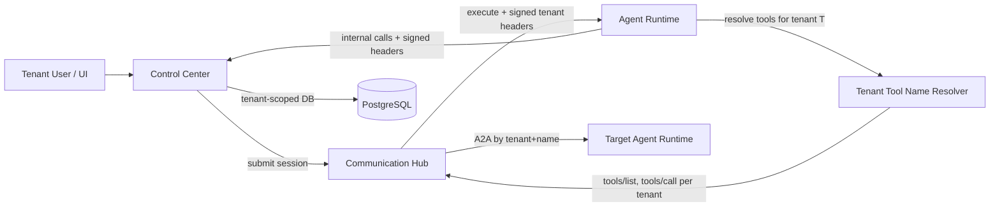

# Architecture: strict-tenant-isolation

Owner: es-architect
Change: `docs/changes/strict-tenant-isolation/`
Scope: tenant isolation hardening across Control Center (CC), Communication Hub (CH), Agent Runtime (AR), MCP hub, skills, scheduling, notifications.

---

## 1. Changed Components

### CC — Internal-endpoint tenant enforcement
- `/api/v1/internal/*` (CC): signed `X-Internal-Tenant-*` headers (per `backend/app/core/tenant_signature.py`) become **mandatory** — missing, stale, or invalid signature → fail-closed 401. No verify-if-present.
- `backend/app/middleware/tenant_resolution.py`: internal path bypass semantics unchanged; enforcement moves into the internal-endpoint layer so every internal entry point binds the tenant context before any handler runs.

### CC — `backend/app/db/tenant_scoping.py`
- Fail-closed scoping: sessions without a resolved tenant on data-plane paths are rejected (or default to root tenant only when multi-tenancy is off) instead of silently running unscoped.
- Identity-plane `execute_unscoped` exemptions retained (identity lookups only); data-plane services add explicit tenant predicates as defense in depth.

### CC — MCP hub slug tenant-binding + tool namespace
- `McpServer.slug` becomes **unique per tenant** (not platform-wide); slug lookups always `(tenant, slug)`.
- `McpTool` gains tenant binding; tool sync (`backend/app/services/mcp/tool_sync.py`) upserts under the owning tenant's namespace.

### CC — Tool naming (`backend/app/services/agents/tool_naming.py`)
- `build_tool_name` / `parse_tool_name` become tenant-aware at resolution time: the wire format `server____tool` stays stable, but resolution maps the server slug against the **calling tenant's** server registry. System/`decision` reserved namespaces are exempt (tenant-neutral resolution within the caller's tenant).

### CC — Skill bindings & permission grants
- Skill → MCP tool bindings, permission grants, and agent roles resolve only against tools of the same tenant; a grant never authorizes a cross-tenant tool.

### CC — Notification dispatch
- `notification_service.py` / `notification_repository.py`: recipient-group resolution requires the calling tenant (`(tenant, slug)`), removing the NULL-tenant "shared" slot; `get-recipient-group` system tool resolves within the bound tenant.

### CC — Skill seeder (`backend/app/services/skill_seeder.py`)
- Seeds into the **root tenant** (or calling tenant), never NULL; global name lookups become tenant-scoped so seeding cannot mutate tenant-owned skills.

### CC — Decision tools NULL-slot removal
- `backend/app/api/v1/decision_tools.py`, `backend/app/services/system_one/decision_tool_service.py`: drop `tenant_id IS NULL OR tenant_id = own` patterns; strict `tenant_id == calling tenant` only.

### CC — Scheduler tenant binding
- `backend/app/services/scheduling/scheduler.py`: `job.tenant_id` mandatory at creation (NULL = hard error); dispatch resolves a single owning tenant (no `or agent_type.tenant_id` fallback) and runs the job fully within that tenant's context (scoping + quotas).

### AR — Virtual tenant awareness
- `backend/app/services/agents/runtime_executor.py`: AR resolves the calling tenant from the signed internal context carried on the execution request and uses it for **all** tool/MCP/A2A resolution and downstream internal calls during the agent run.

### CH — MCP protocol server & forwarding
- CH `/internal/a2a` forwarding and MCP protocol server (`tools/list`, `tools/call`) verify and forward the signed tenant context; per-tenant tool listings and per-tenant tool-call resolution.

---

## 2. New Components

- **Tenant adoption migration step** (one-time, idempotent Alembic data migration): adopts NULL-tenant legacy rows (data types, seeded skills, scheduled jobs, shared recipient groups) into the root tenant; must run before strict matching goes live.
- **Tenant-aware tool name resolver in AR**: resolves `server____tool` and `agent____<slug>` names against the calling tenant's MCP servers/agent types instead of the platform-wide registry; fails closed on unresolved names.
- **Internal tenant-context propagation into AR execution sandbox**: signed tenant headers (already used on internal HTTP calls) are extended to the execution context so every tool invocation inside a run carries the tenant binding (no ambient/global tenant state in AR).

### Component flow: tenant context through an agent tool invocation



---

## 3. Integration Points

- **CC → CH → AR internal calls**: HMAC-signed `X-Internal-Tenant-Id/Slug/Timestamp/Signature` headers now **mandatory** on every hop (execution requests, A2A forwarding, tool-call token/permission resolution). AR and CH verify-only.
- **CH MCP protocol server** (`tools/list`, `tools/call`): per-tenant — an API-key-authenticated MCP client sees and calls only its tenant's namespaced tools.
- **A2A delegation naming** (`agent____<slug>`): target agent type resolved strictly by `(tenant, name)` at CH/CC; cross-tenant name collisions never route cross-tenant.
- **MCP tool sync** (CC → external MCP servers): sync results stored tenant-bound; slug uniqueness enforced per tenant.
- **Scheduler → CC dispatch**: dispatch carries the job's owning tenant binding into the execution chain.

---

## 4. Data Flow Changes

Same-slug collision: tenant A and tenant B each register an MCP server with slug `supabase`.

```mermaid
sequenceDiagram
    participant Agent as Agent (AR, tenant A)
    participant CC as Control Center
    participant CH as Communication Hub
    participant S as MCP Server "supabase" (tenant A)

    Agent->>CH: tools/call supabase____query (signed tenant A context)
    CH->>CC: resolve tool + permission (signed tenant A headers)
    CC->>CC: lookup (tenant A, "supabase") → tenant A server; tenant B row invisible
    CC-->>CH: allowed; tenant A server target + identity token
    CH->>S: invoke tool on tenant A server
    S-->>CH: result
    CH-->>Agent: result
    Note over Agent,S: Tenant B's "supabase" (same slug, other server)<br/>is never listed, resolved, or invoked
```

Key changes vs. today:
- Tool/permission resolution and slug lookup are tenant-qualified end to end (today: platform-wide slug).
- No hop resolves records without the signed tenant binding (today: fail-open on headerless internal traffic).
- Downstream data effects (outputs, saved data, notifications) are written with and filtered by the calling tenant only.

---

## 5. Master Arch Update Instructions

Update in `docs/master/architecture/`:

- **`system-overview.md`**:
  - Add "strict tenant isolation" as a cross-cutting property: mandatory signed `X-Internal-Tenant-*` headers on all CC↔CH↔AR internal calls; fail-closed semantics; root tenant as single tenant when multi-tenancy is off.
  - Update the MCP hub description: slug unique **per tenant**, tools namespaced per tenant; per-tenant `tools/list`/`tools/call` on the CH MCP protocol server.
  - Note the retired concepts: NULL-tenant shared slot (data types, seeded skills, shared recipient groups), platform-wide tool registry.
- **`modules/`**:
  - MCP hub module: tenant-bound slug/tool namespace, tenant-aware tool naming/resolution, scheduler tenant binding at creation and dispatch.
  - Agent runtime module: virtual tenant awareness — tenant resolved from signed context and applied to all tool/MCP/A2A resolution.
  - Notifications/scheduling modules: tenant-bound recipient groups and jobs.
  - Keep every diagram ≤ 15 nodes, Mermaid only.
