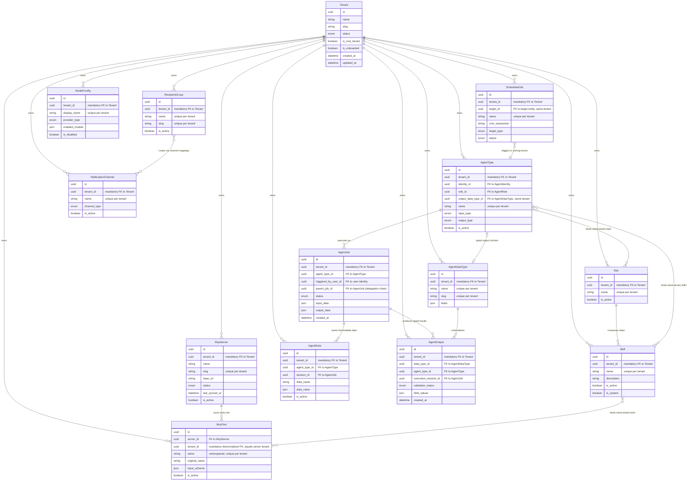

# Data Model Changes: strict-tenant-isolation

> **Rule baseline:** no cross-tenant fallback, sharing, or visibility of business data. Every data-plane entity carries a mandatory tenant binding; lookups match the exact session tenant only. When multi-tenancy is disabled, everything binds to the **root tenant** — behavior is identical, never tenant-less.

---

## 1. New Entities

**None.** All isolation is achieved by strengthening the existing tenant binding on current entities. No new tables, join entities, or lookup entities are required.

---

## 2. Modified Entities

Business-level changes only; all entities keep their existing business attributes unless noted.

### McpServer
- `tenant` becomes a **mandatory** ownership relationship (every server belongs to exactly one tenant).
- `slug` uniqueness changes from **platform-wide** to **per-tenant**: two tenants may each register a server with slug `supabase`. Business identity of a server is **(tenant, slug)**.
- Server slug is the tool namespace *within* its tenant only.

### McpTool
- **Recommendation: denormalized mandatory tenant binding on the tool itself** (in addition to inheritance via its server). Rationale at business level:
  - Tool lookups happen in hot paths (tool naming, permission resolution, skill binding validation) that should not require joining through the server to prove containment.
  - It gives defense in depth: even if a binding or sync path references a tool directly, the tenant match is checkable on the row itself.
  - Server remains the source of truth for the tenant; the tool's binding must always equal its server's tenant (kept consistent by tool sync).
- Tool namespaced name (`slug/tool`) is unique only within a tenant.
- Tool **permission grants** (role → tool) conceptually resolve within the granting tenant: a grant in tenant A never authorizes a tool in tenant B (roles and tools now share the same tenant scope).

### McpSession
- Inherits tenant scope through its server (no own tenant field needed); session-to-role assignments stay within one tenant.

### Skill / Sop / AgentType
- Already carry a tenant reference; the change is that it becomes **mandatory** (no NULL after adoption).
- The **global NULL-tenant name uniqueness variant** is removed — names are unique per tenant only.
- Bindings must resolve within the tenant:
  - **Skill → McpTool binding**: a skill may only bind tools of its own tenant (including virtual/system tools resolved within that tenant).
  - **AgentType → Skill / Sop bindings**: bound skills and SOPs must belong to the same tenant as the agent type.
  - **SOP delegation steps** and **A2A delegation by name** resolve the target agent type by **(tenant, name)** — a name collision across tenants never routes to the wrong tenant's agent.
  - **Role permissions on tools / skills / SOPs**: every side of the grant belongs to the same tenant.

### AgentRole / AgentIdentity
- Tenant reference becomes mandatory (no NULL); the NULL-tenant global name variant is retired. Identity–role assignments remain same-tenant only.

### AgentData
- `tenant` becomes a **mandatory** ownership relationship (no unowned rows after adoption).
- Retrieval by `data_name`, agent type, or session is strictly within the calling tenant; identical names across tenants never collide.

### AgentOutput
- `tenant` becomes **mandatory**. Output listing and typed queries (`query_result` by data type name/slug) match the calling tenant only.

### AgentDataType
- `tenant` becomes **mandatory** (no NULL "platform-shared types"). Name and slug are unique per tenant; resolution by slug or name matches the exact session tenant only.

### RecipientGroup / NotificationChannel
- Both carry a **mandatory** tenant binding. Group name and slug are unique per tenant.
- **Dispatch tenant binding**: notification dispatch resolves the recipient group (and its channel mappings) within the calling tenant only; the global NULL-tenant "shared slot" is no longer a dispatch target. Channel lookup by id also verifies tenant containment.

### ScheduledJob
- `tenant` becomes **mandatory** at creation. Dispatch never falls back through `job → agent type` chains to a NULL tenant; each job executes under its owning tenant's context (quotas, scoping, tool resolution).

### PolicyStatement / PolicyResource / TagDefinition
- Tenant reference becomes mandatory; grants and tag keys resolve only within their owning tenant (containment invariant, including wildcards).

---

## 3. Removed Entities/Fields

As a **business concept removal** — no rows are deleted:

- **The NULL-tenant "shared slot"** on all data-plane entities (AgentDataType, Skill, Sop, AgentRole, AgentIdentity, RecipientGroup, NotificationChannel, ScheduledJob, TagDefinition, ModelConfig, AgentData, AgentOutput, McpServer): the idea of "platform-shared rows visible to and mutable by every tenant" ceases to exist on the data plane.
  - All existing NULL-tenant rows are **adopted once into the root tenant** (idempotent one-time migration).
  - The "NULL tenant means global/shared" lookup pattern (`tenant IS NULL OR tenant = own`) is removed everywhere; only exact tenant matching remains.
  - Related removed constructs: the NULL-tenant partial uniqueness variants on names/slugs (names are per-tenant unique only) and the platform-wide uniqueness of `McpServer.slug`.
- **Fail-open tenant resolution**: data-plane reads/writes without a tenant binding cease to be a valid state — an unbound context is a hard error, never a default.

---

## 4. Schema File References

Model files to update under `backend/app/db/models/`:

| File | Change |
|------|--------|
| `backend/app/db/models/mcp_hub.py` | McpServer: tenant mandatory, slug per-tenant unique; McpTool: denormalized tenant binding |
| `backend/app/db/models/skills.py` | Skill, Sop, SkillToolBinding, SopStep: mandatory tenant, retire NULL-name variants, same-tenant bindings |
| `backend/app/db/models/agents.py` | AgentRole, AgentIdentity, AgentType, join tables: mandatory tenant, same-tenant binding validation |
| `backend/app/db/models/agent_data.py` | AgentData: mandatory tenant |
| `backend/app/db/models/agent_output.py` | AgentOutput: mandatory tenant |
| `backend/app/db/models/agent_data_type.py` | AgentDataType: mandatory tenant, retire NULL-variant indexes |
| `backend/app/db/models/notifications.py` | RecipientGroup, NotificationChannel, mappings, logs: mandatory tenant + dispatch containment |
| `backend/app/db/models/scheduling.py` | ScheduledJob, JobExecution: mandatory tenant |
| `backend/app/db/models/agents.py` (ModelConfig) | ModelConfig: mandatory tenant, retire NULL display-name variant |
| `backend/app/db/models/policy_statement.py` | PolicyStatement: mandatory tenant |
| `backend/app/db/models/policy_resource.py` | PolicyResource: mandatory tenant |
| `backend/app/db/models/tag_definition.py` | TagDefinition: mandatory tenant, retire NULL-key variant |

Actual column/uniqueness changes are expressed via Alembic migrations (`backend/alembic/versions/`) — no raw DDL.

---

## 5. Master Data Model Update Instructions

Update `docs/master/data-model/` as follows:

- `overview.md`
  - Replace all "NULL tenant = shared/global" wording with **strict containment**: every data-plane entity belongs to exactly one tenant; legacy shared rows adopted into the root tenant.
  - State the new `McpServer` identity rule: slug unique **per tenant** (was platform-wide).
  - Update the cross-domain isolation notes: tool names, A2A delegation names, data type slug/name resolution, and notification dispatch are all tenant-scoped.
- `modules/mcp-hub/entities.md` — tenant-mandatory McpServer/McpTool; per-tenant slug and tool namespace; denormalized tool tenant binding.
- `modules/skills/entities.md` — mandatory tenant on Skill/Sop; bindings (skill→tool, agent type→skill/sop, role grants) resolve within tenant.
- `modules/agents/entities.md` — mandatory tenant on AgentRole/AgentIdentity/AgentType; A2A and SOP delegation resolve targets by (tenant, name).
- `modules/communication/entities.md` — notification recipient groups and channels tenant-bound; no shared dispatch slot.
- `modules/operations/entities.md` — AgentData/AgentOutput/AgentDataType mandatory tenant; strict tenant matching for save/query/get.
- `modules/scheduling/entities.md` — ScheduledJob tenant mandatory at creation and dispatch.
- `modules/security/entities.md` — PolicyStatement/PolicyResource/TagDefinition mandatory tenant; containment invariant incl. wildcards.
- `modules/tenancy/entities.md` — document the one-time adoption of NULL-tenant legacy rows into the root tenant and the retirement of the shared-slot concept.
- Where module docs list name/slug uniqueness, retire per-tenant NULL-variant name uniqueness (names/slugs are unique per tenant only, no separate global variant).

---

## Entity-Relationship Overview (tenant ownership)

