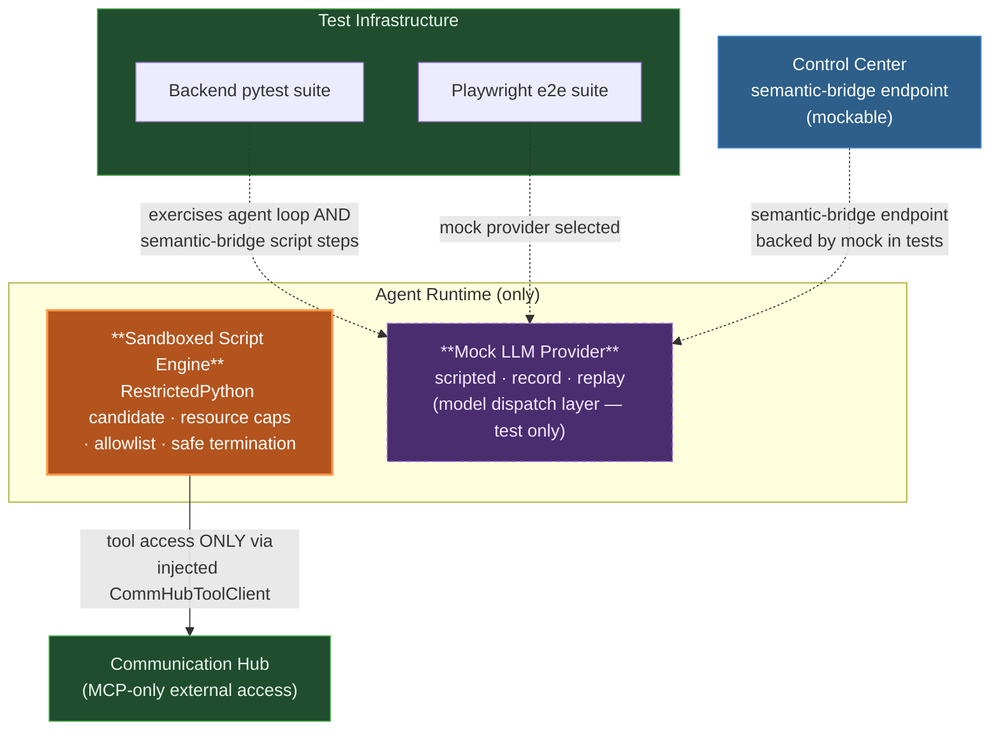

# Architecture: Sandboxed Scripting & LLM Mocking

**Related:** [prd.md](prd.md) · [spec-change.md](spec-change.md)
**Evolves:** [Software 3.0 Agent Framework architecture](../software-3.0-agent-framework/architecture.md) — script registry, Script-First Dispatcher, lifecycle, invocation contract, and Scripts tab are reused unchanged.
**Scope:** Capability extension. Three service boundaries, identity topology, tool/permission model, and the LLM agent loop are preserved. What changes: *what scripts can express* (sandboxed Python), *who authors the composition* (the opt-in optimization step of the Run Agent flow — a separate optimized implementation plan on top of the high-level base plan, not hardcoded templates), and *how executions are tested* (mock LLM layer).

## Flagship View — Sandboxed Scripts & Model-Authored Composition

One-view diagram: the sandboxed engine inside Agent Runtime, the compiler repurposed as validator/normalizer of model-authored scripts, the removed hardcoded render append, and the mock LLM layer for test runs.

```mermaid
flowchart TB
    %% ───────── Agent Runtime (execution plane) ─────────
    subgraph AR["⚙️ Agent Runtime — agents AND scripts run only here"]
        subgraph COMPOSE["Model-Authored Composition (two-layer plan model)"]
            PLAN["Base Implementation Plan<br/>HIGH-LEVEL step list only<br/>(plain plan-generation LLM)"]
            OPT["**Run-with-optimization (opt-in at launch)**<br/>COMMAND-PROMPT-DRIVEN SPECIAL AGENT EXECUTION:<br/>when no verified optimized plan exists, the Run Agent<br/>flow offers optimization; opting in runs a side execution<br/>prompted by the command mission + the user's real task —<br/>the agent's model + optimization system tools —<br/>get_scripts · get_execution_log · get_optimized_implementation_plan ·<br/>generate_script · execute_script ·<br/>generate_optimized_plan · record_verification →<br/>persisted OptimizedImplementationPlan"]
        end
        subgraph VALID["Validation & Registry Feed"]
            SCOMP["**Script Compiler (repurposed)**<br/>validator / normalizer of model-authored scripts:<br/>AST safety checks · secret-shape guard ·<br/>resource annotations"]
            VER["Verification Engine<br/>(unchanged shadow-run + compare)"]
            REG["Script Registry<br/>draft → verified → compiled → retired<br/>(via Control Center APIs only)"]
        end
        subgraph EXEC["Execution"]
            DISP["**Script-First Dispatcher**<br/>executes the model's composition;<br/>any script failure → unconditional LLM fallback<br/>(hardcoded 'semantic____render' append REMOVED)"]
            SANDBOX["**Sandboxed Script Engine (NEW)**<br/>executes sandboxed Python source:<br/>allowlisted builtins/imports · CPU / memory /<br/>wall-time caps with safe termination<br/>failures → LLM fallback"]
            INJCLIENT["Injected CommHubToolClient<br/>the ONLY external access from scripts"]
            AGENT["LLM Agent Loop<br/>(default path + unconditional fallback)"]
        end
        MODEL["Real LLM / System One model<br/>semantic-bridge CC endpoint + agent loop"]
    end

    %% ───────── Mock layer (test-time) ─────────
    subgraph MOCK["🧪 LLM Mock Layer (NEW — test & CI only)"]
        MOCKPROV["Mock LLM Provider<br/>registered in the model dispatch layer<br/>scripted · record · replay modes<br/>selectable via config / env"]
    end

    %% ───────── Other services (unchanged boundaries) ─────────
    subgraph CC["Control Center<br/>(sole DB gateway)"]
        API["Registry / lifecycle /<br/>permission REST APIs"]
        DB[(PostgreSQL)]
    end
    subgraph CH["Communication Hub"]
        MCPHUB["MCP Hub<br/>per-call token injection<br/>script provenance tagging"]
    end
    EXT["External Data Systems"]
    UI["🖥️ Scripts Tab<br/>(Agent Type detail dialog —<br/>governance surface, unchanged)"]

    %% Composition → validation → registry
    PLAN -->|"Python source +<br/>step design"| SCOMP
    SCOMP -->|"normalized, safe candidate"| VER
    VER -->|promote / reject| REG
    REG -->|compiled version| DISP

    %% Execution
    DISP -->|run script segment| SANDBOX
    SANDBOX -->|all tool calls| INJCLIENT
    INJCLIENT -->|MCP only, agent's dual identities| MCPHUB
    SANDBOX -->|model-backed step:<br/>semantic bridge via CC endpoint| MODEL
    DISP -->|no script, or any failure| AGENT
    AGENT --> MODEL
    MODEL -.->|real provider (prod) or<br/>mock provider (test)| MOCKPROV

    %% Service boundaries
    REG -.->|REST only — AR never touches DB| API
    API --> DB
    AGENT -->|tool calls| MCPHUB
    MCPHUB --> EXT
    API -.->|serves dialog| UI

    classDef ar fill:#5f3a1e,stroke:#d99a4a,color:#fdf3e3
    classDef newsb fill:#b3541e,stroke:#ff9a4a,color:#ffffff,stroke-width:2px
    classDef cc fill:#2d5f8a,stroke:#4a90d9,color:#ffffff
    classDef tool fill:#1f4d2e,stroke:#5cb85c,color:#e8f5e9
    classDef mock fill:#4a2d6f,stroke:#a06cd5,color:#f3e8ff,stroke-dasharray: 5 3
    classDef data fill:#333333,stroke:#888888,color:#eeeeee
    class PLAN,DISP,AGENT,MODEL,AR,COMPOSE,VALID,EXEC ar
    class SANDBOX,INJCLIENT,SCOMP newsb
    class API,CC,UI cc
    class MCPHUB,CH,EXT tool
    class MOCK,MOCKPROV mock
    class DB data
```

### Reading the diagram

- **Sandboxed Script Engine (new, inside Agent Runtime):** executes the model-authored Python source. **Sandbox technology:** RestrictedPython is the primary candidate. **Recommendation: adopt RestrictedPython** — it runs in-process inside Agent Runtime with no new runtime dependency, integrates directly with the existing session binding, injected CommHubToolClient, and resource-cap enforcement, and its hardened compile/eval model (restricted AST, guarded builtins, no `import` statement by default) maps 1:1 to the required invariants. WASM alternatives (Pyodide/QuickJS-style sandboxes) offer stronger memory isolation but add a separate runtime, a serialization boundary for every MCP call and model-backed step, degraded observability, and a second supply chain — heavier than the threat model requires given MCP-only external access and no untrusted-user scripting (out of scope). Final evaluation belongs in the tech spec; no WASM component appears in this architecture.
- **Two-layer plan model:** the base implementation plan stays a plain high-level step list. The composition is authored separately by the **opt-in optimization step of the Run Agent flow**, a **command-prompt-driven special agent execution**: when the user launches the agent and no verified optimized plan exists, a dialog offers "Run with optimization" or "Skip optimization"; opting in passes the opt-in flag through the launch (which injects the existing `__command` side-execution markers), so the execution is prompted by the `optimize-and-verify` command mission plus the user's real task, runs the agent's model plus the optimization system tools, and **first reads its own state** — `get_scripts`, `get_execution_log`, `get_optimized_implementation_plan` — skipping re-authoring when the scripts/logs show nothing wrong and the agent hasn't changed. When authoring is needed it authors the full composition — script segments (Python source), LLM bridge steps, decision steps, and the `fully_scripted` mark — against the sandbox capability contract and **verifies each script against the real integration** (the verification IS the real run: tool calls execute for real while accomplishing the user's task). On success the agent calls `generate_optimized_plan` to persist the `OptimizedImplementationPlan` (and the script versions it authored). "Retire plan" on the Optimized Plan tab clears the plan (and serving scripts compiled from it) so the next run triggers the optimized-plan check again. The **hardcoded unconditionally-appended `semantic____render` step is removed**; a summary step exists only if the model includes one.
- **Execution preference:** the Script-First Dispatcher serves the optimized composition only while it is fresh (ready AND newer than the base plan): `fully_scripted` → zero-LLM script; otherwise the scripts are exposed as invocable tools and the LLM orchestrates. An absent, stale, or failed optimized plan falls back to the base plan's LLM path.
- **Script Compiler repurposed:** from generator of declarative step graphs to **validator/normalizer of model-authored scripts** — AST safety checks, secret-shape guard, resource annotations — feeding the unchanged draft → verified → compiled → retired registry lifecycle.
- **LLM Mock Layer (new):** a mock provider registered in the model dispatch layer, selectable via config/env in tests; covers both the agent loop and model-backed script steps (the semantic-bridge Control Center endpoint), so e2e runs consume zero LLM API. Dashed = test-time only; not present in production traffic.

## 1. Changed Components

```mermaid
flowchart LR
    subgraph BEFORE["Before"]
        direction TB
        B1["Script Compiler<br/>generates declarative<br/>step graphs from templates"]
        B2["Script Runner<br/>interprets declarative<br/>transform ops"]
        B3["Dispatcher<br/>unconditionally appends<br/>'semantic____render' step"]
        B4["Script logs<br/>truncated JSON blobs ·<br/>'tokens_saved' estimated"]
    end
    subgraph AFTER["After"]
        direction TB
        A1["Script Compiler<br/>validates / normalizes<br/>model-authored Python"]
        A2["Sandboxed Script Engine<br/>executes sandboxed Python<br/>(RestrictedPython candidate)"]
        A3["Dispatcher<br/>executes the model's composition;<br/>hardcoded render append REMOVED"]
        A4["Humanized one-line logs ·<br/>real measured 'tokens_saved'"]
    end
    BEFORE -->|"evolves"| AFTER

    classDef b fill:#333333,stroke:#888888,color:#eeeeee
    classDef a fill:#b3541e,stroke:#ff9a4a,color:#ffffff
    class B1,B2,B3,B4 b
    class A1,A2,A3,A4 a
```



| Component | Before → After |
|---|---|
| **Script Compiler** | Generator of declarative step graphs from compiler templates → **validator/normalizer of model-authored Python** (AST safety checks, secret-shape guard, resource annotations). Produces candidates only; lifecycle unchanged. |
| **Script Runner → Sandboxed Script Engine** | Interpreter of declarative transform ops → **sandboxed Python execution**: allowlisted builtins/imports, CPU/memory/wall-time caps with safe termination, MCP tools only via the injected CommHubToolClient. Same invocation contract and session binding. |
| **Script-First Dispatcher** | Strategy unchanged (script-first, unconditional LLM fallback). Loses the hardcoded `semantic____render` append; executes whatever composition the model authored, including its LLM bridge and decision steps. |
| **Plan generation (LLM Agent Loop)** | Base plan stays HIGH-LEVEL (plain step list; `user_requirement` as context). Composition authoring moved to the separate optimization flow — the opt-in "Run with optimization" step of the Run Agent flow (`OptimizedPlanService` → `OptimizedImplementationPlan`). |
| **Script execution logging** | Truncated JSON blobs → **humanized one-line entries** (what ran, what it produced). |
| **Token accounting** | Estimated/placeholder `tokens_saved` → **real tokens avoided**, measured against the reference LLM execution. |

**Unchanged:** script registry persistence & Control Center REST APIs, lifecycle states and `repaired_from` lineage, Verification Engine, Scripts tab governance surface, LLM agent loop as default path and fallback engine, invocation contract and identity topology.

## 2. New Components



### Sandboxed Script Engine *(inside Agent Runtime)*
- **Responsibility:** executes sandboxed Python script source. Enforces: no I/O of any kind; allowlisted builtins and imports only; per-execution CPU, memory, and wall-time caps with **safe termination**; MCP tool access **only** through the injected CommHubToolClient. Any sandbox violation or cap breach fails closed, is recorded, and triggers unconditional LLM fallback.
- **Technology:** **RestrictedPython recommended** — in-process (fits existing session binding, injected client, and caps), direct integration with observability, hardened interpreter model matching the invariants; WASM alternatives evaluated in the tech spec but add a runtime split and serialization boundary not justified by the threat model (no untrusted-user scripting; MCP-only egress).
- **Boundaries:** runs only in Agent Runtime under the agent's dual identities and resolved permissions; holds no credentials; no database access.

### LLM Mock Layer *(model dispatch layer — test environments only)*
- **Responsibility:** a mock LLM provider registered alongside real providers, selectable via config/env. Three modes — **scripted** (deterministic hand-authored responses), **record** (capture real interactions), **replay** (deterministic replay). Serves the LLM agent loop **and** model-backed script steps (semantic-bridge CC endpoint), enabling deterministic prompt assertions.
- **Boundaries:** never used in production traffic paths; deterministic behaviour for identical inputs; integrated into backend pytest and Playwright e2e suites for zero-LLM-cost CI.

## 3. Integration Point Changes

| Integration point | Change |
|---|---|
| **Plan-Generation LLM → Script Compiler** | Contract change: the base plan stays high-level; the OPTIMIZED plan (authored by the opt-in optimization run against the sandbox capability contract) carries **Python script source** per script segment plus the step composition (bridge/decision steps), instead of declarative specs for template compilation. |
| **Script Compiler → Script Registry** | Submits validated/normalized model-authored candidates through the unchanged CC APIs; rejection stays in draft with a recorded reason. Lifecycle API surface unchanged. |
| **Sandboxed Script Engine → Communication Hub** | No protocol change. All external access flows through the **injected CommHubToolClient** (MCP-only boundary preserved): same authenticated path, per-call token injection, agent's dual identities, script provenance tags. |
| **Sandboxed Script Engine → Control Center (semantic bridge)** | Model-backed steps inside scripts call the semantic-bridge CC endpoint as before — now mockable end-to-end by the LLM mock layer in tests. |
| **Dispatcher → LLM Agent Loop** | Unconditional fallback semantics unchanged; additionally triggered by sandbox violations, cap terminations, and validation-at-runtime failures, with reason recorded. |
| **Model dispatch layer → LLM providers** | New: mock provider selectable via config/env alongside real providers (test environments only). |
| **Script execution logs & registry records** | Log lines become humanized one-liners; execution records carry **real measured `tokens_saved`**. Telemetry keeps script-vs-LLM provenance, script version, fallback reason. |

**Unchanged:** AR→CC permission-resolution and registry APIs, CH→CC permission/token delegation, CC→PostgreSQL (sole gateway; no new schema beyond the predecessor's registry tables), Scripts tab UI contract.

## 4. Data Flow Changes

**Flow A — Composition authoring (changed):**
plan-generation LLM → emits workflow composition (Python script segments + LLM bridge + decision steps) → Script Compiler validates/normalizes (AST safety, secret-shape guard, resource annotations) → candidate → Verification Engine (unchanged shadow-run + compare) → registry lifecycle via CC APIs. Failed validation remains draft with recorded reason.

**Flow B — Compiled run (changed):**
Script-First Dispatcher detects a compiled script → Sandboxed Script Engine executes the model-authored segments under caps and allowlist:
- tool access → **injected CommHubToolClient → Communication Hub MCP only** (same dual identities, per-call token injection);
- model-backed steps → semantic-bridge CC endpoint → result into downstream steps;
- **no step is appended automatically** — the workflow runs exactly the composition the model authored;
- success → typed output, humanized log entries, real `tokens_saved` recorded.

**Flow C — Fallback (extended trigger set):**
any script failure — error, sandbox violation, disallowed import/attribute access, CPU/memory/wall-time cap termination with safe kill, runtime validation failure → unconditional LLM-path fallback with reason recorded; repair-retry loop unchanged (bounded).

**Flow D — Test run (new):**
config/env selects the mock LLM provider → agent loop and model-backed script steps receive scripted/recorded/replayed responses → deterministic full-run execution with prompt assertions, **zero LLM API usage** — wired into backend pytest and e2e CI.

**Invariant across all flows:** only Control Center touches PostgreSQL; scripts' only external access is MCP via the injected client; agents and scripts never hold tokens or credentials; scripts and agents run only in Agent Runtime.

## 5. What to Update in `docs/master/architecture/`

- **`system-overview.md`** — update the Workflow Execution / Software 3.0 section: scripts are now sandboxed Python (not declarative transform graphs); composition is model-authored (no hardcoded templates); add the LLM mock layer to the testing story.
- **`modules/agent-runtime/architecture.md`** — replace the declarative step-graph execution model with the **Sandboxed Script Engine** (RestrictedPython choice + rationale, allowlist, resource caps with safe termination, MCP-only egress via injected client); re-describe the Script Compiler as validator/normalizer of model-authored scripts; document the mock LLM provider registration in the model dispatch layer.
- **`modules/control-center/architecture.md`** — note the semantic-bridge endpoint is exercised by the mock layer in tests; registry/lifecycle APIs unchanged in role but now ingest model-authored Python source.
- **`modules/communication-hub/architecture.md`** — no protocol change; reiterate that sandboxed scripts reach the Hub exclusively through the injected CommHubToolClient with unchanged token/permission handling.
- **`modules/agent-lifecycle.md`** — extend the execution lifecycle: model-authored composition at plan time, sandboxed execution, sandbox/cap violations as fallback triggers.
- **`modules/observability.md`** — humanized script log entry format; real `tokens_saved` measurement semantics; sandbox-violation and cap-termination events as first-class telemetry.
- **`modules/iam.md` / `modules/identity.md`** — add a note: sandboxed scripts bind to the agent session under the same dual identities; the allowlist/sandbox adds no new identity or permission pathway.
- **`security/` docs** — add a sandbox security section: invariants (no I/O, allowlist-only imports, resource caps, fail-closed escapes), RestrictedPython rationale, and confirmation that scripts never receive credentials (secret-shape guard at validation).
- **`modules/workflow-compilation.md`** (if created by the predecessor change) — rewrite for model-authored composition and the validator/normalizer compiler; remove references to declarative transform ops and the hardcoded `semantic____render` append.
- **`modules/dashboard.md`** — update cost-reporting notes: tokens_saved is measured, not estimated; script log readability improvements.

## Compliance Note

This design complies with `docs/config.yaml` `top_priority_rules`, explicitly: **(1) the three backend services remain fully segregated** — the sandbox and mock layer introduce no cross-service coupling; **(2) agents and scripts run only in Agent Runtime** — the Sandboxed Script Engine lives inside AR, and the mock provider is a dispatch-layer selection, not a new service; **(3) only Control Center connects to the database** — the sandbox has no DB access, and AR consumes the registry exclusively via CC REST APIs; **(4) no credentials reach scripts** — the validation secret-shape guard, unchanged identity-context-only invocation contract, and per-call token injection by Communication Hub ensure scripts never hold tokens or credentials; **(5) MCP-only external access for scripts** — the sandbox exposes exactly one egress path, the injected CommHubToolClient, and every other access vector (filesystem, network, subprocess, database) fails closed. No Mermaid diagram shows code; all labels with special characters are quoted.
