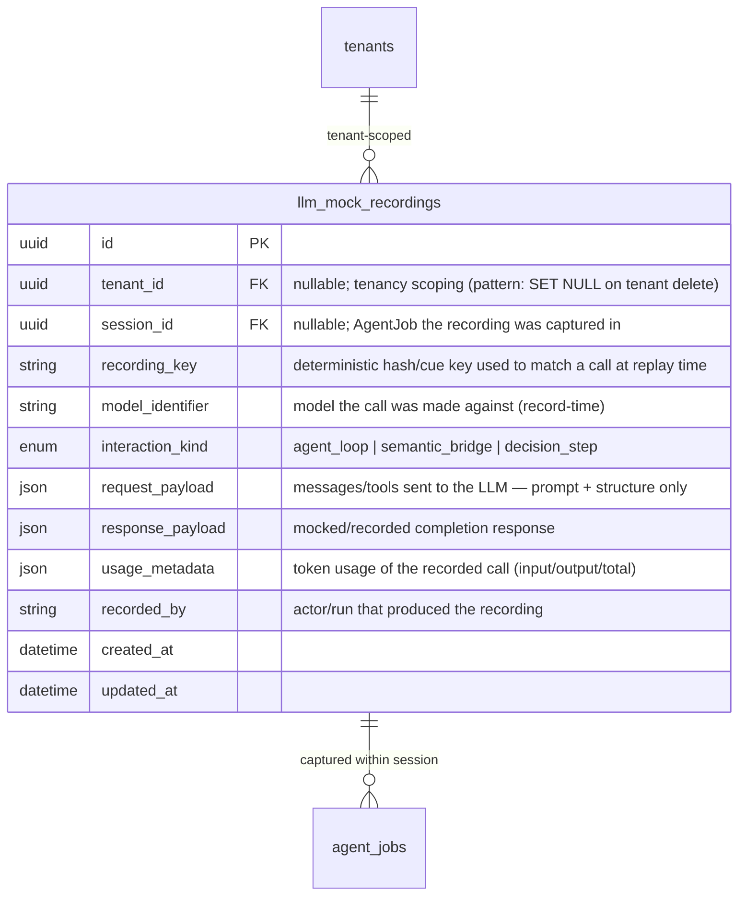
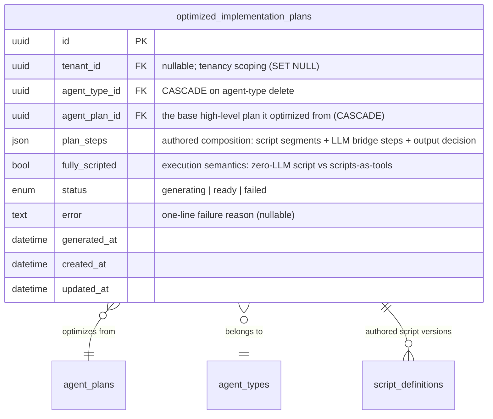
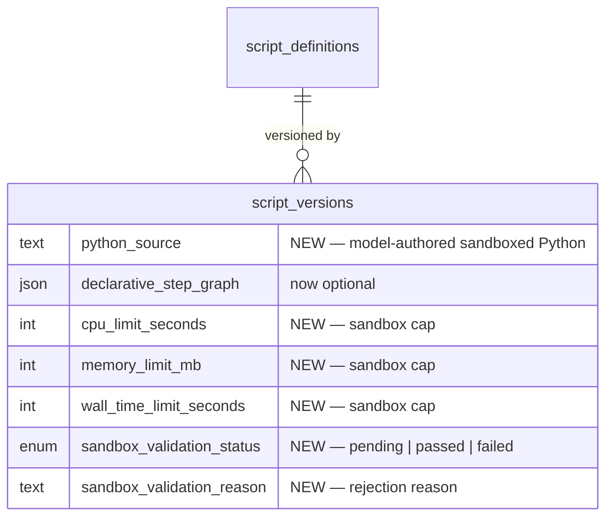

# Data Model: Sandboxed Scripting & LLM Mocking

**Related:** [prd.md](prd.md) · [spec-change.md](spec-change.md) · [architecture.md](architecture.md)
**Evolves:** [Software 3.0 Agent Framework data model](../software-3.0-agent-framework/data-model.md) — reuses ScriptDefinition, ScriptVersion, VerificationRun, ScriptExecutionRecord, FallbackEvent, RepairAttempt, ConversationSession unchanged in structure (extensions noted below). Technology-agnostic in the entity sections: no SQL/DDL there; schemas live in `backend/app/db/models/` (migration concerns isolated in §5).

Ownership invariant: all registry, execution, and mock-recording data is **Control-Center-owned** (sole DB gateway). Agent Runtime reads/writes exclusively via Control Center REST APIs. Scripts hold no credentials; recorded LLM interactions store prompt + response only — never API keys or identity tokens.

## 1. New Entities

### LLM Mock Recording (`llm_mock_recordings`)

Recorded LLM request/response pair captured during a real (or manually driven) execution, for deterministic replay and prompt assertions in tests. Tenant-scoped; contains prompt + response payloads only — no provider credentials, no identity tokens.

**Cardinality:** one AgentJob (session) → 0..many recordings; one recording belongs to 0..1 session. No relationship to ScriptVersion — recordings are keyed by request content, not by script.

Notes:
- Replay matching is by `recording_key` (deterministic function of the request); identical inputs replay identically (determinism AC).
- Test-infrastructure data: written only in test/recording modes, but persisted through Control Center like all registry data (no AR DB access).

### Optimized Implementation Plan (`optimized_implementation_plans`)

The model-authored workflow composition produced by the "Optimize & Verify" flow — a SEPARATE entity from the high-level base implementation plan (`agent_plans`). Carries the authored composition (script segments with Python source, LLM bridge steps, output decision), the `fully_scripted` execution-semantics mark, and lineage to the script versions it authored.

**Cardinality:** one agent type → 0..1 current optimized plan (latest row wins; regeneration of the base plan invalidates it via the freshness gate — ready AND newer than the base plan). Indexes on tenant, agent type, and base plan.

Notes:
- Execution preference: the Script-First Dispatcher serves the optimized composition only while it is fresh; absent/stale/failed → base-plan LLM path.
- Script association: `ScriptDefinition` gains `source_optimized_plan_id` (nullable FK) plus the `fully_scripted` mark, so the registry records which script versions the optimized plan authored.

## 2. Modified Entities

### ScriptVersion — add sandboxed Python source + resource limits

The model now authors Python source; the declarative step graph becomes optional (retained for backward compatibility with predecessor-compiled versions).

| Change | Attribute | Type | Rationale |
|---|---|---|---|
| add | `python_source` | text, nullable | Model-authored sandboxed Python source (N3). Nullable: legacy declarative-only versions keep it empty. |
| relax | `declarative_step_graph` | json, nullable (unchanged) | Now optional — model-authored compositions may carry only `python_source` plus step design. |
| add | `cpu_limit_seconds` | int, nullable | Per-execution CPU cap (sandbox invariant N1). |
| add | `memory_limit_mb` | int, nullable | Per-execution memory cap; breach → safe termination + fallback. |
| add | `wall_time_limit_seconds` | int, nullable | Per-execution wall-clock cap. |
| add | `sandbox_validation_status` | enum (`pending`, `passed`, `failed`), default `pending` | Compiler-as-validator outcome: syntax + sandbox-compliance check (allowlist-only imports, I/O attempts rejected). `failed` keeps the version in draft with `sandbox_validation_reason`. |
| add | `sandbox_validation_reason` | text, nullable | Recorded rejection reason for failed validation (AC: stays in draft with a recorded reason). |

Resource-limit attributes are per-**version** (platform defaults apply when null), so caps are versioned and auditable with the script content they govern.

### ScriptExecutionRecord — accurate token accounting + sandbox failure provenance

| Change | Attribute | Type | Rationale |
|---|---|---|---|
| add | `tokens_saved_actual` | int, nullable | Real tokens avoided, **measured against the reference LLM execution** (N5) — not an estimate. |
| keep | `tokens_saved_estimate` | int, nullable | Retained for historical rows; superseded by `tokens_saved_actual` going forward. |
| add | `sandbox_termination` | bool, nullable | True when the run ended via a CPU/memory/wall-time cap safe-kill (extended fallback trigger set, Flow C). |
| add | `sandbox_violation_detail` | text, nullable | Human-readable one-line summary of what failed (disallowed import, cap breach) — pairs with the humanized logging (N5); no truncated JSON blobs. |

### FallbackEvent — extended trigger reasons

| Change | Attribute | Type | Rationale |
|---|---|---|---|
| extend enum | `trigger_reason` values | enum | Add: `sandbox_violation` (disallowed import/attribute access, fail-closed) and `resource_limit_exceeded` (cap termination). Existing values (`execution_error`, `tool_schema_mismatch`, `output_validation_failure`) unchanged. |

### VerificationRun — sandbox-compliance evidence

| Change | Attribute | Type | Rationale |
|---|---|---|---|
| add | `sandbox_check_passed` | bool, nullable | Records that the shadow-run comparison was executed on a sandbox-compliant candidate; complements the unchanged `comparison_outcome`/`verdict`. |

### Enums

- New: `MockInteractionKind` (`agent_loop`, `semantic_bridge`, `decision_step`).
- New: `SandboxValidationStatus` (`pending`, `passed`, `failed`).
- Extended: `FallbackTriggerReason` (+2 values above).

## 3. Removed Entities / Fields

- **Removed (behavioral, not stored):** the unconditionally appended `semantic____render` compiler template — no stored field, but any persisted composition artifacts produced by the old compiler are superseded; no column removal required.
- **No entity removals.** `declarative_step_graph` is **deprecated-but-retained** (nullable) for backward compatibility with predecessor-compiled versions; do not drop in this change.
- Eventually: `tokens_saved_estimate` may be retired once all rows carry `tokens_saved_actual` — out of scope here.

## 4. Schema File References

All Control-Center-owned; models in `backend/app/db/models/`:

| File | Entities | This change |
|---|---|---|
| `backend/app/db/models/script_registry.py` | ScriptDefinition, ScriptVersion, VerificationRun, FallbackEvent, RepairAttempt (+ enums) | Extend ScriptVersion (source + limits + validation), VerificationRun, FallbackEvent enum |
| `backend/app/db/models/script_execution.py` | ScriptExecutionRecord (+ enums) | Extend with accurate token accounting + sandbox termination fields |
| `backend/app/db/models/llm_mocking.py` | **LLM MockRecording (new)** | New file, same ownership pattern as script_registry.py |
| `backend/app/db/models/optimized_plan.py` | **OptimizedImplementationPlan (new)** + `OptimizedPlanStatus` enum | New file — two-layer plan model (separate optimized composition entity) |
| `backend/app/db/models/` (existing) | AgentJob/AgentPlan, Tenant, ConversationSession | Referenced only — unchanged |

## 5. Alembic Migration Needs

One migration (or a small chain) under `backend/alembic/versions/`:

1. **New enum types** — `mock_interaction_kind_enum`, `sandbox_validation_status_enum` (created via model import; use `postgresql.ENUM(..., create_type=False)` in the migration).
2. **Extended enum** — `fallback_trigger_reason_enum`: add `sandbox_violation`, `resource_limit_exceeded` (`ALTER TYPE ... ADD VALUE`; string-formatted DDL, no bound params).
3. **script_versions** — add `python_source` (text), `cpu_limit_seconds`, `memory_limit_mb`, `wall_time_limit_seconds` (int, nullable), `sandbox_validation_status` (enum, server_default `pending`), `sandbox_validation_reason` (text).
4. **verification_runs** — add `sandbox_check_passed` (boolean, nullable).
5. **script_execution_records** — add `tokens_saved_actual` (int, nullable), `sandbox_termination` (boolean, nullable), `sandbox_violation_detail` (text).
6. **llm_mock_recordings** — create table with indexes on `(tenant_id)`, `(session_id)`, `(recording_key)`; unique constraint candidate: `(tenant_id, recording_key, model_identifier)` if recordings are deduplicated per tenant.
7. **optimized_implementation_plans** — create table per §1 (FKs to `agent_types.id` and `agent_plans.id`, `plan_steps` JSON, `fully_scripted` boolean, `status` enum with new `optimized_plan_status_enum` created via model import, timestamps) + indexes on tenant/agent type/base plan; `script_definitions` gains `source_optimized_plan_id` (nullable FK) and `fully_scripted` (boolean).
8. Downgrade must drop the new columns/table and remove enum values only via the documented enum-rebuild pattern (PostgreSQL cannot `DROP VALUE`).

## 6. What to Update in `docs/master/data-model/`

- **`overview.md`** — add the Software 3.0 script-registry + execution + mock-recording entity group to the entity inventory (note: predecessor change's entities may not yet be present here — land them together).
- **`modules/agents/entities.md`** — add ScriptDefinition, ScriptVersion (with the new sandboxed-source and resource-limit attributes), VerificationRun, FallbackEvent, RepairAttempt to the agent-management ERD, cross-linking AgentType/AgentPlan/AgentJob.
- **`modules/operations/entities.md`** — add ScriptExecutionRecord (execution provenance, accurate token accounting) and LLM MockRecording (test-infrastructure data) with cardinality to AgentJob.
- **`modules/security/entities.md`** — note the sandbox-validation attributes on ScriptVersion and the no-credentials invariant for llm_mock_recordings (prompt+response only).
- **`modules/tenancy/entities.md`** — confirm `tenant_id` FK pattern (SET NULL) for the new table.
