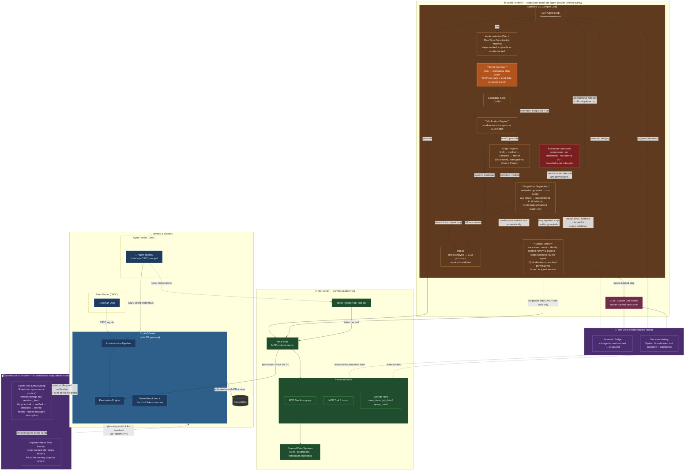
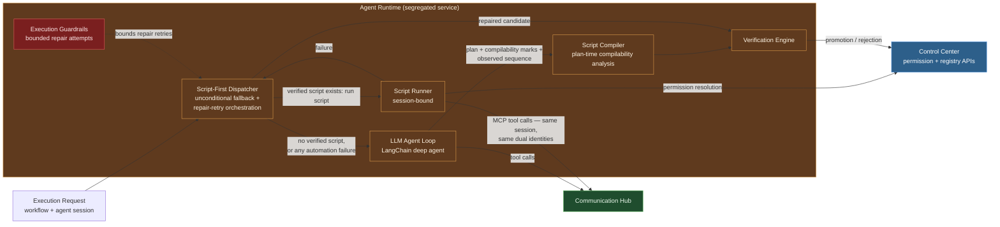
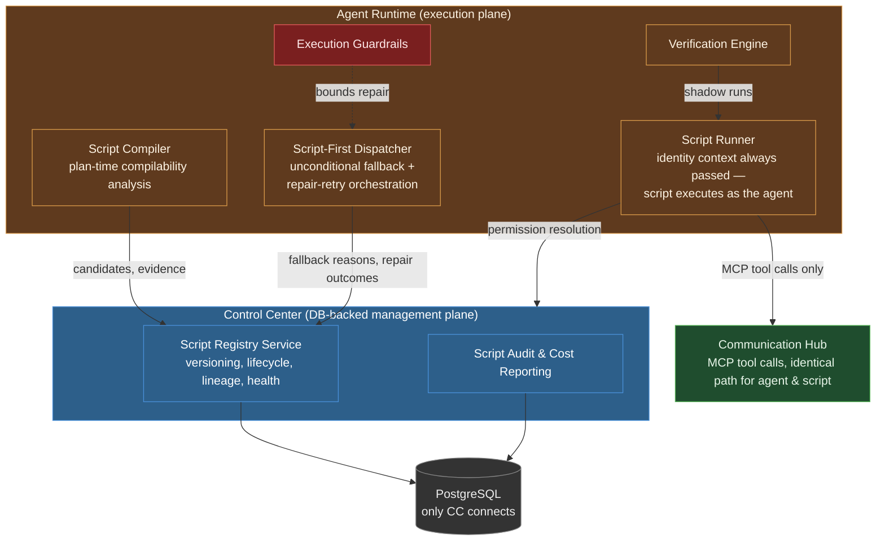

# Architecture: Software 3.0 Agent Framework — Workflow Compilation

**Related:** [prd.md](prd.md) · [spec-change.md](spec-change.md)
**Scope:** Capability extension. The three backend services, identity topology, tool/permission model, and LLM agent loop are preserved; five new compilation-lifecycle components are added within existing service boundaries.

## Flagship View — Parthenon as a Software 3.0 Framework

One-view diagram of the whole system: security layers, dual OIDC identity, the tool access path, the two halves of "The Brain", and the new Software 3.0 compile loop.

### Reading the diagram

- **Security layers (segregated):** Control Center (identity, permissions, registry management, sole DB access), Agent Runtime (all agent and script execution), Communication Hub (tool brokerage, token injection). No cross-layer shortcuts.
- **Identity:** humans sign in via the **user realm**; agents are **first-class OIDC principals in the agent realm**. Both flow through Control Center's authentication pipeline and Permission Engine. Scripts are bound to the executing agent's session — their MCP tool calls carry the **same dual identities** as the agent itself (identity parity); no new identity class exists.
- **Tool access path:** integrations → MCP Hub → permitted tools → external data systems. Permission is checked against Control Center; Communication Hub injects the identity token **per tool call** — agents and scripts never hold tokens. **MCP is the only external access for scripts**: script logic between steps is limited to local data processing/transformation.
- **The Brain, split in two:** the **Semantic Bridge** (sub-agents converting unstructured → structured data) and **Decision Making** (System One model-based decision tool for judgment-type decisions). Both are invocable as *steps inside compiled scripts* — those steps stay model-backed (and are flagged as such).
- **Governance & review surface:** scripts are **functions owned by the agent type** — there is **no standalone `/admin/scripts` module or navigation entry**. Governance visibility lives in the **Scripts tab of the Agent Type detail dialog** (version lineage including `repaired_from`, lifecycle `draft → verified → compiled → retired`, health, human-readable description), served by the unchanged Control Center registry/lifecycle/verification REST APIs. During **plan review**, plan steps backed by a script display a **link to that script** so reviewers can open it in the Scripts tab.
- **Invocation contract:** scripts are invoked like functions of the agent itself — the contract **always passes identity context** (the agent's dual identities and resolved permissions) to script execution; a script runs **as the agent**, never under an identity of its own.
- **Script technology, stated plainly:** compiled scripts are **declarative JSON step graphs interpreted by the Script Runner** — there is **no arbitrary code execution, by design**. Between MCP tool calls, scripts reshape and derive data with a fixed set of declarative **transform ops**: structural (`passthrough`, `select_keys`, `json_path_get`, `template`, `constant`) and **computed-data ops** (`count`, `pluck`, `merge`, `sum`, `first`, `last`) that deterministically derive counts, columns, merged structures, aggregates, and element selections from prior step outputs for subsequent steps.
- **Script output contract:** when a script ends in an LLM render step (`llm_render`), the session output is the **rendered text only** — auto-detected markdown, stored raw (never re-wrapped in a JSON envelope) and rendered as markdown in the UI (GFM tables included). Without a render step (`deterministic`), the output is the deterministic JSON/template projection.
- **The compile loop (NEW):** at plan time the agent performs **compilability analysis**, marking each step scriptable vs model-backed (conversational/interactive agents are never compiled) → implementation plan + recorded tool calls → Script Compiler → candidate script → Verification Engine (shadow-run, compare vs LLM output) → promoted to compiled registry. Execution is **script-first by strategy, not configuration**: a verified script runs automatically; any failure unconditionally falls back to the LLM path, and a defect-driven repair loop (failure → defect analysis → repaired candidate → re-verification → retry) runs within execution guardrails. There are no execution modes to configure.

## 1. Changed Components

### Agent Runtime — execution engine

| Aspect | Before | After |
|---|---|---|
| Execution path | Every session traverses the LLM observe-reason-act loop | **Script-first by fixed strategy (no configured modes):** execution automatically runs the compiled script when a verified script exists, and unconditionally falls back to the LLM path on any automation failure |
| Plans | Describe steps for this run only | Additionally include **plan-time compilability analysis** (each step marked scriptable vs model-backed) and yield a reusable candidate bridge script |
| Session binding | Agent session scopes LLM execution | Script execution binds to the **agent session** — MCP calls carry the same dual identities (user realm + agent realm) as the agent |
| Telemetry | LLM usage only | Distinguishes script runs vs LLM runs, script version, fallback events, repair attempts, residual model-backed step usage |

### Communication Hub — Agent Gateway / MCP Hub
Unchanged responsibilities, extended bookkeeping: every tool call now carries an execution provenance tag (`script` vs `llm`) and, where applicable, a script version — recorded in audit trails. Script tool calls carry the same dual identities as the originating agent session (identity parity). Token injection per call and permission delegation to Control Center are untouched.

### Control Center — governance surface
Adds registry management (lifecycle transitions, health status), script audit and cost reporting, and operator dashboards (compilation rate, fallback rate, token savings). The registry, lifecycle, verification, and repair REST APIs remain unchanged — they **serve the Scripts tab in the Agent Type detail dialog** as the governance/review surface; **no standalone script admin module exists**. There is **no execution-mode configuration**: the script-first-with-unconditional-fallback strategy is fixed platform behavior, not a per-workflow setting. Remains the only database-connected service.

### Agent Implementation Plans (capability)
A plan becomes a *durable artifact* that includes the agent's **plan-time compilability analysis** — each step marked scriptable or model-backed; conversational and interactive agents are marked never-compiled. **Plan steps backed by a script display a link to that script**, so during plan review the user can open it (in the owning agent type's Scripts tab) and review its content, description, and lineage before approving. Plans are reviewed alongside the agent's steps and used (with the observed tool-call sequence) as compiler input.

### Observability & Cost Reporting (capability)
OTEL spans and dashboards distinguish script executions from LLM executions; cost reports show tokens *not* consumed versus the LLM baseline, and call out residual model usage from semantic-bridge/decision steps.

## 2. New Components

Five new components, all within existing service boundaries:

### Script Compiler *(inside Agent Runtime)*
- **Responsibility:** performs **plan-time compilability analysis** — the agent marks each plan step **scriptable** (deterministic MCP tool calls plus local data transformation) or **model-backed** (semantic bridging, System One judgment, interactive input); conversational/interactive agents are never compiled. It then turns a compilable implementation plan and/or the recorded tool-call sequence of a successful LLM run into a deterministic **bridge script** — a declarative step graph: MCP tool calls, local data transformations/filters, branches to Semantic Bridge or Decision steps, typed inputs/outputs.
- **Boundaries:** produces candidates only; never promotes, never executes. Output contains no credentials or tokens (SEC3). Model-backed steps are marked, not inlined.

### Script Registry *(managed via Control Center, DB-backed)*
- **Responsibility:** versioned storage of scripts with lifecycle `draft → verified → compiled → retired`, health status, lineage back to the producing plan or run, verification evidence, and execution/audit records.
- **Boundaries:** managed exclusively by Control Center (the sole DB gateway). Agent Runtime consumes compiled versions through Control Center APIs — never the database. Re-verification is required after repair or tool-schema change.

### Script Runner *(inside Agent Runtime)*
- **Responsibility:** executes compiled scripts through the **standardized invocation contract: identity context is always passed** — the runner binds each execution to the invoking agent's dual identities (user-realm human + agent-realm OIDC agent principal) and its resolved permissions, so the script runs **as the agent itself**, like a function owned by the agent, never under an identity of its own, and is bound to the agent session. Runs the declarative step graph step-by-step; between steps, scripts perform **local data processing only** (transforms, filters, aggregation) — **MCP tool calls are the only external access**: no direct network, filesystem-outside-sandbox, database, or other I/O. Model-backed steps delegate to the Semantic Bridge sub-agent or System One decision tool; every MCP tool call goes through Communication Hub **exactly like an agent tool call**, carrying the same dual identities as the agent session (identity parity). **Execution logging:** the runner ships best-effort execution log entries through the CC data client (`log_execution_event`) for run start (script version, step count), each step completion (step name/kind with a truncated outcome brief — never full payloads for large results), every model-backed step (so script↔LLM segment iterations stay visible in the session log stream), run completion, and failure; the dispatcher adds a fallback entry on script→LLM handoff. Logging failures are swallowed and never affect the run.
- **Boundaries:** runs under the executing agent's identity and permission model — it can never invoke a tool the agent identity is not permitted to use (SEC1), holds no credentials, and has no database access. Per-tool permission resolution flows through Control Center; tokens are injected per call by Communication Hub.

### Verification Engine *(inside Agent Runtime)*
- **Responsibility:** shadow-runs candidate scripts against recorded LLM executions on identical inputs, compares outputs (with declared comparison tolerance), retains evidence (inputs, expected vs actual, outcome), and promotes matches to **verified/compiled** or returns mismatches to **draft** with a diff.
- **Boundaries:** promotes only after successful comparison; rejection reasons are recorded for repair. Verification artifacts are stored via the registry (Control Center), never locally in Agent Runtime.

### Script-First Dispatcher *(inside Agent Runtime; replaces the former Fallback Controller)*
- **Responsibility:** implements the fixed platform strategy — **no execution modes exist**. When a verified script exists for the workflow, it dispatches the run to the Script Runner automatically; when no verified script exists, it uses the LLM path without error. On any automation failure (execution error, tool schema mismatch, output validation failure, or repair exhaustion) it **unconditionally falls back** to the LLM agent path so a run never fails solely because a script failed, records the fallback reason and script version, and orchestrates the **self-improvement repair loop**: defect analysis → LLM produces a repaired candidate → re-verification → retry of the repaired script — bounded by execution guardrails.
- **Boundaries:** repair and retries stay within existing guardrails (permissions, no credentials, no external access, bounded attempt budget); degrades script health status on repeated fallbacks; never silently discards failures; never widens permissions during fallback or repair.

## 3. Integration Point Changes

| Integration point | Change |
|---|---|
| **Agent Runtime → Control Center** | New reads: current compiled script version per workflow (checked by the Script-First Dispatcher — no mode resolution); new writes: candidates, verification evidence, fallback events, repair attempts, health updates. Permission resolution API reused unchanged by the Script Runner. |
| **Agent Runtime → Communication Hub** | No protocol change. Script tool calls use the same authenticated path (agent-instance mTLS, delegated permission check, per-call token injection) and carry the **same dual identities as the originating agent session** (identity parity); requests tagged with script provenance for audit. |
| **Communication Hub → Control Center** | Unchanged permission/token delegation; audit records gain script version metadata. |
| **Control Center → PostgreSQL** | New schema: script registry tables (versions, lifecycle, evidence, lineage, health, execution/audit records), fallback/repair event records, cost-tracking records. Alembic migration required. |
| **Agent Implementation Plans → Compiler** | Plan output contract extended: the plan now embeds **plan-time compilability analysis** (scriptable vs model-backed marks, never-compiled agent types); plan steps backed by a script carry a **link to the script** for review during plan review; plan plus observed tool-call sequence become compiler inputs. |
| **Semantic Bridge / System One decision tool → compiled scripts** | New invocation contract: both are callable as steps in a declarative script's step graph, with structured results and confidence carried downstream; marked as model-backed steps. |
| **Agent Type detail dialog (UI) → Control Center** | New **Scripts tab** — the sole governance/review surface for scripts (no standalone `/admin/scripts` module): version lineage including `repaired_from`, lifecycle promotion/demotion/retirement, health, human-readable description; served by the unchanged registry/lifecycle/verification REST APIs. Script health, fallback and agent-driven repair dashboards, and cost-savings reports remain available. No execution-mode settings (the strategy is fixed). |
| **OTEL telemetry** | New span attributes: execution provenance (script vs LLM), script version, fallback reason, repair attempt outcomes, model-backed-step usage; new metrics: compilation rate, script hit rate, fallback rate, tokens saved. |

## 4. Data Flow Changes

**Flow A — First run / LLM path (existing, extended):**
request → Agent Runtime LLM loop → tool calls via Communication Hub (permission check + token injection) → result. *New:* the plan embeds plan-time compilability analysis (scriptable vs model-backed marks); the plan and observed tool-call sequence are captured and handed to the Script Compiler; the candidate script and verification evidence flow Agent Runtime → Control Center → database.

**Flow B — Compiled run (new, script-first with no configuration):**
request → Script-First Dispatcher detects a verified compiled script → Agent Runtime Script Runner — **bound to the agent session** — executes the step graph:
- scriptable steps → **MCP tool calls via Communication Hub only** (identical permission/token path, same dual identities as the agent) → external data systems, with **local data processing between steps**;
- model-backed steps → Semantic Bridge sub-agent or System One decision tool → structured result/confidence into downstream steps;
- success → typed output; telemetry records `script` run with script version, zero LLM token spend for scriptable steps.

When no verified script exists, the dispatcher uses the LLM path by default without error.

**Flow C — Fallback & self-improvement repair (new):**
script failure (error / schema mismatch / output validation) → Script-First Dispatcher → **unconditional fallback**: the LLM agent path always completes the run → fallback reason + script version recorded in registry → **defect analysis → repaired candidate → re-verification (Verification Engine) → retry of the repaired script** — all bounded by execution guardrails (permissions, no credentials, no external access, bounded repair budget) until success or guardrail-bounded exhaustion → promote to new compiled version (or remain draft). Health status degrades on repeated fallbacks; operators notified.

**Flow D — Verification (new):**
candidate (draft) → shadow-run on recorded inputs → compare vs LLM execution output → match: promote to compiled; mismatch: stay draft with recorded diff. Evidence retained for audit (V2).

**Invariant across all flows:** only Control Center touches PostgreSQL; every external tool access traverses Communication Hub with per-call token injection; agents and scripts never hold tokens or credentials.

## 5. What to Update in `docs/master/architecture/`

- **`system-overview.md`** — add a Software 3.0 section to *Workflow Execution* (script-first execution with unconditional LLM fallback) and extend *Key Responsibilities* for Agent Runtime (compiler/runner/dispatcher) and Control Center (registry, cost reporting). Link the flagship diagram.
- **`modules/agent-runtime/architecture.md`** — add the Script Compiler, Script Runner, Verification Engine, and Script-First Dispatcher with their boundaries; describe the declarative step-graph execution model, the MCP-only script boundary with local data processing, session binding, and the identical tool-call path for scripts.
- **`modules/control-center/architecture.md`** — add the Script Registry service and script audit & cost reporting; new database schema summary. Note explicitly that there is no execution-mode configuration.
- **`modules/communication-hub/architecture.md`** — note script-provenance tagging on tool calls; explicitly state the token-injection/permission path is unchanged for script calls.
- **`modules/identity.md`** — add a short note: scripts bind to the executing agent's session and carry the same dual OIDC identities (user realm + agent realm); no new identity class (U2).
- **`modules/iam.md`** — add a section: scripts are consumers of the existing permission model; no new permission pathway; deny-by-default applies unchanged to script MCP calls.
- **`modules/tool-execution.md`** — document script-initiated MCP tool calls alongside agent tool calls (same resolution, same injection, same identities, provenance metadata).
- **`modules/agent-lifecycle.md`** — extend the execution lifecycle with the script-first dispatch, unconditional fallback, and repair-retry transitions.
- **`modules/observability.md`** — new telemetry attributes/metrics for compilation, fallback, repair, and token savings.
- **New module doc: `modules/workflow-compilation.md`** — dedicated module architecture for the compile loop (compilability analysis → compiler → verification → registry → script-first dispatch → fallback/repair), following the notation of existing module docs.
- **`modules/dashboard.md`** — operator dashboards for script health and cost savings; note that registry governance lives in the Agent Type detail dialog's Scripts tab (no standalone admin module).
- **`security/certificate-management.md`** — confirm agent-instance certificates are used unchanged by the Script Runner; scripts hold no certificates.

## Compliance Note

This design complies with `docs/config.yaml` `top_priority_rules`: the three backend services remain fully segregated; agents (and scripts) run only in Agent Runtime; only Control Center connects to the database; scripts execute bound to the agent session under the same identity/permission model as agents — they interact with the outside world exclusively through MCP tool calls (local data processing only between steps), never bypass MCP tool permissions, never hold credentials, and Communication Hub injects tokens per tool call exactly as today.
