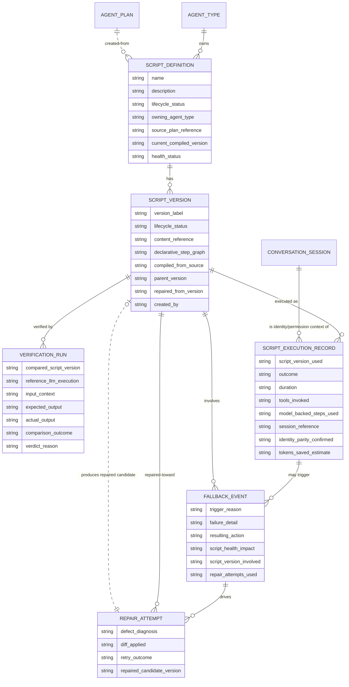

# Data Model: Software 3.0 Agent Framework — Workflow Compilation

**Related:** [prd.md](prd.md) · [spec-change.md](spec-change.md) · [architecture.md](architecture.md)
**Scope:** New business entities for the script registry, verification, compiled execution, and fallback/repair. This document is **technology-agnostic**: it describes business entities, attributes (name + meaning + cardinality), and relationships only — no table DDL, no SQL, no column types.

## 1. New Entities

### 1.1 Script Definition

A versioned, named bridge script compiled from an agent workflow — the registry's primary entity. One script belongs to exactly one **Agent Type** (the agent whose identity and permissions it inherits); an agent type may own many scripts.

- **Name / description** — human-identifiable identity of the workflow the script automates (1 each).
- **Lifecycle status** — where the script sits overall: `draft → verified → compiled → retired` (1).
- **Owning agent type** — reference to the Agent Type whose identity/permissions bound the script (exactly 1).
- **Source lineage** — reference to the implementation plan and/or observed LLM run from which it was compiled (0..1 each; G1 lineage requirement).
- **Current compiled version** — pointer to the version currently serving compiled runs (0..1; absent while draft/unverified).
- **Health status** — aggregate health derived from recent fallback behavior; degrades on repeated fallbacks (1; F4).

### 1.2 Script Version

An **immutable** revision of a Script Definition. Versioning warrants a separate entity because each version carries its own lifecycle, verification evidence, and audit history (V4).

- **Version label** — ordered identity within the parent script (1).
- **Lifecycle status** — `draft / verified / compiled / retired` for this version (1).
- **Content** — the declarative step graph (tool calls, transforms, model-backed steps) by reference — content is stored via Control Center, never in Agent Runtime (1).
- **Parent version** — the prior version this was derived from (0..1).
- **Repaired-from lineage** — when this version was produced by self-improvement, the defective version it repairs (0..1; E9). Distinct from generic parent lineage so defect-driven repair chains are auditable (E10, G2).
- **Created by** — the run or actor that produced this version (1).

### 1.3 Verification Run

The evidence record of shadow-running a Script Version against an LLM execution on identical inputs (V1, V2). Many verification runs per script version over its life; each belongs to exactly one version.

- **Compared script version** — the candidate under test (exactly 1).
- **Reference LLM execution** — the recorded LLM run used as ground truth (exactly 1).
- **Inputs, expected output, actual output** — retained comparison evidence (1 each).
- **Comparison outcome** — match / mismatch within declared tolerance (1).
- **Verdict** — promoted to compiled, or rejected back to draft with a recorded diff/reason (1; V3).

### 1.4 Script Execution Record

One execution of a compiled script (or its fallback run). Execution is **bound to the agent session**: the session reference is the identity and permission context of the run — the script's MCP tool calls carry the same dual identities as the agent (identity parity, E7/SEC1). **Invocation contract:** the identity context of the owning agent type's session is **always passed** to every script execution — the script has **no identity of its own**, no credentials, and never authenticates independently; all tool calls execute strictly under the session's identities. There is **no execution-mode attribute**: script-first execution with unconditional LLM fallback is fixed platform behavior, not configuration (E1–E3).

- **Script version used** — exactly 1.
- **Session reference** — the agent session the run is bound to; its identity/permission context (exactly 1; E7).
- **Identity parity confirmed** — evidence that the script ran under the session's dual identities, with no separate or anonymous identity (1; E7, SEC1).
- **Outcome** — success, validation failure, or fell back (1).
- **Duration** — elapsed time (1).
- **Tools invoked** — the MCP tool calls made, mirroring existing tool-call records (0..many).
- **Model-backed steps used** — semantic-bridge / decision steps that consumed model capacity (0..many; S3).
- **Token savings estimate** — LLM tokens not consumed versus LLM baseline (1; G3).
- **Repair lineage (where relevant)** — when the run is a post-repair retry, its repair attempts trace back to the defect that triggered it (0..many; E9/E10, G2).

### 1.5 Fallback Event

Recorded whenever a script run failed and execution fell back to the LLM path (F1, F2, E2). Fallback is **unconditional and mode-independent**: every automation failure — script error, tool schema mismatch, output validation failure, or repair exhaustion — always completes via the LLM path. Each event belongs to exactly one execution record and references the script version involved.

- **Trigger reason** — `execution error` / `tool schema mismatch` / `output validation failure` / `repair exhaustion` (1).
- **Failure detail** — context needed for repair (1).
- **Resulting action** — LLM completed the run; repaired candidate produced or not (1; F3).
- **Script health impact** — contribution to the owning script's health degradation (1; F4).
- **Script version involved** — the defective version (exactly 1).
- **Repair attempts used** — how many guardrail-bounded retry attempts were made within this failure episode (1; E9/E10).
- **Repair lineage** — the Repair Attempts linking the defect to the repaired candidate version, if any (0..many; E9).

### 1.6 Repair Attempt

One bounded, agent-driven repair cycle within a fallback episode (E9, E10). Many attempts may occur per fallback event, bounded by execution guardrails; exhaustion of the budget triggers unconditional fallback with reason capture (E2).

- **Defect diagnosis** — the agent's recorded diagnosis of the script defect (1).
- **Diff applied** — the change applied to produce the candidate (1).
- **Retry outcome** — success or failure of the retried script version (1).
- **Repaired candidate version** — the successor Script Version produced, if any (0..1); the candidate must re-verify (V1) before promotion.

### 1.7 Removed: Execution Mode Configuration

The previously-planned `ExecutionModeConfiguration` entity (per-agent / per-workflow `llm` / `compiled-with-fallback` / `compiled-only` setting) is **removed**. There is nothing to configure: script-first execution with unconditional LLM fallback is the single fixed strategy (E1–E3). Scripts always bind to the agent session for identity/permissions (E7); no mode-conditional execution semantics exist.

## 2. Modified Entities

No changes to existing entity *structure* are required. Existing entities are **extended in role**, not altered:

- **Agent Type** (`agents.py`) — becomes the owner of Script Definitions (new one-to-many relationship only).
- **Agent Plan** (`agents.py`) — gains a backward reference to the Script Definition(s) compiled from it (lineage).
- **Conversation Session / Agent Job** — executions may now reference a Script Execution Record for provenance; no structural change required.

Execution *records* for script runs are new entities (§1.4) rather than modifications of existing run/turn records, to keep LLM-native records untouched.

## 3. Removed Entities / Fields

- **`ExecutionModeConfiguration`** (§1.7) — removed during refinement; execution strategy is fixed platform behavior, not configuration. Must be dropped from `script_execution.py` via a follow-up Alembic migration (see §4).

No other existing entity or field is removed or repurposed.

## 4. Schema Files Needing Updates (`source.schema` = `backend/app/db/models/`)

All new entities live behind Control Center (sole DB gateway); Agent Runtime consumes registry data only via Control Center APIs. There is **no standalone admin module or page** for scripts: the registry is persisted and served via Control Center REST APIs, and its governance/consumption surface is the **Scripts tab of the Agent Type detail dialog**. New models and changes:

| File | Change |
|---|---|
| **`backend/app/db/models/script_registry.py`** *(exists)* | Hosts `ScriptDefinition`, `ScriptVersion`, `VerificationRun`, `FallbackEvent`. Add `RepairAttempt` and the `repaired_from` lineage on `ScriptVersion`. |
| **`backend/app/db/models/script_execution.py`** *(exists)* | Hosts `ScriptExecutionRecord`. **`ExecutionModeConfiguration` lives in this file and must be dropped via a follow-up Alembic migration** (see §3 / §1.7); apply per AGENTS.md migration rules (`alembic upgrade head`) before testing. |
| **`backend/app/db/models/agents.py`** | Add FK relationships on `AgentType` and `AgentPlan` to the new script entities (existing classes otherwise unchanged). |
| **`backend/app/db/models/__init__.py`** | Export the new models. |

**Related existing models referenced (not modified):** `AgentType`, `AgentPlan`, `AgentJob`, `ConversationSession` (all `agents.py` / `conversations.py`); execution logging continues via `ExecutionLogEntry` (`session_logs.py`) and tool-call provenance via `ToolCallRecord` / `RuntimeToolCall` (`tool_calls.py`). An Alembic migration under `backend/alembic/versions/` is required (see AGENTS.md migration rules).

## 5. Updates to `docs/master/data-model/`

- **`overview.md`** — add a Software 3.0 / Workflow Compilation section: introduce Script Definition, Script Version, Verification Run, Script Execution Record, Fallback Event, Repair Attempt; state they are Control-Center-owned and Agent Runtime accesses them via APIs only; note there is no execution-mode configuration.
- **`modules/agents/`** — extend the agent-type entity page with the Agent Type → Script Definitions ownership relationship and the Agent Plan → script lineage.
- **New module page `modules/workflow-compilation/`** (or a page within the closest existing module, e.g. `modules/operations/`) — the script registry ERD from §1, lifecycle rules (`draft → verified → compiled → retired`), health/fallback semantics, and verification evidence retention.
- **`modules/operations/`** (execution/audit pages) — document Script Execution Records as a first-class execution provenance kind alongside LLM runs, including outcome (script run vs fell back), duration, tools invoked, and token savings.
