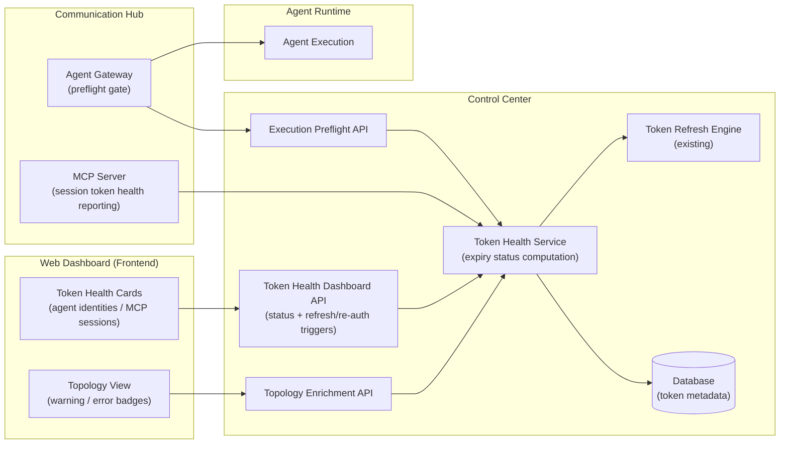
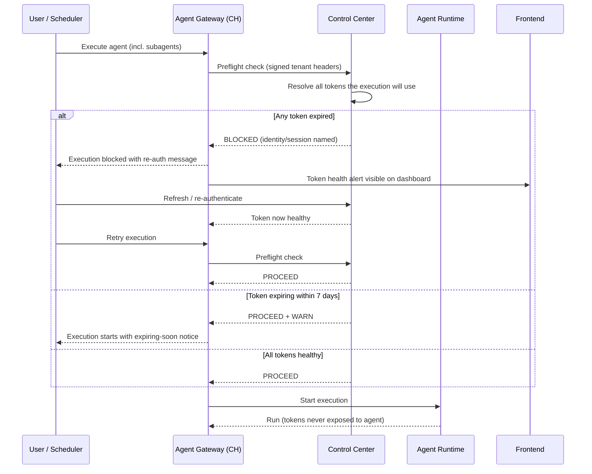

# Architecture — Token Expiry Alerting

High-level architecture impact of the Token Expiry Alerting epic. All rules from `docs/config.yaml` `top_priority_rules` are respected: three fully segregated backend services, only Control Center touches the database, and agents never receive or hold identity tokens.

## 1. Changed Components

| Component | Change |
|---|---|
| **Control Center — Token Health Service** | New: computes expiry status (`expired` / `expiring-within-7-days` / `healthy`) for agent identity tokens and MCP sessions from token metadata it already owns. Tenant-scoped. |
| **Control Center — Dashboard API** | New: token health counts/details per category; endpoints to trigger identity refresh and MCP session re-auth navigation. |
| **Control Center — Execution Preflight API** | New: validates all tokens an execution (including subagents) will use; returns block/warn/proceed outcome. |
| **Communication Hub — Agent Gateway** | Extended: calls the preflight check before starting any execution; blocks on expired, warns on expiring-soon (decision documented in §5). |
| **Communication Hub — MCP Server** | Extended: exposes session-level token health so CC can classify MCP sessions. |
| **Frontend** | Extended: token health cards (clickable → identity / MCP session pages), warning/error badges on topology containers. |

## 2. New Components

- **Token Health Service (CC)** — the single owner of token expiry state; the only component that reads token metadata from the database.
- **Execution Preflight API (CC)** — internal, signed-tenant-header endpoint consumed by the Agent Gateway.
- **Token Health Dashboard API (CC)** — tenant-scoped REST surface for the frontend (health per category + refresh/re-auth triggers).

No new deployable service is introduced; all new components live inside existing segregated services.

## 3. Integration Point Changes

| Integration | Change |
|---|---|
| CH Agent Gateway → CC (internal HTTP) | New preflight call, carried via `internal_httpx_client` with signed `X-Internal-Tenant-*` headers; fail-closed without them. |
| Frontend → CC | New token health API calls (dashboard cards, refresh/re-auth triggers). Existing topology API responses are enriched with per-container token health states. |
| CC → Identity Provider (Keycloak / Azure EntraID) | Existing automatic refresh flow extended to evaluate and persist expiry classification. |
| CC ← MCP session metadata | Session credential/identity bindings evaluated for expiry; no change to how tokens are injected per tool call. |
| Agent Runtime | No direct change: agents still never see tokens; they only receive a blocked/warned outcome via the Gateway. |

## 4. Data Flow — Execution Preflight

Key guarantees:
- **Expired ⇒ block.** The user can never discover token failure for the first time at execution time.
- **Expiring-soon ⇒ warn, not block.** Documented decision: a token still valid today should not prevent business work; the warning drives proactive remediation via the dashboard and topology surfaces.
- Agents receive only the outcome; no token material ever crosses the CH/AR boundary.

## 5. Documented Decision — Warn (not block) on Expiring-Soon

| State | Preflight outcome | Rationale |
|---|---|---|
| `expired` | **Block execution** + alert user for re-auth | Execution would certainly fail; eliminates wasted runs. |
| `expiring-within-7-days` | **Warn (non-blocking)** on execution; warning on dashboard + topology | Token is still valid; blocking would stall scheduled work unnecessarily. Risk surfaced proactively instead. |

## 6. Updates Required in `docs/master/architecture/`

- `modules/token-refresh.md` — add expiry-state classification (expired / expiring-7-days / healthy) and the Token Health Service.
- `modules/identity.md` — document token health states for agent identities and the refresh/re-auth entry points.
- `modules/mcp-hub/architecture.md` — document MCP session token health and its exposure to CC.
- `modules/communication-hub/architecture.md` — add the Agent Gateway preflight gate to the execution flow.
- `modules/agent-runtime/architecture.md` — note the preflight-blocked outcome surfaced to agents (no token exposure).
- `modules/agent-lifecycle.md` — add the execution preflight step before any execution (incl. subagents).
- `modules/dashboard.md` — add token health cards (agent identities / MCP sessions) with click-through remediation.
- `system-overview.md` — add token expiry alerting to the system capability overview.
