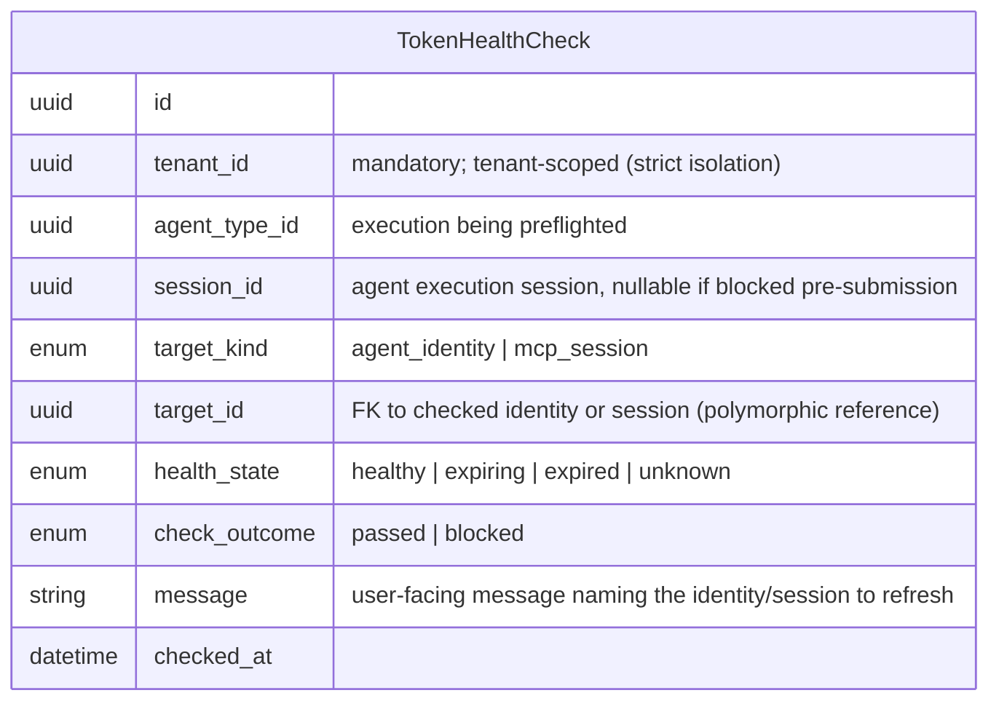
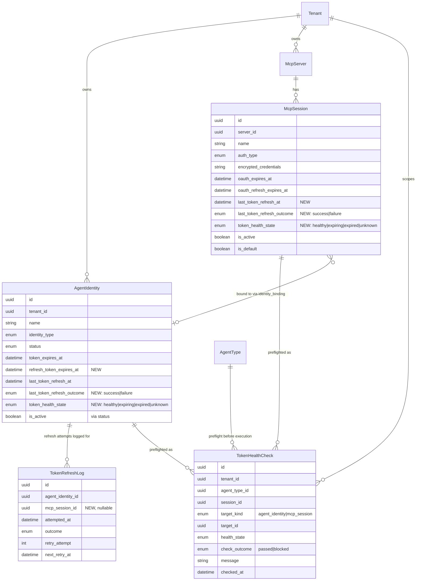

# Data Model — Token Expiry Alerting

Technology-agnostic view of the business entities affected by token expiry health tracking. Schema code lives in `backend/app/db/models/`; this document shows entities and relationships only.

Related docs: [PRD](./prd.md)

---

## 1. New Entities

### TokenHealthCheck (preflight outcome record — auditability)

One row per pre-execution token health evaluation performed by Control Center before an agent execution (including subagent token checks).

- Purpose: audit trail of preflight checks so "every expired token surfaced before a run" is provable, and blocked executions are traceable.
- `health_state` is computed at check time from token/refresh expiry timestamps; not a stored invariant.

---

## 2. Modified Entities

### AgentIdentity — add token health fields

Existing entity (`backend/app/db/models/agents.py`). Already stores encrypted tokens, `token_expires_at`, `token_status`, `last_token_refresh_at`. Modified to carry the full computed health state:

| Change | Field | Type | Purpose |
|---|---|---|---|
| New | `refresh_token_expires_at` | datetime (nullable) | Expiry of the refresh token; drives "expiring within 7 days" vs "expired" when access token can be renewed |
| New | `last_token_refresh_outcome` | enum (nullable): `success \| failure` | Outcome of the most recent automatic refresh by Control Center |
| New | `token_health_state` | enum (nullable): `healthy \| expiring \| expired \| unknown` | Computed health state surfaced on dashboard and topology; refreshed on token refresh and dashboard read |

### McpSession — add token health fields

Existing entity (`backend/app/db/models/mcp_hub.py`). Already stores `oauth_expires_at` and `oauth_refresh_expires_at`. Modified:

| Change | Field | Type | Purpose |
|---|---|---|---|
| New | `last_token_refresh_at` | datetime (nullable) | When Control Center last refreshed this session's OAuth token |
| New | `last_token_refresh_outcome` | enum (nullable): `success \| failure` | Outcome of that refresh |
| New | `token_health_state` | enum (nullable): `healthy \| expiring \| expired \| unknown` | Computed health state surfaced on dashboard and topology |

No changes to existing credential/encryption fields; token payloads remain encrypted and agent-inaccessible.

### TokenRefreshLog — no structural change

Existing audit log (`backend/app/db/models/agent_security.py`, `token_refresh_logs`) already records per-attempt outcomes for agent identities. If MCP session refreshes are routed through the same mechanism, a nullable `mcp_session_id` reference is added alongside `agent_identity_id` (exactly one set per row); otherwise the entity is unchanged.

---

## 3. Removed Entities / Fields

None. No entities or fields are dropped by this change.

---

## 4. Schema Files to Update

Per `docs/config.yaml` (`source.schema` = `backend/app/db/models/`):

| File | Change |
|---|---|
| `backend/app/db/models/agents.py` | Add `refresh_token_expires_at`, `last_token_refresh_outcome`, `token_health_state` to `AgentIdentity`; extend `AgentTokenStatus` enum values if the health state reuses it (prefer a new `TokenHealthState` enum) |
| `backend/app/db/models/mcp_hub.py` | Add `last_token_refresh_at`, `last_token_refresh_outcome`, `token_health_state` to `McpSession` |
| `backend/app/db/models/agent_security.py` | Optionally add nullable `mcp_session_id` FK on `TokenRefreshLog`; define `TokenRefreshOutcome` reuse for sessions |
| New file `backend/app/db/models/token_health.py` | `TokenHealthCheck` entity + `TokenHealthState` / `TokenCheckOutcome` enums |
| `backend/app/db/models/__init__.py` | Export the new model so autogenerate detects it |

---

## 5. Updates to `docs/master/data-model/`

| File | Update |
|---|---|
| `docs/master/data-model/modules/identity/entities.md` | Add the three new `AgentIdentity` token-health attributes to the Identity/agent-identity erDiagram block; add `TokenHealthCheck` entity and its relationship to AgentIdentity |
| `docs/master/data-model/modules/mcp-hub/entities.md` | Add the three new `McpSession` token-health attributes to the McpSession erDiagram block |
| `docs/master/data-model/modules/security/entities.md` | Add `TokenHealthCheck` (preflight audit) alongside existing `TokenRefreshLog` / certificate audit entities |
| `docs/master/data-model/overview.md` | One-line note under the relevant domain summary: token expiry health tracking exists for agent identities and MCP sessions (healthy / expiring ≤7 days / expired) |

Keep module docs reference-based — entity lists + source file pointers, no schema code.

---

## Relationship Summary (full view)

**Source files**: `backend/app/db/models/agents.py`, `backend/app/db/models/mcp_hub.py`, `backend/app/db/models/agent_security.py`
