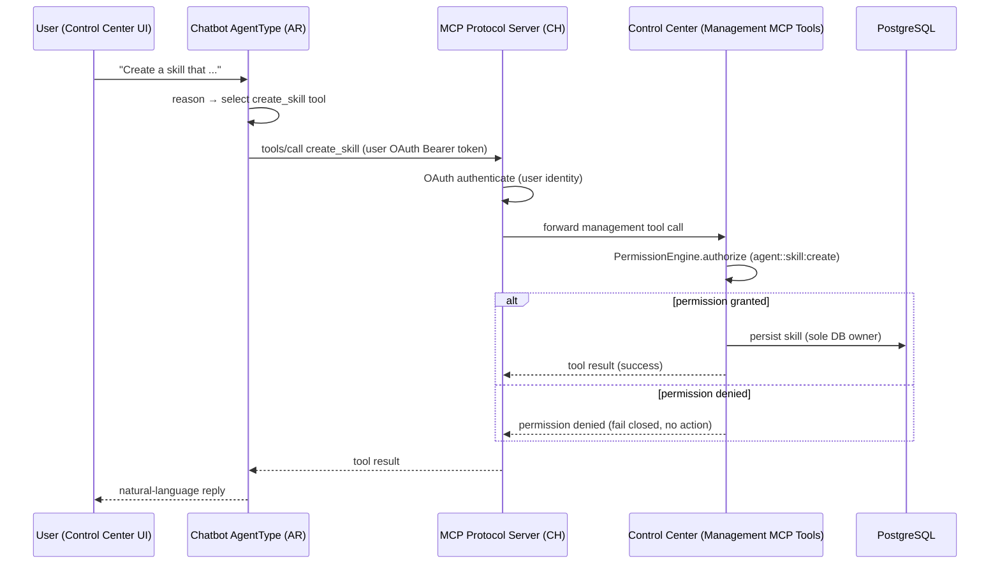

# Architecture Changes: Control Center Assistant (Chatbot)

A conversational assistant embedded in the Control Center web UI that performs Agents-menu management tasks (create / update / configure / read of skills, SOPs, agent types, roles, identities, model configurations, schedules, MCP Hub connections, data types) through natural language.

The assistant is a **normal agent, not a special delegated actor**: its management capabilities are exposed as **MCP tools on the existing Communication Hub MCP protocol server** (`/mcp`), and the MCP session is authenticated via **OAuth/OIDC using the user's own Bearer token**. Because the session authenticates as the user, the permission scope *is* the user's scope — resolved by the existing permission engine against the same `agent::*` (and `integration::mcp_hub`) resource types. There is no elevated path, no separate delegation machinery, and deletion is simply never registered as a tool.

One tool surface serves two consumers: the in-app chatbot (a conversational `AgentType` running in Agent Runtime) and any external MCP client a user connects with their own OAuth credentials — both invoke the same management MCP tools.

This change is additive and honors the platform's top-priority segregation rules: agents execute only in Agent Runtime, only Control Center connects to PostgreSQL (management MCP tool execution lands on CC), and agents never touch sensitive data (identity tokens, DB credentials, decrypted MCP credentials).

## 1. Changed Components

- **Control Center (CC, :8000)** — sole DB owner, boundary unchanged. Gains a set of **management MCP tools** (create / update / read for Agents-menu resources plus MCP Hub connections), registered in `SystemToolRegistry` (`backend/app/services/agents/system_tool_registry.py`). Tool execution lands on CC and is authorized by the existing `PermissionEngine` against `agent::*` and `integration::mcp_hub`. No delete tools are registered; no new DB access path is introduced.
- **Communication Hub (CH, :8002)** — extends the existing MCP protocol server (`backend/app/communication_hub/mcp/protocol_server.py`) with an **OAuth/OIDC Bearer-token auth path**, parallel to the existing API-key auth (`backend/app/communication_hub/middleware/api_key_auth.py`). The management tools flow through the existing permission-filtered catalog (`tool_registry_bridge.py`) like every other tool.
- **Agent Runtime (AR, :8001)** — hosts the chatbot as a seeded conversational `AgentType` whose tools are the management MCP tools. It calls the MCP server like any other MCP client carrying the user's OAuth identity; it has no direct path to CC or the DB.
- **Control Center Web UI** — embeds the assistant using the existing `ConversationDialog` conversational UI (`frontend/src/components/agents/ConversationDialog.tsx`); additive to, not a replacement of, the existing Agents-menu forms/dialogs.
- **Conversation Session** — reused for multi-turn context and per-turn visibility via the existing conversational channel (`backend/app/api/ws/chat.py`); no longer a delegation anchor (identity comes from the OAuth session, not `triggered_by_user_id`).

## 2. New Components

```mermaid
flowchart LR
    subgraph UI["Control Center Web UI"]
        CP["Assistant Chat Panel"]
    end
    subgraph AR["Agent Runtime :8001"]
        CT["Chatbot AgentType<br/>(conversational agent)"]
    end
    subgraph CH["Communication Hub :8002"]
        MPS["MCP Protocol Server (/mcp)"]
        AUTH["OAuth / API-Key Auth Middleware"]
        TRB["ToolRegistryBridge<br/>(permission-filtered catalog)"]
    end
    subgraph CC["Control Center :8000"]
        MMT["Management MCP Tools<br/>(create / update / read)"]
        STR["SystemToolRegistry"]
        PE["Permission Engine<br/>(agent::*, integration::mcp_hub)"]
        DB[("PostgreSQL")]
    end
    EC["External MCP Client<br/>(user's own OAuth credentials)"]

    CP -->|conversation turn| CT
    CT -->|tools/call (user OAuth token)| MPS
    EC -->|tools/call (user OAuth token)| MPS
    MPS --> AUTH
    AUTH --> TRB
    TRB -->|management tool execution| MMT
    MMT -.->|registered in| STR
    MMT -->|authorize| PE
    MMT -->|persist (sole DB owner)| DB
```

- **Assistant Chat Panel** — conversational UI surface inside the Control Center web UI (reuses `ConversationDialog`).
- **Chatbot AgentType** — a seeded conversational `AgentType` whose tools are the management MCP tools; executes in AR and calls the MCP server as a normal MCP client carrying the user's OAuth identity.
- **Management MCP Tools** — MCP tools on CC for create / update / read of Agents-menu resources (skills, SOPs, agent types, roles, identities, model configurations, schedules, data types) and MCP Hub connections. No delete tools are registered.
- **OAuth / API-Key Auth Middleware** — parallel auth paths on the MCP server: OAuth/OIDC (user's Bearer token, the identity plane) alongside the existing API-key auth; both resolve to the same downstream permission resolution.
- **External MCP Client** — any MCP-capable agent/client a user connects with their own OAuth credentials; an alternate consumer of the identical management MCP surface.

## 3. Integration Points

- **New — OAuth/OIDC Bearer-token auth on the MCP server (CH):** add a Bearer-token auth path to the existing MCP protocol server, parallel to `ApiKeyAuthMiddleware`. The MCP session authenticates as the *user*, so its permission scope is the user's scope; both auth paths feed the same downstream permission resolution and permission-filtered catalog (`tool_registry_bridge.py`). There is no agent-API-key path for management tools.
- **New — Management MCP tool registration (CC):** register the management tools in `SystemToolRegistry` so they are exposed through the MCP server's permission-filtered catalog. Every tool call is authorized by the existing `PermissionEngine` against `agent::*` (and `integration::mcp_hub`) resource types declared in `backend/app/core/resource_types.py`; no separate delegation machinery and no elevated path.
- **Reused — Conversational channel:** the chatbot uses the existing WebSocket chat endpoint (`backend/app/api/ws/chat.py`) and `ConversationSession` for multi-turn context and per-turn visibility (thinking/working indicators).
- **Cross-cutting — OTEL:** all AR/CH/CC hops for management MCP tool calls remain OTEL-instrumented per the existing inter-service telemetry convention.

## 4. Data Flow Changes



## 5. Master Arch Update Instructions

- `docs/master/architecture/system-overview.md` — add a short "Control Center Assistant" section under Key Responsibilities noting the assistant as a seeded conversational `AgentType` whose management actions are MCP tools on the existing MCP server, authenticated via OAuth and resolved against the user's permission scope.
- `docs/master/architecture/modules/control-center/` — document the management MCP tools and their registration in `SystemToolRegistry` as a new CC capability alongside the existing system tools.
- `docs/master/architecture/modules/communication-hub/` — note the OAuth/OIDC Bearer-token auth path on the MCP protocol server (parallel to API-key auth) feeding the permission-filtered catalog.
- `docs/master/architecture/modules/agent-runtime/` — note the Control Center Assistant as a hosted conversational agent whose toolset is the management MCP tools.
- `docs/master/architecture/security/` — note the OAuth identity-plane model (MCP session authenticates as the user; scope equals the user's scope; no elevation) and the explicit no-delete boundary (delete is simply not registered as a tool).
