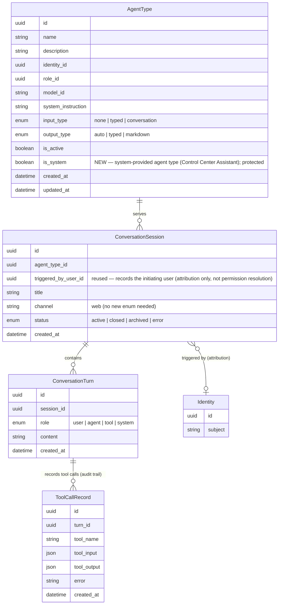

# Data Model Changes: Control Center Assistant (Chatbot)

## Delta Summary

The Control Center Assistant is **not a new business entity** — it is a seeded, system-provided conversational `AgentType` that performs Agents-menu management operations. Those management operations are now exposed as **MCP tools authenticated via OAuth/OIDC** (the user's own Bearer token) on the existing CH MCP protocol server: the in-app chatbot is a seeded conversational `AgentType` that invokes those tools, and external MCP clients can invoke them too. Permission resolution (against the authenticated user) is identical for both.

Because the OAuth MCP session authenticates as the user directly, there is **no delegation-specific persistence** — no `triggered_by_user_id` resolution hop and no delegated-permission-scope field or entity. Permission scope is the OAuth-authenticated user identity, resolved at runtime by the permission engine (no new schema).

The honest delta is therefore **minimal — a single new boolean flag** on `AgentType` to mark it as protected/system-provided, plus a set of explicit "no schema change" determinations for the permission-scope and audit requirements.

---

## 1. New Entities

**None.**

The assistant reuses the existing entities end-to-end:

- The assistant itself → `AgentType` (conversational: `input_type = conversation`), with its management scope and "no deletion" policy encoded in `system_instruction` and its bound MCP tools.
- The conversation → `ConversationSession` + `ConversationTurn`.
- The audit trail of every management action → `ToolCallRecord` (per-turn) and `RuntimeToolCall` (runtime).
- The permission scope → the OAuth-authenticated user identity (the Bearer token on the MCP session), resolved at runtime by the permission engine — not persisted as a delegation field.

The management operations the assistant performs (create/update/configure across the Agents menu and MCP Hub connections) are **MCP tools on the existing CH MCP protocol server**, not database entities — consistent with the platform's existing MCP tool surface.

---

## 2. Modified Entities

### 2.1 `AgentType` — ADD `is_system` flag

Add a boolean flag marking the agent type as a protected, system-provided resource. The seeded Control Center Assistant is the first (and currently only) system agent type.

| Field | Type | Change | Notes |
|---|---|---|---|
| `is_system` | `boolean` | **Added** | Default `false`. `true` marks a system-provided agent type (e.g. the Control Center Assistant) that the UI surfaces specially and that users cannot arbitrarily modify or delete. |

This mirrors the existing project convention for system-provided resources (`Skill.is_system`, `Role.is_system`, `DecisionTool.is_system`), rather than introducing a new enum. A boolean is sufficient at this stage because there is exactly one system assistant and the flag's only responsibilities are: UI recognition + protection from user edit/delete. If a second distinct kind of system agent ever appears, an `assistant_kind` enum can supersede this flag.

### 2.2 Reused entities — explicitly NO schema change

After inspecting the actual schema, the following PRD requirements are already satisfied by existing columns and require **no new fields, entities, or tables**:

- **`ConversationSession.triggered_by_user_id`** — still records the initiating user's `Identity` for attribution/audit only. It is **not** the permission-resolution mechanism: the assistant's management operations are MCP tools authenticated via the user's own OAuth/OIDC Bearer token, so permission scope is the authenticated user identity resolved at runtime by the `PermissionEngine` (the `agent::*` resource-type namespace) — never a separate privileged identity. No delegated-permission field or entity is needed.
- **`ToolCallRecord`** — already persists `tool_name`, `tool_input`, `tool_output`, and `error` per conversation turn, giving a per-turn audit trail of every management action the assistant performs on the user's behalf. No new audit entity is needed.
- **`RuntimeToolCall`** — already logs runtime tool executions (`route_type` = `system | mcp | a2a`) for the runtime topology/monitor. No change.
- **`Identity` / `Role` / `Permission` / `PolicyStatement`** — the permission model already supports the `agent::*` resource-type namespace and wildcard grants; the assistant's "no elevation" rule is enforced by the existing `PermissionEngine` at runtime (against the OAuth-authenticated user), not by schema.
- **`channel`** (on `ConversationSession`) — a free string with default `web`; the assistant's Control Center sessions reuse `web` with no new enum value or column.

---

## 3. Removed Entities / Fields

**None.** No entities or fields are removed by this change.

---

## 4. Schema File References

The only schema file that changes is:

| File | Change |
|---|---|
| `backend/app/db/models/agents.py` | Add `is_system` boolean column to `AgentType` (default `False`, non-null). |

The following files are **unchanged** (the assistant reuses their existing entities):

- `backend/app/db/models/conversations.py` — `ConversationSession`, `ConversationTurn`, `ToolCallRecord` (reused as-is).
- `backend/app/db/models/tool_calls.py` — `RuntimeToolCall` (reused as-is).
- `backend/app/db/models/skills.py`, `backend/app/db/models/identity.py` — reference only.

---

## 5. Master Data Model Update Instructions

Update the following master docs to reflect the new `AgentType.is_system` flag:

1. **`docs/master/data-model/overview.md`**
   - In the **Agent Management** section, add `boolean is_system "system-provided agent type (e.g. Control Center Assistant); protected from user edit/delete"` to the `AgentType` entity block (both the main diagram and the `Agent Execution Data Flow` snippet where the entity appears).
   - Optionally add one line to the Agent Management prose noting that the Control Center Assistant is a seeded `AgentType` with `is_system = true`.

2. **`docs/master/data-model/modules/agents/entities.md`**
   - Add `boolean is_system` to the `AgentType` entity block in the ER diagram.
   - Extend the `AgentType` row in the entity description table to mention the `is_system` flag.
   - Add a business rule: *System-provided agent types (`is_system = true`, e.g. the Control Center Assistant) are protected — the UI surfaces them specially and users cannot modify or delete them.*

No updates are required to `docs/master/data-model/modules/communication/entities.md` — the conversation/turn/tool-call entities are unchanged. Permission scope is the OAuth-authenticated user identity resolved at runtime (no schema), and the assistant's attribution/audit behavior is already covered by the existing `triggered_by_user_id` and `ToolCallRecord`/`RuntimeToolCall` semantics documented there.
