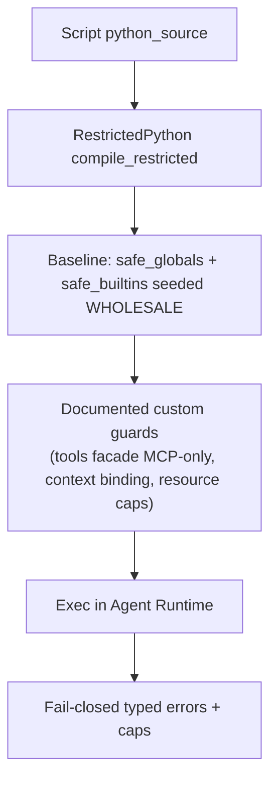
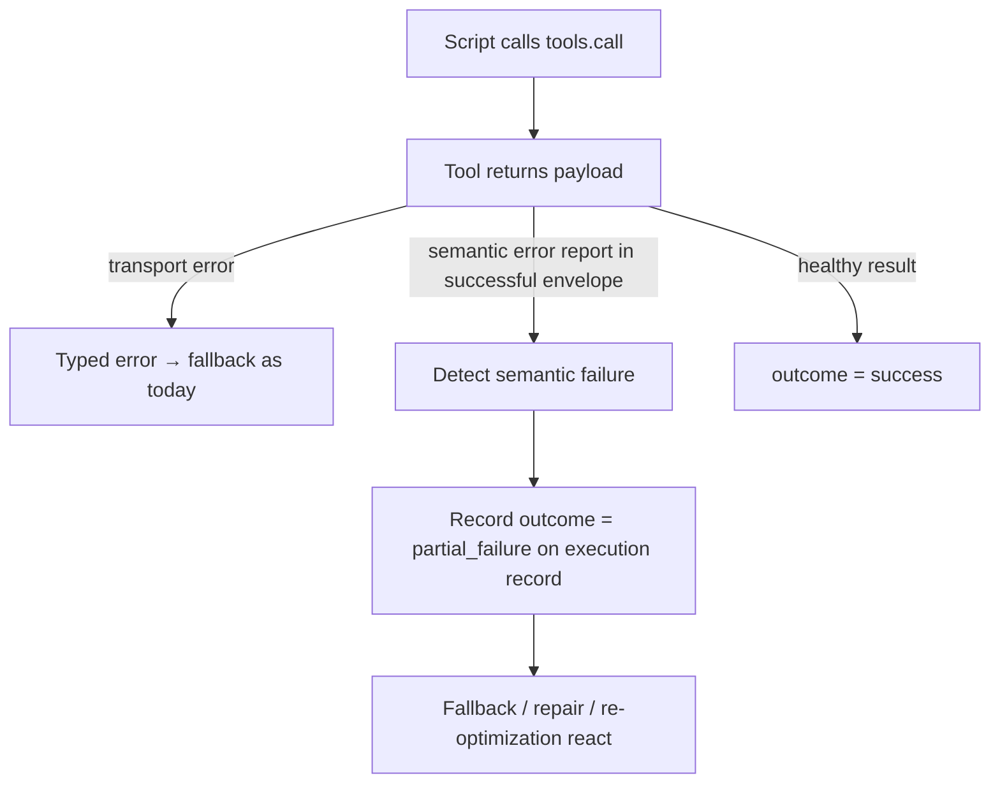
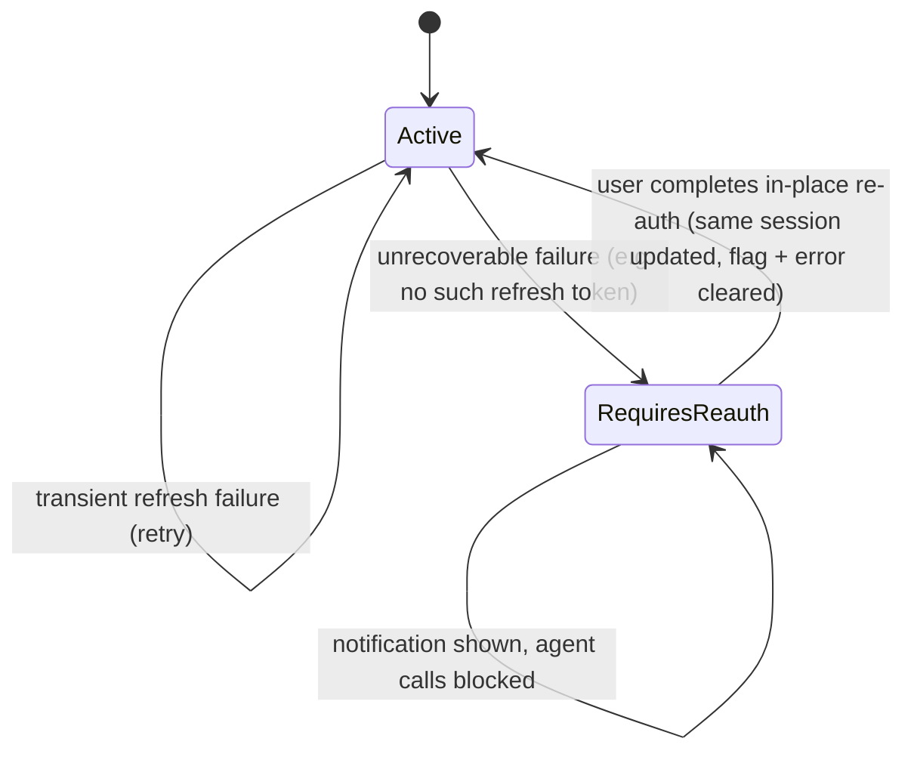
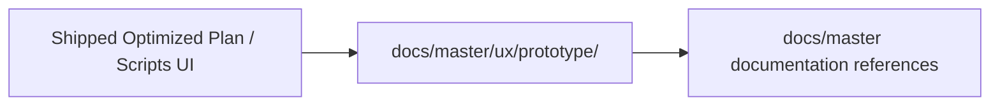

# Architecture: Sandboxed Scripting Follow-ups

No architectural boundaries change: three services remain fully segregated, the sandbox runs only in Agent Runtime, only Control Center touches the database. This change alters sandbox baseline construction, outcome semantics, and adds a session health state.

## 1. Sandbox Baseline Construction

One audited baseline replaces incremental guard-hook patching; `_unpack_sequence_` / `_inplacevar_` come from the baseline. Every layering on top of the baseline must appear in the capability contract and have a test.

## 2. Tool-Error Propagation (Outcome Semantics)

## 3. OAuth Re-auth State Machine (McpSession)

Detection lives in the refresh path; the in-place re-auth fix already exists — this adds detection, the flag, and the UX.

## 4. Master UX Prototype Placement

## Master Architecture Update Instructions

Post-implementation, update `docs/master/`:

1. `modules/sandboxed-scripting.md` (or the sandbox module page): replace "allowlisted builtins" description with the baseline-seeding model; list the documented custom guards.
2. Execution-lifecycle documentation: add the `partial_failure` outcome and its reaction paths (fallback, repair, re-optimization).
3. MCP Hub module docs: document `requires_reauth` session state, the user-facing re-auth prompt, and the in-place re-auth flow.
4. Optimized Plan documentation: failure-reason (`error`) visibility in the tab; retire "nothing to retire" state.
5. Reference `docs/master/ux/prototype/` from the relevant UX documentation sections.
