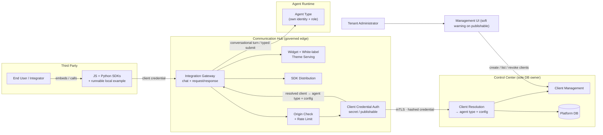
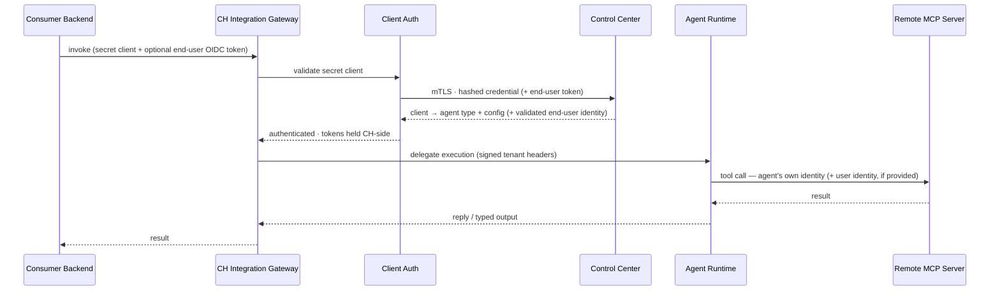

# Architecture: Third-Party Agent Integration

Third-party traffic enters **only** through Communication Hub's governed surface. The change introduces a new primitive — the **client** — that grants access to an agent type's *input interface* (conversation turn or typed submit). A client carries a credential of type `secret` (server-to-server) or `publishable` (browser-safe). This is **separate** from the existing **API key**, which authenticates *as* an agent identity (+ role) for MCP tool access and is unchanged. Because a client is not an identity, there is no agent-identity abuse surface: it cannot list/call tools, cannot reach the MCP hub, and cannot impersonate an agent. The target agent type runs with its own identity + role exactly as configured.

## 1. Changed Components

- **Communication Hub (CH)** — gains the public `/integrate/*` surface (conversational chat, typed request/response, white-label widget/theme serving, SDK distribution). Client credentials are validated against Control Center over mTLS and resolved to `(client → agent type + config)`; a client credential yields **no agent identity token** (it is not an identity), and a `secret` client may additionally carry an optional end-user token (server-side dual identity).
- **Control Center (CC)** — gains **client management**: create/list/revoke clients bound to an agent type, with credential type (`secret`/`publishable`), white-label theme, allowed origins, and rate limit. Extends its internal validation endpoint to resolve a client credential → agent type + config. The existing API-key validation and agent-identity machinery are unchanged.
- **Agent Runtime (AR)** — unchanged. The invoked agent type runs with its own identity + role; its tool calls forward its own identity as today.
- **Management UI** — the **agent type detail dialog gains a "Clients" tab** (create/list/revoke, `secret` vs `publishable`, theming/origins/rate limit, embed snippet) with a **soft warning** when creating a `publishable` client; also reachable as a global `/clients` page.

## 2. New Components



## 3. Integration Points

| Integration | Type | Description |
|---|---|---|
| Third Party → CH `/integrate/chat` (client credential) | New | Conversational turn; streamed replies with heartbeats and error turns |
| Third Party → CH `/integrate/submit` (client credential) | New | Typed input → validated `AgentOutput` (validation status + raw-output fallback) |
| Third Party → CH widget / SDK serving | New | White-label widget assets + per-client theme config; JS/Python SDK artifacts + runnable example |
| CH → CC client validation (mTLS) | New | Resolve client credential → agent type + config (no identity token for `publishable`) |
| CH edge → origin + rate limit | New | Secondary controls enforced at the edge from per-client config |
| CH → AR execution | Changed | Existing signed internal path now also carries client-invoked agent-type execution |

## 4. Data Flow Changes

### Client invocation (conversational widget, publishable client)

```mermaid
sequenceDiagram
    participant EU as End User
    participant SDK as JS SDK / Widget
    participant GW as CH Integration Gateway
    participant AUTH as Client Auth
    participant CC as Control Center
    participant AR as Agent Runtime

    EU->>SDK: open widget / send message
    SDK->>GW: conversational turn (client credential)
    GW->>AUTH: validate client credential
    AUTH->>CC: mTLS · hashed credential
    CC-->>AUTH: resolved client → agent type + config (no identity token)
    AUTH-->>GW: authenticated
    GW->>AR: delegate turn (signed tenant headers; agent type runs as itself)
    loop turn in flight
        AR-->>GW: status / thinking / tool use
        GW-->>SDK: stream reply + heartbeats
    end
    AR-->>GW: reply (or guardrail/timeout error turn)
    GW-->>SDK: reply on live session
```

### App-to-app with optional dual identity (secret client, server-to-server)



Dual identity is **server-to-server only**: the end-user token is passed by the consumer's backend with the `secret` client, tenant-matched, held CH-side, and forwarded only to MCP servers whose sessions are configured for passthrough/dual identity. The `publishable` (browser) client path carries **no** user identity.

## 5. Master Arch Update Instructions

- **`docs/master/architecture/system-overview.md`** — add third-party agent integration as a client-based external path (distinct from API-key identity auth) entering through the Communication Hub governed surface.
- **`docs/master/architecture/modules/communication-hub/architecture.md`** — document the integration gateway, widget/SDK/theme serving, and the client-credential path (`secret`/`publishable`).
- **`docs/master/architecture/security/api-key-security.md`** — distinguish the two credential classes: API keys (identity auth, MCP tools) vs clients (agent-type input-interface access); note clients cannot impersonate an identity.
- **`docs/master/architecture/modules/agent-types.md`** — note that an agent type may be exposed to third parties through one or more clients.
- **`docs/master/architecture/modules/multi-tenancy.md`** — add that clients and their credentials are tenant-scoped under strict isolation.
- **New** `docs/master/architecture/modules/third-party-agent-integration/architecture.md` — module-level diagram of the client model and the two credential types (≤15 nodes, Mermaid only).
