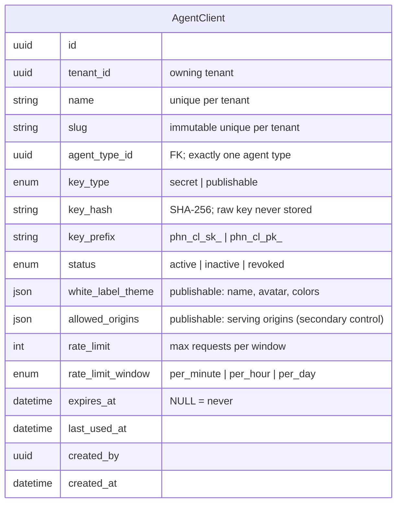
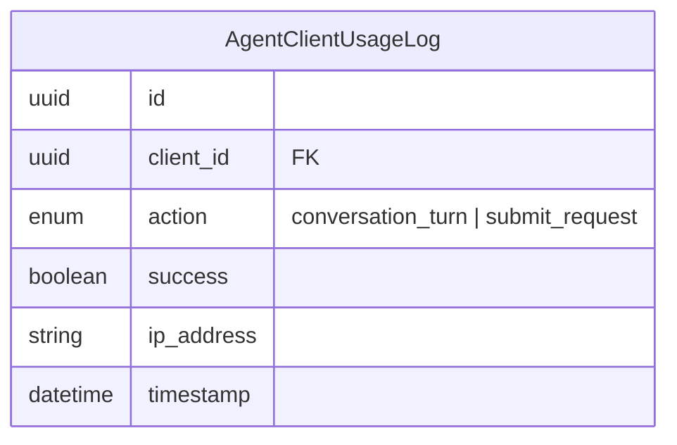
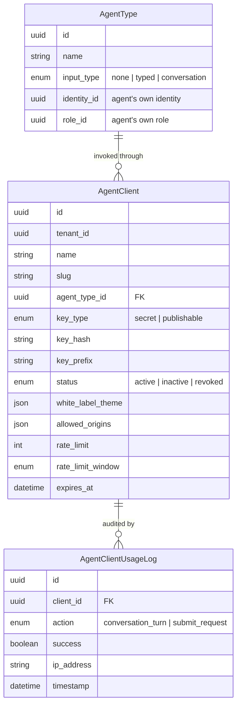

# Data Model: Third-Party Agent Integration

Business-entity model for letting third-party systems invoke Parthenon **agent types** through **clients** — a client is an access grant to an agent type's *input interface* (conversation turn or typed submit), not an identity. This is separate from the existing **API key**, which authenticates *as* an agent identity (with a role) for MCP tool access. The two primitives are deliberately distinct.

- A **client** is bound to exactly one **agent type**; a tenant can create many clients per agent type.
- A client carries a credential of type `secret` (server-to-server) or `publishable` (browser-safe).
- A client grants **input-interface-only** access: it cannot list/call tools, cannot reach the MCP hub, and cannot impersonate an agent identity.
- The agent type runs with its own identity + role exactly as configured; exposing it is the tenant's decision and risk.

No SQL DDL, ORM classes, indexes, or constraints — schema files are the source of truth.

---

## 1. New Entities

### `AgentClient`

A tenant-owned access grant to one agent type. `key_type` is immutable once created.

### `AgentClientUsageLog`

Append-only audit record for each client invocation (success and failure), never storing the credential value.

---

## 2. Modified Entities

### `AgentType`

No field change. Gains a one-to-many relationship: `AgentType 1:N AgentClient` (a type may be exposed through many clients). The type's `input_type` selects the integration surface — `conversation` → chat widget, `typed` → request/response.

### Explicitly NOT modified (rationale)

- **`AgentIdentity`** — unchanged. No anonymous identity type is introduced. The client is not an identity; it invokes an agent type that runs with its own (existing) identity + role.
- **`AgentApiKey`** — unchanged. API keys continue to authenticate *as* an agent identity + role for MCP tool access (local agents such as OpenCode/Cursor). Clients are a separate table and a separate credential class.
- **`AgentRole`** — unchanged. A client does not carry a role; the target agent type's own role governs its tool permissions.

---

## 3. Removed Entities / Fields

None. Earlier drafts' `IntegrationApplication`/`IntegrationCredential`/… and the anonymous-identity approach are **not** introduced — superseded by the `AgentClient` entity.

---

## 4. Schema File References

- **New `backend/app/db/models/agent_client.py`** — `AgentClient`, `AgentClientUsageLog`, and their enums.
- **`backend/app/db/models/agents.py`** — add the `AgentType` → `AgentClient` relationship (no column change).
- No changes to `agent_api_key.py`, `identity.py`, `role.py`, `mcp_hub.py`, or `tenant.py`.

Migration: generate with `alembic revision --autogenerate` (project convention — never raw `ALTER TABLE`).

---

## ER Diagram (new + related entities)

**Business rules:**

- A `publishable` client is safe to embed in a browser because it only grants "invoke this one agent type's input interface" — it is not an identity and cannot be used to list/call tools or impersonate an agent.
- A `secret` client is server-side; the consumer's backend controls input and may optionally pass an end-user identity (dual identity) which is validated and tenant-matched.
- Rate limits are enforced per client; origin checks are a secondary anti-abuse/branding control.
- Third parties never receive identity tokens, database credentials, or decrypted secrets.
- Creating a `publishable` client for an agent type exposes that type's full behavior publicly — surfaced to the tenant via a soft warning (no hard block).

---

## 5. Master Data Model Update Instructions

- **`docs/master/data-model/modules/agents/entities.md`** — add `AgentClient` and `AgentClientUsageLog` (and the `AgentType 1:N AgentClient` relationship) to the agents module.
- **`docs/master/data-model/overview.md`** — add the new entities and the `AgentType → AgentClient` relationship to the cross-domain relationship map.
- **`docs/master/data-model/modules/security/entities.md`** — cross-reference that clients are a separate credential class from `AgentApiKey` (no duplication).
