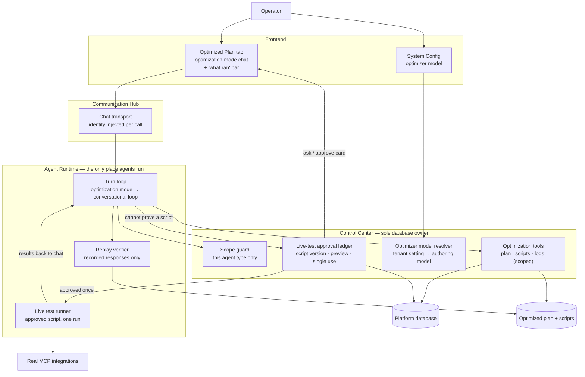
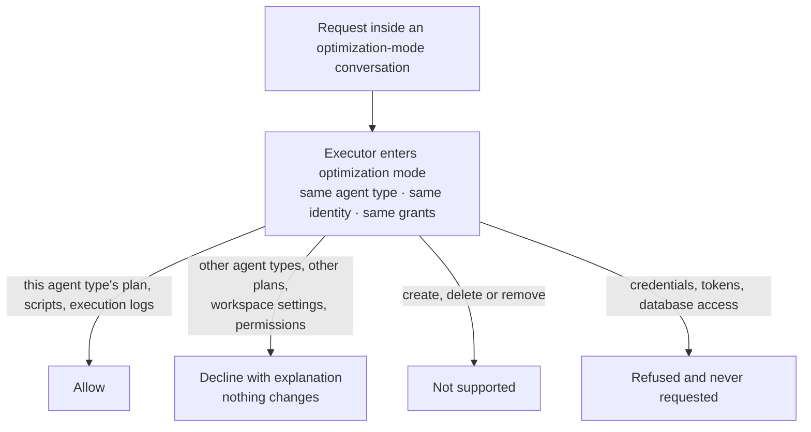
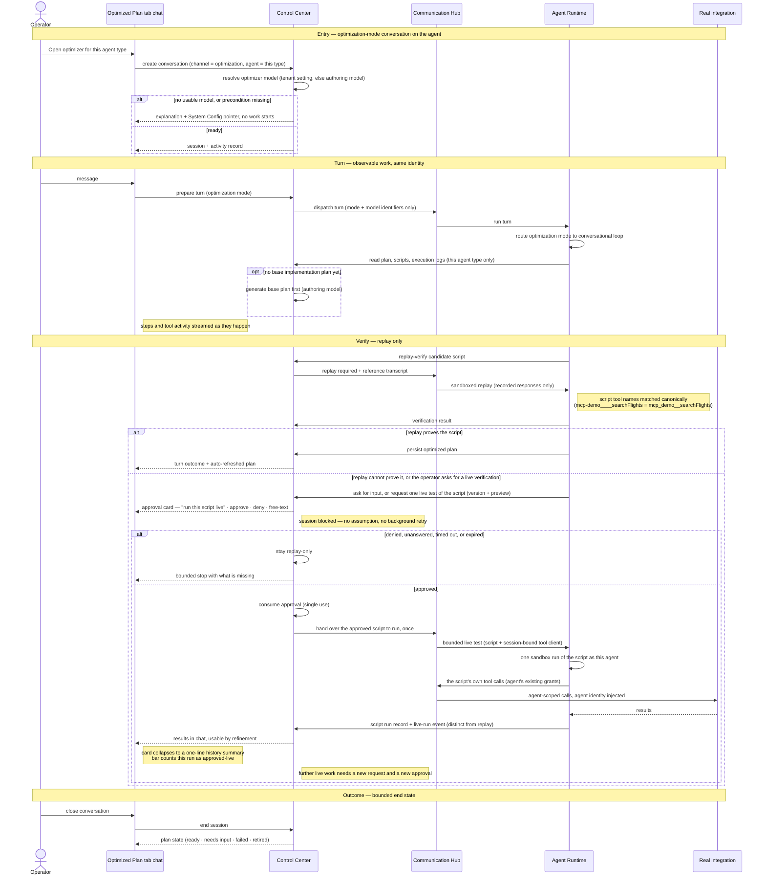
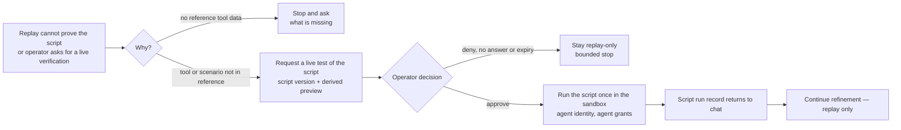
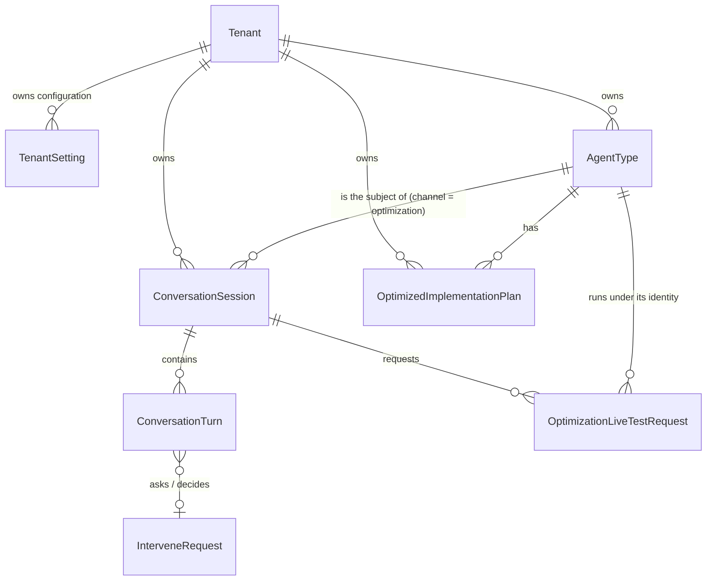

# Architecture: Conversational Optimizer

Today optimization is a one-shot command with post-hoc feedback: the operator triggers Optimize, a single mission runs unseen, and a replay gap ends as a written "needs feedback" reason that can only be resolved by re-optimizing blindly. This epic makes the optimizer **conversational, as an optimization-mode conversation on the agent type itself** (the *avatar* model): the operator opens a chat from that agent type's Optimized Plan tab, the agent type shows its work, asks when it is blocked, and can run **one explicitly approved live test** when replay alone cannot prove a script. Replay stays the default; a live test runs **one approved script version** exactly once and never repeats. Optimization runs on its own tenant-scoped model setting that falls back to the workspace plan-authoring model.

There is no separate optimizer agent: no seeded agent type, no second identity or role, and no permission bridge. The conversation is the subject agent type running in an optimization mode — same identity, same role, same tool grants — so scope is inherent rather than assigned. The design reuses existing machinery rather than adding a parallel stack: the conversational session/turn runtime with durable interrupt/resume, the optimization system tools, and the replay-only verifier from `separate-optimization-from-execution`. All top-priority rules hold: three segregated services; agents and scripts execute only in Agent Runtime; only Control Center touches the database; agents never receive sensitive data (identity tokens are held by Communication Hub and injected per tool call).

---

## 1. Components

| Component | New / Changed | Responsibility |
|---|---|---|
| **Optimization-mode conversation** | New | A `ConversationSession` on the subject agent type, marked `channel = "optimization"`. The channel is a free string, so the scope needs no new field: the session's own agent type *is* the subject, and the same identity, role, and tool permissions carry over from a business run. |
| **Optimization chat surface** | New | The Optimized Plan tab of an agent type mounts the existing chat experience (activity, waiting, inline requests, session controls, history) as that agent type's optimization-mode conversation. Unavailable when no agent type is selected; unavailable-with-explanation when a precondition is missing. |
| **Session-run summary bar** | New | The only chrome above the transcript: a compact, default-collapsed **"What ran in this session"** bar showing replay versus approved-live counts and the replay-only state, expanding to the full audit detail. No persistent scope header; business and assistant conversations render nothing. |
| **Optimization mode** | New | Inside an optimization-mode conversation the optimization mission replaces the agent's business system instruction and skills, and the optimization system tools are injected. The agent's granted tools remain available only for an approved live test — never as an unsupervised path. |
| **Turn routing** | Changed | The executor chooses its loop from the session's mode: an optimization-mode conversation always runs the conversational loop, whatever the agent type's input type. Normal business runs keep today's routing unchanged. |
| **Scope guard** | New | Enforces the inherent scope server-side: only this agent type's plan, scripts and execution logs. Other agent types, other plans, workspace settings, permissions, deletion and credentials are refused with an explanation. Never prompt-only. |
| **Ask/decide card** | New (chat-native) | Uses the existing conversational interrupt/resume mechanism to pause a turn and surface approve / deny / free-text. Explicitly **not** the interventions dashboard: no queue, no cross-session list. |
| **Live-test approval ledger** | New | Records the **script version under test**, a server-derived tool-call **preview**, the operator decision, and the single **script run record** (result, duration, tool calls, telemetry), tied to tenant, agent type, and conversation. Owns the single-use markers that make a replayed approval a no-op. Backs the script-based approval card, which collapses to a one-line history summary once decided. |
| **Live test runner** | New | Executes the approved script **once** in the sandbox with the live, session-bound tool client, under the agent's own identity, role and tenant, and returns the script run record to the conversation. MCP tools are assumed to work; there is no per-operation execution. Deny, silence, timeout, or expiry keeps the session replay-only. |
| **Replay verifier** | Unchanged | Reference-transcript replay only: the recorded reference transcript replayed with an exact tool + arguments match. A miss or absent reference data is a terminal `needs_user_input` stop — never a live fallback, never a retry loop. |
| **Optimizer model setting** | New | A tenant setting holding the optimizer model id. Unset resolves to the existing plan-authoring model; a disabled/removed selection is a hard "not configured" state with no substitution. Never the agent's runtime model. |
| **System Config** | Changed | Exposes the optimizer model choice alongside the authoring model, states workspace scope and the fallback rule, and points to the fix when no usable model exists. |
| **Execution history** | Changed | Approved live script runs are recorded with their script run record, attributed to the agent identity plus the operator, and rendered as distinguishable from replay/verification work. |
| **One-shot Optimize** | Unchanged | The existing gated Optimize action and its `ready` / `needs_feedback` / `failed` outcomes keep working exactly as before. |

## 2. System Architecture

The optimizer is not a separate actor: it is the agent type itself, entered in optimization mode. It reads its own plan, scripts and logs through scoped optimization tools, writes only through the plan-persistence tool, and reaches a real integration only through an approved live test routed CC → CH → AR under its own identity. That live test runs the approved **script** once with a live, session-bound tool client — the ledger keeps only the derived tool-call preview and the single script run record, so no tool call is consented to or executed individually.

### 2.1 Inherent scope — one agent type, nothing else

Scope is not a stored assignment: the conversation's own agent type is the subject, so there is nothing to widen. Reconnects, resumes, and model changes cannot change it, a prompt-injected or drifting turn cannot extend it, and no other agent type can become the subject of that session. Optimization changes that agent type's plan and scripts only — its identity, role, and tool grants are untouched, and its normal business runs are unaffected.

## 3. Data Flow — Optimize → Chat → Ask/Approve → Verify → Plan

Every session ends in one of three bounded states — a ready plan, an explicit needs-input stop, or an explicit failure — and a session can never accumulate live access: each live test is a fresh request for one script version, so no "always allow" state exists to inherit. The "What ran in this session" bar stays collapsed by default and expands to the audit of those replay and live counts.

### 3.1 Safe stop instead of loop

The turn never forces a match by retrying; a live test of the script is the only escape from an unprovable script, and it requires a human decision.

## 4. Integration Points

| Integration | Change |
|---|---|
| UI → CC (open conversation) | Creates an optimization-mode conversation on the selected agent type; refuses with an explanation when no agent type is selected, a precondition is missing, or the operator lacks permission to optimize/view that agent type. |
| UI → CC (chat turns) | Reuses the existing prepare-turn / append-turn flow and chat transport; the optimization channel marks the mode. Messages steer refinement; the manual feedback box remains available beside it. |
| CC → CH → AR (turn) | Conversational turn carries the optimization mode and **model identifiers only**; Agent Runtime builds the turn from that context and routes an optimization-mode conversation to the conversational loop regardless of the agent type's input type. Existing heartbeats, per-call timeout, turn watchdog, and iteration budget apply unchanged. |
| AR → CC (optimization tools) | Scoped reads of this agent type's plan, scripts and bounded execution history; plan persistence writes `ready` / `needs_feedback` / `failed`. A replay miss returns a terminal needs-input stop rather than retrying. |
| AR → CC → CH → AR (replay) | Unchanged replay contract: reference transcript in, sandboxed replay out, no live tool client. |
| UI ↔ CC (ask/decide) | Pending question surfaced as a conversation turn with an approve/deny/free-text card; a live-test approval is a typed pause naming the script version, with the derived tool-call preview. The turn is blocked until answered and re-surfaces on reconnect; the answer is persisted in the conversation record and the card collapses to a history line. |
| UI → CC → ledger → CH → AR (live test) | A live-test request names the saved **script version** to run; the approval card shows a server-derived tool-call preview, and approval is consumed, then that script runs **once** in the sandbox under the agent's own identity and existing grants. MCP tools are assumed to work: no operation is executed individually, substituted, added, or repeated, and the single script run record is what returns. |
| CC → UI (visibility/audit) | Activity while working; the default-collapsed "What ran in this session" bar carries replay versus approved-live counts and the replay-only state and expands to the audit; live-run events are distinguished from replay work in the conversation and in the agent type's history, attributed to the agent identity plus the operator; the approval card collapses to a one-line history summary once decided; plan view refreshes without a reload. |
| CC (System Config) | Optimizer-model read/update, tenant-scoped: options come from the workspace's enabled catalogue; unset falls back to the authoring model; unavailable state is explained at the point of use. |

## 5. Tenant, Permission, and Identity Parity

- **Tenant** — the subject agent type, its optimization-mode conversations, turns, approvals, live tests, plan work, and model choice are tenant-owned. Options and settings resolve from the session tenant (root tenant when multi-tenancy is off); nothing crosses a workspace boundary, and no tenant-less path exists.
- **Permission** — the operator's existing permission to optimize/view/execute that agent type gates opening the conversation, reading the agent type, and viewing history. Because the conversation *is* the agent type, it holds exactly that agent type's role and tool grants: no elevated, shared, or service identity, no permission bridge, and no widening of what the agent could do in a business run. A permission-denied tool call is reported and never retried. An approved live script cannot exceed the agent type's existing tool grants.
- **Identity** — one identity start to finish: the agent type's own identity and role, identical to a business run. Reads are attributed to that agent identity plus the authenticated operator; an approved live script runs under the same identity and tenant. Communication Hub holds the identity material for the call lifetime and injects it per tool call; Agent Runtime and the conversation record never see tokens or credentials, and model credentials never cross a service boundary (identifiers only).
- **Mode isolation** — optimization behaviour is a conversation mode, not a separate agent: the optimization mission replaces the business instruction and skills only for those turns, and the optimization tools are injected only there. Normal business runs (typed or conversational) are unchanged, and no residual mode survives the conversation.
- **Service segregation** — Control Center alone writes the database (settings, conversations, approvals, plans, audit); Communication Hub routes and injects identity; Agent Runtime is the only place a turn, a sandbox replay, or a live test executes.

## 6. Key Business Entities

A workspace owns one optimizer-model setting whose unset state resolves to the plan-authoring model — a read-time fallback, not a second row to keep in sync. A conversation has one agent-type reference, and it is the subject: the optimization channel is just a value on the session, so no scope field and no seeded optimizer row exist. A conversation contains ordered turns; an ask/decide is a turn pair bound to one intervention request; an approved live test is a single request record naming the script version under test, with its decision and the script run record, consumed once — it clears the way for authoring the plan, with no stored link between the two.

## 7. Master Architecture Updates

Update `docs/master/architecture/`:

- **`modules/agent-types.md`** — no optimizer agent type is seeded: optimization is an optimization-mode conversation on the agent type itself, carrying the same identity, role, and tool permissions; a conversation's agent type is its subject and is never changed.
- **`modules/agent-roles.md`** — no optimizer role exists and no permission bridge is granted; an optimization-mode conversation uses the agent type's role and tool grants exactly as a business run does.
- **`modules/identity.md`** — optimization-mode conversations and approved live tests run under the agent type's own identity and tenant; audit attributes replay and approved live work to the agent identity plus the operator.
- **`modules/sandboxed-scripting.md`** — add the conversational optimization path: per-agent-type chat, visible activity, in-chat ask, replay-only default, and the single approved live test of the script; state that verification rules, script lifecycle, retire behaviour, and execution preference/fallback are unchanged.
- **`modules/agent-management-panel.md`** — the Optimized Plan tab gains the conversation entry, the scoped chat surface, the default-collapsed "What ran in this session" bar, the script-based live-test approval card (collapsing to a history line once decided), and the post-conversation auto-refresh; the one-shot Optimize action remains.
- **`modules/agent-runtime/architecture.md`** — record that an optimization-mode conversation routes to the conversational loop regardless of the agent type's input type, that the optimization mission replaces the business instruction/skills while the optimization tools are injected, and that replay verification stays the default with a single approved script run as the only live route.
- **`modules/control-center/architecture.md`** — add optimization-channel conversation creation, the scope guard on the inherent scope, the single-use, audited live-test approval ledger (script version, derived preview, script run record), the session-run audit projection behind "What ran in this session", optimizer-model resolution with authoring-model fallback, and the conversation/plan writes.
- **`modules/communication-hub/architecture.md`** — the optimization conversation rides the existing chat transport; an approved live test forwards the script to run, with the agent type's identity injected per tool call.
- **`modules/model-config.md`** — the optimizer model: tenant-scoped, chosen from the enabled catalogue, defaults to the authoring model, never the agent's runtime model and never an unapproved substitution.
- **`modules/multi-tenancy.md`** — optimization conversations, approvals, live tests, and model choice are tenant-scoped; live tests run inside the session tenant under the subject agent type's identity.
- **`modules/execution-logs.md`** — approved live script runs are recorded with their script run record, attributed, and distinguishable from replay/verification work.
- **`security/control-center-assistant.md`** — note that the optimizer is *not* a seeded assistant: it adds no system agent type, identity, or role, and shares only the conversation runtime, interrupt/resume, and per-call identity injection; the assistant's own scope, preview, and approval rules are unchanged.
- **`system-overview.md`** — reflect that optimization is offered both as a one-shot action and as a human-gated optimization-mode conversation on the agent type, and that replay remains the default.
