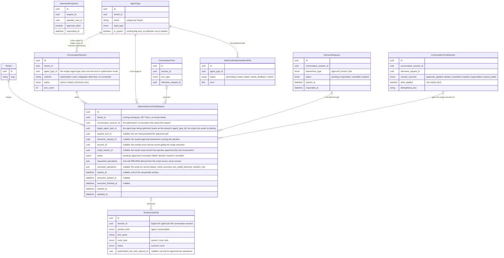

# Data Model: Conversational Optimizer

Technology-agnostic entity model for making optimization **conversational** for one agent type at a time. This design follows the **avatar model**: the optimizer is **not** an agent of its own. An optimization conversation *is* the subject agent type in optimization mode — an existing `ConversationSession` bound to that agent type, marked with `channel = "optimization"`, running with that agent type's own identity, role, model, and skill bindings. In-chat ask/decide, progress, pause and resume reuse the existing conversation and intervention records.

Exactly one need has no current home: **which script was approved to run live, and what that run produced**. It gets one small domain entity plus one nullable audit pointer on the raw tool log.

## Design Note — what is persisted, and what deliberately is not

Most of this epic is *mode and behaviour* on entities that already exist. There is **one new entity** and **one new nullable column**.

| Need | Home | Schema change |
|---|---|---|
| Optimization *mode* of a conversation | Existing `ConversationSession.channel` — an existing free-form string, new value `"optimization"` | **None** (a value, not an enum or column) |
| *Which agent type is being optimized* | Existing `ConversationSession.agent_type_id` — in optimization mode the session's agent type **is** the subject | **None** |
| Optimization reasoning model | Per-tenant setting store (`TenantSetting`), new key `optimizer_model_id` | **None** (a value, not a column) |
| Conversation, turns, progress/activity, pause + resume | Existing `ConversationSession`, `ConversationTurn`, `ConversationActivity`, `ConversationTurnResume` | **None** |
| In-chat ask / decide (question, choice, free text) | Existing `InterveneRequest` + `InterveneResponse` (+ resume record for exactly-once) | **None** |
| *The pending live-test request: approved script version + tool-call preview, decision, what actually ran* | **New entity** `OptimizationLiveTestRequest` | **One new entity** |
| *Live calls distinguishable from replay work in the raw tool log* | New nullable pointer on `RuntimeToolCall` | **One nullable column** |

### Why the subject agent type is inherent (no scope column)

In the avatar model there is no second agent to distinguish. The session that carries an optimization conversation is bound to **the agent type being optimized**, and that same binding is what runs the turns: `agent_type_id` is simultaneously the runner and the subject. A dedicated "scope" pointer would exist only to separate a host agent from a subject agent — a distinction that no longer exists, so the column would be a redundant duplicate of a value that is already mandatory in practice for these sessions.

Consequences that make this deliberate rather than merely minimal:

- **Cross-agent isolation is structural, not instructional.** A session can only act on the agent type it is bound to; there is no field an instruction or a request could repoint to a different agent type. A different subject is a different session.
- **No ambiguity to resolve at write time.** Nothing has to compare a scope field against the bound agent type, so there is no class of "mismatch" states, no NULL-means-unscoped semantics, and no compatibility question with existing and non-optimizer sessions.
- **The permission envelope is the subject's own.** The identity/permission scope the live script run uses is exactly the subject agent type's — the same one that runs the conversation — which is what an operator approving a run against that agent type would expect.

The converse mapping is also clean: `channel` distinguishes *how* the session is used (`"optimization"` vs `"web"` / `"integration"`), while `agent_type_id` says *what* it is about. Filtering, attribution, and listing use the channel value; no structural change is needed to carry it.

### Why there is no seeded optimizer agent type

The avatar model removes seeding entirely:

- **Optimization capability is already available to every agent type.** No new built-in skill, no skill/role/identity binding rows, and no capability gating are introduced by this epic — that behaviour already exists and is unchanged here.
- **No `AgentType` row is created** — not per tenant, not at startup, not as a protected `is_system` record. Optimization cannot accidentally appear as an assignable, schedulable, delegable, or itself-optimizable agent type, because it is not an agent type at all.
- **The reasoning model is tenant configuration, not an agent type property.** `optimizer_model_id` sits in the existing per-tenant setting store, so changing the optimization model never mutates an agent type's runtime model.
- **Nothing new is written at Control Center startup**, so existing tenants gain the capability with no data step.
- **The subject's role/model/skills stay exactly what they are.** The conversation does not borrow a proxy identity; it runs as the agent type it is optimizing, which keeps the plan it produces directly attributable to that agent type's real configuration and permissions.

### Why the live-test approval needs its own entity

Three existing candidates were evaluated and rejected:

1. **`InterveneRequest.choices` / `reason` as a carrier for the requested-live-run payload.** `choices` is the option list for `intervention_type = choice`; `reason` is the human-readable prompt text. Overloading either puts a machine-verifiable, security-relevant payload into a free-text/option field: the executor could not reliably compare *what ran* against *what was approved*, and denial/expiry would have no structured record of what was asked. The generic intervention entity is also used by every agent and must not gain optimization semantics.
2. **A structured payload column on `ConversationTurn`.** A turn is a chat transcript row (`role`, `turn_type`, free-text `content`). A generic JSON payload column would blur transcript and domain records, still offer nowhere to record "approved once, ran once, these operations, this outcome", and make declined/expired requests discoverable only by scanning transcripts.
3. **Reusing `ConversationTurnResume.applied_effect_summary`.** That field is written *after* the effect lands and is empty on denial/expiry — exactly the cases the audit trail must retain. It also describes *what a write changed*, not *what was proposed*.

So the **decision plumbing stays generic and is reused**, while one small domain entity holds the **proposal + the execution evidence**:

- *Decision* → `InterveneRequest` / `InterveneResponse` (who responded, when, approve/deny) and `ConversationTurnResume` (`idempotency_key` + `write_applied` = the exactly-once gate that makes a replayed approval unable to execute twice). No duplication in the new entity.
- *Proposal + execution* → `OptimizationLiveTestRequest` (approved script version + derived tool-call preview, domain status, script run record, timings).

This split is what the acceptance criteria need: a **request survives denial** (it is never executed but stays on record), and **approval can never execute twice** (the resume record's exactly-once marker, mirrored by the domain row reaching `executed`/`failed` at most once).

---

## 1. New Entities

**Entity description:**

- **OptimizationLiveTestRequest** — one operator-facing request to run real work against a live integration during optimization. Created when replay cannot prove a script or when the operator explicitly asks for a live verification (`pending`) and carries **the saved script version it wants to run** (`script_version_id`) — the *script* is the unit of approval and of execution, never an individual tool call: MCP tools are assumed to work, and the point of the approval is to prove the script end to end. `requested_operations` is therefore only the **tool-call preview** derived server-side from that version's `python_source` (the literal `tools.call(...)` names), which is what the operator sees ("it will call: …"). Its `status` is the domain state machine: `pending` → `approved` (consent recorded; at most one execution attempt may follow) → `executed` or `failed`; or `pending` → `denied` / `expired` / `cancelled`, all of which keep the session replay-only. `executed_operations` records the **script run** actually observed (status, bounded result summary, per-`tools.call` outcomes, telemetry, duration), so *what ran* is comparable to *what was approved* and no unlisted work can be silently substituted. The row is tenant-owned and tied to the conversation; `target_agent_type_id` states the identity and permission scope the script ran under on the record itself (normally equal to the conversation's `agent_type_id`), so later session edits cannot rewrite that audit fact.

**Business rules:**

- A live-test request can only be raised inside an optimization conversation — a `ConversationSession` with `channel = "optimization"` whose `agent_type_id` is the subject. Because the subject is inherent to the session, the request can never reference another agent type or another workspace: there is no field to repoint, and the requested script version must belong to that subject.
- A live script run executes under the **subject agent type's** identity and permission scope — the same envelope that runs the conversation — so approval covers exactly the permissions that agent type already has, and a script that names an ungranted tool is refused before it runs.
- `requested_operations` (the preview) and `script_version_id` are immutable after creation: an approval authorizes exactly that script, once. A changed script is a **new version** and a **new** request with a **new** approval; an earlier approval is never inherited.
- `status = approved` never implies executed evidence; only `executed` / `failed` carry `execution_started_at` / `execution_finished_at`, and `executed_operations` holds the script run record for the single run that was reached.
- Denial, silence, and expiry leave `executed_operations` empty and the session replay-only; a denied request is retained for audit, never resurrected.
- The execution side of the row is single-shot: it is gated by the linked resume record's exactly-once marker (`idempotency_key` + `write_applied`), so a replayed or re-delivered approval can never run the script a second time.
- **Decision attribution is not duplicated** — who decided, when, and the approve/deny value are read from the linked `InterveneResponse`; `status` is the domain projection written at decision time.
- Replay evidence and live evidence stay separate: `VerificationRun` (and `ScriptExecutionRecord`) remain the **replay/verification** record; `OptimizationLiveTestRequest` + the `RuntimeToolCall` pointer are the **live** record. A live row therefore makes "a real integration was contacted" unambiguous, and the approval record alone tells you which run was live-authorized.

**Unchanged-by-design (no new entity, no new column):**

- **Optimization mode.** The `"optimization"` value of the existing free-form `ConversationSession.channel` marks a conversation as an optimization conversation and is how listings, filters, and attribution distinguish it. It is a stored value, not a new enum, constraint, or column — non-optimization sessions (`"web"`, `"integration"`, …) are untouched.
- **The subject agent type.** Existing `ConversationSession.agent_type_id` carries it. No `AgentType` row is seeded, no `is_system` record is created, and no identity, role, or skill binding rows are added: the subject's own configuration is the optimization context.
- **Optimizer model.** A value in the existing per-tenant setting store under a new key `optimizer_model_id` (string). Unset or unusable resolves **at read time** to the existing plan-authoring selection (`workflow_generation_model_id`) — no resolved model is ever persisted, and no fallback value is written back, mirroring the existing authoring-model resolver. Disabled/removed selections remain visible as-is and are reported, never normalised.
- **Optimized plan output.** The conversation's outcome lands on the existing `OptimizedImplementationPlan` (`status`, `error`, `feedback_comments`); nothing new is stored per conversation turn.

---

## 2. Modified Entities

- **`RuntimeToolCall`** — the **only** schema modification to an existing entity: add nullable `optimization_live_test_request_id`. The raw runtime tool log is the authoritative record of *what was actually called*; flagging exactly those rows makes live work distinguishable from replay verification in the agent type's history without a second log or an enum widening on an append-only table. `NULL` for every ordinary run, replay verification, and normal conversation turn.

**Explicitly not modified:**

- **`ConversationSession`** — no column added. Optimization sessions are ordinary sessions whose `agent_type_id` is the subject and whose `channel` is `"optimization"`. There is deliberately no separate scope/pointer column (see "Why the subject agent type is inherent").
- **`AgentType`** — no column, no seeded row, no new flag. Optimization adds nothing to agent type configuration.

**Unchanged entities (explicitly reused, verify at implementation):**

| Entity | Role in this change | Change |
|---|---|---|
| `AgentType` | The **subject**: its identity, role, model, and skill bindings are the optimization context and the permission envelope for live operations | none |
| `ConversationSession` | Hosts the optimization conversation via `agent_type_id` (subject) + `channel = "optimization"` | none (value only) |
| `ConversationTurn` | Messages plus `intervene_request` / `intervene_response` turns; the approval card is presented here | none |
| `ConversationActivity` | Working / waiting-for-human / finished / failed / timed-out progress shown while the conversation advances | none |
| `ConversationTurnResume` | The pause → answer → resume gate, and the exactly-once marker for the approved live test | none |
| `InterveneRequest` / `InterveneResponse` | In-chat ask/decide **and** the live-test approve/deny decision | none |
| `ToolCallRecord` | Per-turn tool activity shown as "what it looked at" | none |
| `OptimizedImplementationPlan` | Conversation outcome (ready / needs feedback / failed / retired, `error`, feedback memory) | none |
| `VerificationRun`, `ScriptExecutionRecord` | Replay verification evidence, kept distinct from live-test evidence | none |
| `TenantSetting` | Holds the new `optimizer_model_id` key alongside `workflow_generation_model_id` | none |

---

## 3. Removed Entities / Fields

**None** — no existing entity or column is dropped. The conversational path is additive: the one-shot optimization path, its plan lifecycle, script registry, and execution records are untouched, and the manual feedback path on the optimized plan remains. (The earlier draft of this document proposed an extra session-level scope pointer; that proposal is withdrawn — nothing of it exists in the shipped schema, so there is nothing to remove.)

---

## 4. Schema File References

Schema source root is `source.schema` = `backend/app/db/models/`.

| File | Change |
|---|---|
| `backend/app/db/models/optimization_live_test.py` *(new module; name it after the entity)* | **New entity** — `OptimizationLiveTestRequest` (incl. `script_version_id`) and its `status` enum. It belongs in its own optimizer-domain module, not in `intervene.py`: the intervention entities stay generic for every agent. |
| `backend/app/db/models/tool_calls.py` | Add nullable `optimization_live_test_request_id` FK on `RuntimeToolCall`; no enum or existing-column change. |
| `backend/alembic/versions/3d7c2a5940bc_optimization_live_test_requests.py` *(new)* | Ledger table + enum + the nullable runtime tool-log pointer. |
| `backend/alembic/versions/7b1e4c2d9f03_optimization_live_test_script_version.py` *(new)* | Nullable `optimization_live_tests.script_version_id` FK (`script_versions.id`, `SET NULL`), `down_revision = "3d7c2a5940bc"`. |
| `backend/app/db/models/conversations.py` | **No change** — `channel` is already a free-form string, so `"optimization"` is a value written by the conversation service; `agent_type_id` already identifies the subject for optimization sessions. |
| `backend/app/db/models/agents.py` | **No change** — no optimizer agent type is seeded or configured. |
| `backend/app/db/models/intervene.py` | **No change** — reused as-is for the decision. |
| `backend/app/db/models/conversation_turn_resume.py`, `conversation_activity.py` | **No change**. |
| `backend/app/db/models/tenant_setting.py` | **No change** — `optimizer_model_id` is a `(tenant, key)` value. |
| `backend/app/db/models/script_registry.py`, `script_execution.py`, `optimized_plan.py`, `command_prompt.py` | **No change**. |

**Step-tree payload (no schema change).** Plan steps stay flat JSON on `AgentPlan.plan_steps` / `OptimizedImplementationPlan.plan_steps`. Each step may carry an optional `parent_order` (the `order` of its parent) and its existing optional `type`; the API schema (`PlanStepRead`) exposes `parent_order` and the plan-authoring prompt/normalizer preserves valid values (malformed values are dropped, never fatal). The UI builds the tree from `parent_order`. This is a JSON-only refinement — no column, enum or migration.

**Step-type hard rule (no schema change).** `type` is a free-form string on the step JSON. The plan generator now uses `processing` for non-entity steps and reclassifies any `sop_invocation`/`skill_invocation`/`tool_call`/`agent_delegation` that does not reference an existing SOP/skill/tool/delegated agent. Explicit optional references (`sop_id`, `skill_id`, `tool_name`, `target_agent_type_id`) may be stored in the JSON but are not new columns.

**Migration needed: yes — two additive Alembic revisions.** `3d7c2a5940bc` covers the new table (with its own enum created alongside the table, per project convention) plus the single nullable pointer column on the runtime tool log; `7b1e4c2d9f03` (its child) adds the nullable `script_version_id` FK that names the approved script. Both columns are nullable and the new table has no backfill requirement, so both revisions are non-destructive and reversible: no data migration, no column drop, no enum widening, no constraint added to an existing entity beyond the two nullable columns.

There is also **no data seeding step**: the `optimizer_model_id` setting is an operator-set value and no per-tenant optimizer row is created at startup, so the two schema revisions are the complete persistence change for this epic.

**Migration count: 2.**

---

## 5. Master Data Model Update Instructions

1. **`docs/master/data-model/modules/agents/entities.md`** — in the *Software 3.0 Script Registry, Optimized Plan & Command Prompt Entities* section, alongside `OptimizedImplementationPlan` (the record this entity supplies live evidence for):
   - Add `OptimizationLiveTestRequest` to that section's `erDiagram` with the attributes above and relationships: `ConversationSession ||--o{ OptimizationLiveTestRequest`, `AgentType ||--o{ OptimizationLiveTestRequest` (target), `ConversationTurn |o--o{ OptimizationLiveTestRequest`, `InterveneRequest |o--o{ OptimizationLiveTestRequest`, `ConversationTurnResume |o--o{ OptimizationLiveTestRequest`, `OptimizationLiveTestRequest |o--o{ RuntimeToolCall`.
   - Add an entity-description row and business rules: the approved **script version** is the immutable unit (the tool-call preview is derived from its source, never executed tool-by-tool), single use, denial retained, replay-only on denial/expiry, raised only by a `channel = "optimization"` conversation whose agent type is the subject and owns the script, the script runs under the subject's own identity/permissions (MCP tools assumed to work), decision attribution read from `InterveneResponse`.
   - Add `backend/app/db/models/optimization_live_test.py` to that section's Sources line.
   - **Do not** extend the "system-provided agent types" business rule: no optimizer agent type is seeded, so that rule keeps listing only the Control Center Assistant.
2. **`docs/master/data-model/modules/communication/entities.md`**
   - `ConversationSession`: document the `channel = "optimization"` value ("an optimization conversation about the agent type in `agent_type_id`; the session's agent type is the subject and also runs the turns") and add the relationship `AgentType ||--o{ ConversationSession : "is the subject of (channel=optimization)"`. **Do not** add any scope/subject pointer column — the subject is inherent.
   - Add `RuntimeToolCall.optimization_live_test_request_id` and a note that non-null means the call was part of an **operator-approved, single-use live test** — so live contact is distinguishable from replay inside the raw tool log.
   - Extend the conversation-scoped-interventions paragraph: the approval chain for a live test is `ConversationSession` → `ConversationTurn` → `InterveneRequest` → `InterveneResponse` → `OptimizationLiveTestRequest` (proposal + execution evidence), with `ConversationTurnResume` providing the exactly-once gate.
3. **`docs/master/data-model/modules/tenancy/entities.md`**
   - `TenantSetting` description: `optimizer_model_id` joins `workflow_generation_model_id`; note unset/unusable resolves at read time to the authoring selection, is never persisted as a second value, and never falls back to the subject agent type's runtime model.
4. **`docs/master/data-model/modules/workflow-compilation/entities.md`**
   - One paragraph separating evidence: `VerificationRun` / `ScriptExecutionRecord` = **replay** verification; `OptimizationLiveTestRequest` = the **live** request/approval/execution audit for optimization, distinct from replay runs, and the only path by which optimization contacts a real integration.
5. **`docs/master/data-model/overview.md`**
   - Add `OptimizationLiveTestRequest` to the *Software 3.0 Script Registry, Optimized Plans, Execution & LLM Mock Entities* section (diagram + table row), and reference it from the conversation-domain section rather than duplicating it.
   - Add the nullable `RuntimeToolCall.optimization_live_test_request_id` where `RuntimeToolCall` is drawn.
   - In the communication/conversations section, note the `channel = "optimization"` conversation mode and that the session's `agent_type_id` is the subject. No `ConversationSession` structural change to draw.

**Ownership boundary to record:** both touched schema objects are Control Center-owned (CC is the only DB writer). Agent Runtime and Communication Hub receive the live-test authorization and the resume binding through the existing mTLS internal APIs, never direct database access; the `"optimization"` channel value is written by CC when it creates the session. Persisted operation arguments are state context only and never contain identity tokens, credentials, or decrypted secrets.
