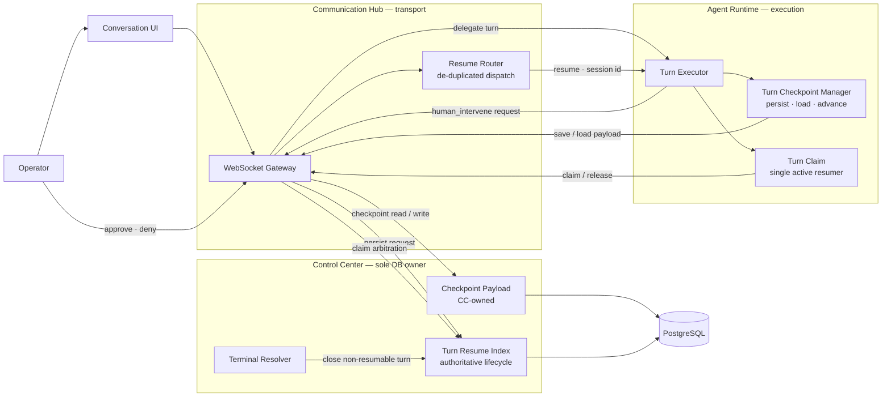
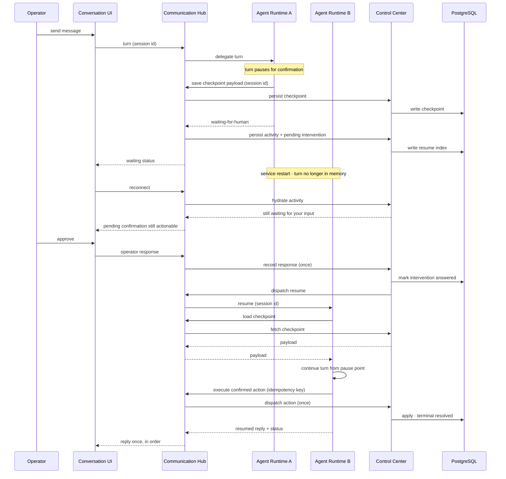
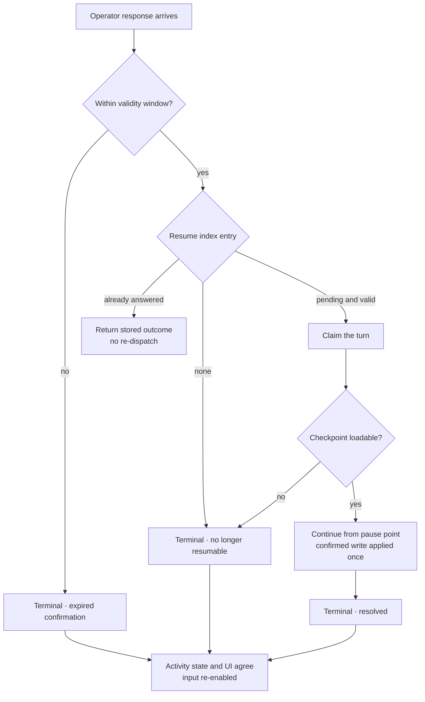

# Architecture: Resumable Agent Turn Persistence

## 1. Changed Components

- **Agent Runtime (AR)** — the paused turn stops being process-local. A turn's graph state (including the `human_intervene` pause point) is written as a **CC-owned durable checkpoint** keyed by the conversation session id, and a paused turn becomes loadable by *any* AR instance. The in-process resume registry is replaced by a **Turn Checkpoint Manager** (persist / load / claim / advance) plus **turn claim** arbitration so only one instance continues a given paused turn at a time. Resuming uses the framework's interrupt/resume semantics against the loaded checkpoint rather than an in-memory future. AR remains a courier only: no identity tokens, DB credentials, database connection, **or datastore endpoint**.
- **Communication Hub (CH)** — the resume path becomes **instance-independent**: a resume routed to CH is forwarded to an AR instance that can load the paused turn (not necessarily the one that paused it), and repeated operator responses are funnelled through one de-duplicated resume dispatch. The orphaned-resume terminal notification changes meaning: it is emitted only when the *durable* state genuinely cannot be resumed, not on a registry miss. CH stays pure transport: it verifies and forwards signed tenant headers, never signs, and never reads the database.
- **Control Center (CC)** — remains the **sole owner of the authoritative turn lifecycle**. CC gains a **new resume record** (`ConversationTurnResume`) held beside the persisted intervention and conversation-activity state, plus `ConversationActivity.active_resume_id` so "shown as waiting" structurally equals "actually answerable". The existing activity reaper is extended into a **Terminal Resolver** that closes unresolved turns — writing the same terminal outcome the UI shows, so "waiting for your input" never coexists with an unresumable turn.

## 2. New Components

Paused turn state is an opaque, Control Center–owned durable checkpoint stored beside the authoritative resume index (see `data-model.md`). Agent Runtime produces and consumes the payload only through the existing mTLS CC internal API — no datastore access, no credentials, no new infrastructure dependency.

- **Turn Checkpoint Manager** (AR) — writes the paused turn's state (as an opaque payload) to CC through CH, under the conversation session id as the resume key, and reloads it on resume; the payload contains no secrets.
- **Turn Claim** (AR) — a short-lived, TTL-bounded claim on a paused turn so two instances never continue the same turn concurrently; an expired claim is re-acquirable after failover.
- **Turn Checkpoint (CC-owned)** — the durable opaque paused-turn payload stored by CC beside the resume index; never a business system of record, never holding tokens or credentials.
- **Turn Resume Index** (CC) — the authoritative record of which turn is paused, the pending intervention, the validity window, and the terminal outcome.
- **Terminal Resolver** (CC) — advances genuinely unresumable turns (expired window, deliberately ended work, abandoned turn) to one terminal state with one actionable message.
- **Resume Router** (CH) — forwards a resume to an AR instance able to load the turn, and collapses duplicate deliveries of the same operator response into a single dispatch.

## 3. Integration Points

- **AR ↔ CC checkpoint payload (new, via CH)** — save/load of the opaque paused-turn state routed AR → CH → CC over the existing mTLS internal API; AR gains no datastore access, no direct CC path, and no new dependency; startup reachability validation applies to CC only.
- **CH → AR resume forwarding (existing, hardened)** — unchanged service path and mTLS/tenant-header contract, but the target AR no longer needs to be the instance that paused the turn; the resume carries the authoritative turn reference, not a process-local handle.
- **CH → CC resume index (extended)** — the persist/read of activity and intervention state is now also the resume-index read/write used to decide whether a response is answerable, already answered, or no longer resumable.
- **CC → CH resume dispatch (existing, idempotent)** — one dispatch per answered intervention; a duplicate operator response returns the stored outcome instead of re-dispatching.
- **CH orphan/terminal notification (changed)** — emitted only for a *durably* unresumable turn; a restart alone no longer produces a terminal message.
- **CC → DB (unchanged, CC-only)** — new turn lifecycle, resume-reference, and checkpoint-payload state is written exclusively by CC; no other service gains a database path.

## 4. Data Flow Changes

Turns now survive restarts because pause state is durable (CC-owned) and resume is routed to any instance that can load it.

When a turn genuinely cannot be continued — answered outside its validity window, work deliberately ended, or no loadable state — it resolves terminally with one clear message rather than a timeout. Duplicate responses short-circuit to the stored outcome.

## 5. Master Arch Update Instructions

Update in `docs/master/architecture/`:

- **`system-overview.md`**
  - Update the **Control Center Assistant** flow and the execution diagram to show the **CC-owned checkpoint payload beside the resume index** (no AR-side checkpoint store).
  - Update **Key Responsibilities**: AR gains "paused-turn checkpoint production and instance-independent resume (courier only — no datastore)"; CH's conversational bullet changes from "routes interventions through a live-session registry" to "routes resumes to any instance able to load the paused turn, de-duplicated"; CC gains "authoritative turn resume index, checkpoint payload store, and terminal resolution".
- **`modules/agent-runtime/architecture.md`**
  - Replace **In-Process Intervention Resume** with **Durable Turn Checkpointing & Resume** (resume key = conversation session id, pause state persisted by CC, claim-before-continue).
  - Update the **Conversational Turn Execution** diagram: in-process resume registry → Turn Checkpoint Manager + Turn Claim (payload shuttled to CC via CH).
  - Note **AR's courier-only role**: no datastore access, no credentials, no new infrastructure dependency.
- **`modules/communication-hub/architecture.md`**
  - Update the **Conversational WebSocket Flow** and its sequence diagram: resume is instance-independent, duplicate responses collapse to one dispatch, and the orphaned-resume terminal notification applies only to durably unresumable turns.
  - Update **Responsibilities**: add the Resume Router; note the live-session registry is no longer the resume home.
- **`modules/control-center/architecture.md`**
  - Add the **Turn Resume Index**, the **CC-owned checkpoint payload store**, and the extended **Terminal Resolver** (activity reaper) plus their internal read/write integrations.
- **`modules/communication.md`** (hub index) — one-line note that paused conversational turns are durably resumable across restarts and instances.
- **`modules/tool-execution.md`** — note `human_intervene` on the conversational path pauses into durable state, and delivery of a response is exactly-once.
