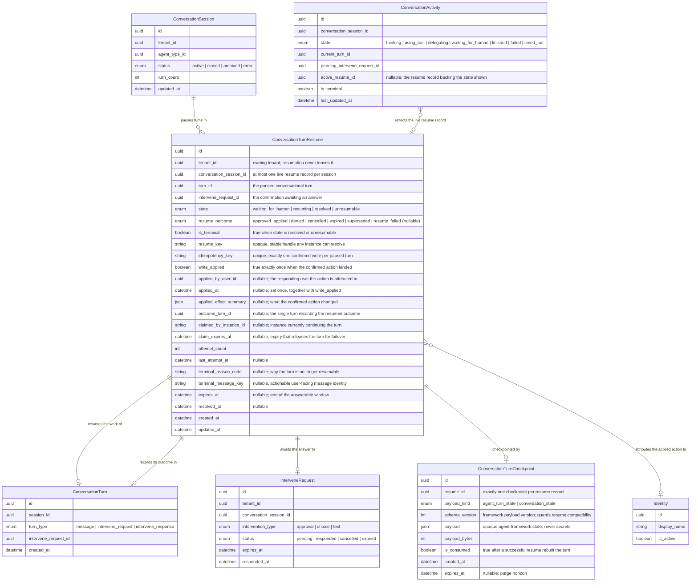

# Data Model: Resumable Agent Turn Persistence

Technology-agnostic entity model for a **durably resumable paused conversational turn**: the work in flight when the assistant stops to ask a human for confirmation, surviving restarts, failover, and instance replacement, with exactly-once application of a confirmed write and one clear terminal outcome when a turn genuinely cannot be continued.

## Design Note — Where the durable checkpoint lives

**Decision: the DB (Control Center-owned), not an external cache.** The opaque execution checkpoint is persisted as a *payload entity* next to a small, queryable *resume index* — `ConversationTurnResume` + `ConversationTurnCheckpoint`.

Rationale:

- **Durability is the product promise.** The headline acceptance criterion is that a pause survives a restart of *any* service in the path. The relational store is the only already-backed-up, single-owner durable store in the platform; an in-memory/cache tier cannot be the authority for that guarantee.
- **Segregation is preserved without a new shared store.** Agent Runtime produces and consumes the checkpoint but never gets database credentials: it ships and receives the opaque payload through the existing mTLS Control Center internal APIs. An external store would give AR a new shared-state dependency for zero durability gain.
- **Exactly-once needs one transactional authority.** The idempotency marker and the resume lifecycle transition must commit together. Splitting "index in DB / blob elsewhere" allows an index that says *applied* with no checkpoint (or the reverse) — the ambiguous half-finished outcome the epic forbids.
- **The payload is quarantined, not modelled.** Framework-serialised agent state is opaque and large; it lives in its own 1:1 entity so the business record stays small, queryable, and purgeable on resolution, and so the domain model never depends on the agent framework's serialization format.

**Ownership boundary:** only Control Center connects to the DB. Both entities are CC-owned; Agent Runtime and Communication Hub reach them exclusively through CC (mTLS). The checkpoint payload carries conversation/agent state only — never identity tokens, credentials, or decrypted secrets.

---

## 1. New Entities

**Entity descriptions:**

- **ConversationTurnResume** — the durable resume index for one paused conversational turn. Created when a turn pauses for human input, it ties together the four things that must agree across a restart: the `ConversationSession`, the paused `ConversationTurn`, the pending `InterveneRequest`, and the eventual terminal outcome. `resume_key` is the opaque handle any instance can resolve; `state`/`resume_outcome` make the turn's fate explicit; `idempotency_key` + `write_applied`/`applied_at` guarantee the confirmed write lands at most once; `claimed_by_instance_id` + `claim_expires_at` ensure one instance continues a given turn at a time and that failover can take it over; `outcome_turn_id` guarantees the resumed (or resolved) outcome appears exactly once in history.
- **ConversationTurnCheckpoint** — the opaque, versioned payload that lets a *different* instance rebuild the paused turn. Framework-owned serialization with no secrets and no business semantics of its own; consumed once and purgeable on resolution. If it is missing or unusable at resume time, the resume record resolves to `unresumable` — the index, not the payload, is authoritative for whether a turn should have been answerable.

**Resume state semantics (aligned with `ConversationActivity` states):**

| `ConversationTurnResume.state` | Activity state shown | Meaning |
|---|---|---|
| `waiting_for_human` | `waiting_for_human` | Paused, answerable, checkpoint available |
| `resuming` | `thinking` / `using_tool` / `delegating` | Answer accepted; work continuing on some instance |
| `resolved` | `finished` | Terminal; outcome recorded once (write applied or nothing written) |
| `unresumable` | `timed_out` (`failed` when `resume_failed`) | Terminal; cannot be continued — actionable reason surfaced |

**Outcome vocabulary:** `approved_applied` (confirmed write applied exactly once), `denied` (nothing written), `cancelled` (deliberately ended before answering) resolve the turn; `expired` (answered outside the answerable window), `superseded` (a newer turn took over the session), and `resume_failed` (checkpoint unusable) mark it unresumable. A denial or expiry never sets `write_applied`.

---

## 2. Modified Entities

- **`ConversationActivity`** — add nullable `active_resume_id` (the resume record backing the state being shown) plus its relationship. This makes the epic's core invariant structural rather than coincidental: `waiting_for_human` is only displayed when a live `ConversationTurnResume` exists. `state`, `detail`, and terminal semantics are unchanged.
- **`ConversationSession`** — gains only a relationship to `ConversationTurnResume`; no column changes. Lifecycle `status` remains the coarse session state.
- **`ConversationTurn`** — unchanged; it is referenced twice by the resume record (`turn_id` for the paused turn, `outcome_turn_id` for the single recorded outcome) and needs no new column or `turn_type` value.
- **`InterveneRequest`** — unchanged. `status` keeps its existing values (`pending → responded`, `cancelled`, `expired`); the resume record is what distinguishes *resumed*, *resolved*, and *no longer resumable*, so no lifecycle enum is extended. Its `expires_at` is the bound the resume record's `expires_at` must agree with.

**Business rules:**

- At most one live (non-terminal) resume record per `ConversationSession`; a new pause closes the previous one as `superseded`.
- A resume record exists for exactly one pending confirmation, and `state = resolved` with `resume_outcome = approved_applied` requires `write_applied = true`, `applied_at`, `applied_by_user_id`, and one `outcome_turn_id`.
- `idempotency_key` is globally unique per paused turn, so a duplicate or re-delivered answer is rejected rather than applied twice.
- Claim expiry (`claim_expires_at`) never changes the state — it only frees the turn for another instance; the terminal decision is made under the claim.

---

## 3. Removed Entities / Fields

None. The in-process pause state being replaced was never persisted, so nothing is dropped from the schema.

Note (semantic, not structural): `ConversationActivity.detail` stays "state context only" and must not be treated as a checkpoint — durable resume state now lives exclusively in `ConversationTurnResume` + `ConversationTurnCheckpoint`.

---

## 4. Schema File References

Paths relative to workspace root; schema source root is `source.schema` = `backend/app/db/models/`.

| File | Change |
|---|---|
| `backend/app/db/models/conversation_turn_resume.py` | **New** — `ConversationTurnResume`, `ConversationTurnCheckpoint`, and the `ResumeState` / `ResumeOutcome` / `CheckpointPayloadKind` enums. |
| `backend/app/db/models/conversation_activity.py` | Add nullable `active_resume_id` FK + relationship; no state changes. |
| `backend/app/db/models/conversations.py` | Add back-reference relationship from `ConversationSession` to its resume records; no column changes. |
| `backend/app/db/models/intervene.py` | Optional back-reference relationship to the resume record (may instead be resolved by join on `intervene_request_id`). |

Generate the migration with `alembic revision --autogenerate` (never hand-written DDL); add the new model module to the models package so autogenerate sees it, then review the `down_revision` chain and enum handling before applying.

---

## 5. Master Data Model Update Instructions

**Ownership boundary to record in master docs:** `ConversationTurnResume` and `ConversationTurnCheckpoint` are Control Center-owned; Agent Runtime and Communication Hub reach them only through CC (mTLS). Durable turn information contains no identity tokens, credentials, or other secrets, and resumption stays inside the conversation's tenant.

Update these files in `docs/master/data-model/`:

1. **`modules/communication/entities.md`** (canonical home for conversation entities):
   - Add `ConversationTurnResume` and `ConversationTurnCheckpoint` to the `erDiagram` with the attributes above and the relationships: `ConversationSession ||--o{ ConversationTurnResume`, `ConversationTurnResume ||--o| ConversationTurn` (twice — paused turn, outcome turn), `ConversationTurnResume ||--o| InterveneRequest`, `ConversationTurnResume ||--o| ConversationTurnCheckpoint`, `ConversationActivity }o--o| ConversationTurnResume`.
   - Add a `ResumeState` / `ResumeOutcome` enum table (mirroring the existing `ConversationStatus` table), including the mapping to the activity states and which outcomes are terminal.
   - Add entity-description rows for both new entities and one for the new `ConversationActivity.active_resume_id` field.
   - Extend the "Conversation-scoped interventions" paragraph: the resume chain is `ConversationSession` → paused `ConversationTurn` → pending `InterveneRequest` → `ConversationTurnResume` → terminal `resume_outcome`; `conversation_session_id` remains the resume key for conversation-scoped requests.
   - State the exactly-once rule (unique `idempotency_key`; `write_applied`/`applied_at` set once) and the one-live-resume-per-session rule.

2. **`overview.md`** — add both entities to the conversation-domain diagrams only (the Third-Party Agent Integration / conversational section that already lists `ConversationSession`, and the intervene-bearing conversation section). Do not duplicate them into unrelated modules.

3. **Cross-references** — where `ConversationActivity` is described as the durable *status* record, note that `ConversationTurnResume` is the durable *work-in-flight* record and that `active_resume_id` is what guarantees "shown as waiting" equals "actually answerable".
