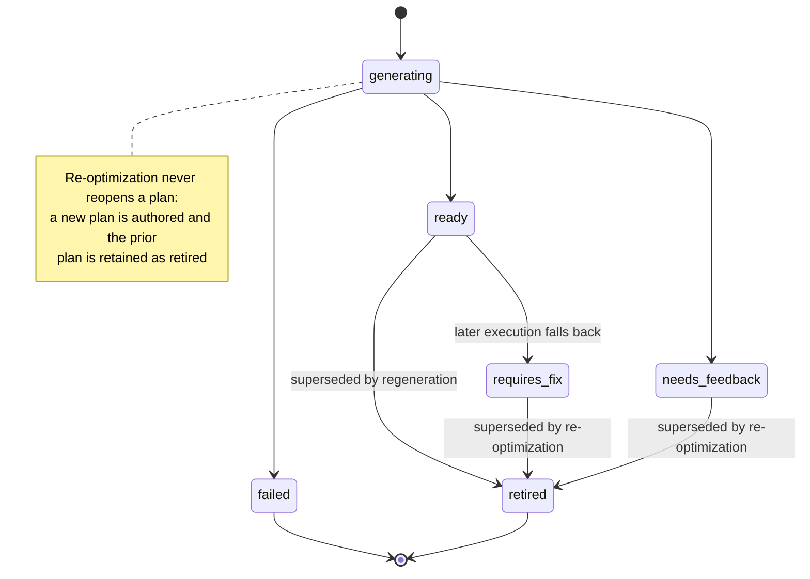
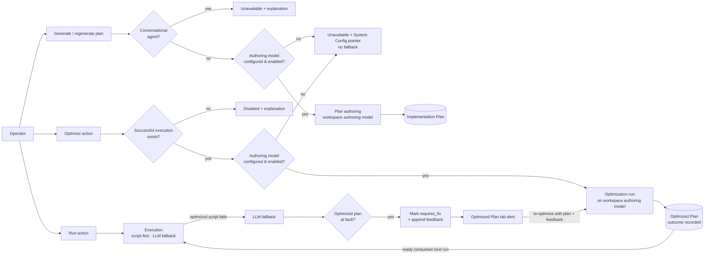
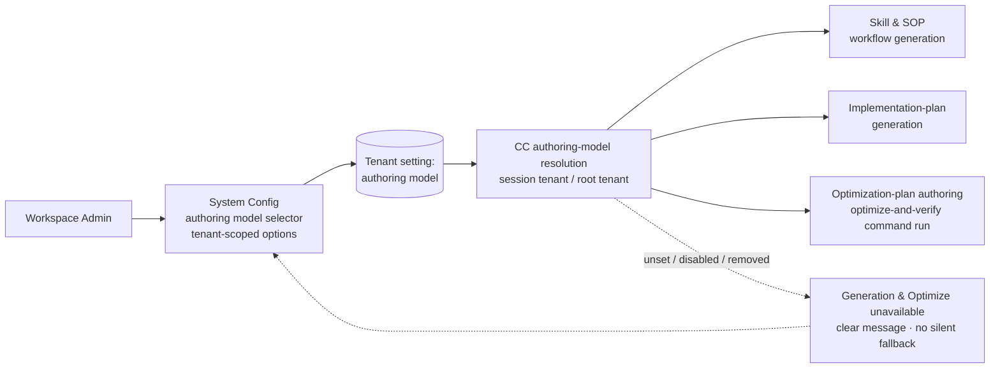
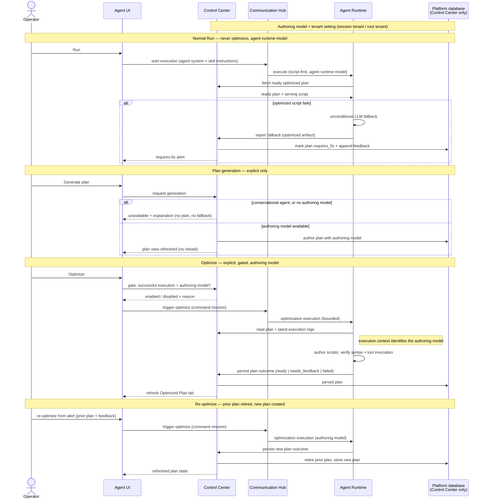
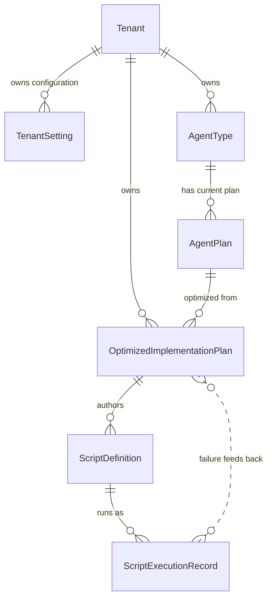

# Architecture: Separate Optimization from Execution

Today "Optimize & Verify" is entangled with execution: the Run Agent flow offers "Run with optimization," which converts a normal run into an `optimize-and-verify` command side-execution that replaces the agent's system instruction. This epic splits the two concerns — a normal Run stays focused on the user's task, while a dedicated, preconditioned, human-kept-in-the-loop **Optimize** action authors a bounded, realistic, self-correcting optimized plan. It also puts plan authoring on the right footing: **all plan authoring runs on the workspace's single approved authoring model** (already used for Skill/SOP workflow generation), happens **only on explicit request**, and is **not available for conversational agents**.

All top-priority rules hold: three segregated backend services; agents and their scripts execute only in Agent Runtime; only Control Center touches the database; agents never receive sensitive data (identity tokens are resolved by Control Center and injected by Communication Hub per tool call).

---

## 1. Changed Components

| Component | Change |
|---|---|
| Run Agent flow | "Run with optimization" is removed; a normal Run uses the agent's own system + skill instructions and never becomes an optimization mission. |
| Optimize trigger | Optimization becomes a distinct action (new control + command-execution trigger). Available only when both preconditions hold (§2). |
| Optimization execution | Dedicated command run over the agent's optimization instructions, current plan, agent info and a bounded (latest-first) slice of execution logs. Verifies script syntax + correct tool invocation — not identical results — and stops at high confidence. Runs on the authoring model. |
| Plan authoring | Implementation plans and optimized plans both use the workspace's single authoring model; generation is explicit-only and unavailable for conversational agents. |
| Execution context | Identifies the authoring model for command-driven optimization runs; normal runs keep the agent's runtime model. |
| Plan status | New `requires_fix` value: a ready plan whose later execution fell back is never re-served as-is; execution stays on the model-driven path. |
| `optimize-and-verify` mission | Verification goal reworded (correct syntax + proper tool invocation, no identical-result matching) with an explicit high-confidence stop rule. |
| Optimized Plan tab · Plan Preview · Agent Type dialog | Requires-fix alert + auto-recorded feedback, auto-refresh after re-optimization; explicit "Generate plan" with an empty state before first generation, hidden/disabled when unavailable. |
| System Config | **Label/scope refinement only** — the existing workflow-generation-model setting is re-presented as the workspace **authoring model** (three uses, higher-end recommendation, unset reminder). The tenant setting key and schema are unchanged: no data rename, no new setting. |

Status set: `generating`, `ready`, `needs_feedback`, `failed`, `requires_fix`, `retired`. The optimizer persists only `ready`, `needs_feedback`, or `failed`; `requires_fix` is set by Control Center when a fallback is attributed to the plan; `retired` is a lifecycle outcome (superseded or manually retired), not an optimizer write.

## 2. New Components

- **Authoring-model resolver** — Control Center resolves the workspace authoring model once (session tenant; root tenant when multi-tenancy is off) and hands it to every authoring path. One setting, one resolver, no second knob.
- **Gating check** — Control Center verifies both Optimize preconditions (≥1 successful execution, authoring model available) and returns an explanation when either fails; the same response drives the Generate-plan surface.
- **Explicit-generation surface** — the Plan Preview request; no authoring on create/update, configuration change, or schedule.
- **Requires-fix flagging + alert** — on fallback from a script authored by an optimized plan, Agent Runtime signals Control Center through internal service APIs; CC marks the plan `requires_fix`, appends a feedback comment, and the Optimized Plan tab alerts the operator (re-optimize or add manual feedback). No unattended re-optimization.

### 2.1 Authoring Model — single source for plan quality

The agent type's runtime model still governs **execution**; the authoring model never does, so a cheap runtime model cannot cap plan quality. The selector validates against the workspace catalogue (a smaller enabled model is allowed; the higher-end recommendation is advisory). If the chosen model is later disabled or removed, authoring and Optimize become unavailable and the reminder resurfaces — never a fallback model.

## 3. Integration Points

| Integration | Change |
|---|---|
| UI → CC (Run) | Unchanged run trigger; no optimization option embedded. |
| UI → CC (Generate plan) | Explicit generation/regeneration request. CC rejects with a clear reason when the agent is conversational or no authoring model is configured — nothing is generated, no fallback model used. |
| UI → CC (Optimize) | New trigger: gating check first, then a command-driven execution dispatch over the existing CC → CH → AR path. |
| UI → CC (System Config) | Authoring-model read/update, tenant-scoped: options come from the current tenant's catalogue, the selection persists for that tenant only, and models not in the catalogue are rejected. |
| CC internal | All authoring paths read the same tenant setting; unset is a hard stop. Agent create/update schedules no plan work. The execution context identifies the authoring model for command runs (identifiers only, no credentials). |
| CC → CH → AR (optimize) | Dedicated command execution (an internal command marker + the `optimize-and-verify` mission) — same transport, guardrails, and sandboxing as Run; Agent Runtime runs it as its normal deep-agent loop on the authoring model. |
| AR → CC (read) | The optimization run reads the current plan and a bounded latest-first window of execution logs through the existing self-context / optimization system tools. |
| AR → CC (write) | The plan-persistence tool stores the outcome (`ready` / `needs_feedback` / `failed`); only Control Center writes it. |
| AR → CC (fallback signal) | Fallback reporting on an optimized artifact is translated by CC into `requires_fix` + auto-feedback. |
| CC → UI (alert / refresh) | Optimized Plan tab renders the requires-fix alert; Plan Preview and Optimized Plan refresh automatically after explicit generation or re-optimization. |

## 4. Data Flow Changes

## 5. Key Business Entities

A workspace is a tenant and owns exactly one authoring-model setting, resolved at read time for that tenant — no schema relationship ties it to plans or agent types. An agent type has one current plan and one active (non-retired) optimized plan; an optimized plan authors the script definitions later executions run, and a failed execution feeds back into the plan as `requires_fix` plus recorded feedback.

## 6. Master Arch Update Instructions

Update `docs/master/architecture/`:

- **`modules/agent-management-panel.md`** — replace the "Run with optimization" surface with the gated Optimize action (dual precondition, requires-fix alert, auto-feedback); add the explicit Generate-plan control, its empty state, and conversational-agent unavailability.
- **`modules/agent-types.md`** — plan authoring is not triggered on save and not tied to the agent type's model; conversational agents have no plan/optimization surface.
- **`modules/agent-runtime/architecture.md`** — rewrite the opt-in Run-with-optimization step as a dedicated, gated Optimize trigger; the authoring model arrives via execution context; requires-fix marking on fallback.
- **`modules/sandboxed-scripting.md`** — separate trigger, realistic verification, authoring model, `requires_fix` + auto-feedback on fallback, and no re-serving of a `requires_fix` plan.
- **`modules/control-center/architecture.md`** — add the authoring-model resolver and its hard stop, the dual gate, removal of automatic generation on agent create/update, and requires-fix flagging + auto-feedback persistence.
- **`modules/model-config.md`** — the authoring model selector: three uses, an enabled catalogue model, tenant-scoped, System Config surface with recommendation and unset reminder.
- **`modules/multi-tenancy.md`** — authoring model is a tenant setting (session tenant, or root tenant when multi-tenancy is off); no cross-workspace effect.
- **`system-overview.md`** — align workflow-compilation/optimization references with the separated trigger, the authoring-model unification, and `requires_fix`.

Tandem note (outside `architecture/`, update in parallel):

- The plan-status change is mirrored in `data-model/overview.md`, `data-model/modules/workflow-compilation/entities.md`, and `data-model/modules/agents/entities.md`.
- `data-model/modules/tenancy/` documents the authoring-model selection and its tenant-scoped resolution; the setting key itself is unchanged.
- `data-model/modules/agents/entities.md` — implementation-plan authoring no longer depends on the agent type's model.
