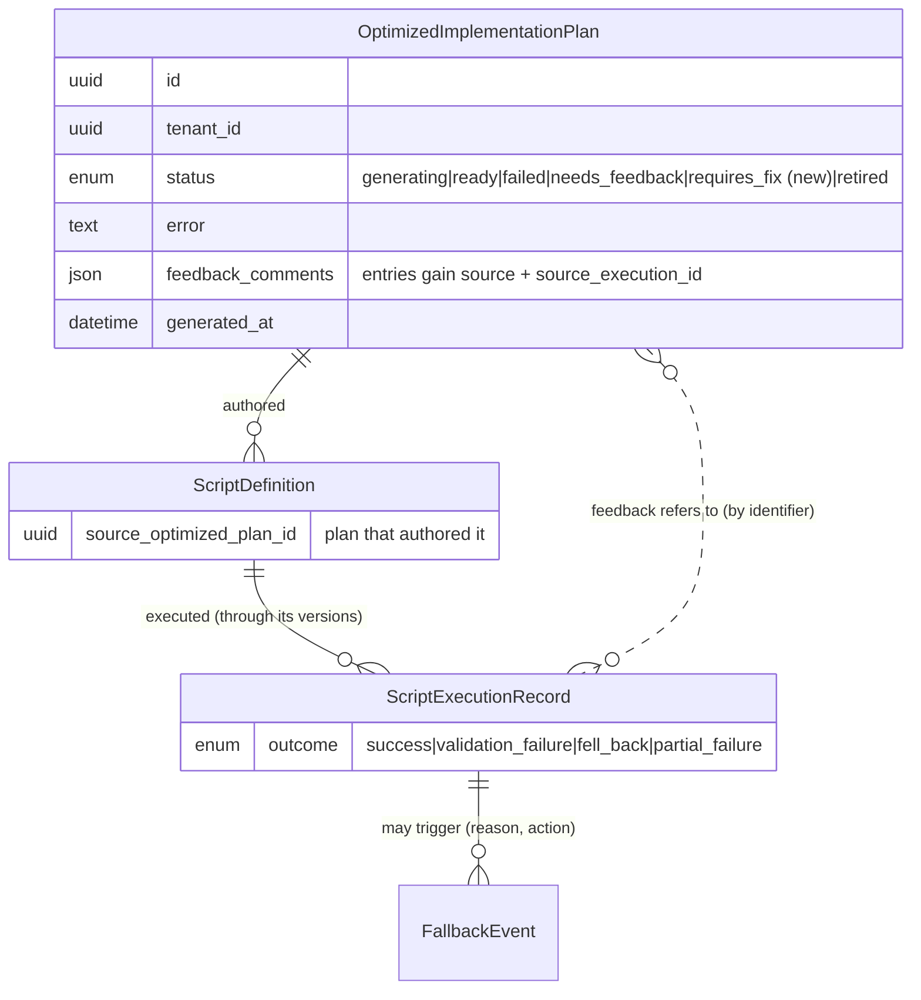
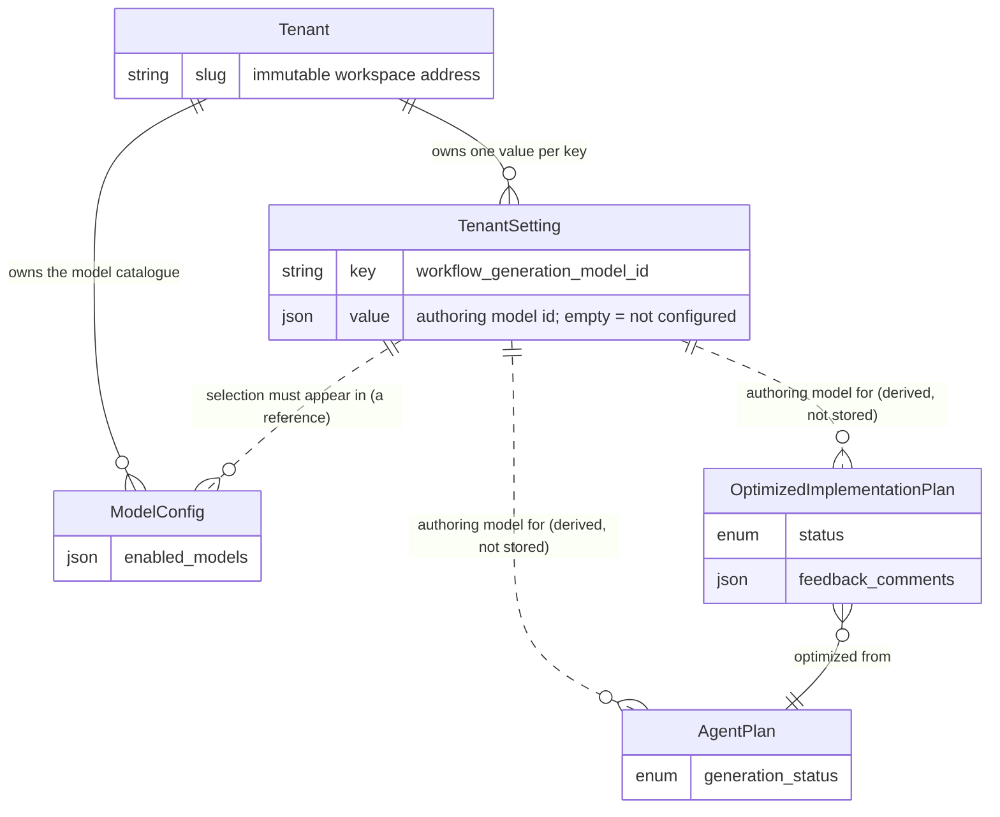

# Data Model: Separate Optimization from Execution

Conceptual, technology-agnostic view. Control Center owns all persisted state (it is
the only service with database access); Agent Runtime reaches it only through CC
APIs.

Two things change: the optimized plan gains one lifecycle state, and its feedback
memory gains a source discriminator plus a reference to the execution that failed.
The authoring-model part reuses an existing tenant setting — no new stored concept.

## Design Note — the "needs a fix" signal lives on the plan

A ready plan that later causes a fallback is the *same* plan changing state, not a
new record: the status carries the signal and an auto-recorded feedback entry
carries the why, via a read-only walk back from that execution to the plan.

---

## 1. Optimized plan — one new lifecycle state

**Changes:**

1. **One new plan state — `requires_fix`**, distinct from `needs_feedback`:
   - `needs_feedback` — optimization authoring itself could not verify a passing
     composition; set at the end of an Optimize run.
   - `requires_fix` — a later execution of the ready plan failed and fell back, and
     the plan is attributed as the cause; set after the fact, at fallback time.

2. **Feedback entries** gain `source` (`manual` as today, or `execution_derived`
   when auto-recorded from a failed execution; entries lacking it read as `manual`),
   a `source_execution_id` reference to the failed execution on derived entries, and
   optionally a `source_fallback_event_id` for the alert. Such an entry is appended,
   reuses the existing fields (summary = one-line failure reason, raw feedback =
   fuller context), and never replaces a manual entry. Nothing else changes.

**Business rules:**

- **Serving:** only a ready plan is ever served. A plan that needs a fix, or a
  retired plan, is never served; execution stays on the model-driven path so
  behaviour cannot degrade.
- Marking `requires_fix` and appending the derived entry happen together, only when
  attribution resolves to a live (non-retired) plan.
- Re-optimization supersedes the old plan (retired, kept for reference) and authors
  a new one with the prior plan plus the full feedback memory as context.
- `requires_fix` does not reuse the authoring error field, which stays the reason
  for `needs_feedback`. One active plan per agent type is unchanged.

---

## 2. Authoring model — a reused tenant setting

Plan quality is governed by the workspace's approved authoring model, already used
for Skill/SOP workflow generation. Plan authoring now reads that same value — a
behavioural change (who reads it, when authoring runs), not a structural one.

**Rules — all resolved when read; nothing new is stored:**

- **Scope = tenant = workspace.** One value per tenant and key: no second, global
  setting to keep in sync, and one workspace never affects another. The value
  resolves for the session tenant, or the root tenant when multi-tenancy is off
  (context-free work such as startup and background jobs too).
- **The selection is a reference to the model catalogue, not an enforced
  relationship** — a model identifier that must appear in the tenant's own enabled
  model list, as the agent type's model reference already does.
- **"Not configured / re-select" is derived, never stored** — computed on read: an
  empty value, or an identifier no longer in the enabled list. No flag or status
  value exists, and the setting stays untouched so the earlier choice stays visible.
- **No fallback model.** When the authoring model is missing, none is stored or
  resolved; generation is unavailable, no plan is written, and the last successful
  plan is preserved.
- **No per-plan authoring-model field.** Nothing records which model authored a
  given plan: the preview's "Generated … by <model>" line shows the workspace's
  *current* authoring model, not stored provenance. Freshness is signalled by the
  plan's generation timestamp and the agent configuration it was built from.
- **Explicit generation only.** Agent save no longer schedules authoring; it
  happens only on explicit request — a trigger change, not a stored one.
- **Conversational agents have no schema implication** — they never read or write
  plan artifacts, so they have no plan or optimization surface.
- `AgentPlan.generation_status` stays `pending | success | failed`: the outcome of
  an attempt, not a configuration prerequisite.

---

## 3. Optimization precondition — computed

"Optimize is available only after ≥1 successful execution" derives from existing
execution records — a completed job for the agent type. No counter, no flag; a
legitimately empty result still counts as a successful run, as product requires.

---

## 4. Removals and migration state

Nothing is dropped; the only removal is behavioural — the "Run with optimization"
run mode no longer exists, while the optimize-and-verify action and its plan
artifacts are retained unchanged.

This change includes exactly one migration — adding `requires_fix` to the plan
status — applied with the original change. The authoring-model refinement needs no
additional migration; it only widens which work reads an existing setting value.
Earlier feedback entries read as `manual`, so no data conversion is required.

---

## 5. Master data model updates

1. **`modules/tenancy/entities.md`** — the workflow-generation model setting has
   three consumers: Skill/SOP workflow generation, implementation-plan generation,
   and optimization-plan authoring. One approved authoring model per workspace;
   the agent type's runtime model never authors plans. The selection is a
   reference into the tenant's enabled model list, and "not configured" is derived.

2. **`modules/agents/entities.md`** — `AgentPlan`: authored only on explicit
   request, by the workspace authoring model rather than the agent type's model;
   "no plan yet" and "not configured" are UI-derived. `OptimizedImplementationPlan`:
   same authoring model, unavailable when the setting is unset or invalid. Add the
   `requires_fix` state, the serving exclusion, the status enumeration update, and
   the derived feedback entry — plus the rule that authoring is explicit, uses the
   workspace's single model, and never records which model authored a plan. Do not
   add a tenant-configuration edge to either plan entity.

3. **`modules/workflow-compilation/entities.md`** — when a fallback is attributable
   to the optimized plan that authored the failing script, the planner marks the
   plan `requires_fix` and records a derived feedback entry, in addition to the
   existing script-health degradation. No new field on the fallback entities.

4. **`overview.md`** — update the plan status enumeration and the non-servable
   states, and note that authoring uses the workspace's single authoring model.
