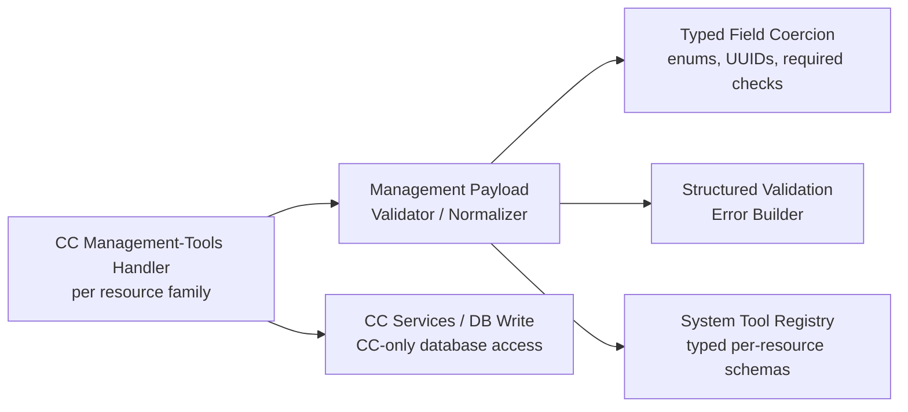
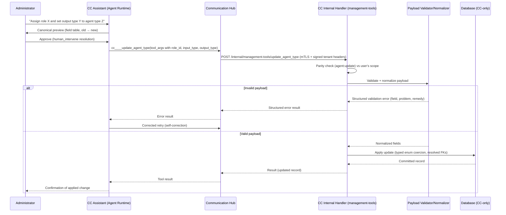

# Architecture: Control Center Assistant Management Tool Coverage

## 1. Changed Components

| Component | Change |
|---|---|
| **CC management-tools internal handlers** (`backend/app/api/v1/internal/management_tools.py`) | Per-resource-family create/update handlers accept the **full field set** the corresponding web UI edit form accepts, with typed validation (enum coercion, UUID resolution, required-field checks). Closest known gap: `update_agent_type` accepts only `model_id`, `system_instruction`, `is_active` — it must also accept `role_id`, `identity_id`, `input_type`, `output_type`, `output_data_type_id`; `update_agent_identity` gains role-assignment support. Read serializers already return UI-detail-level records and stay aligned. |
| **System tool registry** (`backend/app/services/agents/system_tool_registry.py`) | The generic `data` pass-through object (`additionalProperties: true`) is replaced/augmented with **typed per-resource parameter schemas** for create/update tools, matching the field sets above. The existing enrichment pattern (agent-type bindings, role grants, skill tool bindings) is generalized; stable `mcp_hub_id`s and parity pairs are never changed. |
| **Assistant meta tools** (`invoke_management_tool`, `get_management_tool_schema`) | Schemas they serve on demand reflect the enriched typed schemas; dispatch and parity re-enforcement logic unchanged. |
| **Validation error surface** | Validation failures return **structured, actionable error payloads** (field, problem, remedy hint) instead of bare 400 strings, so the assistant can self-correct on retry. Handlers remain the only DB writers (top-priority rule: only CC touches the database). |

Unchanged: Communication Hub routing, permission parity checks, confirm-before-write flow, seeder ownership of the `cc` MCP entity.

## 2. New Components

One new shared helper module in Control Center: a **management payload validation/normalization component** that each resource family's create/update handler runs before writing. It owns field normalization (id-or-name resolution, enum coercion, required-field enforcement) and structured error construction.

## 3. Integration Points

- **CH → CC management tool routing** — transport unchanged (`_route_to_system_tool` in `backend/app/communication_hub/api/internal/tool_routing.py` maps bare tool names to CC endpoints via the registry). Only the **payload shapes are enriched**: `tool_args.data` now conforms to typed per-resource schemas. CH remains forward-only, never signs tenant headers.
- **Permission parity** — unchanged. Each tool's `(resource_type, action)` pair in the parity map (`SystemToolRegistry.get_parity_map()`) is re-enforced per invocation against the signed-in user's scope, both on the per-tool endpoint and inside `invoke_management_tool`. No delete verb.
- **Confirm-before-write** — unchanged. The assistant presents the canonical preview (operation + field table, old → new) and obtains approval via `human_intervene` before invoking any create/update tool. Rejection or timeout writes nothing.
- **Tool execution identity** — tools run on the user's OAuth identity; agents never hold identity tokens or credentials; sensitive material is never echoed in results.
- **`cc` MCP entity** — stays system-managed; the seeder is the only writer. If any new tools are ever registered, they continue the reserved UUID block (`…0019`–`…0058` allocated; next counter value) — never reuse or change a deployed UUID.

## 4. Data Flow Changes

Representative flow: assistant updates an agent type's role and input/output configuration.

## 5. Master Arch Update Instructions

In `docs/master/architecture/`:

- **`modules/control-center`** — update the management-tools module diagram/notes: management create/update handlers now accept the full UI-parity field set per resource family with typed validation; note the new shared payload validation/normalization component and structured validation-error responses.
- **`modules/communication-hub`** — update tool-routing notes: routing transport unchanged, but `cc____` management tool payloads are typed per-resource (no more free-form `data` pass-through for affected families).
- **`system-overview.md`** — no structural change; optionally note that conversational management now has full web-UI parity (create/read/update; no delete).
