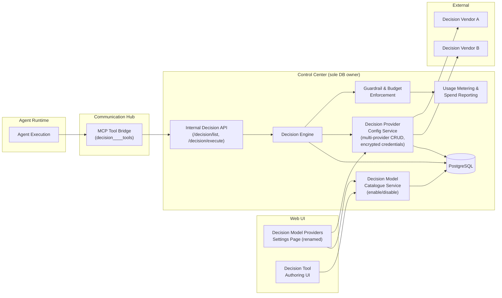
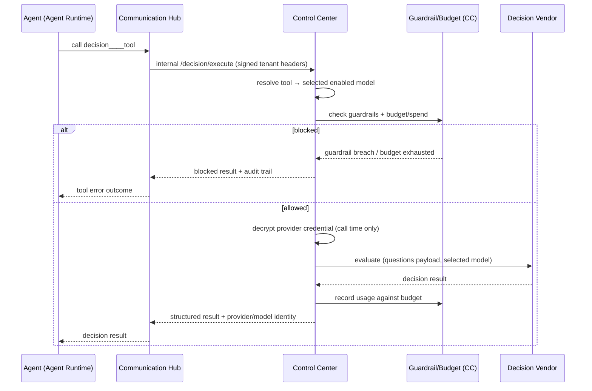

# Architecture — Decision Model Providers

Generalises the single "System One Provider" into multiple **Decision Model Providers** (vendors) with per-model enablement, per-decision-tool model selection, and full guardrail/budget coverage. The design mirrors the existing LLM Model Configurations pattern and fully respects the top-priority rules: provider configuration, credential storage, and guardrail/budget enforcement live **only in Control Center** (the only DB-connected service); Agent Runtime and Communication Hub never touch provider credentials or the database — all decision execution flows through Control Center internal endpoints.

## 1. Changed Components

| Component | Change |
|---|---|
| Decision Provider Config Service (CC) | Extended from single-provider to multi-provider CRUD; vendor catalogue per provider; per-model enable/disable; encrypted credentials (never returned on read); connection test |
| Decision Engine (CC) | Resolves the tool's selected enabled model instead of the single global provider |
| Internal Decision API (CC) | Unchanged contract; execution response now includes provider/model identity for audit |
| Decision Tool configuration (CC DB) | Each tool stores a reference to its selected enabled decision model |
| Communication Hub MCP bridge | Renamed/aware of multi-provider decision tools; forwards all execution to CC (unchanged segregation) |
| Agent Runtime | No direct change — decision tool calls route via CH → CC as today |
| Frontend Settings page | Renamed to "Decision Model Providers"; multi-provider table mirroring Model Configurations UX |
| Decision Tool authoring UI | Adds enabled-model selector; shows selected model on list/detail views |
| Usage / spend reporting | Includes decision model usage alongside regular agent model usage |

## 2. New Components

- **Decision Provider entity & Decision Model entity (Control Center DB)** — multi-provider, multi-model storage replacing the single System One provider row; tool→model references with referential-integrity deletion blocking.
- **Decision-to-provider data migration (CC, Alembic)** — idempotent one-time migration of the existing single provider + tool bindings into the new multi-provider model.
- **Decision usage metering hookup (CC)** — records decision evaluations into the existing usage/spend pipeline (same store as regular model usage).
- **Frontend enabled-model selector** — reusable picker listing only enabled decision models across all providers.

No new runtime services; no new components in Agent Runtime or Communication Hub beyond wire-field additions.

## 3. Integration Points (new/changed)

| Integration | Type | Notes |
|---|---|---|
| Web UI → CC Provider Config API | Changed | Multi-provider CRUD, model enable/disable, connection test; credentials write-only |
| Web UI → CC model catalogue | Changed | Enabled-models listing feeds the decision-tool authoring selector |
| CH MCP bridge → CC internal `/decision/list` | Changed | Catalogue now exposes each tool's selected provider/model identity |
| CH MCP bridge → CC internal `/decision/execute` | Changed | CC-side execution resolves tool's selected model, applies guardrails/budget **before** vendor call |
| CC → Decision vendors | Changed | One client abstraction, instantiated per provider type; credentials decrypted at call time only, CC-only |
| CC → Guardrail/Budget pipeline | New | Decision evaluations pass the same pre-call checks as regular agent model calls |
| CC → Usage metering/spend reporting | New | Decision model usage recorded and reported together with LLM usage |
| Tool→model reference integrity | New | Provider/model deletion blocked while referenced by decision tools |

## 4. Data Flow Changes

Decision tool execution now resolves the tool's selected enabled model and applies guardrails/budget inside Control Center before any vendor call:

Provider configuration and connection testing remain exclusively human-admin → Control Center flows; agents never receive credentials, connection details, or provider configuration data.

## 5. Master Architecture Update Instructions

Update `docs/master/architecture/` as follows:

1. **System architecture diagram**: replace the single "System One Provider" node with "Decision Model Providers (multi-vendor)" inside the Control Center boundary; keep vendor integrations as external systems reachable only from Control Center.
2. **Data model**: add Decision Provider (1—* Decision Model) and Decision Tool (*—1 enabled Decision Model) relationships; note the migration from the single-provider configuration.
3. **Governance / guardrail documentation**: extend coverage statements to say guardrails and budget/spend enforcement apply to *all* model calls, including decision model evaluations.
4. **Terminology**: globally replace "System One Provider" with "Decision Model Provider" in diagrams, component descriptions, and settings references (internal identifiers unchanged).
5. **Component descriptions**: note that the Decision Engine resolves per-tool selected models and that execution logs capture provider/model identity for audit.
