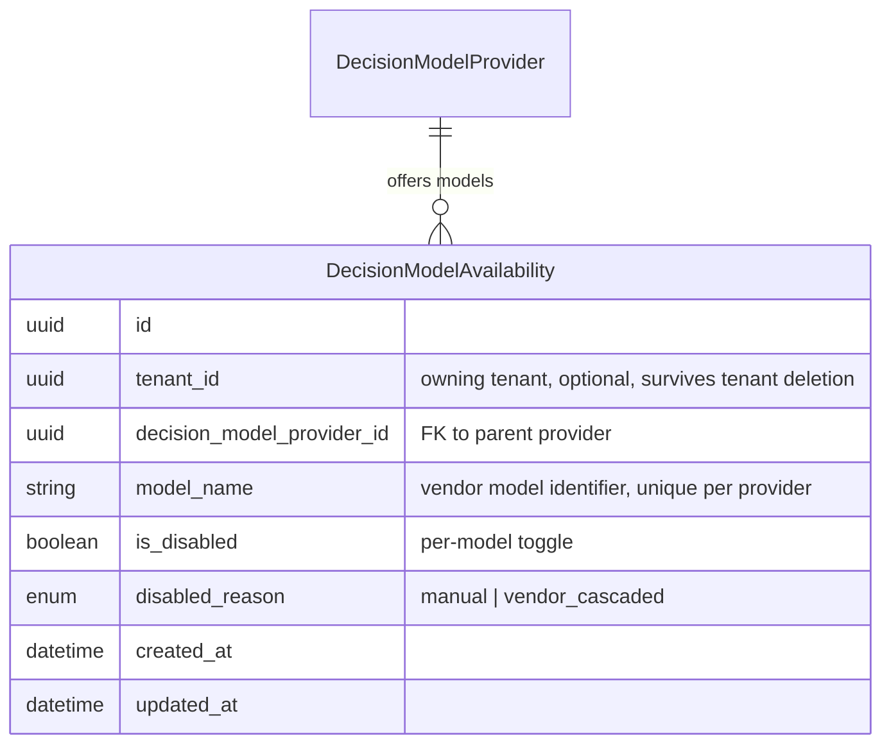
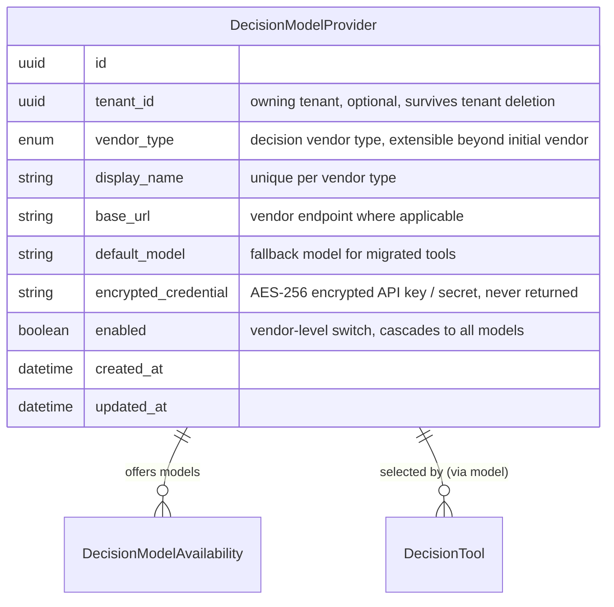
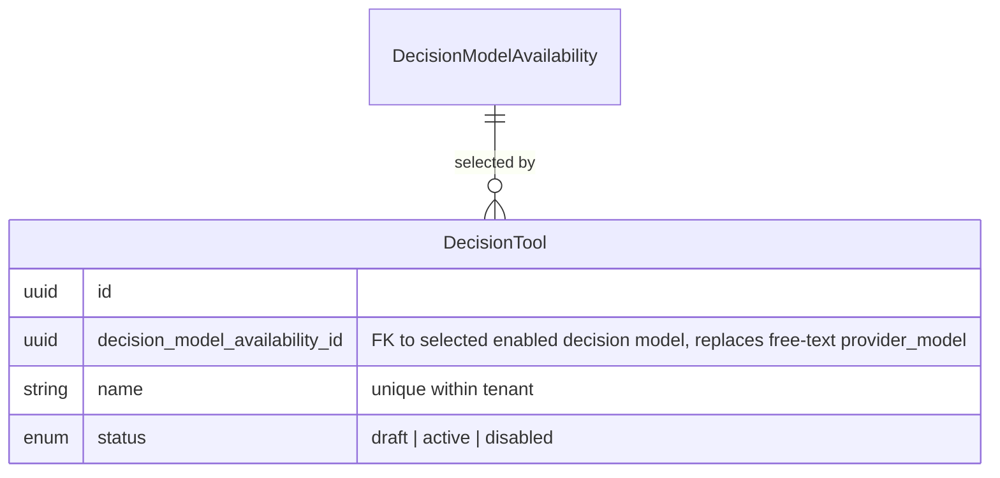

# Data Model — Decision Model Providers

Change: `decision-model-providers` · Schema source: `backend/app/db/models/`

Technology-agnostic business entities only. Schema files are the source of truth; this document describes the target business model.

---

## 1. New Entities

### DecisionModelAvailability

Per-model enable/disable record under a Decision Model Provider, mirroring the existing Model Configurations availability pattern. Each row represents one model offered by a vendor; administrators toggle models individually, and a vendor-level disable cascades to all its model rows while preserving manually-disabled state.

---

## 2. Modified Entities

### DecisionModelProvider (formerly SystemOneProviderConfig)

Generalised from the single "System One Provider" into a multi-vendor decision model provider registry. Multiple providers may be registered per tenant; each stores encrypted credentials (never returned in plaintext) and a vendor-level enabled flag that cascades to its models. Renamed conceptually to "Decision Model Provider"; internal identifiers may remain unchanged to limit migration risk.

Changes vs. current `SystemOneProviderConfig`:
- Vendor type is no longer limited to a single value; uniqueness enforced on display name within vendor type (and vendor-type registration where uniqueness is required).
- Deletion is blocked while any decision tool still references one of its models.
- Existing single-provider row migrates 1:1 into this entity; its `default_model` becomes the initial enabled model.

### DecisionTool

Gains an explicit reference to a selected, enabled decision model instead of relying on the single global provider's implicit model. The selection is resolvable at evaluation time to a provider + model pair, so execution records can identify which vendor/model was used.

Changes vs. current `DecisionTool`:
- Free-text `provider_model` (default `jev-latest`) is superseded by a reference to a `DecisionModelAvailability` row; tools only select from models that are enabled (and whose provider is enabled).
- Changing the selection takes effect on the next evaluation; disabled/unavailable selections surface a clear actionable error at evaluation time.

---

## 3. Removed Entities/Fields

- `DecisionTool.provider_model` (free-text string) — replaced by the structured decision-model reference.
- `SystemOneProviderConfig` as a single-provider singleton concept — superseded by the multi-vendor `DecisionModelProvider` registry (existing row migrates; no data loss).
- Hard-coded single-vendor default (`jev-latest` as the implicit global choice) — becomes the migrated provider's default/enabled model.

---

## 4. Schema File References

Files under `backend/app/db/models/`:

| File | Action |
|---|---|
| `system_one_provider_config.py` | Modify/generalise → multi-vendor decision model provider (rename concept in docstring/enum values; internal table identity may remain) |
| `decision_model_availability.py` | **Create** — new per-model availability entity mirroring `model_availability.py` |
| `decision_tools.py` | Modify — add decision-model reference to `DecisionTool`; retire `provider_model` |
| `__init__.py` | Update — export the new model |

Pattern to mirror: `model_availability.py` (per-vendor model enablement with `manual` / `vendor_cascaded` disable reasons).

---

## 5. Master Data Model Update Instructions

Update `docs/master/data-model/` as follows:

1. **`overview.md`** — add/update the domain section (agents/skills module group where decision tools currently live) with the new `DecisionModelProvider` / `DecisionModelAvailability` entities and their relationship to `DecisionTool`; replace any "System One Provider" references with "Decision Model Provider".
2. **Module docs** — update the relevant module page (decision tools) to describe the multi-provider model and per-tool model selection; add a short entity description for `DecisionModelAvailability` (max 3 lines, referencing the schema file).
3. **Mermaid diagrams** — extend the existing domain `erDiagram` with the provider → model-availability → decision-tool relationships; no standalone ERD document.
4. **Cross-domain links** — note that guardrail/budget entities continue to govern decision model usage via the evaluation pipeline (no schema change to those entities).
