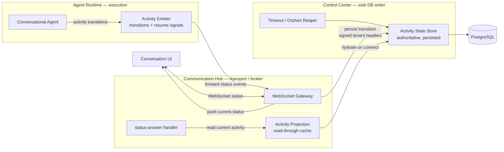
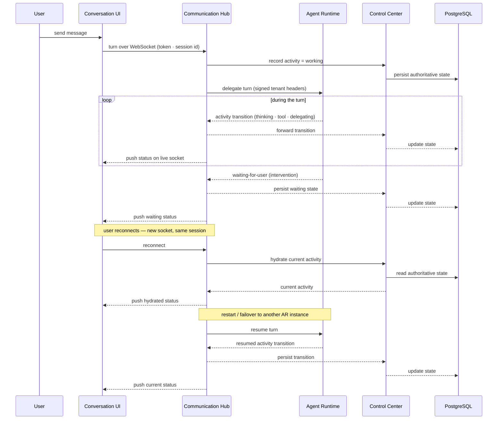

# Architecture: Persistent Agent Activity State

## 1. Changed Components

- **Control Center (CC)** — becomes the **sole owner and writer** of a persisted "current agent activity" record. It gains an internal write/read surface for activity transitions and hydration, and the existing `ConversationSession` record is extended with an authoritative *current-activity* state (distinct from its coarse lifecycle status). A **timeout/orphan reaper** in CC resolves stale or non-resumable activity to a terminal state so a turn never shows a perpetual "working"/"waiting" indicator.
- **Agent Runtime (AR)** — execution stays here (unchanged), but its activity emission changes: the existing status/delegation/intervention emitters (and its in-process resume state) now forward activity transitions to CC (via Communication Hub) so the state is persisted, not just streamed. AR never writes the database and never holds identity tokens or DB credentials.
- **Communication Hub (CH)** — the WebSocket broker loses its role as the *source of truth* for live status. Its process-local status tracking becomes a **read-through projection/cache** of the persisted state. The status-answer message now reads the authoritative persisted activity rather than CH's in-memory tracking, so a fresh or restarted CH instance answers correctly. On (re)connect, CH hydrates the current activity from CC and pushes it to the client.

## 2. New Components

The activity state is persisted by CC only; AR/CH forward transitions and never touch the database. CH remains pure transport/broker, AR remains pure execution.

- **Activity State Store** (CC) — the single authoritative, tenant-scoped record of what a conversation's assistant is doing *right now*. Written only through CC's internal surface; contains status only (never tokens, credentials, or secrets).
- **Activity Projection / read-through cache** (CH) — a live projection of the persisted state used for status answers, heartbeats, and status pushes; hydrated from CC on connect and kept consistent with it, so any CH instance can serve the truth after scaling or failover.
- **Timeout / Orphan Reaper** (CC) — advances activity that can no longer be resumed (turn abandoned after a restart, session ended, watchdog/guardrail timeout) to a terminal `finished`/`failed`/`timed out` state.

## 3. Integration Points

- **AR → CH status channel** (existing, extended) — activity transitions now carry enough context to be persisted; the existing thinking/delegation/intervention event stream remains the transport. **Security boundary:** AR originates **no outbound call** for activity — transitions travel only inside the HTTP response to CH's conversation-turn call. AR has no DB connection and never calls the CC activity endpoints; only CH forwards activity to CC (which alone writes the database).
- **CH → CC internal integration (new)** — persist an activity transition; uses the standard internal HTTP path with mandatory signed tenant headers (CH is a forward-only receiver, never a signer).
- **CH → CC internal integration (new)** — hydrate current activity on connect; read-only, tenant-scoped, fail-closed without valid signed headers.
- **CC → DB** — the new activity record is written by CC only; no other service gains a database path.
- **Conversation resume** — the resumed-turn flow now re-establishes the activity state from CC before (re)starting execution in AR, so a turn resumed on a different AR instance carries its latest status.

## 4. Data Flow Changes

Status transitions, reconnect hydration, and failover/resume now all route through the persisted store in CC.

## 5. Master Arch Update Instructions

Update in `docs/master/architecture/`:

- **`system-overview.md`**
  - Update the **Control Center Assistant** flow to show the persisted activity-state store in CC and hydration over WebSocket on (re)connect.
  - Update the **Key Responsibilities** bullets: CC gains "persisted activity-state owner (sole DB writer) + timeout/orphan reaper"; CH's conversational responsibility changes from "holds live status" to "projects/hydrates authoritative status"; AR notes activity transitions are forwarded for persistence.
- **`modules/communication-hub/architecture.md`**
  - Update the **Conversational WebSocket Flow** and its sequence diagram: live-session routing now hydrates current activity from CC on connect; the status-answer message reads the authoritative state rather than in-memory tracking.
  - Update **Responsibilities**: Live Session Registry / Conversation Turn Runner now project (read-through cache) the persisted state; add the **Activity Projection** component.
- **`modules/agent-runtime/architecture.md`**
  - Note the activity emitter forwards transitions to CC (via CH) for persistence, and resume state is now backed by the persisted activity state.
- **`modules/control-center/architecture.md`**
  - Add the **Activity State Store** and the internal write/read integrations, plus the **Timeout / Orphan Reaper**.
- **`modules/communication.md`** (hub index) — one-line note that chat status is now persisted and hydrated, no longer process-local.
