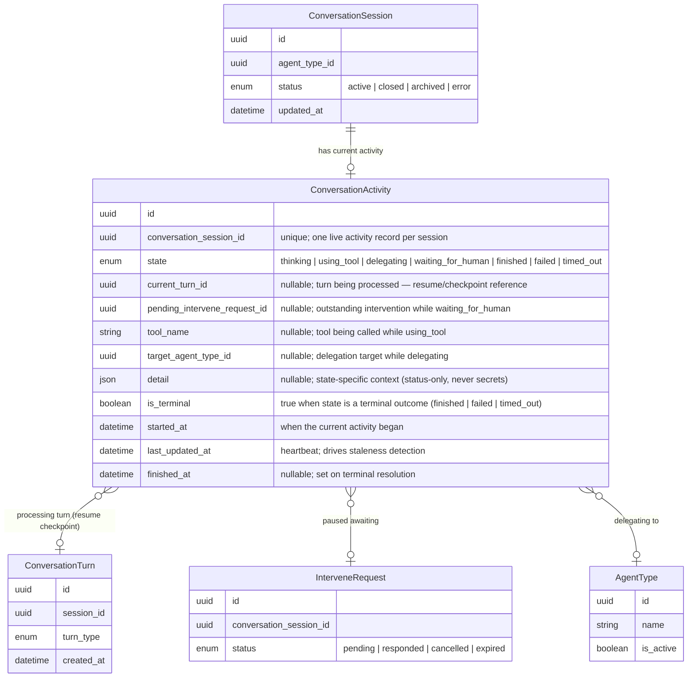

# Data Model: Persistent Agent Activity State

Technology-agnostic entity model for the persisted, authoritative "what is the assistant doing right now" record that powers the chat processing indicator across reloads, restarts, and server failover.

## Design Note — New Entity vs. Fields on `ConversationSession`

Modeled as a **new entity** (`ConversationActivity`), not new fields on `ConversationSession`.

Rationale:
- `ConversationSession.status` is the coarse **lifecycle** state (active / closed / archived / error). The activity indicator is a **different axis** — a fast-changing "live turn" state with state-specific payloads (tool name, delegation target, pending intervention). Conflating them would force a pile of mostly-NULL columns onto the session and muddle lifecycle vs. liveness.
- A dedicated 0..1 child gives a clean, single authoritative record per session that can be atomically overwritten on every state transition, cheaply queried on (re)load, and independently resolved to a terminal state when work can no longer be resumed.
- The resume/checkpoint reference (current turn + pending intervention) lives naturally on the activity record rather than on the session or turn history.

---

## 1. New Entities

**Entity description:**

- **ConversationActivity** — the authoritative, persisted record of a conversational agent's current activity within a conversation session. Exactly one live record per session (created on first activity, updated in place on every state transition). `state` is the single source of truth the chat surface reads to reconstruct the indicator; `current_turn_id` and `pending_intervene_request_id` are the resume/checkpoint references that let a paused turn be resumed (or re-surfaced) after reload, restart, or failover. `detail` carries state-specific context only — never credentials, tokens, or decrypted secrets.

**State semantics:**

| State | Meaning | Carried in |
|---|---|---|
| `thinking` | Assistant is reasoning, no tool/delegation active | `current_turn_id`, `detail` |
| `using_tool` | Assistant is calling a tool | `tool_name` |
| `delegating` | Assistant delegated to another agent | `target_agent_type_id` |
| `waiting_for_human` | Assistant paused for human input | `pending_intervene_request_id` |
| `finished` | Turn completed normally (terminal) | — |
| `failed` | Turn failed (terminal) | `detail` |
| `timed_out` | Turn timed out or work no longer resumable (terminal) | `detail` |

---

## 2. Modified Entities

No field additions, removals, or renames to existing entities.

- **ConversationSession** — gains only a **relationship** (`ConversationActivity`), not a column. Lifecycle `status` remains unchanged.
- **ConversationTurn**, **InterveneRequest**, **AgentType** — unchanged; referenced by `ConversationActivity` via foreign keys.

---

## 3. Removed Entities / Fields

None.

---

## 4. Schema File References

Paths relative to `source.schema` (`backend/app/db/models/`):

| File | Change |
|---|---|
| `backend/app/db/models/conversation_activity.py` | **New** — `ConversationActivity` entity + `ActivityState` enum (mirrors the one-entity-per-file pattern used by `agent_data.py` / `agent_output.py`). |
| `backend/app/db/models/conversations.py` | Add `ConversationSession.activity` relationship (back-reference); no column changes. |
| `backend/app/db/models/intervene.py` | Optional back-reference from `InterveneRequest` to `ConversationActivity` (or resolve via `conversation_session_id` at read time). |
| `backend/app/db/models/agents.py` | No change required; `target_agent_type_id` references existing `AgentType`. |

---

## 5. Master Data Model Update Instructions

**Persistence boundary (must be preserved):** only the **Control Center** connects to the database — `ConversationActivity` is persisted and owned by CC. Agent Runtime and Communication Hub read activity state only through CC (mTLS), never the DB directly. The entity model itself remains tech-agnostic; just ensure the master docs note the ownership boundary (CC-owned, AR/CH read-only via CC).

Update these files in `docs/master/data-model/`:

1. **`modules/communication/entities.md`** — the canonical home for conversation entities:
   - Add `ConversationActivity` to the `erDiagram` (attributes above) and wire the relationships: `ConversationSession ||--o| ConversationActivity`, `ConversationActivity }o--o| ConversationTurn`, `ConversationActivity }o--o| InterveneRequest`, `ConversationActivity }o--o| AgentType`.
   - Add a `ConversationActivity` row to the entity-description table.
   - Add an **ActivityState enum values** table (mirroring the existing `ConversationStatus` table) listing the seven states and their terminal/non-terminal classification.
   - Note in the "Conversation-scoped interventions" text that `waiting_for_human` links to the outstanding `InterveneRequest` via `pending_intervene_request_id`.

2. **`overview.md`** — wherever the conversation-domain diagram appears (the Third-Party Agent Integration / conversational section and the intervene section), add `ConversationActivity` with its relationships. Keep it to the conversation-domain sections; do not duplicate it into unrelated modules.

3. **Optional** — add a brief `ConversationActivity` entry to any cross-domain diagram that already lists `ConversationSession`, but only if that section is conversation-domain-facing (not the Agents/Runtime sections, which surface `AgentSession` status separately).
