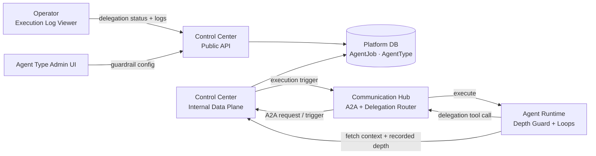
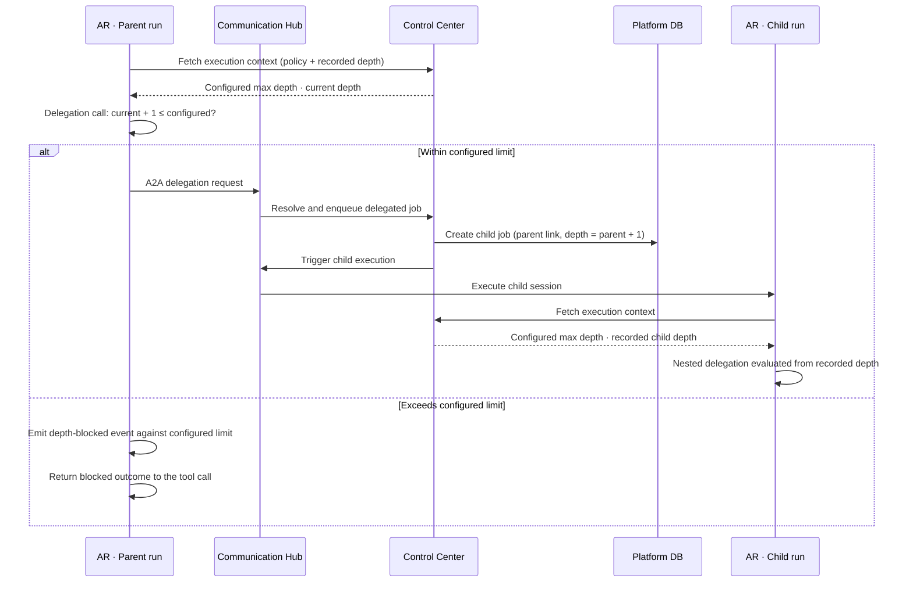
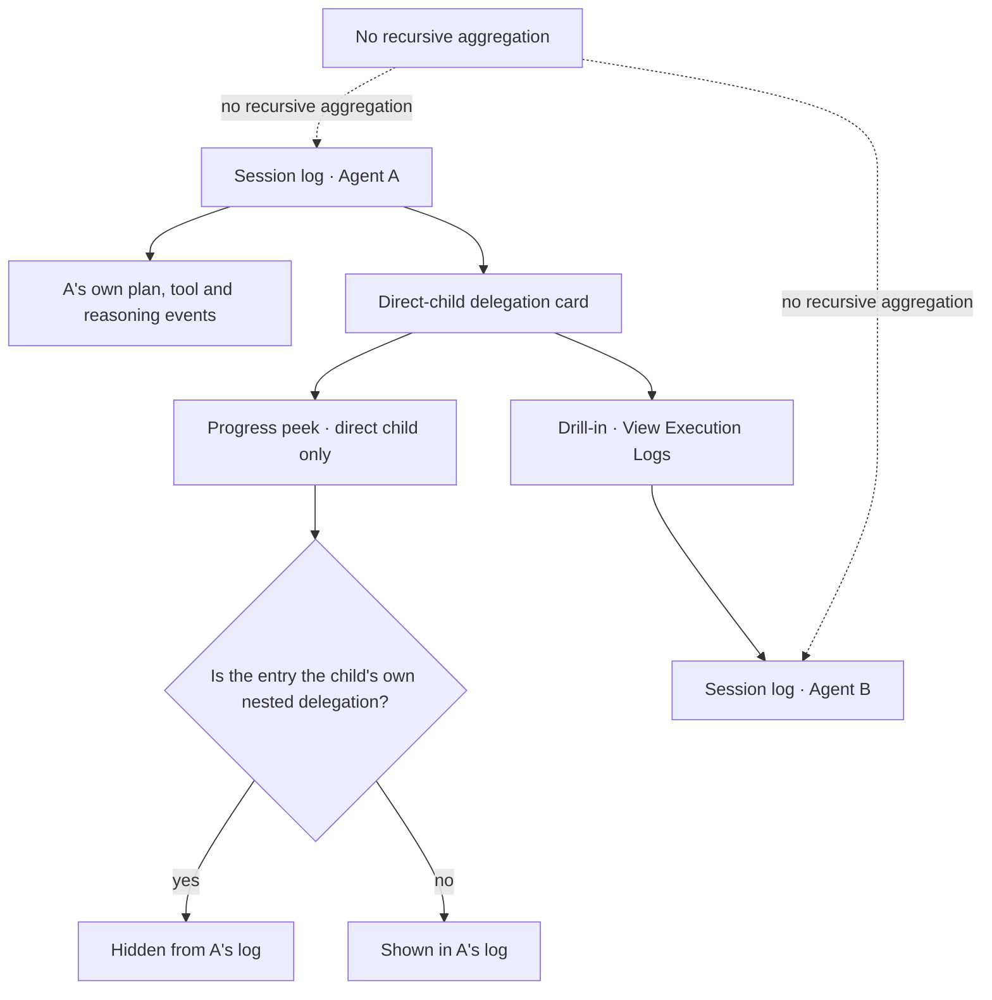
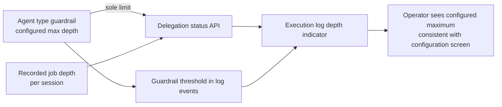

# Architecture Changes: Remove the Hard-Coded Delegation Depth Cap

## Summary

The platform currently applies two depth limits: the per-agent-type **Max Delegation Depth** guardrail and a cap of its own — a delegated agent cannot pass work on, so a chain never extends past the originating agent plus one level; task (non-conversational) agents additionally have their configured value forced down to a single level; and the delegation status always reports a constant platform maximum. This change removes every platform-imposed cap so the configured guardrail is the sole limit for both conversational and task agents.

No new service, no new component, no database schema change, and no migration. The change is confined to how Agent Runtime derives and evaluates depth, how Control Center surfaces that depth and the configured maximum, and how the execution log filters its direct-child progress peek.

Key paths: Agent Runtime → Control Center internal data plane (depth is read, not assumed); Control Center public API → Operator (configured maximum reported); Agent Runtime → Communication Hub (evaluation against the configured limit instead of a constant).

---

## 1. Changed Components

| Component | Service | Change |
|---|---|---|
| **Guardrail State Builder** | Agent Runtime | Stop forcing the Max Delegation Depth value down to a single level for task (non-conversational) agents. The value resolved from the execution context is used as-is for both conversational and task agents. Agent types that never configured a value keep today's default behaviour. |
| **Delegation Depth Guard** | Agent Runtime | Begin the run's depth counter from the depth already recorded for the job (the delegated child's own persisted depth) instead of always starting from zero on an input key that is not populated today. A nested delegation is allowed while `current depth + 1` is within the configured maximum. Blocking still emits the existing depth-blocked event and returns a blocked tool result, but the limit reported is the configured maximum rather than a platform constant. Cycle detection, delegated-step budget, iterations, timeout, and token budgets are untouched. |
| **Task Execution Loop** | Agent Runtime | The task loop's depth ceiling is seeded from the resolved guardrail policy rather than a hard-coded value, and the inline fallback guardrail state used when no policy is available no longer introduces a cap of its own. |
| **Internal Session Payload** | Control Center | Expose the job's recorded delegation depth on the internal session payload Agent Runtime already fetches, so nested delegation can be evaluated without any database access. The delegation enqueue path already derives depth from the parent job at creation; that behaviour is unchanged and becomes the authoritative source the runtime reads. |
| **Delegation Status API** | Control Center | The delegation status response returns the **configured** maximum depth for the session's agent type instead of a constant. Response shape is unchanged; only the value's meaning changes (configured policy, not platform constant). |
| **Guardrail Validation** | Control Center | Remove the platform upper bound on the configurable Max Delegation Depth in both the direct-API and assistant-managed (conversational management) validation paths, keeping the existing non-negative check. No change to the setting, its label, its stored value, or its default. |
| **Execution Log Delegation Card** | Web UI | The direct-child progress peek filters out the child's own nested delegation activity, so a delegated agent's onward delegation does not appear in the parent's log. The depth indicator reads the configured maximum from the payload it already consumes. Layout, timeline, and the existing drill-in action are unchanged. |
| **A2A / Delegation Router** | Communication Hub | No behavioural change. Confirmed to remain a forward-only relay: it forwards the delegation request and execution trigger, and it carries no implied one-level assumption in its delegation events. No depth logic is added here. |

**Service boundary preserved:** only Control Center touches the database. Agent Runtime obtains the recorded depth and the configured maximum through Control Center internal APIs; Communication Hub continues to forward without reading or writing state directly.

**Removed concepts:**

- The implicit rule that a delegated agent can never pass work on.
- The forced single delegated level for task agents.
- The constant maximum depth in the delegation status response.
- The platform-level upper bound on the configurable guardrail value.

---

## 2. New Components

None.

No new service, endpoint family, storage, message type, or background worker is introduced. The change reuses the existing delegation lifecycle events (started, waiting, resumed, depth-blocked, timeout, failed) and the existing delegation status and execution log services.

---

## 3. Integration Points

| Integration point | Direction | Change |
|---|---|---|
| Execution context / session metadata | Agent Runtime → Control Center internal data plane | Extended payload: the recorded delegation depth travels with the internal session payload the runtime already fetches, alongside the configured maximum carried by the guardrail policy in its execution context. This is the only new data the runtime needs; it introduces no new call. |
| A2A delegation request | Agent Runtime → Communication Hub → Control Center | Unchanged contract. Control Center continues to derive the child job's depth from its parent at enqueue, which is now the value the child runtime evaluates against. |
| Execution trigger | Control Center → Communication Hub → Agent Runtime | Unchanged contract. The trigger does not need to carry depth; the runtime reads it from the execution context. |
| Delegation status (read) | Execution Log Viewer → Control Center public API | Value semantics change only: the reported maximum depth now reflects the session agent type's configured guardrail. Two agent types with different configurations now report different maximums. |
| Guardrail configuration (write) | Agent Type admin UI / assistant → Control Center | Validation accepts any non-negative depth. No new field; the assistant-managed path applies the same relaxed bound as the direct API path. |
| Execution log read | Agent Runtime → Control Center log store; Execution Log Viewer → Control Center | Log scoping contract unchanged: a session's log returns only that session's entries. No recursive aggregation, no chain-wide query, no new endpoint. |

No new integration crosses the service boundary, and no path introduces database access from Agent Runtime or Communication Hub.

---

## 4. Data Flow Changes

### 4.1 Depth resolution for a delegated chain

The decisive change is the arrow into the child run: the child evaluates nested delegation against **its recorded depth and its configured maximum**, instead of restarting from zero against a platform constant.

### 4.2 Execution log scoping (unchanged guarantee, one filter added)

Each session log stays single-agent scoped. Deeper activity is reached one hop at a time by drilling into the delegated agent's own log, which shows that agent's own direct delegations — the mechanism that makes a multi-level chain readable without merging output.

### 4.3 Operator-visible depth reporting

---

## 5. Master Arch Update Instructions

| Master document | Update |
|---|---|
| `docs/master/architecture/modules/agent-runtime/architecture.md` | Rewrite the **Delegation Depth Guard** section: the per-agent-type configured maximum is the sole limit for both conversational and task agents; depth is inherited from the job's recorded depth; no platform cap exists. Update the Execution Flow diagram so the guard edge reads "within configured limit: allow / exceeds configured limit: blocked". |
| `docs/master/architecture/modules/agent-lifecycle.md` | Replace the "Delegation depth is limited to 1 level for non-conversational agents" paragraph: nested delegation is bounded by the configured guardrail; blocked outcomes name the configured limit. Keep the existing note that cycle detection and other guardrails are unaffected. |
| `docs/master/architecture/modules/tool-execution.md` | Update the agent-delegation step description: the depth check compares against the configured maximum, not a fixed single level. |
| `docs/master/architecture/modules/execution-logs.md` | Update the delegation-status sequence and stop-reason flowchart wording: depth blocks are reported against the configured limit; the parent log shows only direct-child delegation lifecycle plus a filtered progress peek, with drill-in used for deeper levels. |
| `docs/master/architecture/system-overview.md` | Amend the Agent Runtime bullet so it states that delegation depth is enforced from the agent type's configured guardrail as the single limit — removing any wording implying a platform-level cap — while cycle, step, iteration, timeout, and token guardrails remain. |
| `docs/master/architecture/modules/agent-types.md` | Note that Max Delegation Depth has no platform upper bound (basic non-negative validation only) and that the default for unconfigured agent types is unchanged. |
| `docs/master/architecture/modules/control-center/runtime-monitoring.md` | Verify only — delegation-tree columns by depth remain valid; deeper trees may now appear because chains are no longer truncated. No layout change intended. |
| `docs/master/architecture/README.md` / `system-overview.md` | Only if a "delegation guardrails" summary line exists — confirm it names the configured guardrail as the sole depth limit. |
