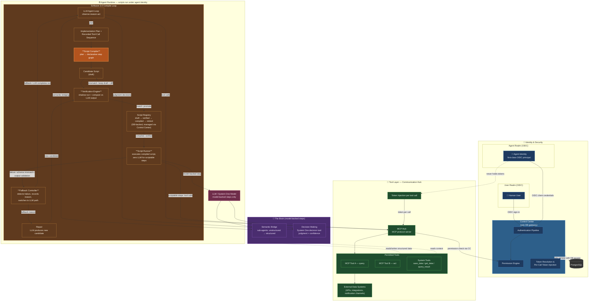
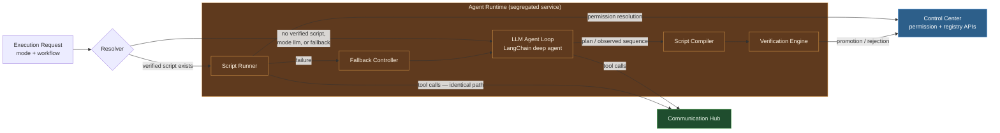
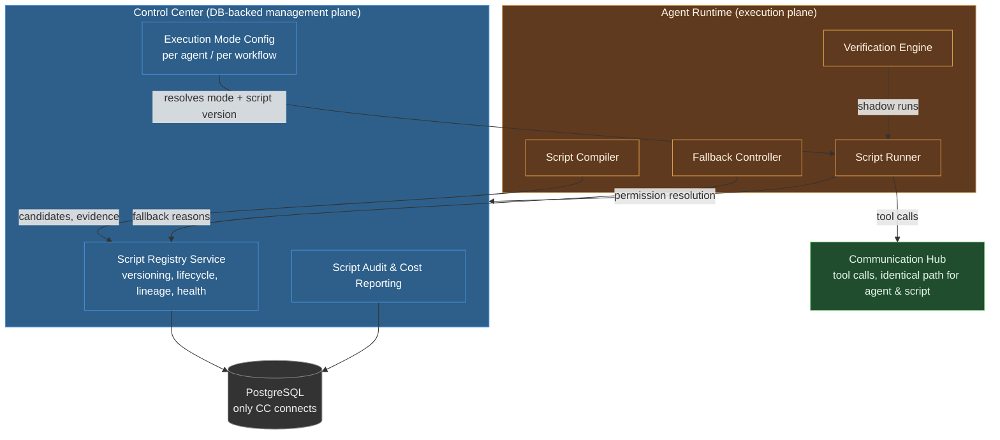

# Architecture: Software 3.0 Agent Framework — Workflow Compilation

**Related:** [prd.md](prd.md) · [spec-change.md](spec-change.md)
**Scope:** Capability extension. The three backend services, identity topology, tool/permission model, and LLM agent loop are preserved; five new compilation-lifecycle components are added within existing service boundaries.

## Flagship View — Parthenon as a Software 3.0 Framework

One-view diagram of the whole system: security layers, dual OIDC identity, the tool access path, the two halves of "The Brain", and the new Software 3.0 compile loop.

### Reading the diagram

- **Security layers (segregated):** Control Center (identity, permissions, registry management, sole DB access), Agent Runtime (all agent and script execution), Communication Hub (tool brokerage, token injection). No cross-layer shortcuts.
- **Identity:** humans sign in via the **user realm**; agents are **first-class OIDC principals in the agent realm**. Both flow through Control Center's authentication pipeline and Permission Engine. Scripts inherit the executing agent's identity — no new identity class.
- **Tool access path:** integrations → MCP Hub → permitted tools → external data systems. Permission is checked against Control Center; Communication Hub injects the identity token **per tool call** — agents and scripts never hold tokens.
- **The Brain, split in two:** the **Semantic Bridge** (sub-agents converting unstructured → structured data) and **Decision Making** (System One model-based decision tool for judgment-type decisions). Both are invocable as *steps inside compiled scripts* — those steps stay model-backed (and are flagged as such).
- **The compile loop (NEW):** agent run → implementation plan + recorded tool calls → Script Compiler → candidate script → Verification Engine (shadow-run, compare vs LLM output) → promoted to compiled registry → subsequent runs execute script-only with zero LLM. On failure, the Fallback Controller routes to the LLM path and records the reason; repair loops a new candidate back through verification.

## 1. Changed Components

### Agent Runtime — execution engine

| Aspect | Before | After |
|---|---|---|
| Execution path | Every session traverses the LLM observe-reason-act loop | Session resolves to **LLM run**, **compiled script run**, or **fallback run** based on the workflow's execution mode (`llm` / `compiled-with-fallback` / `compiled-only`) and script availability |
| Plans | Describe steps for this run only | Additionally yield a reusable candidate bridge script |
| Telemetry | LLM usage only | Distinguishes script runs vs LLM runs, script version, fallback events, residual model-backed step usage |

### Communication Hub — Agent Gateway / MCP Hub
Unchanged responsibilities, extended bookkeeping: every tool call now carries an execution provenance tag (`script` vs `llm`) and, where applicable, a script version — recorded in audit trails. Token injection per call and permission delegation to Control Center are untouched.

### Control Center — governance surface
Adds registry management (lifecycle transitions, health status), script audit and cost reporting, execution-mode configuration per agent/workflow, and operator dashboards (compilation rate, fallback rate, token savings). Remains the only database-connected service.

### Agent Implementation Plans (capability)
A plan becomes a *durable artifact*: reviewed alongside the agent's steps, and used (with the observed tool-call sequence) as compiler input. Plan review UI gains a candidate-script review step.

### Observability & Cost Reporting (capability)
OTEL spans and dashboards distinguish script executions from LLM executions; cost reports show tokens *not* consumed versus the LLM baseline, and call out residual model usage from semantic-bridge/decision steps.

## 2. New Components

Five new components, all within existing service boundaries:

### Script Compiler *(inside Agent Runtime)*
- **Responsibility:** turns an implementation plan and/or the recorded tool-call sequence of a successful LLM run into a deterministic **bridge script** — a declarative step graph: tool calls, data transformations/filters, branches to Semantic Bridge or Decision steps, typed inputs/outputs.
- **Boundaries:** produces candidates only; never promotes, never executes. Output contains no credentials or tokens (SEC3). Model-backed steps are marked, not inlined.

### Script Registry *(managed via Control Center, DB-backed)*
- **Responsibility:** versioned storage of scripts with lifecycle `draft → verified → compiled → retired`, health status, lineage back to the producing plan or run, verification evidence, and execution/audit records.
- **Boundaries:** managed exclusively by Control Center (the sole DB gateway). Agent Runtime consumes compiled versions through Control Center APIs — never the database. Re-verification is required after repair or tool-schema change.

### Script Runner *(inside Agent Runtime)*
- **Responsibility:** executes compiled scripts. Runs the declarative step graph step-by-step; model-backed steps delegate to the Semantic Bridge sub-agent or System One decision tool; every tool call goes through Communication Hub **exactly like an agent tool call**.
- **Boundaries:** runs under the executing agent's identity and permission model — it can never invoke a tool the agent identity is not permitted to use (SEC1), holds no credentials, and has no database access. Per-tool permission resolution flows through Control Center; tokens are injected per call by Communication Hub.

### Verification Engine *(inside Agent Runtime)*
- **Responsibility:** shadow-runs candidate scripts against recorded LLM executions on identical inputs, compares outputs (with declared comparison tolerance), retains evidence (inputs, expected vs actual, outcome), and promotes matches to **verified/compiled** or returns mismatches to **draft** with a diff.
- **Boundaries:** promotes only after successful comparison; rejection reasons are recorded for repair. Verification artifacts are stored via the registry (Control Center), never locally in Agent Runtime.

### Fallback Controller *(inside Agent Runtime)*
- **Responsibility:** detects script failure (execution error, tool schema mismatch, output validation failure), switches the run to the LLM agent path (except in `compiled-only` mode), records the fallback reason and script version, and feeds the repair loop — the LLM path may produce a repaired candidate that must re-verify before promotion.
- **Boundaries:** degrades script health status on repeated fallbacks; never silently discards failures; never widens permissions during fallback.

## 3. Integration Point Changes

| Integration point | Change |
|---|---|
| **Agent Runtime → Control Center** | New reads: resolved execution mode + current compiled script version per workflow; new writes: candidates, verification evidence, fallback events, health updates. Permission resolution API reused unchanged by the Script Runner. |
| **Agent Runtime → Communication Hub** | No protocol change. Script tool calls use the same authenticated path (agent-instance mTLS, delegated permission check, per-call token injection); requests tagged with script provenance for audit. |
| **Communication Hub → Control Center** | Unchanged permission/token delegation; audit records gain script version metadata. |
| **Control Center → PostgreSQL** | New schema: script registry tables (versions, lifecycle, evidence, lineage, health, execution/audit records), execution-mode configuration, cost-tracking records. Alembic migration required. |
| **Agent Implementation Plans → Compiler** | Plan output contract extended: plan plus observed tool-call sequence become compiler inputs. |
| **Semantic Bridge / System One decision tool → compiled scripts** | New invocation contract: both are callable as steps in a declarative script's step graph, with structured results and confidence carried downstream; marked as model-backed steps. |
| **Operator UI → Control Center** | New screens: registry browser (compare/promote/demote/retire), execution-mode settings, script health & fallback dashboards, cost-savings reports. |
| **OTEL telemetry** | New span attributes: execution mode, script version, fallback reason, model-backed-step usage; new metrics: compilation rate, script hit rate, fallback rate, tokens saved. |

## 4. Data Flow Changes

**Flow A — First run / LLM path (existing, extended):**
request → Agent Runtime LLM loop → tool calls via Communication Hub (permission check + token injection) → result. *New:* the plan and observed tool-call sequence are captured and handed to the Script Compiler; the candidate script and verification evidence flow Agent Runtime → Control Center → database.

**Flow B — Compiled run (new):**
request → Control Center resolves mode + compiled script version → Agent Runtime Script Runner executes the step graph:
- scriptable steps → tool calls via Communication Hub (identical permission/token path as an agent) → external data systems;
- model-backed steps → Semantic Bridge sub-agent or System One decision tool → structured result/confidence into downstream steps;
- success → typed output; telemetry records `script` run with script version, zero LLM token spend for scriptable steps.

**Flow C — Fallback & repair (new):**
script failure (error / schema mismatch / output validation) → Fallback Controller → LLM agent path completes the run → fallback reason + script version recorded in registry → repaired candidate → Verification Engine → re-verify → promote to new compiled version (or remain draft). Health status degrades on repeated fallbacks; operators notified.

**Flow D — Verification (new):**
candidate (draft) → shadow-run on recorded inputs → compare vs LLM execution output → match: promote to compiled; mismatch: stay draft with recorded diff. Evidence retained for audit (V2).

**Invariant across all flows:** only Control Center touches PostgreSQL; every external tool access traverses Communication Hub with per-call token injection; agents and scripts never hold tokens or credentials.

## 5. What to Update in `docs/master/architecture/`

- **`system-overview.md`** — add a Software 3.0 section to *Workflow Execution* (compiled vs LLM execution paths, fallback) and extend *Key Responsibilities* for Agent Runtime (compiler/runner/fallback) and Control Center (registry, modes, cost reporting). Link the flagship diagram.
- **`modules/agent-runtime/architecture.md`** — add the Script Compiler, Script Runner, Verification Engine, and Fallback Controller with their boundaries; describe the declarative step-graph execution model and the identical tool-call path for scripts.
- **`modules/control-center/architecture.md`** — add the Script Registry service, execution-mode configuration, script audit & cost reporting; new database schema summary.
- **`modules/communication-hub/architecture.md`** — note script-provenance tagging on tool calls; explicitly state the token-injection/permission path is unchanged for script calls.
- **`modules/identity.md`** — add a short note: scripts inherit the executing agent's OIDC identity; no new identity class (U2).
- **`modules/iam.md`** — add a section: scripts are consumers of the existing permission model; no new permission pathway; deny-by-default applies unchanged to script tool calls.
- **`modules/tool-execution.md`** — document script-initiated tool calls alongside agent tool calls (same resolution, same injection, provenance metadata).
- **`modules/agent-lifecycle.md`** — extend the execution lifecycle with the three modes and fallback/repair transitions.
- **`modules/observability.md`** — new telemetry attributes/metrics for compilation, fallback, and token savings.
- **New module doc: `modules/workflow-compilation.md`** — dedicated module architecture for the compile loop (compiler → verification → registry → runner → fallback), following the notation of existing module docs.
- **`modules/dashboard.md`** — operator dashboards for registry management, script health, and cost savings.
- **`security/certificate-management.md`** — confirm agent-instance certificates are used unchanged by the Script Runner; scripts hold no certificates.

## Compliance Note

This design complies with `docs/config.yaml` `top_priority_rules`: the three backend services remain fully segregated; agents (and scripts) run only in Agent Runtime; only Control Center connects to the database; scripts execute under the same identity/permission model as agents — they never bypass MCP tool permissions, never hold credentials, and Communication Hub injects tokens per tool call exactly as today.
