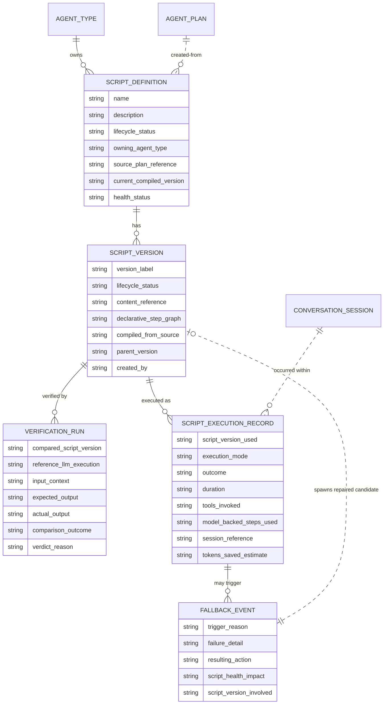

# Data Model: Software 3.0 Agent Framework — Workflow Compilation

**Related:** [prd.md](prd.md) · [spec-change.md](spec-change.md) · [architecture.md](architecture.md)
**Scope:** New business entities for the script registry, verification, compiled execution, and fallback/repair. This document is **technology-agnostic**: it describes business entities, attributes (name + meaning + cardinality), and relationships only — no table DDL, no SQL, no column types.

## 1. New Entities

### 1.1 Script Definition

A versioned, named bridge script compiled from an agent workflow — the registry's primary entity. One script belongs to exactly one **Agent Type** (the agent whose identity and permissions it inherits); an agent type may own many scripts.

- **Name / description** — human-identifiable identity of the workflow the script automates (1 each).
- **Lifecycle status** — where the script sits overall: `draft → verified → compiled → retired` (1).
- **Owning agent type** — reference to the Agent Type whose identity/permissions bound the script (exactly 1).
- **Source lineage** — reference to the implementation plan and/or observed LLM run from which it was compiled (0..1 each; G1 lineage requirement).
- **Current compiled version** — pointer to the version currently serving compiled runs (0..1; absent while draft/unverified).
- **Health status** — aggregate health derived from recent fallback behavior; degrades on repeated fallbacks (1; F4).

### 1.2 Script Version

An **immutable** revision of a Script Definition. Versioning warrants a separate entity because each version carries its own lifecycle, verification evidence, and audit history (V4).

- **Version label** — ordered identity within the parent script (1).
- **Lifecycle status** — `draft / verified / compiled / retired` for this version (1).
- **Content** — the declarative step graph (tool calls, transforms, model-backed steps) by reference — content is stored via Control Center, never in Agent Runtime (1).
- **Parent version** — the prior version this was repaired/re-verified from (0..1).
- **Created by** — the run or actor that produced this version (1).

### 1.3 Verification Run

The evidence record of shadow-running a Script Version against an LLM execution on identical inputs (V1, V2). Many verification runs per script version over its life; each belongs to exactly one version.

- **Compared script version** — the candidate under test (exactly 1).
- **Reference LLM execution** — the recorded LLM run used as ground truth (exactly 1).
- **Inputs, expected output, actual output** — retained comparison evidence (1 each).
- **Comparison outcome** — match / mismatch within declared tolerance (1).
- **Verdict** — promoted to compiled, or rejected back to draft with a recorded diff/reason (1; V3).

### 1.4 Script Execution Record

One execution of a compiled script (or its fallback run). Relates to the existing **Agent Session / ConversationSession** concept — a compiled run occurs within or on behalf of a session (G2 audit).

- **Script version used** — exactly 1.
- **Execution mode in effect** — `llm` / `compiled-with-fallback` / `compiled-only` (1).
- **Outcome** — success, validation failure, or fell back (1).
- **Duration** — elapsed time (1).
- **Tools invoked** — the tool calls made, mirroring existing tool-call records (0..many).
- **Model-backed steps used** — semantic-bridge / decision steps that consumed model capacity (0..many; S3).
- **Token savings estimate** — LLM tokens not consumed versus LLM baseline (1; G3).

### 1.5 Fallback Event

Recorded whenever a compiled run fell back to the LLM path (F1, F2). Each belongs to exactly one execution record; each references the script version involved.

- **Trigger reason** — `execution error` / `tool schema mismatch` / `output validation failure` (1).
- **Failure detail** — context needed for repair (1).
- **Resulting action** — LLM completed the run; repaired candidate produced or not (1).
- **Script health impact** — contribution to the owning script's health degradation (1; F4).
- **Repaired candidate** — link to the successor Script Version, if repair produced one (0..1).

### 1.6 Execution Mode Configuration

Per-agent / per-workflow execution mode setting (`llm` / `compiled-with-fallback` / `compiled-only`), operator-managed via Control Center (E1). One setting per agent-type/workflow pair; referenced when resolving how a run executes.

## 2. Modified Entities

No changes to existing entity *structure* are required. Existing entities are **extended in role**, not altered:

- **Agent Type** (`agents.py`) — becomes the owner of Script Definitions (new one-to-many relationship only).
- **Agent Plan** (`agents.py`) — gains a backward reference to the Script Definition(s) compiled from it (lineage).
- **Conversation Session / Agent Job** — executions may now reference a Script Execution Record for provenance; no structural change required.

Execution *records* for script runs are new entities (§1.4) rather than modifications of existing run/turn records, to keep LLM-native records untouched.

## 3. Removed Entities / Fields

**None.** No existing entity or field is removed or repurposed. The change is purely additive (capability extension).

## 4. Schema Files Needing Updates (`source.schema` = `backend/app/db/models/`)

All new entities live behind Control Center (sole DB gateway); Agent Runtime consumes registry data only via Control Center APIs. New models and changes:

| File | Change |
|---|---|
| **`backend/app/db/models/script_registry.py`** *(new)* | Host `ScriptDefinition`, `ScriptVersion`, `VerificationRun`, `FallbackEvent` — one module for the registry cluster, following the project's one-domain-per-file pattern (cf. `agent_security.py`, `scheduling.py`). |
| **`backend/app/db/models/script_execution.py`** *(new)* | Host `ScriptExecutionRecord` and `ExecutionModeConfiguration`. |
| **`backend/app/db/models/agents.py`** | Add FK relationships on `AgentType` and `AgentPlan` to the new script entities (existing classes otherwise unchanged). |
| **`backend/app/db/models/__init__.py`** | Export the new models. |

**Related existing models referenced (not modified):** `AgentType`, `AgentPlan`, `AgentJob`, `ConversationSession` (all `agents.py` / `conversations.py`); execution logging continues via `ExecutionLogEntry` (`session_logs.py`) and tool-call provenance via `ToolCallRecord` / `RuntimeToolCall` (`tool_calls.py`). An Alembic migration under `backend/alembic/versions/` is required (see AGENTS.md migration rules).

## 5. Updates to `docs/master/data-model/`

- **`overview.md`** — add a Software 3.0 / Workflow Compilation section: introduce Script Definition, Script Version, Verification Run, Script Execution Record, Fallback Event, Execution Mode Configuration; state they are Control-Center-owned and Agent Runtime accesses them via APIs only.
- **`modules/agents/`** — extend the agent-type entity page with the Agent Type → Script Definitions ownership relationship and the Agent Plan → script lineage.
- **New module page `modules/workflow-compilation/`** (or a page within the closest existing module, e.g. `modules/operations/`) — the script registry ERD from §1, lifecycle rules (`draft → verified → compiled → retired`), health/fallback semantics, and verification evidence retention.
- **`modules/operations/`** (execution/audit pages) — document Script Execution Records as a first-class execution provenance kind alongside LLM runs, including mode, duration, tools invoked, and token savings.
