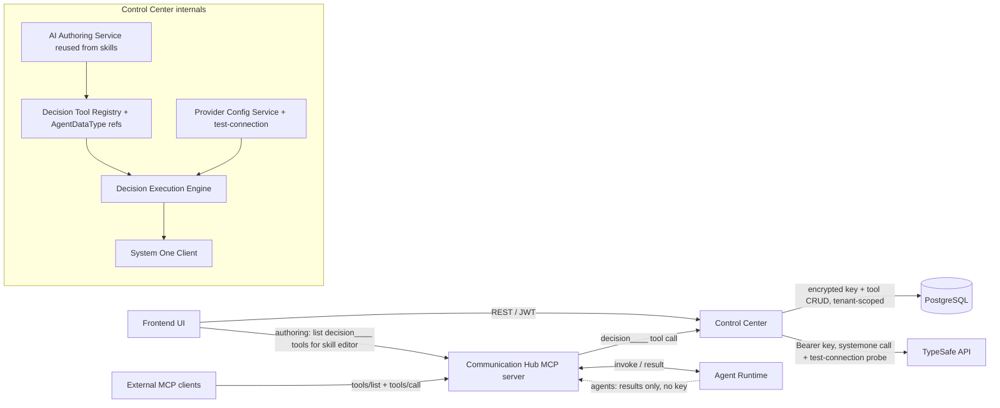
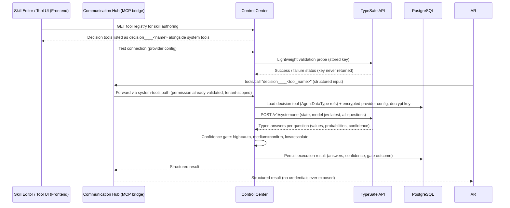

# Architecture Changes: System One Decision Tools

> Top-priority rule validation (docs/config.yaml): service segregation preserved (Control Center only calls TypeSafe API and DB; Agent Runtime only runs agents; Communication Hub only brokers); agents never receive the TypeSafe API key — decryption and external calls happen in Control Center only, mirroring model-config resolution and MCP credential decryption at call time. Skills are unchanged — decision-making is delivered as user-definable **decision tool** modules that behave exactly like Parthenon's built-in system tools, with all tools tenant-contained (names unique per tenant).

## 1. Changed Components

### Control Center (backend)
- **System tool registry & resolution** — the existing system-tool registry/resolution path now also carries user-defined decision tools alongside built-in system tools (`system____save_data`, `system____get_data`, …); decision tools resolve through the same lookup, permission, and grant model. No change to skills or the skills model.
- **Tool naming & reservation** — the shared tool-naming convention (`server____tool` four-underscore separator) gains `decision` as a second reserved server slug next to `system`; decision tools surface canonically as `decision____<name>` everywhere (backend registry, frontend tool naming, MCP catalog). Both names parse through the same canonical-name helpers.
- **Provider configuration service** — extends the encrypted-credential pattern (AES-256) used by MCP server credentials and model configurations to store the TypeSafe API key; supports multiple System One providers (only `typesafe`/`jev-latest` enabled initially). Key is decrypted only at call time inside Control Center.
- **Provider test-connection endpoint** — follows the existing `test_connection` pattern of the system-config and MCP-hub routers: Control Center performs a lightweight validation call to the configured provider base URL with the stored key and reports success or a clear failure. The response carries status only — **the key is never returned** by the endpoint or any read API.
- **System-tools execution path** — when a dispatched tool is a decision tool, the existing system-tool execution route resolves the tool definition + provider config, builds state and question set, calls the TypeSafe System One API, and returns typed answers instead of routing to an LLM.
- **Permission resolution** — decision tools are granted like system tools through the existing role → tool → permission resolution; no parallel permission path.

### Communication Hub
- **MCP tool registry bridge** (`tool_registry_bridge`) — decision tools are registered alongside system tools in the MCP `tools/list` catalog with the canonical `decision____` name prefix (same four-underscore convention as `system____`); `tools/call` for a `decision____`-prefixed name is forwarded to Control Center's system-tools execution path. CH brokers only: no direct external calls, no credentials.
- **Tenant-scoped tool catalog** — the permission-filtered catalog and dispatch resolve tool names within the caller's tenant, so identical tool names in different tenants never collide.
- **MCP server slug validation** — the reserved-slug check that rejects `system` on MCP server create/update is extended to also reject `decision`, so no external MCP server slug can collide with the decision-tool namespace.

### Agent Runtime
- **Agents/SOP engine** — decision tools appear in the agent/SOP tool surface exactly like system tools; agents receive only structured results (answers, probabilities, confidence), never credentials.
- **Role/permission resolution** — no structural change; decision tools granted via existing agent roles like any system tool.

### Frontend
- **Tool management UI (system tools section)** — new decision-tool authoring flow: configured-model check (blocking if none), type-driven question form (Choice / Score / Noul), state preset mapper, Agent Data Type selectors with read-only type viewers, auto-generated tool description preview.
- **Skill authoring tool picker** — the existing tool registry listing used when defining skills (fed by the same tool catalog that powers the MCP bridge) now lists saved decision tools alongside system tools as `decision____<name>`, so authors attach them to skills with no extra step.
- **System Config UI** — new provider configuration section for TypeSafe API key (write-only; never returned in plaintext) with a **Test connection** button calling the new Control Center validation endpoint.
- **Tool catalog / monitoring UI** — decision tools listed alongside system tools with the `decision____` prefix; execution results display typed answers and confidence.

## 2. New Components

- **Decision Tool Registry** (Control Center, DB) — CRUD for user-defined decision tools: question sets (Choice / Score / Noul with instructions and criteria), state preset, and input/output references to **existing Agent Data Type records** (no ad-hoc schemas — the platform's typed-schema catalogue, aligned with system-tool conventions, read-only viewable in the form); **tenant-scoped name uniqueness** (same name allowed in different tenants); definition validation (question types, data-type references, state preset mapping); auto-generation of the tool description from the definition. Provider-configuration-status check gates authoring.
- **State placeholder detection & mapping assistant** (Control Center + Frontend) — the authoring form scans question instructions for backtick-quoted object/state paths (e.g. `` `input.tier` ``) and surfaces them as suggested state mappings; the chosen input data type's properties populate the mapping property selectors automatically.
- **AI-assisted decision authoring endpoint** (Control Center) — reuses the agent-skill instruction-generation mechanism (`workflow_authoring_service`, the same backend service behind the skill editor's generation button): a new endpoint takes the tool description plus the chosen input/output Agent Data Types and drafts questions and state mapping for the author to review and adjust. Frontend gets a generation button mirroring the skill editor's.
- **System One Provider Config Service** (Control Center) — CRUD for encrypted provider credentials, enabled-model list, configuration-status query used by the tool authoring UI, and the test-connection validation operation.
- **System One Client** (Control Center internal, reused) — outbound integration to `https://api.typesafe.ai/v1/systemone` (Bearer key); provider-agnostic interface so future providers plug in; also serves the lightweight test-connection probe. Now keyed to decision tools, not skills.
- **Decision Execution Engine** (Control Center, reused/re-keyed) — orchestrates per-tool invocation: resolve decision tool → apply state preset → dispatch all questions in one parallel evaluation → normalize typed answers → compute confidence gate.
- **Decision Tool → MCP Exposure Path** — via the existing Communication Hub MCP server: decision tools enter the tool registry bridge catalog with the canonical `decision____<name>` name, Agent Data Type–derived schemas and auto-generated description included; invocable by external MCP clients through the standard `tools/call`, and listed to skill authors through the same registry.
- **Tenant Containment Enforcement** — all decision-tool records, lookups, permission grants, and invocations resolve within the caller's tenant (X-Tenant resolution), matching the platform multi-tenancy model.
- **Decision Result Store** (Control Center, DB) — persists each execution: tool, state snapshot, question set, answers, probabilities, confidence, gate outcome; auditable like existing tool executions.

## 3. Integration Points

| Integration | Direction | Notes |
|---|---|---|
| TypeSafe System One API (`POST /v1/systemone`) | Control Center → external | Bearer API key; body: `state` + `model: "jev-latest"` + typed `questions`; parallel evaluation; key decrypted at call time only |
| Provider test-connection | Frontend → Control Center → TypeSafe API | Lightweight validation call with the stored key; returns success/failure status only — key never returned; follows existing `test_connection` router pattern |
| Provider config CRUD | Frontend → Control Center | REST; key write-only, never returned in plaintext; JWT-protected |
| Decision tool CRUD & validation | Frontend → Control Center | REST; tenant-scoped name uniqueness; input/output via existing AgentDataType records; configured-model check gates authoring; description auto-generated |
| AI-assisted authoring | Frontend → Control Center | Reuses the agent-skill instruction-generation mechanism (`workflow_authoring_service`); input: description + chosen data types; output: drafted questions + state mapping |
| Reserved MCP slug namespace | Control Center → MCP server registry | `decision` added to the reserved-slug set alongside `system` (same create/update rejection in the MCP hub API); no external MCP server slug may collide |
| Skill authoring tool listing | Frontend (skill editor) → tool registry → Communication Hub catalog | Saved decision tools listed alongside system tools as `decision____<name>`, attachable to skills like any system tool |
| MCP `tools/list` | External MCP clients / Agent Runtime → Communication Hub | Decision tools listed alongside system tools with `decision____` prefix, auto-generated description + Agent Data Type–derived input schema; permission-filtered per session |
| Decision tool invocation | Agent/SOP → Communication Hub (or internal system-tools path) → Control Center | Follows the existing system-tool call path; bridge routes `decision____`-prefixed calls to CC; CH brokers, CC executes |
| Decision result persistence & query | Control Center → DB; Frontend → Control Center | Results stored and browsable like existing tool executions |
| Permission resolution for decision tools | Communication Hub → Control Center | Existing system-tool delegation pattern unchanged; tools granted like system tools via roles |

## 4. Data Flow Changes

## 5. Master Arch Update Instructions

- `docs/master/architecture/system-overview.md` — add System One decision tools as a second decision-making pathway alongside LLM skills, delivered through the system-tools pathway; document that decision tools are user-definable tool modules exposed as MCP tools with the canonical `decision____<name>` prefix (four-underscore convention shared with `system____`); add TypeSafe API as an external system accessed only by Control Center (execution calls and the test-connection probe); note the "API key decrypted at call time in Control Center only; never returned by any API" boundary; note tenant-contained tool naming (names unique per tenant) and that `decision` is a reserved MCP slug namespace alongside `system`.
- `docs/master/architecture/modules/` — add/update a modules page covering: System One provider configuration (CRUD + test-connection endpoint), decision tool registry (CRUD, AgentDataType-based input/output, tenant-scoped uniqueness, validation, state placeholder auto-detection, AI-assisted question/mapping drafting via the skill authoring-generation mechanism, auto-generated descriptions), decision execution engine, decision result storage, and the Communication Hub MCP tool registry bridge `decision____` routing path plus skill-authoring tool listing.
- Update any existing system-tool registry / tool-catalog / MCP module diagrams to show decision tools registered alongside system tools (canonical `decision____` names in the skill editor tool picker and MCP `tools/list`); explicitly note that **skills are unchanged** by this change.
- Keep all diagrams ≤ 15 nodes, Mermaid only.
