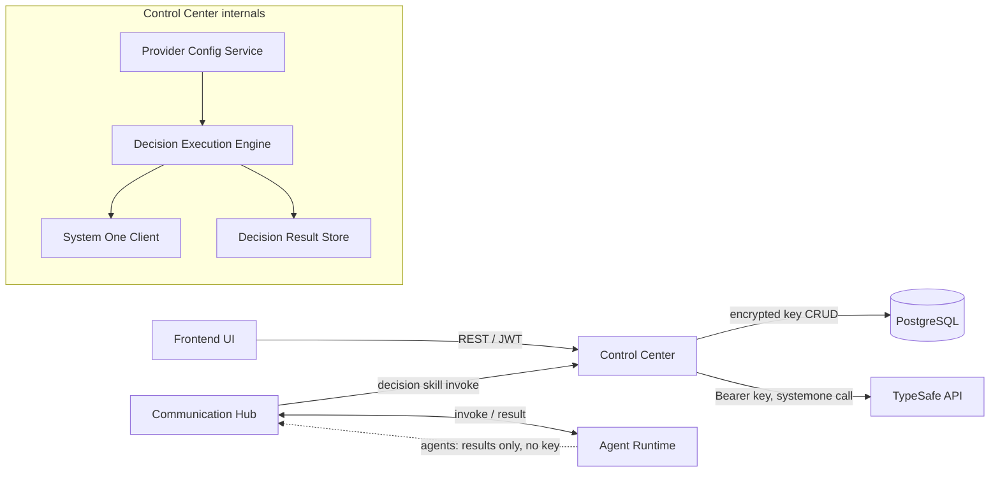
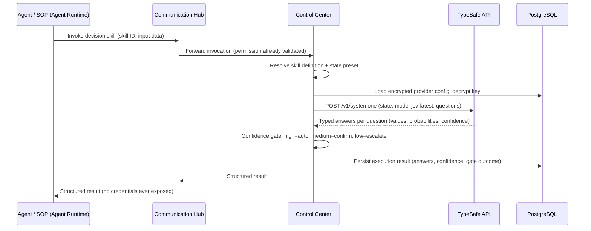

# Architecture Changes: System One Decision Skills

> Top-priority rule validation (docs/config.yaml): service segregation preserved (Control Center only calls TypeSafe API and DB; Agent Runtime only runs agents; Communication Hub only brokers); agents never receive the TypeSafe API key — decryption and external calls happen in Control Center only, mirroring model-config resolution and MCP credential decryption at call time.

## 1. Changed Components

### Control Center (backend)
- **Skill model & registry** — new `decision` skill type alongside existing LLM-based skill types; same invocable unit, same permission/role grant model.
- **Provider configuration service** — extends the encrypted-credential pattern (AES-256) used by MCP server credentials and model configurations to store the TypeSafe API key; supports multiple System One providers (only `typesafe`/`jev-latest` enabled initially). Key is decrypted only at call time inside Control Center.
- **Skill execution service** — when invoked skill is a decision skill, resolves skill definition + provider config, builds state and question set, calls the TypeSafe System One API, and returns typed answers instead of running an LLM.
- **Permission resolution** — decision skills flow through the existing role → skill → permission resolution unchanged; no parallel permission path.

### Communication Hub
- **Skill invocation path** — existing agent/SOP → skill invocation broker path extended to recognize decision skills and route to Control Center's decision execution endpoint; no direct external calls, no credentials.

### Agent Runtime
- **Agents/SOP engine** — decision skills appear as invocable units in the agent/SOP tool surface; agents receive only structured results (answers, probabilities, confidence), never the question-to-API request credentials.
- **Role/permission resolution** — no structural change; decision skills granted via existing agent roles.

### Frontend
- **Skill editor UI** — new decision-skill authoring flow: configured-model check (blocking warning if none), type-driven question form (Choice / Score / Noul), state preset mapper.
- **System Config UI** — new provider configuration section for TypeSafe API key (write-only; never returned in plaintext).
- **Skill catalog / monitoring UI** — decision skills listed like other skills; execution results display typed answers and confidence.

## 2. New Components

- **System One Provider Config Service** (Control Center) — CRUD for encrypted provider credentials, enabled-model list, configuration-status query used by the skill editor.
- **System One Client** (Control Center internal) — outbound integration to `https://api.typesafe.ai/v1/systemone` (Bearer key); provider-agnostic interface so future providers plug in.
- **Decision Execution Engine** (Control Center) — orchestrates: resolve skill → apply state preset → dispatch all questions in one parallel evaluation → normalize typed answers → compute confidence gate.
- **Decision Result Store** (Control Center, DB) — persists each execution: state snapshot, question set, answers, probabilities, confidence, gate outcome; auditable like existing skill executions.

## 3. Integration Points

| Integration | Direction | Notes |
|---|---|---|
| TypeSafe System One API (`POST /v1/systemone`) | Control Center → external | Bearer API key; body: `state` + `model: "jev-latest"` + typed `questions`; parallel evaluation; key decrypted at call time only |
| Provider config CRUD | Frontend → Control Center | REST; key write-only, never returned in plaintext; JWT-protected |
| Configured-model status check | Frontend → Control Center | REST; skill editor gates decision-skill authoring |
| Decision skill execution | Frontend / Agent Runtime → Communication Hub → Control Center | Extends existing skill invocation path; CH brokers, CC executes |
| Decision result persistence & query | Control Center → DB; Frontend → Control Center | Results stored and browsable like existing skill executions |
| Permission resolution for decision skills | Communication Hub → Control Center | Existing delegation pattern unchanged |

## 4. Data Flow Changes

## 5. Master Arch Update Instructions

- `docs/master/architecture/system-overview.md` — add System One decision pathway as a second decision-making route alongside LLM skills; add TypeSafe API as an external system accessed only by Control Center; note the "API key decrypted at call time in Control Center only" boundary.
- `docs/master/architecture/modules/` — add/update a modules page covering: System One provider configuration, decision execution engine, decision result storage, and the Communication Hub decision-skill routing path.
- Update any existing skill-execution / skill-editor module diagrams to include the `decision` skill type and the configured-model authoring gate.
- Keep all diagrams ≤ 15 nodes, Mermaid only.
