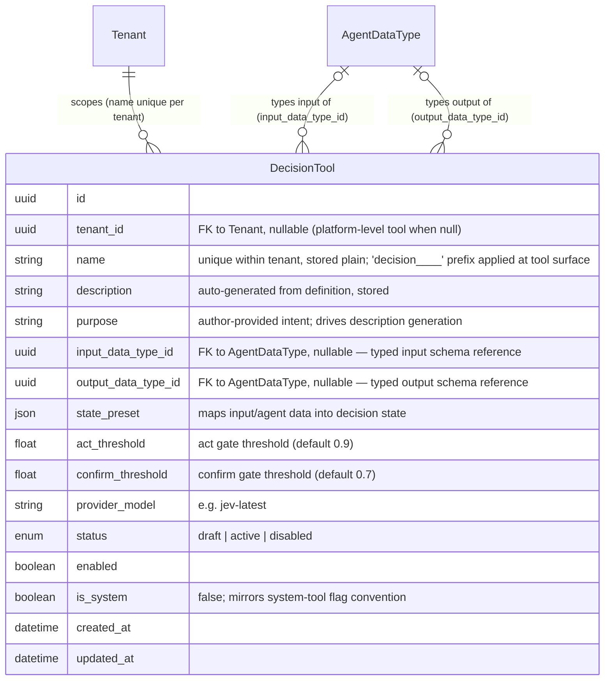
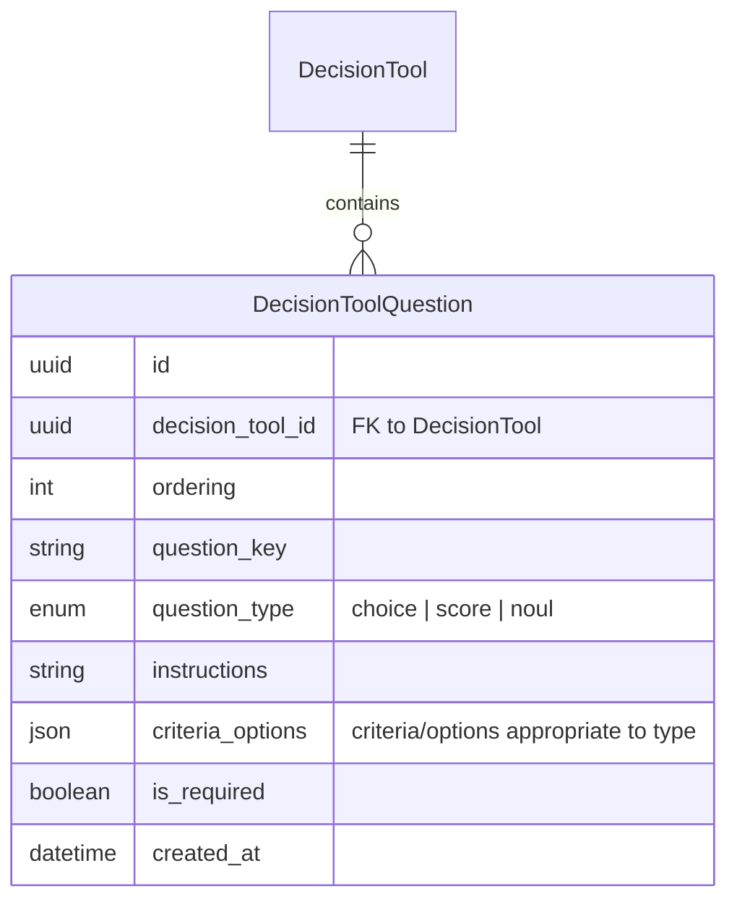
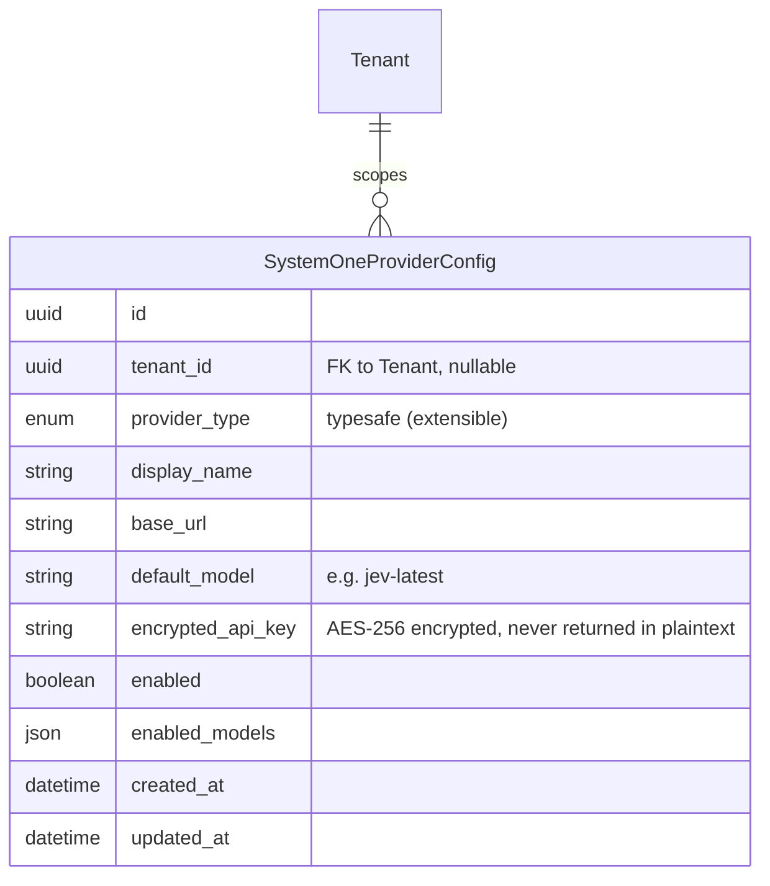
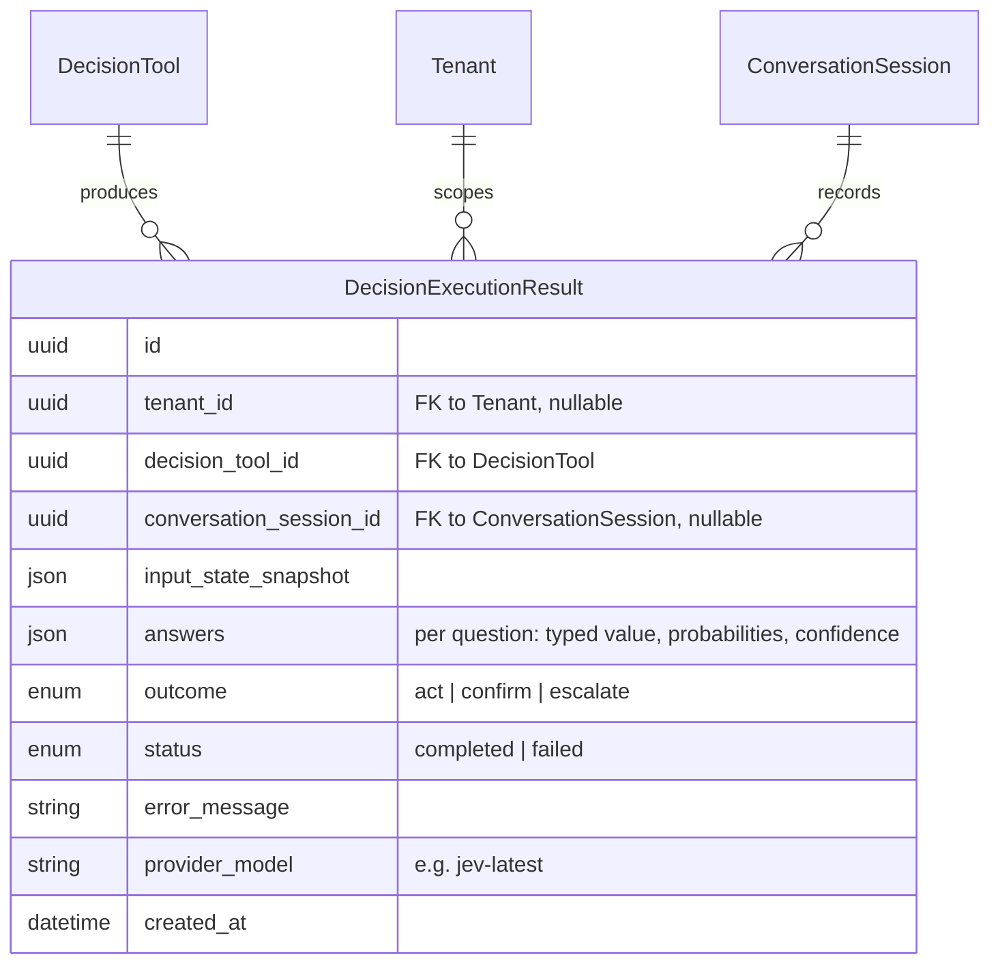

# Data Model Changes: System One Decision Tools

> Technology-agnostic business entity model. No SQL, ORM, or storage details.

## 1. New Entities

### DecisionTool

A user-definable "decision tool" — the decision-making counterpart of a built-in system tool, but authored by tenant users rather than shipped with the platform. It mirrors the system-tool entity conventions (McpTool: `name`, `description`, `is_active`, tenant scoping) so that skills, agents, SOPs, roles/permissions, and MCP exposure work with the existing tool consumption model with no new pathway. Tool names are unique **within a tenant only** (tenant A and tenant B may each have `decision_tool_a`). The stored name is plain; the `decision____<name>` prefix (four underscores, mirroring `system____`) is applied only at the tool surface — the tool registry, permission grants, and MCP tool list — to distinguish decision tools from system tools in every listing and grant.

The tool description is **auto-generated** from the tool's definition (questions, purpose) and is stored on the entity — this generated description is what skills, agents, and MCP clients see.

Input and output schemas are **not stored on the tool**. Instead, the tool references the platform's central **AgentDataType registry** (the existing catalogue of reusable typed schemas, also used for agent-type output contracts): `input_data_type_id` and `output_data_type_id` reference existing AgentDataType records. Both references are **optional** (a tool may not require a typed input or output — e.g. a state-only tool). Referenced data types are **protected from deletion**: an AgentDataType cannot be deleted while referenced by a decision tool, mirroring the existing agent-type reference rule.

The tool name is stored **plain** (no prefix). The `decision____<name>` prefix (four underscores, mirroring the `system____` convention) is applied only at the tool surface — the tool registry, permission grants, and MCP tool list — never in storage.

#### State preset / thresholds placement — on the tool (chosen)

The state preset (mapping of input/agent data into the decision state) and the act/confirm confidence thresholds are stored **directly on `DecisionTool`** as attributes (state preset as `json` via the definition mapping; thresholds as numeric attributes), rather than in a separate definition child entity. Justification: unlike questions — which are repeated, ordered, individually authored rows — the preset and thresholds are single, atomic values that always exist one-per-tool; a child entity would add a one-to-one join with no modeling benefit. Questions remain a child entity (below) because they need per-question typing, ordering, and individual authoring.

### DecisionToolQuestion

An ordered, typed question child of a DecisionTool. Replaces the previous `DecisionQuestion` (which hung off the removed skill-based definition).

### SystemOneProviderConfig

Stores credentials for a System One model provider (initially only TypeSafe/Jev), following the existing encrypted-credential pattern (as used by identity provider configs). Unchanged from the prior revision.

### DecisionExecutionResult

Persists each decision **tool** execution: state snapshot, per-question typed answers with probabilities and confidence, and the computed gate outcome. Auditable alongside existing tool/skill executions. Re-keyed from the prior revision: it now references the `DecisionTool` instead of a Skill/`DecisionSkillDefinition` (those references are removed).

## 2. Modified Entities

- **Skill (existing)** — **no changes**. The previously proposed `skill_type` discriminator is removed; skills revert to their original shape (decision-making is not a skill type). Skill authoring, behavior, and tool bindings are untouched.
- **System tools (McpTool and related)** — no schema changes required. Decision tools are a parallel, tenant-authored entity that mirrors system-tool conventions; they surface alongside system tools in listings, permission grants, and MCP tool lists without altering the system-tool entities themselves.
- **AgentDataType (existing)** — **no schema changes**. The registry is reused as-is: decision tools reference existing data types via `input_data_type_id` / `output_data_type_id`. One **behavioral rule is extended**: an AgentDataType cannot be deleted while referenced by a **decision tool** — in addition to the existing rule that it cannot be deleted while referenced by an agent type.

## 3. Removed Entities/Fields

- **`DecisionSkillDefinition`** — removed (superseded by `DecisionTool`; was only partially applied and is dropped before release).
- **`DecisionQuestion`** — removed (superseded by `DecisionToolQuestion`).
- **`Skill.skill_type`** — removed / reverted; the `Skill` entity keeps its original attributes (no discriminator).
- **`DecisionExecutionResult.skill_id` / `DecisionExecutionResult.definition_id`** — removed; replaced by `decision_tool_id`.

## 4. Schema File References

Files under `backend/app/db/models/`:

- `decision_tools.py` — **modified**: `DecisionTool` carries `input_data_type_id` / `output_data_type_id` FKs to `agent_data_types` (nullable, protected against deleting a referenced data type) in place of inline JSON schemas (replaces `decision_skills.py`).
- `agent_data_type.py` — **referenced, not modified**: the existing AgentDataType registry model supplies input/output schemas for decision tools.
- `skills.py` — **reverted**: remove the added `skill_type` discriminator; restore original `Skill` definition.
- `decision_skills.py` — **removed** (`DecisionSkillDefinition`, `DecisionQuestion` deleted).
- `results.py` — modified: `DecisionExecutionResult` re-keyed to `decision_tool_id` (drop `skill_id` / `definition_id`).
- `system_one_provider_config.py` — new file for `SystemOneProviderConfig` (kept as previously planned).
- `__init__.py` — register `decision_tools`; drop the `decision_skills` registration.

## 5. Master Data Model Update Instructions

- `docs/master/data-model/overview.md` — add `DecisionTool`, `DecisionToolQuestion`, `SystemOneProviderConfig`, and `DecisionExecutionResult` to the ER diagram; show Tenant → DecisionTool scoping (unique name per tenant), AgentDataType → DecisionTool typing (input and output, both optional), DecisionTool → DecisionToolQuestion containment, and DecisionTool → DecisionExecutionResult production. Do **not** show any Skill specialization or `skill_type` attribute — Skills are unchanged.
- `docs/master/data-model/modules/skills/entities.md` — no changes (skills module is untouched).
- Add a decision-tools entry to whichever module entity list covers tools/tooling (alongside system tools), listing `DecisionTool` and `DecisionToolQuestion` (names and one-line purposes only, no schema code). Note the AgentDataType registry usage: input/output are references to the registry, not inline schemas.
- In the entity documentation for `AgentDataType` (Agent Data Type Registry domain), extend the deletion-protection rule: a data type cannot be deleted while referenced by a decision tool, in addition to the existing agent-type reference rule.
- If a tenancy/system-config module entity list exists, add `SystemOneProviderConfig` there; note the encrypted API key attribute (write-only, never returned in plaintext).

## 6. Tenant Containment

All managed data records introduced by this change are **tenant-contained**: uniqueness and resolution happen within a tenant, so independent tenants may reuse the same natural names without collision (e.g., tenant A and tenant B each have a tool named `decision_tool_a`).

Entity attributes supporting per-tenant uniqueness:

| Entity | Tenant scoping | Uniqueness |
|---|---|---|
| `DecisionTool` | `tenant_id` FK to Tenant | `(tenant_id, name)` unique — tool names unique WITHIN a tenant |
| `AgentDataType` (referenced, unchanged) | `tenant_id` FK to Tenant, **nullable** — data types may be platform-level (shared across tenants) or tenant-scoped | `name` and `slug` are **globally unique** across the registry (not per-tenant), reflecting the existing model; decision tools reference existing types by id and inherit their scoping |
| `SystemOneProviderConfig` | `tenant_id` FK to Tenant (nullable for platform-level config) | one config per tenant per provider |
| `DecisionToolQuestion` | inherited via parent `DecisionTool` | unique per parent tool (`decision_tool_id`, `question_key`); no direct tenant column needed |
| `DecisionExecutionResult` | `tenant_id` FK to Tenant | not unique (append-only execution log), always tenant-filtered |

All lookups, permission checks, and invocations resolve within the caller's tenant (aligned with the platform's X-Tenant resolution); no cross-tenant name resolution occurs for decision tools or their results. A decision tool may reference a **platform-level** (tenant-less) AgentDataType, in which case the shared type definition is readable by all tenants but remains managed by administrators; tenant-scoped data types are only resolvable within their own tenant.
