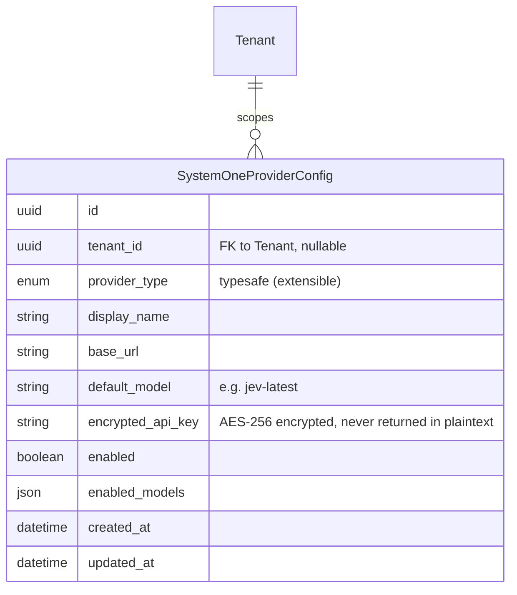
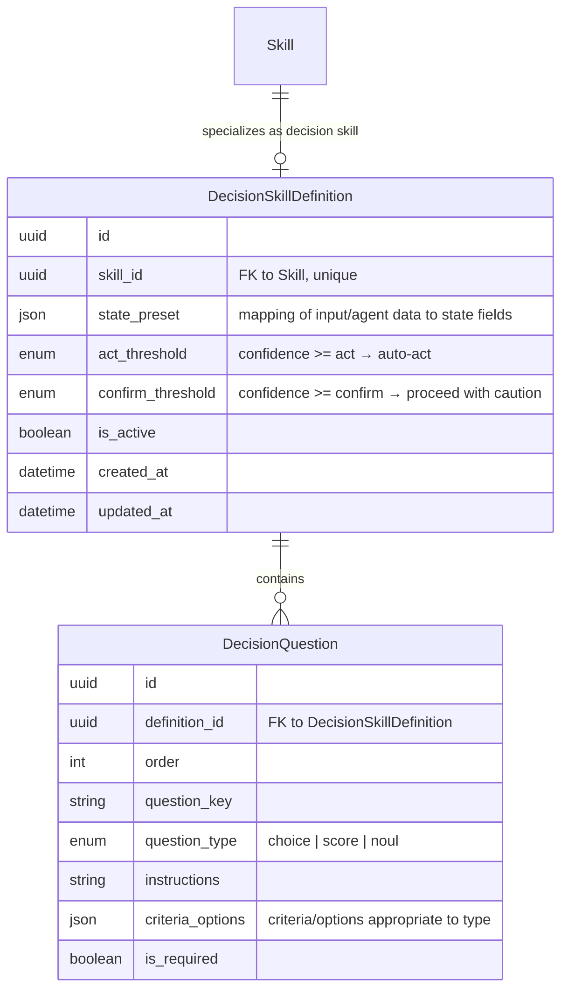
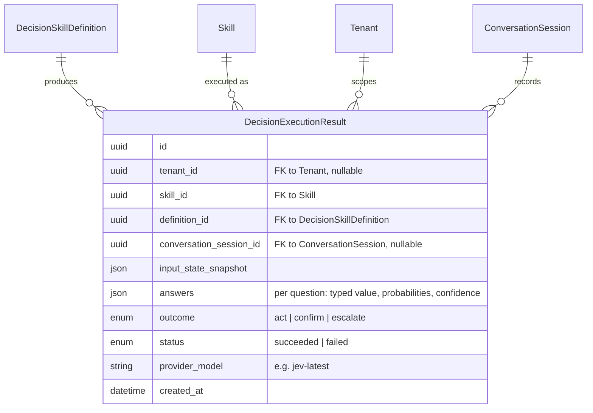
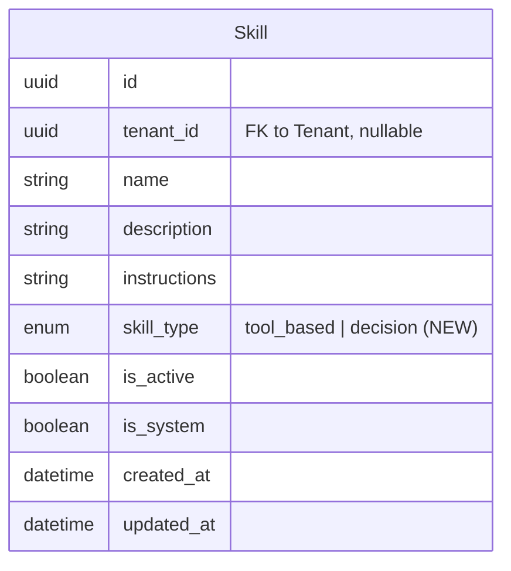

# Data Model Changes: System One Decision Skills

> Technology-agnostic business entity model. No SQL, ORM, or storage details.

## 1. New Entities

### SystemOneProviderConfig

Stores credentials for a System One model provider (initially only TypeSafe/Jev), following the existing encrypted-credential pattern (as used by identity provider configs).

### DecisionSkillDefinition

Defines the authoring-time payload for a skill of the `decision` type. Extends the existing Skill entity (one-to-one) rather than overloading Skill, because question sets and state presets are large structured payloads only relevant to decision skills — keeping them separate avoids null-heavy columns on ordinary LLM skills.

### DecisionExecutionResult

Persists each decision skill execution: state snapshot, per-question typed answers with probabilities and confidence, and the computed gate outcome. Auditable alongside existing skill executions.

## 2. Modified Entities

- **Skill** (existing) — gains a `skill_type` discriminator (`enum`: `tool_based` | `decision`, default `tool_based`) so decision skills are first-class members of the existing skill/permission/SOP model. No other Skill behavior changes; decision skill specifics live in `DecisionSkillDefinition`.
- **DecisionQuestion as child entity (chosen over json attribute)** — questions are repeated, ordered, individually editable in the authoring form, and need per-question type validation; a child entity keeps the authoring API and audit story clean. State preset and answers, by contrast, are stored as `json` since they are opaque mappings/snapshots.

## 3. Removed Entities/Fields

None.

## 4. Schema File References

Files under `backend/app/db/models/` to update:

- `skills.py` — add `skill_type` to `Skill`; add `DecisionSkillDefinition` and `DecisionQuestion` models (or a new `decision_skills.py` if a separate file is preferred, registered in `__init__.py`).
- `system_one_provider_config.py` — **new file** for `SystemOneProviderConfig`.
- `results.py` — add `DecisionExecutionResult` (or new `decision_results.py`).
- `__init__.py` — register any new model modules.

## 5. Master Data Model Update Instructions

- `docs/master/data-model/overview.md` — add `SystemOneProviderConfig`, `DecisionSkillDefinition`, `DecisionQuestion`, and `DecisionExecutionResult` to the ER diagram; show Skill → DecisionSkillDefinition specialization; show Skill `skill_type` attribute.
- `docs/master/data-model/modules/skills/entities.md` — add the decision skill entities (names and one-line purposes only, no schema code) to the skills module entity list.
- If a tenancy/system-config module entity list exists, add `SystemOneProviderConfig` there; note the encrypted API key attribute (write-only, never returned in plaintext).
