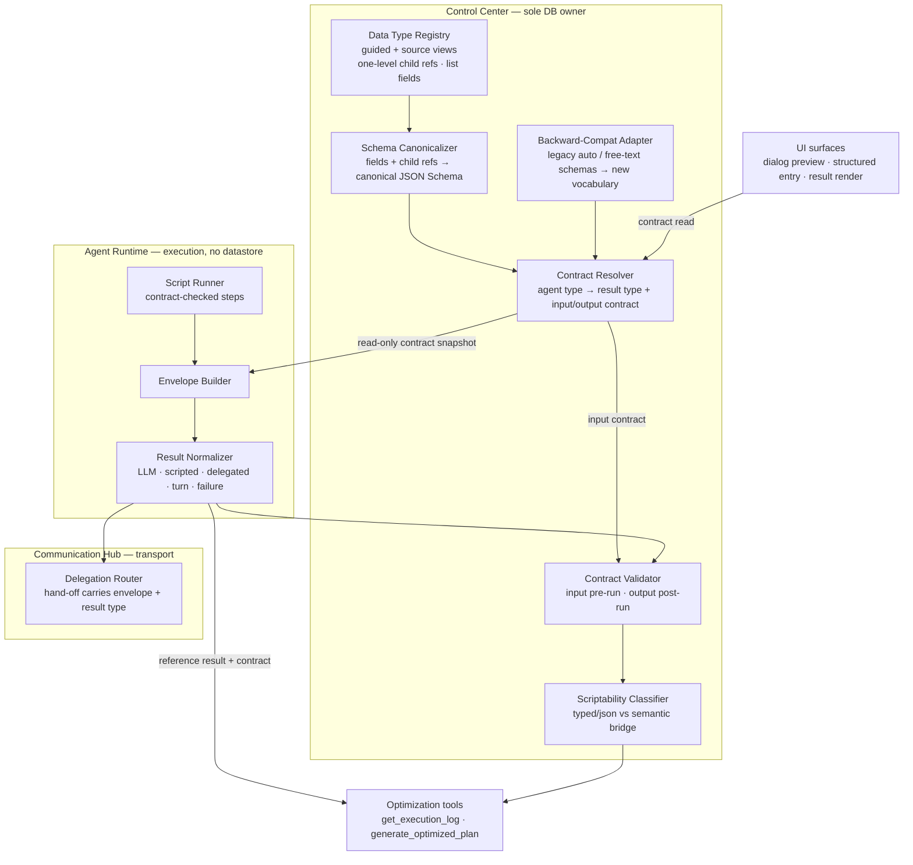
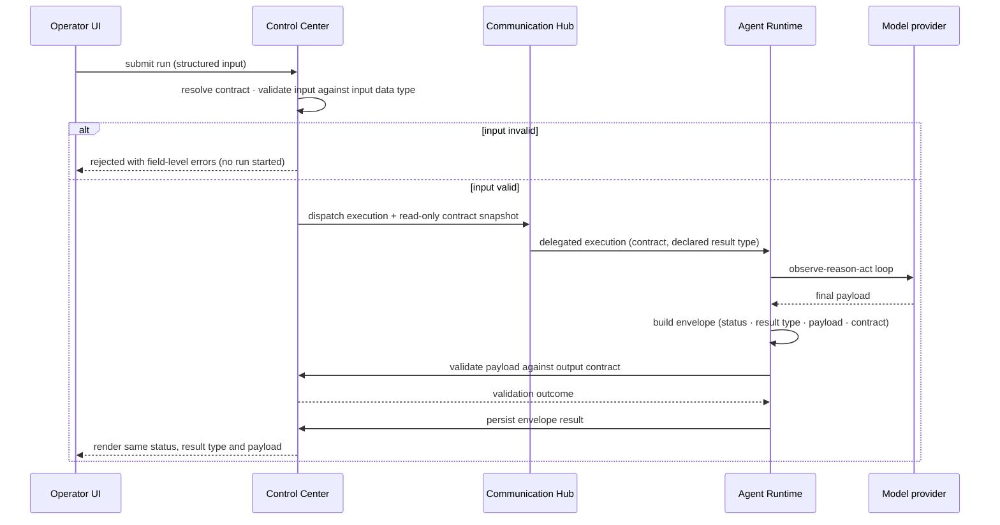
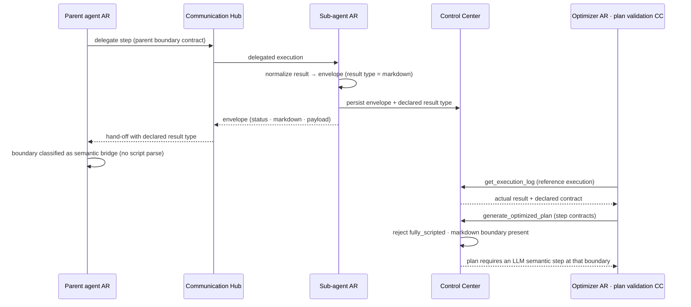
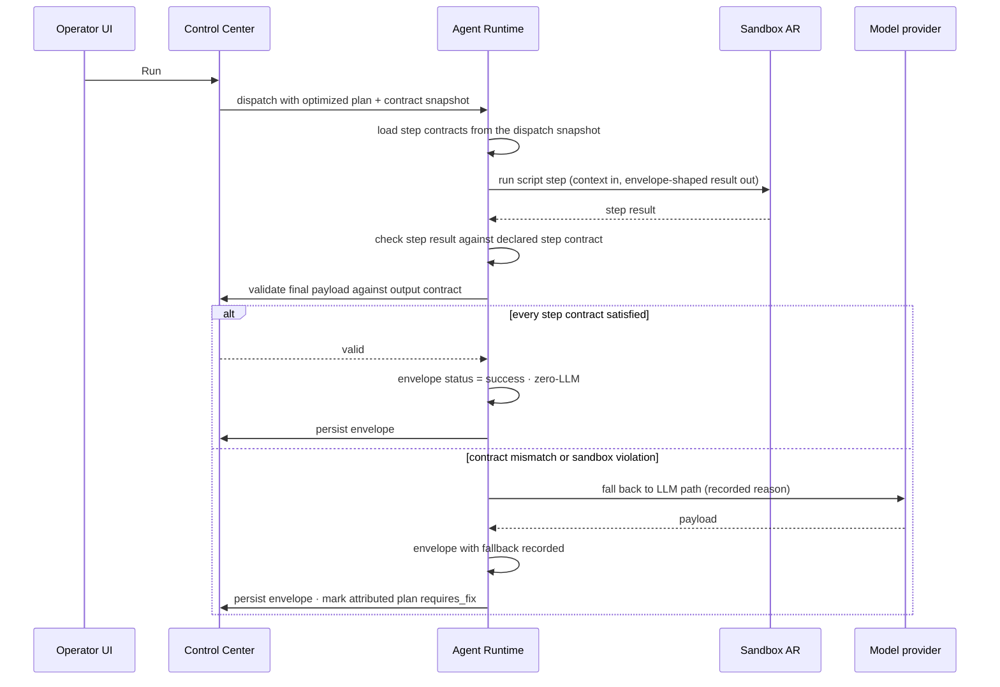

# Architecture Changes: Unified Agent I/O Contract

One canonical **Agent Result Envelope** on every execution path (LLM, fully-scripted, delegated, conversational, failed) and one **contract unit** — the registry data type — for both input and output. The envelope is produced in Agent Runtime, its contract is declared by Control Center, and every consumer (execution logs, result repository, delegation, script results, optimization, third-party delivery) reads the same shape.

## Service Segregation Invariants (non-negotiable)

| Rule | How this design honours it |
|---|---|
| Three fully segregated services | Contract/registry/validation/optimization-plan logic in Control Center; envelope production and script execution in Agent Runtime; delegation transport in Communication Hub. No responsibilities merge. |
| Agents run only in Agent Runtime | Envelope building, result normalization, script execution and semantic bridges all remain inside Agent Runtime. |
| Only Control Center connects to the database | Contracts, schemas, result types and stored results are read/written only by Control Center. Agent Runtime receives a **resolved, read-only contract snapshot** over the internal API and holds no datastore. |
| Agents never receive sensitive data | The resolved contract carries schema and result-type metadata only — no identity tokens, no DB credentials, no provider secrets. Delegation hand-offs carry the envelope and declared result type, never credentials. |

## Changed Components

| Component | Service | Change |
|---|---|---|
| Data Type Registry | CC | Becomes the **single I/O contract unit**: assignable as input contract, output contract, or both. Gains **one level only** of same-tenant child reference (single value or list; deeper nesting and cross-tenant references are rejected), list support on any field, and one canonical schema behind guided-editor and source-editor views. Delete guard extends to parent-type references. |
| Agent Type configuration | CC | Explicit declared result type (`text \| markdown \| json \| typed`) replaces inferred output type; `typed` requires a data type and a data type requires `typed`. Optional input data type assignment on non-conversational agent types; conversational turns keep their conversation input. |
| Contract/validation services | CC | Output validation is joined by **input validation before dispatch**; both resolve against the same data type definition. |
| Agent Type dialog + launch surface | UI | Read-only in-dialog preview of the selected input/output schema; structured entry form (nested groups, repeatable rows, allowed-value choices, field-level errors) derived from the input data type. |
| Executor and result paths | AR | Every path — LLM loop, fully-scripted run, delegated step, conversational turn, failure — hands its raw outcome to one normalizer that produces the envelope. |
| Script-First Dispatcher / Script Runner | AR | Script steps declare and are checked against a step contract (typed/json input and output); contract mismatch is an enumerated **fallback trigger**, not a run failure. |
| Delegation routing | CH | A hand-off carries the delegated result's envelope plus its declared result type, so the parent step and the optimizer can distinguish a parseable payload from free text. The child's input contract is validated by CC before the delegated step runs. Routing path itself is unchanged. |
| Optimization tools | CC | `get_execution_log` exposes the reference execution's result **and its declared contract**; `generate_optimized_plan` validates every step contract and rejects a `fully_scripted` claim when any step or hand-off boundary is text/markdown. |
| Result repository / execution log / exports | CC + UI | Render from the envelope and its declared result type; one content type per result, with the result type visible to the operator. |
| Decision tools | CC | Registry selection only, unchanged — but the selected data type now carries child references, list fields and the expanded field model through the same definition. |
| Third-party delivery | CH + CC | Typed submissions validate against the agent's input data type; delivered responses use the same envelope and validation status as an in-product run. |

## New Components

- **Contract Resolver** is the single place that decides what a run's contract *is*: declared result type, input contract, output contract. It is the only origin of contract truth, and it hands Agent Runtime a read-only snapshot.
- **Schema Canonicalizer** stores one definition behind both editor views; combined with the registry's child-reference expansion it yields a canonical schema including expanded one-level children and list markers.
- **Envelope Builder + Result Normalizer** are the only producers of a result. Path-specific shapes are abolished — a path supplies outcome, payload and contract reference; the normalizer emits the envelope. A failed conversational turn carries the envelope internally and in logs only; the chat error surface the user sees is unchanged.
- **Backward-Compat Adapter** is a first-class component, not a shim hidden in a consumer: it is the only read path for legacy definitions and legacy results, normalises legacy `auto` to `text`, keeps legacy free-text schemas readable, and never rewrites stored data or retroactively revalidates history. No review queue, approval step or backfill is introduced.
- **Scriptability Classifier** classifies each boundary from the **declared** result type. It supplies the per-boundary verdict; the binding verdict on a `fully_scripted` claim is issued by plan validation in Control Center, which is the only authority.

### Scriptable vs semantic bridge — and who decides

| Boundary result type | Classification | Who decides | Consequence |
|---|---|---|---|
| `typed`, `json` | Scriptable | Declared result type; classifier verdict, confirmed by plan validation in CC | A step may consume/produce it without an LLM; `fully_scripted` allowed if every boundary qualifies. |
| `text`, `markdown` | Semantic bridge | Declared result type; plan validation in CC | No script step may parse it; an LLM step must interpret it; `fully_scripted: true` is rejected. |
| Conversational turn | Always a semantic bridge | Declared `text`/`markdown` — typed I/O is not offered on turns | Never scriptable, never a typed hand-off. |
| Legacy `auto` | Resolved on read to `text` | Backward-Compat Adapter, then as above | Never silently becomes scriptable. |

A delegated hand-off publishes its declared result type with the envelope, so the parent's boundary is classified from the child's contract, not from the payload's appearance. The optimizer sees the reference execution's actual result plus contract, so the predicted final format and the verdict are evidence-based.

## Integration Points

| Boundary | Direction | Carries | Unchanged |
|---|---|---|---|
| UI ↔ CC | UI → CC (config, submit) / CC → UI (rendering) | Declared result type, input/output data type selection, schema previews, structured-entry validation errors, envelope-backed result views | Auth, permissions, CRUD paths |
| CC ↔ AR | AR → CC / CC → AR over mTLS internal API | Resolved contract snapshot (read-only), input validation before dispatch, output validation at completion, envelope persistence, envelope-shaped reference results for optimization | Transport, signed tenant headers, certificate auth, egress choke point |
| CC ↔ CH | CH → CC | Delegation metadata, envelope persistence for delegated steps, client resolution, third-party input validation | Transport, tenant signing (CC is sole signer) |
| AR ↔ CH | Bidirectional | Delegation hand-off carrying envelope + declared result type; tool routing during scripted and LLM steps | Tool namespacing, per-call token injection, MCP path |
| Third-party ↔ CH | CH → external client | Envelope-shaped delivery (status, result type, payload, validation status) | Client credential classes, origin allowlist, rate limiting |

**Internal endpoints that carry the envelope (route-level):** contract resolution, input validation, output validation, typed result persistence, result querying, reference-execution inspection for optimization, and optimized-plan submission with step contracts.

**Internal endpoints unchanged in shape:** tool permission resolution, MCP tool routing, certificate bootstrap and renewal, token health preflight, conversation turn delegation/resume, checkpoint save/load, model-config resolution, and all management/CRUD APIs. None of them gains an envelope dependency — the envelope is a *result* contract, not a transport contract.

## Data Flow Changes

### (a) Normal LLM run returning a typed result

### (b) Delegated markdown result reaching a parent and the optimizer

### (c) Fully-scripted run with contract validation

## Master Arch Update Instructions

| File | Change |
|---|---|
| `docs/master/architecture/system-overview.md` | Add a section stating the universal result envelope as a cross-cutting invariant (all execution paths), the data type as single I/O contract unit, and that only CC resolves contracts. Add a diagram (≤15 nodes) of the contract-resolve → execute → envelop → consume loop. Add "contract + envelope" to the Control Center and Agent Runtime key-responsibility bullets; note CH remains transport-only and gains no data access. |
| `docs/master/architecture/modules/agent-lifecycle.md` | In phases 3–6, state that dispatch carries a read-only contract snapshot, that every completion (including failure) yields the envelope, and that the Result Persistence phase records status, result type, payload and contract metadata. Update the "Result Persistence and Completion" sequence to persist an envelope. |
| `docs/master/architecture/modules/execution-logs.md` | Replace the assumption of per-surface result shapes with "renders from the envelope + declared result type". Note the delegation status events carry the delegated declared result type. |
| `docs/master/architecture/modules/communication.md` and `modules/communication-hub/architecture.md` | Document the delegation hand-off carrying the envelope plus declared result type; keep the explicit statement that CH remains forward-only, gains no data access, and never inspects payload semantics. |
| `docs/master/architecture/modules/sandboxed-scripting.md` | Add step-level contracts (`typed`/`json` scriptable; `text`/`markdown` semantic), the contract-mismatch fallback trigger, and that a `fully_scripted` claim requires every boundary to be typed or JSON. Add the envelope to script outcome reporting. |
| `docs/master/architecture/modules/control-center/optimization-and-plans.md` | Document `get_execution_log` exposing the reference result and contract, and `generate_optimized_plan` validating step contracts and `fully_scripted` claims. |
| `docs/master/architecture/modules/decision-tools/architecture.md` | Note that selected data types carry child references, list fields and the source view, and that selection stays read-only registry choice (no ad-hoc schemas). |
| `docs/master/architecture/modules/third-party-agent-integration/architecture.md` | Note input validation against the input data type and envelope-shaped delivery with result type and validation status. |
| `docs/master/architecture/modules/agent-management-panel.md`, `modules/agent-types.md` | Note in-dialog read-only schema preview, input data type slot, and result-type-labelled rendering; keep the canonical topology canvas wording (contract slots: input none/conversation, output declared result type). |

## Risks & Assumptions

- **Consumers migrate together** — the envelope is only real when execution logs, result repository, delegation, script results, plan contracts, reference-execution inspection and third-party delivery all read it; a partially migrated consumer would re-introduce per-surface shapes. Decision tools read the same data type definition, so they follow the expanded field model. Sequencing is an implementation risk, not an architectural one.
- **Read-only snapshot freshness** — Agent Runtime validates against a contract snapshot resolved at dispatch. A data type edited mid-run is evaluated consistently for that run; the design rejects re-resolution mid-execution.
- **Legacy fidelity limit** — an exotic legacy free-text schema may not convert losslessly; the adapter keeps it readable and enforcement continues as today. No silent reinterpretation and no retroactive revalidation.
- **Classification is declared, not inferred** — a mis-declared `text` result on a genuinely typed workflow costs an optimization opportunity; a mis-declared `typed` result on free text fails validation and falls back to raw rendering. Declared-type errors are visible, never silently repaired.
- **Assumption** — result-type-aware verdicts are enforced at plan validation in Control Center, so no Agent Runtime path can assert scriptability on its own.
