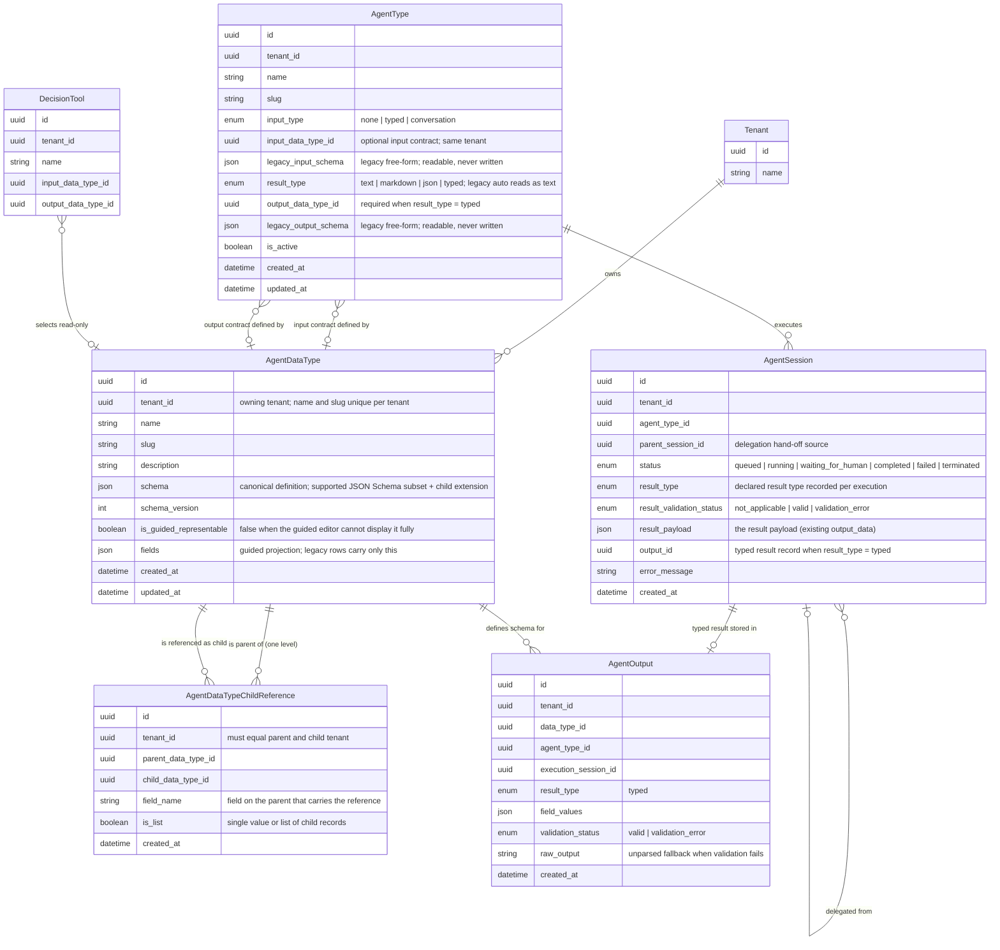

# Data Model — Unified Agent I/O Contract

Change: `unified-agent-io-contract` · Source of truth: [`prd.md`](prd.md), [`spec-change.md`](spec-change.md)

Business-level entity model only. Schema files under `backend/app/db/models/` remain the
source of truth for structure; this page records **what changes and why**.

Tenant isolation is unchanged and applies to every addition below: data types, child
references and recorded results are tenant-owned, name/slug uniqueness is per tenant, and
a child reference may only target a data type in the same tenant.

---

## 1. New Entities

One new entity: the **child reference** between two data types. It is a *derived
integrity projection* of the canonical definition (see §1.1) — not a second place to
author the relationship.

`AgentSession` is the `agent_jobs` / `AgentJob` entity; the business name is used here to
match the master data model. `DecisionTool` and `AgentDataType` are shown for reference
context only — decision tools keep selecting registry entries read-only. Every entity shown
is tenant-owned; only the data-type edge to `Tenant` is drawn, to keep the diagram readable.

### 1.1 Child reference — why a projection entity

**Recommendation: the reference id lives inside the canonical definition, and a derived
child-reference entity mirrors it for integrity.**

- The **definition** (`AgentDataType.schema`) is the system of record. A child-bearing
  field carries a documented extension holding the child's **data type id** (not name,
  not slug), so a rename of the child never breaks the parent.
- The **child reference** entity is rewritten for that parent on every save (wholesale,
  idempotent) and exists only so that three rules are checkable and fast:
  same-tenant, one-level, and deletion protection.
- Rejected alternative A — *definition only*: no foreign key is possible, so dependents
  must be found by scanning a document column on every delete, and a concurrent
  create/delete race can orphan a reference.
- Rejected alternative B — *relation entity only*: a pasted schema could not express a
  child reference without an out-of-band id lookup, and the two editor views could no
  longer be projections of one document.
- Accepted trade-off: a second write path. It is contained because the projection is
  never hand-edited and is always regenerated from the definition in the same
  transaction; a reconcile check must exist so drift is detectable and repairable.

**Rules to enforce (Control Center application layer, plus the foreign keys noted in §4):**

| Rule | Enforcement |
|---|---|
| Child must be in the same tenant as the parent | Same-tenant composite reference on the projection; rejected with a clear message |
| One level only | Save rejects a child that itself has child references, and rejects a data type that is already used as a child from gaining children |
| No self-reference | Rejected on save (a data type may not be its own child) |
| No cycles | Impossible once depth is capped at one; self-reference is the only cycle expressible and is rejected |
| Deletion protection | A data type that appears as a child cannot be deleted; the error names the parent data types and fields |
| Parent deletion | Deleting a parent removes only its own references; the child itself is untouched |
| Rename survival | References are keyed by id, so renames, slug changes and description edits never rewrite parents |
| Editing a child affects all consumers | Save of a child returns its dependent parents so the UI can warn before applying |

An entity may be referenced by the same parent through two different fields; rows are
distinguished by `field_name`, not by child id. `is_list` exists only on child references —
a list of a primitive type is stated in the definition itself, so the projection never
carries a second copy of that fact.

---

## 2. Modified Entities

### 2.1 `AgentDataType` — output-only registry becomes the input+output contract unit

| Change | Detail | Rationale |
|---|---|---|
| **Add** `schema` (json) | Canonical definition: an ordered top-level object of properties using the supported subset (string, number, boolean, date, enum with allowed values, one-level child reference, list on any property) plus a documented child-reference extension | The source view must round-trip definitions the guided editor cannot render, so the stored format must be *wider* than the guided subset. One document also means the two views cannot disagree |
| **Add** `schema_version` (int) | Marks the definition dialect: backfilled-from-`fields` rows vs authored-in-schema rows | Lets readers and a future cleanup distinguish regenerated rows from authored ones without guessing |
| **Add** `is_guided_representable` (boolean) | False when the canonical definition exceeds what the guided editor can display | Satisfies "never silently discard": the definition is preserved, the UI states that the guided view cannot fully show it |
| **Retain** `fields` (json), demoted to a projection | Written by Control Center on every save from the canonical definition; now also carries the list flag and child-reference marker per field | Keeps every current reader (guided editor, validators, result rendering, decision tools, `query_result`) working without a flag day; no column drop, no reader rewrite in one step |
| **Retain** `name`, `slug`, `description`, tenant columns, timestamps | Unchanged; `slug` stays the runtime identifier used by `query_result` | No change to resolution semantics |
| **Relationships** | `AgentType.output_data_type` stays; add `AgentType.input_data_type`; add `child_references` (as parent) and `referenced_by` (as child) | Input assignment and child references are new edges on the same registry entry |

**Decision — canonical `schema` over canonical `fields`:**

1. The PRD requires a schema source view that survives view switching without loss; a
   flat `fields` list cannot hold a definition the guided view cannot display.
2. Validation, input forms, previews, list fields and child references all need a
   structural document; expressing them in JSON Schema keeps one vocabulary for
   storage, validation and source editing instead of three.
3. `fields` remains valuable as the *guided* projection and as the compatibility layer
   for legacy rows and unmodified readers — so it is kept, generated, never
   hand-authored again.
4. Cost accepted: dual write plus a drift surface. Mitigated by regenerating the
   projection in the same transaction and by treating `schema` as authoritative whenever
   present.

`fields` is **not** dropped in this epic (no data loss); retiring the column is a later
change once every reader consumes `schema`.

**When both exist (the normal case after this change):** `schema` wins, always, and
`fields` is regenerated from it on every save. Readers that still consume `fields` see the
same definition because it is a projection, not a peer. A row whose `fields` disagrees
with `schema` is a **defect, not a decision**: the reconcile check in §1.1 reports it and
repairs it by regenerating from `schema`, never by trusting `fields`. A row with no
`schema` (pre-change data) is read by deriving a definition from `fields`; it gains a real
`schema` the first time it is saved.

### 2.2 `AgentType` — explicit result type and an input contract slot

| Change | Detail | Rationale |
|---|---|---|
| **Add** `input_data_type_id` (uuid, nullable) | Input contract for non-conversational agent types; null keeps today's free-prompt behaviour; same tenant only | Data types become the single I/O contract unit |
| **Extend** the output/result type enum with `text` and `json`; keep `markdown`, `typed` and legacy `auto` | Stored in the existing column; exposed in the model and API as the **declared result type** | One setting, one column. A second "result type" column would duplicate the same decision and inevitably diverge |
| **Legacy** `auto` | Accepted on read only; normalised on read to **`text`** (free text, which may be rendered as markdown). A legacy `auto` agent that also carries an output data type still surfaces as `text` — it does not become `typed` by implication. Only an explicitly stored `typed` produces typed output. New and edited configurations must choose an explicit value | Preserves every existing agent without an operator action, and no result is left without a declared type |
| **Retain** `input_schema` / `output_schema` (json, nullable) | Frozen legacy definitions: readable, surfaced as read-only legacy, never written by the new editor, never dropped | No production definition is lost; free-text schemas stop being an enforcement mechanism but stay auditable |
| **Retain** `input_type` | `typed` now means "structured input expected", satisfied by `input_data_type_id` (preferred) or a legacy `input_schema` | Avoids a second flag for "has structured input" |
| **Contract invariants (validated on save, not retroactively on legacy rows)** | `result_type = typed` ⇒ `output_data_type_id` non-null; `result_type ≠ typed` ⇒ `output_data_type_id` null; conversational types carry neither input nor output data type | "Typed without a data type" and "data type on a non-typed result" become unsaveable states |
| **Legacy states tolerated on read** | `typed` with no data type normalises to `text`; `auto` normalises to `text` whether or not a data type is attached | Existing rows must stay valid; normalisation is a read view, stored values are not rewritten |

On the PRD wording "normalised on read to text or markdown": `markdown` remains available as
an explicit, deliberately chosen result type. `auto` itself always normalises to `text`, and
a legacy body that happens to look like markdown is still text — it is not reclassified.

### 2.3 `AgentSession` (`AgentJob`) — the persisted result envelope

| Change | Detail | Rationale |
|---|---|---|
| **Add** `result_type` (enum, nullable) | Declared result type **as recorded at execution time** (text, markdown, json, typed); null only for rows recorded before this change | The envelope's central fact; drives scriptability, delegation hand-offs, rendering, third-party delivery. Persisted so a later edit of the agent type cannot retroactively change what a past result *was* |
| **Add** `result_validation_status` (enum, nullable) | `not_applicable`, `valid`, `validation_error`; null for pre-change rows | One queryable contract-status for every result, including the many that have no typed output record |
| **Reuse** `status` | Envelope execution status — queued/running/waiting/completed/failed/terminated | Already the lifecycle truth; a second "execution status" column would fork the state machine |
| **Reuse** `result_payload` = existing `output_data` (json) | The payload; business fields live only here, never at envelope level | No duplicated payload column |
| **Reuse** `error_message`, `output_id`, `parent_job_id` | Failure reason, typed-result link, delegation provenance | Envelope error surface and hand-off context already exist |
| **Prose note** | Producer metadata (which path produced the result: LLM, fully-scripted, delegated, conversational) is derived from existing lineage — plan/script evidence, `parent_job_id`, conversation records — and is **not** a new column | Avoids a second, drift-prone copy of facts other entities already own; if ops reporting later needs a single filterable column, add it then, not speculatively |

**Decision — minimal useful column set:** two columns (`result_type`,
`result_validation_status`) plus reuse of existing status/payload/error fields.
Reasoning: the two new facts are the only ones that (a) do not already exist somewhere,
(b) are read by every result surface, and (c) are needed as *filters*. Query needs:
execution log and result repository filter/group by result type and by validation
outcome within a tenant — served by supporting indexes on (tenant, result type) and
(tenant, validation status), with time ordering where lists are paginated. Keeping the
envelope JSON-only would force payload parsing and table scans on the exact queries the
epic's dashboards and scriptability analysis depend on.

Deliberately **not** added: a `result_status` duplicate of job status; a copied payload;
a schema snapshot / per-result contract version (data type versioning and schema history
are out of scope — the recorded `validation_status` stays the historical verdict even if
the data type is later edited); a producer enum.

**Conversational turns.** A conversational turn records the same envelope facts, so a turn
result is described in the same vocabulary as any other result. A **failed** conversational
turn persists its envelope internally and in logs only — the chat error surface, retry
behaviour and conversation UX are unchanged, and this change introduces no new chat UI.

### 2.4 `AgentOutput` — typed results stay the typed record

| Change | Detail | Rationale |
|---|---|---|
| **Add** `result_type` (enum, nullable; backfilled `typed`) | Makes the typed record self-describing when read alone | Spec requires the output record to carry the result type with its envelope context; the result repository reads this entity directly |
| **Retain** `validation_status`, `raw_output`, `field_values`, `data_type_id`, `execution_session_id` | Unchanged | Typed validation, fallback rendering and soft schema reference keep today's behaviour |
| **Note** | `AgentOutput` remains the *typed* result only; text/markdown/json results have no output row and are read from the session envelope | Keeps one singular typed result per session and no new entity |

### 2.5 Unchanged but affected

- `DecisionTool` — no structural change; it keeps read-only registry selection and
  inherits child references, list fields and the schema source view.
- `AgentData`, conversations, plans, scripts — no structural change. Plan contracts and
  delegation hand-offs record a declared result type inside existing JSON payloads rather
  than gaining new entities.

---

## 3. Removed Entities/Fields

**None.** No table, column or enum value is dropped by this change.

| Item | Fate | Why |
|---|---|---|
| `AgentDataType.fields` | Retained, demoted to projection | Old rows and unmodified readers depend on it; dropping it would be data loss |
| `AgentType.input_schema` / `output_schema` | Retained, frozen legacy | Legacy definitions must stay readable and auditable; they simply stop enforcing |
| Result value `auto` | Retained, read-only | Existing agents keep working; normalised on read, never offered for new edits |
| `AgentJob.output_data` | Retained, now the envelope payload | Historical results must render unchanged |

**Deprecated (documented, not removed here):** implicit result-type inference, legacy
free-text schemas as an enforcement mechanism, and the `fields`-only definition model.
Each requires a follow-up change to remove safely. Legacy free-text definitions stay
readable throughout; no review queue, triage backlog or approval step is introduced for
them.

---

## 4. Schema File References

| File | Work |
|---|---|
| `backend/app/db/models/agent_data_type.py` | `AgentDataType`: add the canonical definition column, schema version, guided-representability flag; keep `fields`; add parent/child relationships. New `AgentDataTypeChildReference` entity in the same module (it is a projection of this entity) with parent, child, field name and list flag |
| `backend/app/db/models/agents.py` | `AgentOutputType` (declared result type) gains `text` and `json`; keep `auto`. `AgentType` gains the input data type reference and its relationship. New `AgentResultValidationStatus` enum (`not_applicable`, `valid`, `validation_error`). `AgentJob` gains `result_type` and `result_validation_status` |
| `backend/app/db/models/agent_output.py` | `AgentOutput` gains `result_type` (backfilled `typed`), reusing the declared-result-type enum |
| `backend/app/db/models/decision_tools.py` | Verify only — no change; confirm the new definition column does not affect the read-only selection path |
| `backend/app/services/data_types/service.py` | Behavioural companion (not schema): deletion protection must also name parent data types and fields, and save must regenerate the child-reference projection and reject same-tenant/one-level/self-reference violations |

**Alembic approach (describe; no SQL written here).** Two additive revisions on the
current head `7b1e4c2d9f03`, autogenerated then hand-reviewed:

1. **Structure revision** — add the nullable new columns on data types, agent types,
   sessions and outputs; add the new enum values and the new validation-status enum;
   create the child-reference entity with its tenant-scoped uniqueness; add the
   (data type id, tenant) uniqueness needed for a same-tenant composite reference and
   point the new references at it; add the supporting indexes for result-type and
   validation-status filtering. Every addition is nullable or defaulted, so the running
   application is unaffected before cutover. The projection entity's child-side
   reference must prevent deleting a referenced child, while the parent side removes
   rows with the parent. Legacy data-type references on agent types keep today's
   behaviour (service-level deletion protection) — do not silently harden those
   mid-change.
2. **Backfill revision** — for every data type without a canonical definition, derive it
   deterministically from `fields` (order preserved, enum values preserved, required
   flags preserved) and mark the schema version and guided-representability accordingly;
   set `result_type = typed` on existing output records; leave session-level result type
   null on historical rows so the read path applies the legacy normalisation. The
   backfill is idempotent (only rows with no definition are touched) and safe to re-run.
   No data type can have child references at this point, so the projection starts empty.

**Ordering constraints (backfill order):** (1) the structure revision lands first and is
inert because every new column is nullable or defaulted; (2) the backfill runs — enums must
exist before any writer persists them, and the backfill must precede the point where readers
prefer the canonical definition; (3) only then do readers prefer `schema` and do child
references become possible, since every save after that point regenerates the projection.
The existing free-text schema columns are not touched at any step.

**Reversibility.** Both revisions are reversible. Dropping the projection entity and then
the new columns restores the previous shape; the legacy `fields` column and the legacy
free-text schema columns are untouched at every step, so no definition is lost. The
backfill revision is data-only and its downgrade is a no-op in practice (defaults and read
normalisation keep old rows working). Removed enum values cannot be withdrawn from a live
database — the new result-type values and the validation-status enum may remain unused
after a downgrade, which is harmless.

---

## 5. Master Data Model Update Instructions

| File | Update |
|---|---|
| `docs/master/data-model/modules/agents/entities.md` | Rewrite the `AgentDataType` block: canonical definition + schema version + guided-representability, `fields` as projection, child reference (single and list), and the one-level / same-tenant / deletion-protection rules. Add the `AgentDataTypeChildReference` entity and its two edges. Update `AgentType`: input data type slot, explicit result-type vocabulary with legacy `auto`, legacy schemas marked read-only. Update `AgentSession`: declared result type, validation status, payload. Update `AgentOutput`: result type. Replace the business rule "when output type is typed the data type must be non-null" with the new bidirectional invariant, and add child-reference and envelope rules. Refresh the `**Sources**` line if the new entity gets its own module file |
| `docs/master/data-model/overview.md` | No new domain and no new cross-domain edge; check that the Agents row's scope text still reads correctly. Do not grow the hub diagram beyond its current budget |
| `docs/master/data-model/modules/operations/entities.md` | Verify only: it references sessions as relationship context. Add a sentence stating results are read from the session envelope when they are not typed, if the module's result narrative would otherwise imply every result has an output record |

Do **not** put column-level or DDL detail in the master pages — point at
`backend/app/db/models/` for structure.

---

## 6. Compatibility & Migration

| Legacy item | Behaviour after this change |
|---|---|
| `agent_data_types.fields` | Still readable and still written as the guided projection. A row without a canonical definition is read as if its definition were derived from `fields`. "At least one field" validation now applies to the canonical definition, so a definition the guided view cannot fully show is still savable |
| `agent_types.input_schema` / `output_schema` | Readable, surfaced as read-only legacy definitions, never written or enforced, never dropped. Operators are directed to a data type; conversion is documented, not automated when it would not be faithful |
| `agent_types.output_type = auto` | Kept on existing rows, normalised on read to `text` (free text; may render as markdown). A legacy `auto` row keeps a `text` declared type in new session envelopes even if an output data type is attached — only an explicitly stored `typed` yields typed results. New configurations cannot choose `auto` |
| `typed` with no data type (pre-existing state) | Tolerated on read and normalised to text; the invariant is enforced on save only, so no agent type becomes unsaveable without operator action |
| `agent_jobs.output_data` and `agent_outputs` history | Untouched. Historical rows render exactly as today: the read path falls back to legacy behaviour when the envelope's result type or validation status is absent (for a historical row whose agent type is `auto`, that fallback is `text`) |
| Historical validation verdicts | Not recomputed. `validation_status` recorded at write time stays the verdict even if the data type is later edited (schema versioning is out of scope) |
| Child references | None exist before the change; the projection starts empty and is built only by new saves |

**Operator-visible migration notes:** rows backfilled from `fields` are marked by schema
version; data types whose legacy free-text schema cannot be faithfully expressed are
flagged read-only rather than blocked; nothing requires an approval step and no review queue
or triage backlog is created.
