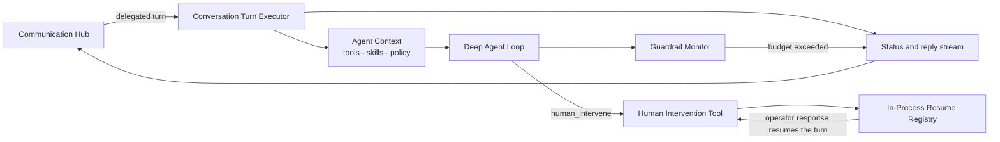
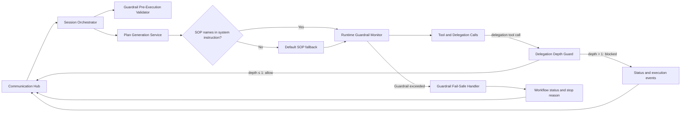
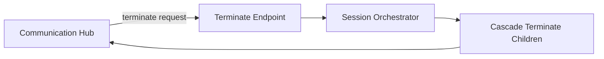
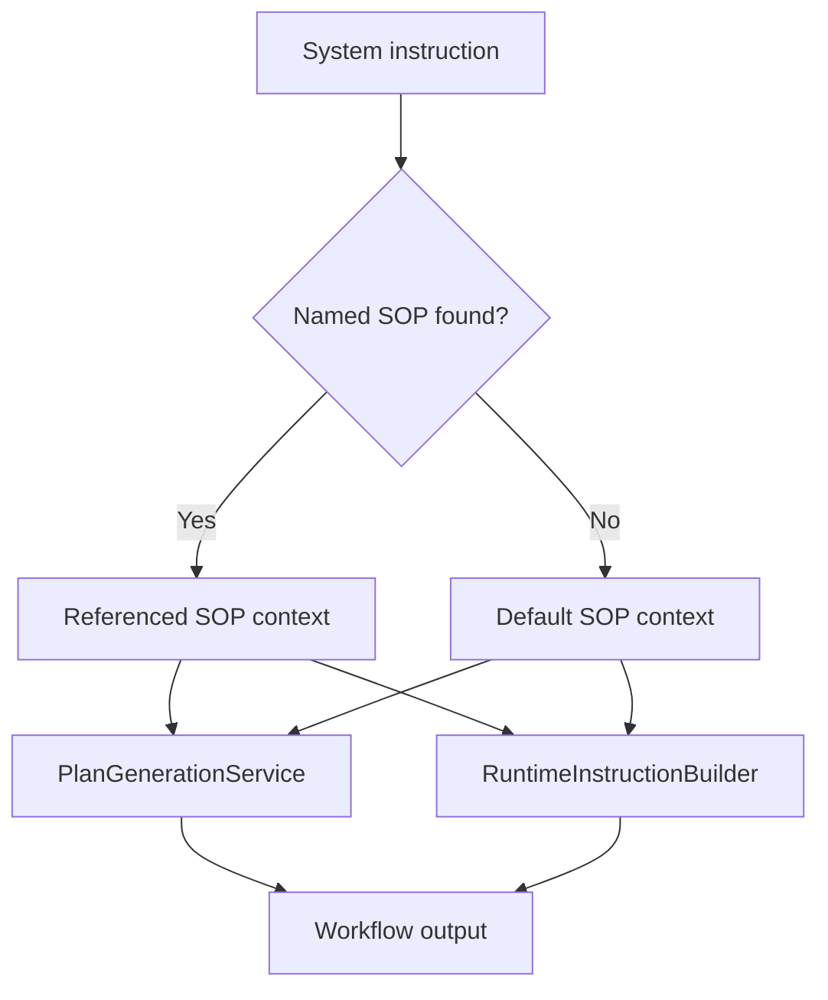

# Agent Runtime Architecture

## Tenant-Bound Execution

Agent Runtime receives a **signed, immutable tenant context** from Control Center over the existing mTLS channels; the context cannot be widened, and Agent Runtime holds no identity tokens or credentials. The signed `X-Internal-Tenant-*` headers are **mandatory** on execution requests — an unverifiable binding is rejected before the run starts (fail-closed). Every execution uses only the owning tenant's skills, tools, model configurations, identities, and permissions. Agent Runtime is database-free and runs **no quota logic** — quota decisions are made entirely in Control Center, which dispatches only quota-cleared executions over the existing signed-header contract. All execution logs and traces carry tenant attribution. See [Multi-Tenancy Architecture](multi-tenancy.md).

### Virtual Tenant Awareness

Agent Runtime resolves the calling tenant **once** from the signed context carried on the execution request (never from ambient or global state) and applies it to **all** resolution and downstream calls during the agent run:

- **Tool name resolution** — `server____tool` and `agent____<slug>` names are resolved against the calling tenant's MCP servers and agent types (tenant-aware resolver); unresolved names fail closed rather than falling back to a platform-wide registry.
- **MCP resolution** — tool lookups are tenant-filtered; a same-slug server in another tenant is invisible.
- **A2A delegation** — `agent____<slug>` targets resolve only within the tenant.
- **Downstream internal calls** — every AR → CH/CC call stamps the run's forwarded signed tenant headers (via the AR `comm_hub_client` and the shared `internal_httpx_client` egress choke point). AR is a **forward-only receiver**: it verifies and forwards tenant headers, never signs new ones.

## System Tool Binding & Routing

Agent Runtime binds LangChain `BaseTool` subclasses for all platform system tools, each holding a `CommHubToolClient` reference. Tool calls follow a mandatory routing path: Agent Runtime → Communication Hub → Control Center. Agent Runtime never accesses the database directly.

| System Tool | Purpose | Tool Call Path |
|---|---|---|
| `save_data` | Persist intermediate named data records during execution (zero or more per session) | AR → CH → CC |
| `get_data` | Query previously saved data by name, agent type, or session | AR → CH → CC |
| `get_output` | Query historical final outputs by agent type, session, or date range | AR → CH → CC |
| `query_result` | Query past typed agent outputs by data type name with optional filters | AR → CH → CC |
| `send_notification` | Send notifications via configured channels | AR → CH → CC |
| `get_recipient_group` | Resolve notification recipient groups | AR → CH → CC |
| `human_intervene` | Suspend execution and request human input (HITL) | AR → CH → CC |

Management (`cc____`) and decision (`decision____`) tool families route through the same path but are owned by the Control Center and Decision Tools modules respectively; Agent Runtime treats them as ordinary MCP tools.

## Inherent Self-Context & Optimization Skills

Every agent — role-based or role-less — receives two **built-in skills** at context-build time, with no administrator configuration and no binding rows:

| Inherent skill | Purpose | Tools |
|---|---|---|
| **Self-context** | The agent can inspect its own plan, scripts, and execution history | Plan retrieval (base and optimized), script listing, execution log |
| **Workflow optimization** | The agent can author and run its own optimized composition | Optimized-plan generation, script generation, script execution, script listing/retrieval |

Injection is dynamic per turn: the inherent tool names are merged into the agent's allowed toolset and the two skills are appended to its skill summary with deterministic identifiers, so nothing is persisted per agent. All inherent tools are **general** category (`system____` namespace) — no management parity, no confirmation requirement, and no privilege escalation; script execution stays inside the Agent Runtime sandbox and the run's iteration budget still applies. Definitions are derived from the system tool registry at request time and fail closed on registry drift.

## Conversational Turn Execution

Conversational agent types run a **deep-agent turn** in Agent Runtime: the runtime receives the turn from Communication Hub, assembles the agent's context for that turn, streams status events back while the loop runs, and returns the reply with guardrail usage.

- **Context per turn** — allowed tools and skills, guardrail policy, delegation limits, and model binding are resolved from Control Center for the calling tenant; a missing model binding is rejected *before* any model call so the surface can guide configuration instead of failing inside the model.
- **Streaming status** — thinking, tool use, delegation, and waiting-for-human states are emitted as status events; the hub keep-alives them so long turns stay visibly alive.
- **Layered time bounds** — every model call is bounded; a hang surfaces as a timeout outcome instead of a silent stall. While a human approval is pending, the wait is re-armed up to a longer intervention bound kept below the hub's turn watchdog.
- **Cancellation** — in-flight conversation turns are registered per session and cancelled when the session ends or an execution is terminated.
- **Never direct** — all tool, MCP, and delegation traffic leaves through Communication Hub; Agent Runtime holds no credentials and never touches the database.

### In-Process Intervention Resume

On the conversational path, a human-intervention tool call **suspends inside the tool call** and awaits the operator: the pending request is registered in-process against the conversation session, forwarded through the hub to the chat surface, and resolved by the runtime's resume endpoint when the operator responds. The resume path checks pending conversational interventions *before* the job-relaunch fallback, so a conversation without an execution job resumes correctly. A timeout returns an explicit "not executed" result to the agent — never a silent success. Task (job) agents keep the existing interrupt/resume flow unchanged.

## Typed Output Handling

When a non-conversational agent type has an assigned output data type (`output_data_type_id`), Agent Runtime performs a two-phase completion flow:

1. **Validation phase**: Calls Control Center's internal validation endpoint with the output payload and data type ID. Control Center validates against the schema and returns validation result.
2. **Persistence phase**: Calls Control Center's internal output persistence endpoint to persist the typed output with validation status, field values, and raw output fallback.

Structured output is enforced at the agent framework level via an output JSON schema passed during agent creation. The framework auto-promotes to provider-native JSON mode where supported.

The legacy `save_result` tool is decoupled from typed output — typed output is captured at session completion by the runtime executor, not via the agent's tool call.

## Delegation Depth Guard

Agent Runtime enforces a 1-level delegation depth limit for non-conversational (task) agents. A **Delegation Depth Guard** intercepts delegation tool calls (`agent____<slug>`) before dispatch:

- **Parent agent (depth 0)** delegates → allowed
- **Sub-agent (depth 1)** attempts to delegate → blocked; a `delegation_depth_blocked` log event is emitted
- **Conversational agents** are exempt — they use policy-defined `max_delegation_depth` (default 3)
- Enforced server-side at the Agent Runtime level — cannot be bypassed from the frontend

Depth is tracked via `RuntimeGuardrailState.delegation_depth`, incremented when a delegation tool call proceeds. When blocked, the sub-agent receives the blocked outcome as its tool result.

## Termination Governance

Agent Runtime exposes a control-plane termination endpoint reachable through the Communication Hub, which authenticates the caller with a service certificate. Agent Runtime rejects direct calls from Control Center — this preserves service segregation. Only Communication Hub service certificates are accepted on internal termination paths.

When a parent agent job is terminated, Agent Runtime cancels the in-flight task and walks the delegation graph to cancel all active delegated child jobs. The agent job status is updated to `terminated`, a distinct state from `failed` (genuine agent or runtime error). Late-arriving tool call completions or status updates are rejected by terminal-state guards.

## Execution Flow

## Termination Cascade

## Token Preflight Outcome

Agent Runtime receives executions only after the Communication Hub's preflight gate has cleared them. If any token the execution (including subagents) would use is expired, the run never reaches Agent Runtime — the Gateway blocks it and the agent surfaces only the blocked outcome with a re-auth message. Expiring-soon executions start with a warning flag. Agents never see identity tokens, before or after preflight.

## Sandboxed Scripting & Model-Authored Composition

Agent Runtime also executes **sandboxed, model-authored Python scripts**
(RestrictedPython; globals seeded from the audited safe baseline plus
pre-bound modules; no I/O; MCP-only
egress via the injected session-bound `CommHubToolClient`; CPU / memory /
wall-time caps with safe termination). The composition follows a
**two-layer plan model**: the base implementation plan stays high-level,
and an opt-in "Run with optimization" step of the Run Agent flow launches a
command-driven side execution that authors the optimized composition
(script segments + LLM bridges + decision steps) as a separate
`OptimizedImplementationPlan` with a `fully_scripted` execution-semantics
mark; the Script Compiler validates and normalizes the authored scripts (no
steps are auto-appended). Sandbox violations and cap terminations are
unconditional LLM-fallback triggers. A first-class **LLM Mock Layer**
(`LLM_MOCK_MODE` env/config) serves deterministic model responses for
zero-LLM test runs. See
[sandboxed-scripting.md](../sandboxed-scripting.md).
