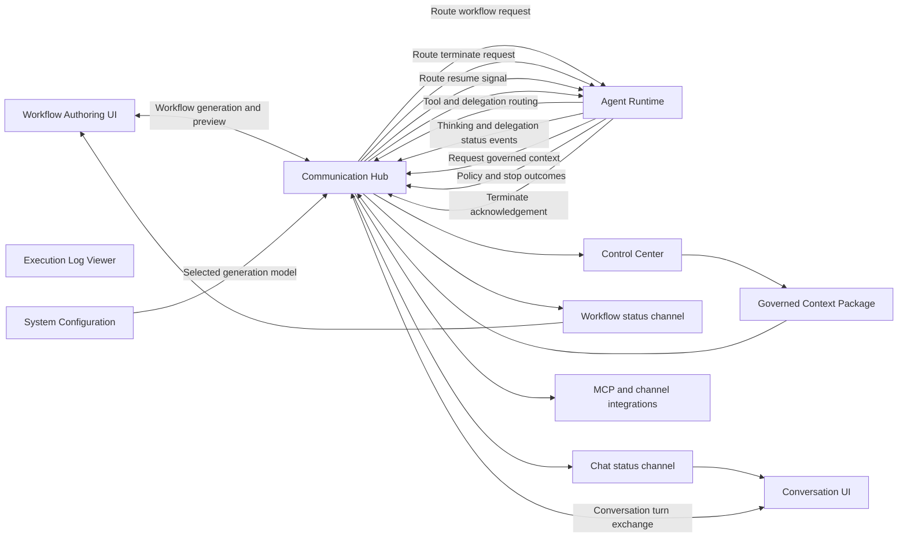
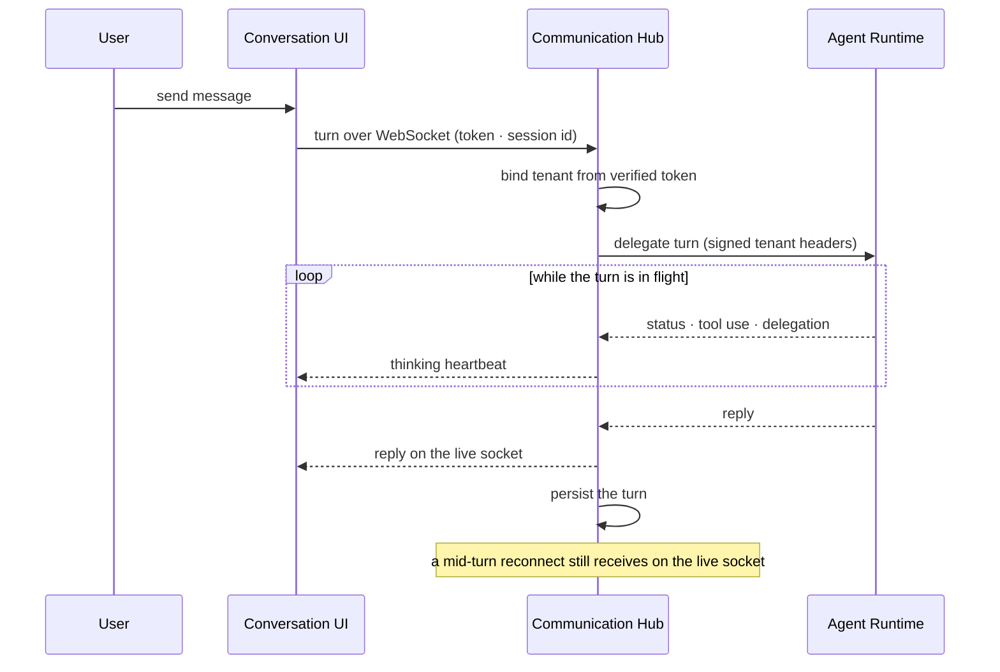
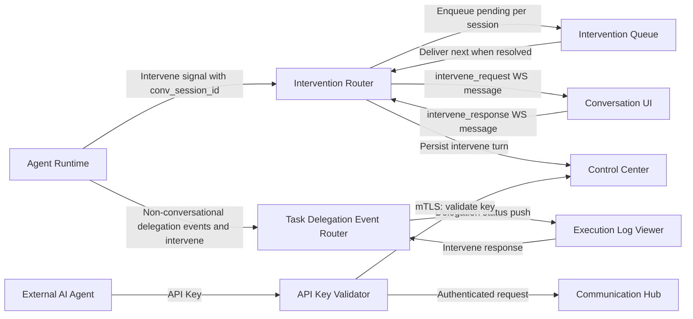
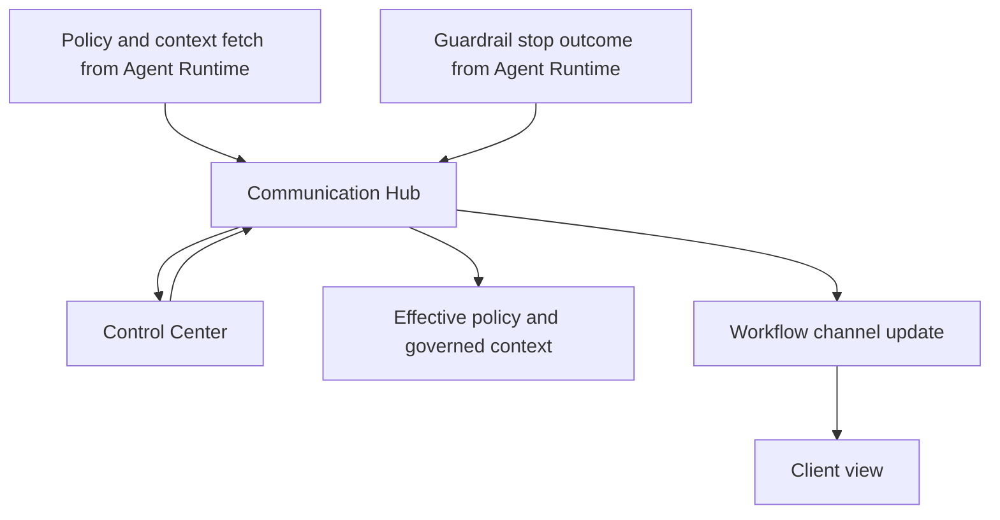
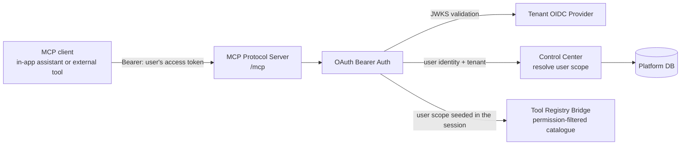
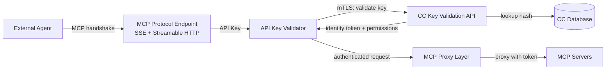
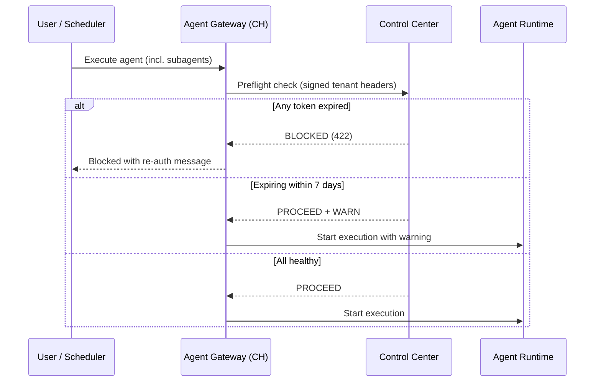
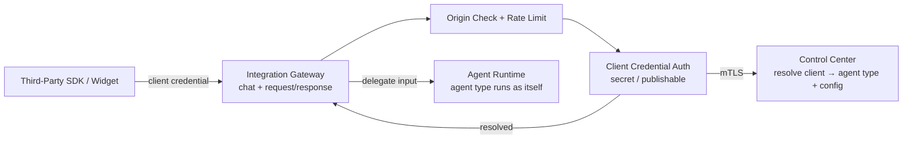

# Communication Hub Architecture

## Tenant-Bound Routing

The Communication Hub receives a **signed, immutable tenant context** from Control Center over the existing mTLS channels — it can never alter or widen tenant scope, and introduces no new trust path. Agent session dispatch, the A2A message broker, the MCP protocol server, and tool-call forwarding are all scoped to that tenant context; cross-tenant routing is impossible (A2A pairs must share the tenant context). MCP client API keys are **tenant-bound**: validation resolves the tenant, and keys cannot reach other tenants' resources. Per-tool-call identity token injection (performed by Control Center) is resolved within the tenant's scope only. The hub receives only quota-cleared dispatches — refusals happen in Control Center before anything is sent here. All routing, log, and trace events carry tenant attribution. See [Multi-Tenancy Architecture](multi-tenancy.md).

CH is a **forward-only receiver** of internal tenant context: it verifies the signed `X-Internal-Tenant-*` headers on internal hops (`/internal/a2a`, MCP server hops, system-tool forwarding) and forwards them — it never signs new bindings. All CH → CC internal HTTP goes through the shared `internal_httpx_client` egress choke point, which automatically forwards the tenant headers. **WS chat** authenticates both OIDC and platform-account tokens, binds the tenant context from the token's tenant claim, mints per-call signatures from that verified context (the one non-CC signing point), and delegates to AR with forwarded headers.

## Message Routing and UI Connections

## Conversational WebSocket Flow

Browser chat — the Control Center assistant and every conversational agent — uses one WebSocket channel per conversation session.

- **Tenant binding at connect** — the socket carries the user's token (OIDC or platform account) as a query parameter, and tenant resolution is bound once from the verified token claim (OIDC users resolve their tenant from an active membership) instead of the HTTP tenant middleware. When multi-tenancy is on and no tenant resolves, the connection fails closed. Outbound internal calls in the turn carry headers minted from that verified context — the WebSocket path is the one place outside Control Center that mints per-call signatures — so the hub delegates to Agent Runtime with a valid tenant binding.
- **Turn delegation** — the hub forwards the turn to Agent Runtime over the internal call path and relays its stream back: status events (thinking, tool use, delegation, waiting for human), the reply, and guardrail usage.
- **Live-session reply routing** — a registry maps conversation session → current socket, and sends resolve the *live* socket at send time, so a client that reconnects mid-turn (new socket, same session) still receives status, intervention prompts, and the final reply. Placement is newest-wins: an older connection's cleanup never evicts a newer registration.
- **Heartbeat** — while a turn is in flight the hub emits periodic thinking keep-alives, so intermediaries do not idle-close the socket and the "thinking" state stays truthful for arbitrarily long turns.
- **Turn supervision** — the whole turn is bounded by a watchdog even on the streaming path; the reply is delivered live before persistence so a slow persistence tail cannot swallow it; error turns are persisted exactly once; ending a session or terminating an execution cancels the pending turn and closes out the operator UI.

## Intervention Routing and External Agents

## Authentication Paths

Communication Hub accepts agents through parallel authentication paths that converge at the same MCP proxy layer:

| Auth Path | Credential | Agent Type | Token Handling |
|-----------|-----------|------------|----------------|
| **mTLS Certificate** | X.509 client cert issued by CC CA | Internal Agent Runtime | AR receives decrypted identity token |
| **API Key** | Bearer token or query parameter | External third-party agents | CH holds identity token internally; never exposed |
| **OAuth Bearer (user)** | The signed-in user's OIDC access token | The in-app assistant, and any MCP client acting as that user | Validated at the hub; user identity, tenant, and scope resolved from Control Center; the token is held server-side only |

**OAuth is the identity plane for management.** An OAuth-authenticated MCP session *is* the user: its permission scope is the user's own scope, resolved against the same resource types and actions as the REST surface. There is no service-account scope and no elevated path. Opaque API keys and JWTs are distinguishable, so a non-JWT credential falls through to the API-key path unchanged and an invalid or expired token is rejected fail-closed.

One tool surface serves two consumers — the in-app assistant and any external MCP client presenting the user's own credentials — so both are subject to exactly the same catalogue and permission decisions.

External agents do not receive identity tokens. The MCP Protocol Endpoint accepts the standard MCP handshake (SSE + Streamable HTTP) and fronts the API Key Validator, which calls Control Center's internal validation endpoint over mTLS, receives a resolved identity token, and holds it internally. CH injects the token only when proxying MCP tool requests to downstream servers.

## Tool Catalogue and Permission Filtering

`tools/list` and `tools/call` are built by the Tool Registry Bridge from four sources, each evaluated against the authenticated session's scope:

| Source | Contents | Filter |
|---|---|---|
| **Skill tool bindings** | Tool definitions contributed by the role's resolved skills and SOPs (skill resolution also returns updated-at for incremental refresh) | Role grants |
| **Management tools** (`cc____`) | Control Center management and meta tools | Per-tool permission parity |
| **Decision tools** (`decision____`) | Tenant decision tools | Grants |
| **Proxied MCP tools** (`server____tool`) | Tenant-namespaced tools of registered MCP servers | Grants |

- **Management filtering** — an OAuth session lists only the management tools the user's own scope satisfies; a direct call without that scope gets a structured denial, and delete-shaped or out-of-scope requests get a fixed "not supported" result before any write. Listing and invocation are enforced separately, so hiding a tool is never the only control.
- **Entity visibility vs invocation** — the `integration::control_center` permission governs the MCP Hub *administration* surface (seeing and defining the Control Center entity); invocation remains governed by tool grants plus parity.
- **Skill bindings are the grantable unit** — a skill contributes exactly the tools it is bound to (including `cc` tools); a skill with no bindings contributes nothing, which is surfaced as a warning on write so an inert skill is caught at authoring time rather than at run time.
- **Listing guarantees** — the MCP Hub tool listing is complete (not truncated by page size), deterministically ordered, permission-filtered *before* pagination, and reports a true total, so a server's tools never silently disappear from the browser or the skill editor. A `cc` tool already referenced by a skill is individually resolvable read-only for that dependency.

## Execution Preflight Gate

Before Communication Hub starts **any** execution (including delegated subagents), the Agent Gateway performs a token-health preflight: it calls Control Center's internal preflight endpoint through the shared `internal_httpx_client` (signed tenant headers, mandatory — fail-closed without them). Control Center resolves every token the execution will use and returns an outcome:

| Token state | Outcome |
|---|---|
| `expired` | Execution **blocked** (HTTP 422) with a re-auth message to the caller |
| `expiring-within-7-days` | Execution starts **with an expiring-soon warning** |
| `healthy` | Execution proceeds |

No token material crosses the CH/AR boundary — agents receive only the outcome.

## Responsibilities

- **Message Broker**: Routes agent execution, tool calls, and delegation requests between Web UI, Agent Runtime, and Control Center. Detects intervention requests originating from delegated sub-agents within a conversation session and routes them to the parent conversation's UI via the Intervention Router.
- **Conversation Session Manager**: Manages conversation WebSocket connections, session state transitions, and intervention-pending flags that block new user messages until outstanding interventions are resolved.
- **API Key Validator**: New middleware that intercepts requests bearing an API key (via `Authorization: Bearer` header or `?apiKey=` query parameter). Calls Control Center's internal validation endpoint over mTLS, receives the resolved identity/role/permission set, and caches the outcome for the request lifetime. External agents never receive the identity token — CH holds it exclusively for MCP request proxying.
- **Intervention Router**: Inspects `human_intervene` suspend signals for a `conversation_session_id`. When present, routes the intervention request to the connected WebSocket client of the parent conversation. When absent, falls through to the existing dashboard-based intervention flow.
- **Intervention Queue**: Per-conversation-session FIFO queue for intervention requests. When multiple delegated sub-agents request intervention concurrently, requests are delivered sequentially.
- **Task Delegation Event Router**: In-memory router that manages delivery of non-conversational delegation status events and intervention requests to execution log viewer clients. Maintains a mapping of active log viewer connections to parent task agent sessions. Pushes delegation status events (`delegation_started`, `delegation_waiting`, `delegation_resumed`, `delegation_depth_blocked`, `delegation_timeout`, `delegation_failed`) and intervention requests to the correct log viewer. Falls back to poll-based delivery when no live viewer is connected.
- **Conversation Turn Runner**: Owns the WebSocket turn lifecycle — binds the tenant from the verified token, delegates the turn to Agent Runtime, relays status events and heartbeats, resolves the live socket at send time for replies and interventions, enforces the whole-turn watchdog, and persists error turns exactly once. Cancels a pending turn when the session is ended or the execution is terminated.
- **Live Session Registry**: Maps conversation session → connected socket for reply and intervention routing. Newest registration wins, so a reconnect mid-turn never loses delivery and an older connection's cleanup never evicts a newer one.
- **System Tool Router**: Maps bare tool names (`save_data`, `get_data`, `get_output`, `query_result`, `load_skills`) to Control Center internal system-tool endpoints. No new structural components are needed; existing permission-check and certificate-forwarding infrastructure handles these tool calls automatically.
- **MCP Protocol Server**: Bridges standard MCP JSON-RPC methods (`initialize`, `tools/list`, `tools/call`) over SSE and Streamable HTTP transports to the existing tool registry and proxy path. Clients authenticate by mTLS (internal Agent Runtime), API key (external agents), or the user's OAuth Bearer token (management surface). Listings and call resolution are **per-tenant**: a client authenticated for a tenant sees and calls only that tenant's namespaced tools (slug uniqueness and resolution are `(tenant, slug)` — see [MCP Hub Architecture](../mcp-hub/architecture.md)).
- **MCP Session Manager**: Tracks per-connection protocol state — capability negotiation from `initialize`, per-session identity context — across the SSE and Streamable HTTP transports.
- **Tool Registry Bridge**: Resolves canonical tool names, enforces the permission set carried on the authenticated session, and dispatches system tools to Control Center's system-tool endpoint, management (`cc____`) tools to the management handler with parity re-enforced per call, and proxied MCP tools to the MCP proxy engine.

## WebSocket Messages

The Communication Hub supports structured WebSocket messages for intervention and chat flows. Intervention messages include request delivery, response submission, cancellation, and status updates between server and client. Chat messages from clients are rejected when the session has a pending intervention, ensuring orderly resolution of HITL requests.

## Integration Gateway (Third-Party Clients)

The hub exposes a public integration surface for third-party consumers of an agent type's *input interface* — conversational chat and typed request/response — plus white-label widget and theme serving and JS/Python SDK distribution. Requests authenticate with a **client credential** (not an identity): the hub validates it against Control Center over mTLS, resolving it to `(client → agent type + config)`. A client credential yields **no agent identity token**; the target agent type runs with its own identity + role as configured. Edge enforcement applies each client's allowed-origins check and rate limit. A `secret` client (server-to-server) may additionally carry an optional end-user token held CH-side; the `publishable` (browser) path carries no user identity.

## Sandboxed Script Egress

Sandboxed scripts in Agent Runtime reach the Hub exclusively through the
injected session-bound tool client — the same authenticated MCP path as the
LLM agent loop, with unchanged handling: the agent's dual identities,
per-call token injection, and script provenance tagging. No new protocol or
identity pathway is introduced for scripted execution. See
[Sandboxed Scripting](sandboxed-scripting.md).
