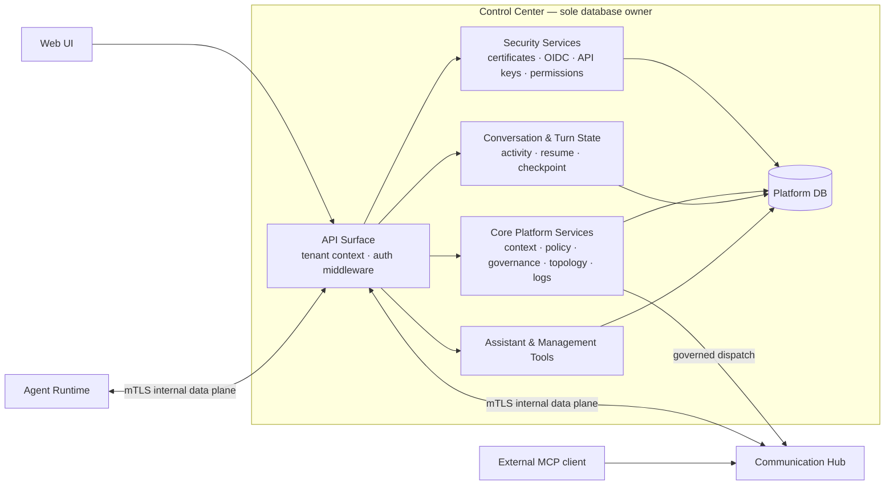
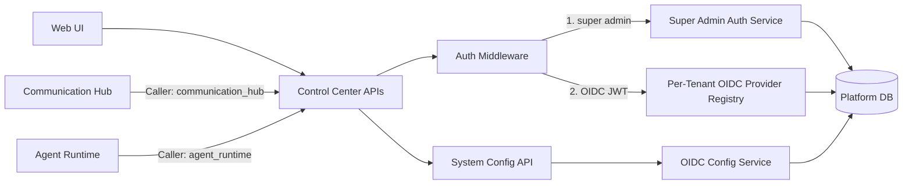
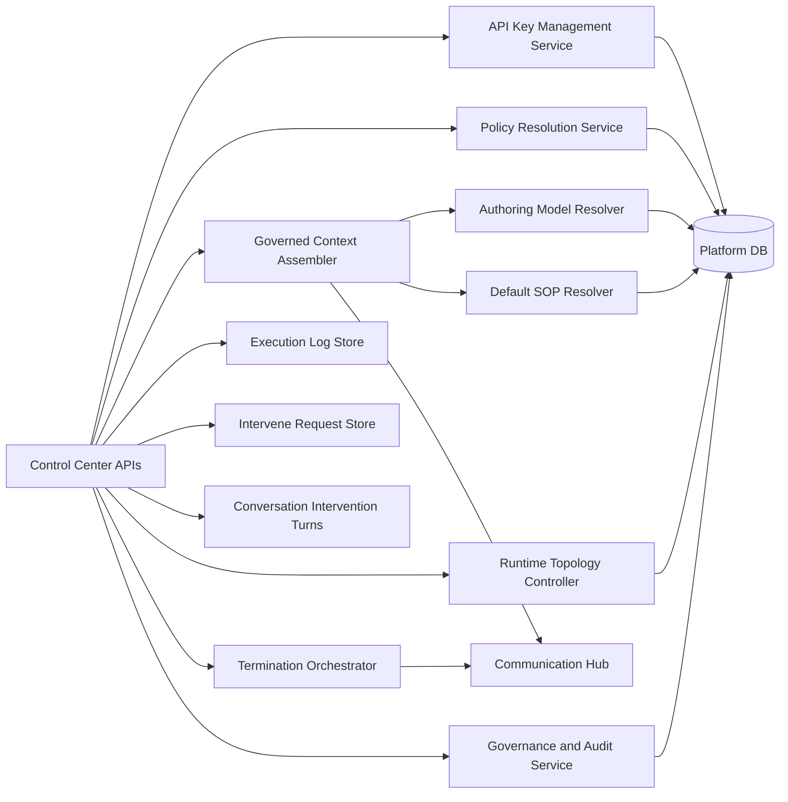
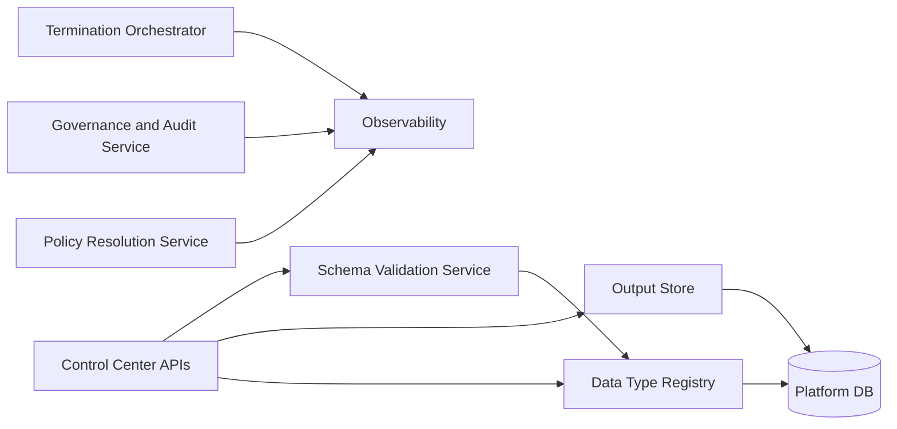
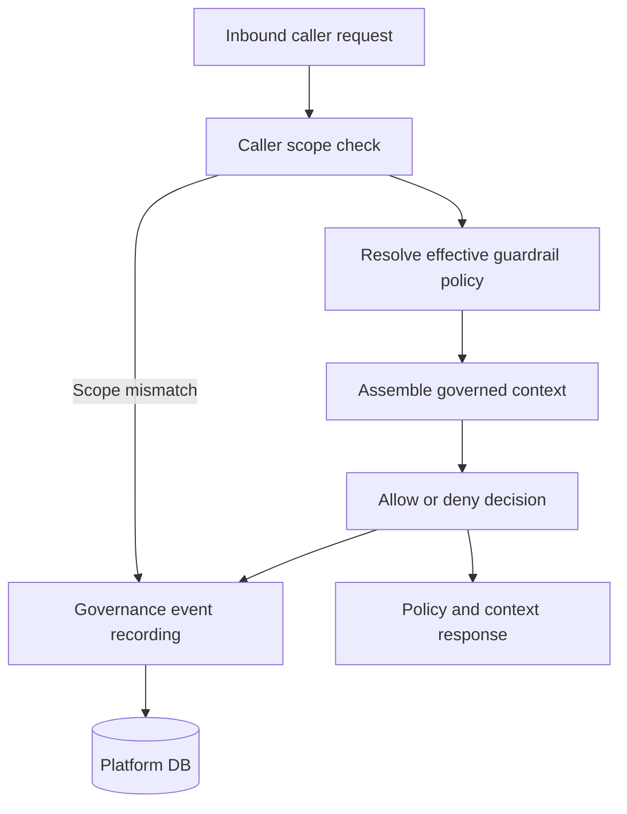
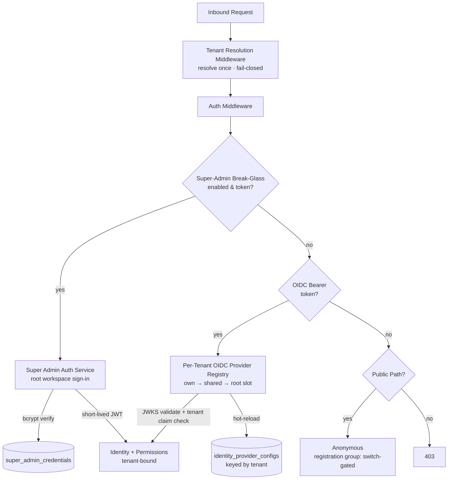
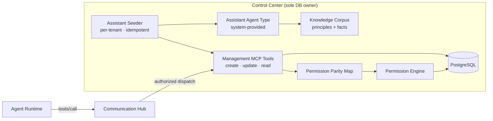
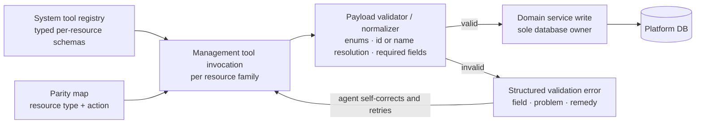
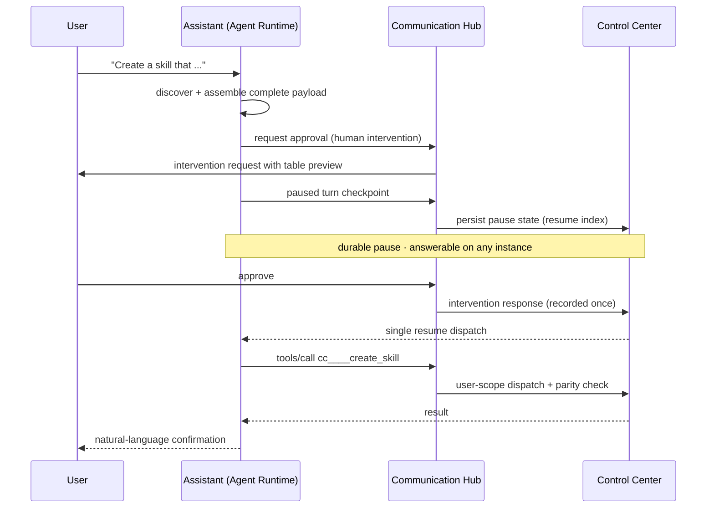

# Control Center Architecture

Control Center (CC) is the platform's single database-connected service: the security authority (certificates, tenant authentication, API keys, permissions), the sole owner of the Platform DB, and the internal data plane that Agent Runtime and Communication Hub reach over mTLS. This page covers the authentication surface, core platform services, data management, and the Control Center Assistant; turn state, optimization, and runtime monitoring live on their own pages (index below).

## Position in the Platform

## Service Segregation Responsibilities

- **Only Control Center touches the database.** Agent Runtime executes and Communication Hub transports; neither holds database credentials, and every persistence need is an internal CC endpoint over mTLS.
- **One signing origin.** CC is the only signer of internal tenant headers; signed context is propagated to Agent Runtime and Communication Hub over the existing mTLS channels.
- **Data plane vs. non-data-plane.** Internal data-plane paths require the signed tenant binding; internal paths that are not data-plane (certificates, bootstrap, API-key validation) keep certificate-only auth.
- **Tenant context is established once**, before any feature logic, and is fail-closed — an unresolvable tenant is rejected, never defaulted.

## Core Services at a Glance

| Service | Responsibility | Detail |
|---|---|---|
| **Certificate authority** | Issues and renews agent-instance and service certificates for Agent Runtime and Communication Hub | [Certificate Management](../../security/certificate-management.md) |
| **Authentication & tenant context** | Tenant resolution plus the three-tier auth pipeline, with JWT validation bound to the resolved tenant | this page |
| **Permission resolution** | Role permissions intersected with agent-type visibility, resolved identically from certificate, API key, or user token | [API Key Security](../../security/api-key-security.md) |
| **Token health & refresh** | On-demand token refresh and token-health signal for identities and sessions | [Token Refresh](../token-refresh.md) |
| **Internal data plane** | Certificate-gated routers with per-caller allowlists for Communication Hub and Agent Runtime | this page, *Core Platform Services* |

## Module Pages

| Page | Covers |
|---|---|
| **[Conversations & Durable Turns](conversations.md)** | Intervention persistence, activity state, resume index, checkpoint store, terminal resolution, and the operator answer flow |
| **[Optimization, Authoring Models & Plans](optimization-and-plans.md)** | Optimize gate, authoring/optimizer model resolution, optimization mode, single-use live-test approvals, plan status and requires-fix |
| **[Agent Runtime Monitoring](runtime-monitoring.md)** | Live topology view: push channel, stream-first flow, canvas guarantees, permission parity, provenance |
| **[Control Center Assistant Security](../../security/control-center-assistant.md)** | Layered security model for delegated management capability |

## API Layer and Authentication

## Core Platform Services

## Data Management and Observability

## Auth Middleware & Tenant Context

Every inbound request first passes **tenant resolution middleware**: in multi-tenant mode the tenant is resolved exactly once from a verified source (tenant address subdomain, or tenant header for API/MCP clients) and bound to an immutable per-request tenant context — fail-closed, so an unresolvable tenant is rejected before any feature logic. The public registration endpoint group is the only switch-gated exemption; when the tenancy switch is off, resolution is bypassed and requests bind to the root tenant. Signed tenant context headers propagate to Agent Runtime and Communication Hub over the existing mTLS channels. On `/api/v1/internal/*` **data-plane** endpoints, the signed `X-Internal-Tenant-*` headers are **mandatory**: a shared dependency verifies the binding and rejects missing, stale, or invalidly signed requests with 401 before any handler or DB access; DB sessions without a resolved tenant are rejected (or bound to root when tenancy is off) and every data-plane service adds explicit tenant predicates as defense in depth. CC is the **only signing origin** for internal tenant headers; internal paths that are not data-plane (certificates, bootstrap, API-key validation) keep certificate-only auth.

Authentication is a three-tier pipeline shared across all inbound API calls; JWT validation is bound to the resolved tenant (a validated token's tenant claim must match, otherwise the request is rejected):

### Super Admin Auth Service

- Stores bcrypt-hashed credentials in the `super_admin_credentials` table
- Issues short-lived internal JWTs (default 15-minute expiry, configurable)
- Seeded on first launch from environment variables (`SUPER_ADMIN_ENABLED`, `SUPER_ADMIN_USERNAME`, `SUPER_ADMIN_PASSWORD_HASH`)
- Enable/disable toggle: when disabled, all super admin login attempts are refused regardless of credentials
- Bypasses OIDC entirely — retained as the super-admin break-glass path at the root workspace sign-in

### Per-Tenant OIDC Provider Registry

- Registry keyed by tenant — the former global registry now resolves provider configurations per resolved tenant; each tenant's credentials are valid only inside that tenant
- Strict per-tenant resolution — each tenant validates only against its **own provider slot** (no shared/root fallback chain); the root slot serves platform sign-in and tenancy-off deployments
- Hot-reload: invalidated and refreshed when OIDC Config Service updates a provider, no restart required
- Caches JWKS keys per provider with TTL-based refresh
- Resolves provider type (`user` vs `agent`) from token claims or request context
- Supports concurrent multi-provider operation — separate issuers for users and agents
- JWT validation binds the token's tenant claim to the resolved tenant — mismatch is rejected; the owner's platform-issued account (email + password) authenticates outside this registry

## OIDC Config Service

- Full CRUD for identity provider configurations in the `identity_provider_configs` table
- Validates OIDC Discovery endpoints (issuer reachability, `.well-known/openid-configuration` fetch)
- Encrypts client secrets at rest
- Supports provider type enumeration: `user` and `agent`
- Each provider entry: issuer URL, client ID, encrypted client secret, scopes, claims mapping
- Replaces the legacy static `config/identity.yaml` approach; DB is the source of truth

## System Config API — Identity Provider Endpoints

JWT-protected endpoints for managing identity provider configurations, super admin settings, and OIDC connectivity testing. All provider configuration is stored in the database and loaded at startup by the OIDC Provider Registry. Client secrets are encrypted at rest via AES-256-GCM.

## API Key Management Service

A new set of CC API endpoints and service logic for CRUD operations on API keys. Platform administrators provision API keys for external agent identities through JWT-protected REST endpoints.

- **Create**: Admin selects an existing agent identity and agent role; CC generates a cryptographically random key, stores its SHA-256 hash, and returns the clear-text key once
- **List**: Returns all keys with bound identity, role, status, creation date, and last-used date
- **Revoke**: Sets key status to `revoked`; immediately invalidates it for future authentication
- **Internal Validation**: mTLS-protected endpoint called exclusively by Communication Hub. CH sends the hashed key value; CC looks up the hash, checks status, resolves the bound identity/role/permission set, and returns the identity token. External agents never receive this token — CH holds it internally for MCP proxying.

### API Key Store (`agent_api_keys` table)

New table in the Platform DB storing SHA-256 hashed key values with metadata including identity binding, role assignment, status, and timestamp tracking. Managed through CC's standard model and Alembic migration toolchain.

### Permission Resolution Chain (API Key Path)

API keys reuse the existing permission engine without modification. The resolution chain is:

`API Key → bound agent identity → bound agent role → policy evaluation → allowed tools/skills/SOPs`

This is the same model used by internal agents — the API key provides an alternative entry point into the identity → role → permission resolution chain.

## Task Delegation Event Persistence

- **Execution Log Store**: Accepts new delegation-related execution log event types: `delegation_started`, `delegation_waiting`, `delegation_resumed`, `delegation_depth_blocked`, `delegation_timeout`, `delegation_failed`. These are persisted to the `ExecutionLogEntry` table via the internal log append endpoint and delivered to log viewers via the existing NDJSON stream.
- **Parent-Child Resolution**: Non-conversational intervention requests use the existing `AgentJob.parent_job_id` FK chain to resolve parent context — `InterveneRequest.agent_session_id` identifies the sub-agent session, and the parent is reached via FK traversal. No new schema columns were added.
- **Pending Intervention Query**: Returns outstanding intervention requests for a task agent session, used by the execution log viewer on reconnect to re-surface dialogs.
- **Delegation Status Query**: Returns current delegation state (active sub-agent types, depths, exit conditions) by querying recent delegation-related `ExecutionLogEntry` entries.

## Agent Data Type Registry

- **Data Type Registry**: Centralized catalogue of reusable typed schemas (`AgentDataType` model) stored in the `agent_data_types` table. Each data type defines a name, slug (canonical runtime identifier), description, and an ordered array of field definitions with types: `string`, `number`, `boolean`, `date`, `enum`. Administrators manage data types via CRUD REST endpoints. The registry enforces uniqueness on name and slug, blocks deletion when referenced by agent types (409 Conflict with referencing type list), and requires at least one field per data type.
- **API**: JWT-protected CRUD endpoints for data types. A `?usage=true` query returns referencing agent type counts for delete-guard UI.

## Output Store

- **Output Store** (`AgentOutput` model): Immutable typed output records in the `agent_outputs` table. Each record links to a data type, agent type, execution session, stores field values matching the data type schema, validation status (valid or validation_error), and raw output fallback. Queried by data type, agent type, date range, and session.
- **Agent Outputs Page**: Paginated JWT-protected query and CSV export endpoints.
- **Internal API**: mTLS-protected endpoints for Agent Runtime output persistence and `query_result` tool queries.
- **System Tool Endpoints** (mTLS-protected): Persists `AgentData` intermediate records, queries `AgentData` with filter guard, queries `AgentOutput` by filters, and resolves data type names to return matching typed outputs.

## Schema Validation Service

- **Schema Validation Service**: Lightweight payload validator invoked by Agent Runtime via mTLS. Accepts a data type ID and a payload, fetches the schema from the Data Type Registry, validates field types (string, number, boolean, ISO 8601 date, enum membership), required field presence, and default values. Returns validation result with field-level error details. Validation failure does not block execution — results are persisted with `validation_error` status and the raw output as fallback.

## Control Center Assistant

The Control Center Assistant is a **seeded, system-provided conversational agent type** that lets a Control Center user perform Agents-menu management tasks — create / update / read of skills, SOPs, agent types, roles, identities, model configurations, schedules, data types, and MCP Hub connections — from natural language. It is an ordinary agent: it executes in Agent Runtime and reaches management capability **only** through MCP tools. There is no Control Center-internal bypass and no elevated service path.

- **System-provided agent type** — provisioned idempotently for every tenant and marked system-protected (no user edit or delete), mirroring the system skill/role convention. Model selection stays a per-tenant operator decision; the chat surface guides the operator when no model is selected.
- **Knowledge-driven, not scripted** — a deterministic platform knowledge corpus plus an always-on instruction digest carry generic principles (understand before acting, resource completeness, prerequisite ordering, grant at the right level, reuse first) and reference facts, retrieved on demand during a turn. Seeded provisioning refreshes drifted knowledge/instruction text on restart.
- **Progressive tool disclosure** — the conversational context carries only a small constant meta set (dispatch a management tool, fetch one tool's schema, list the catalogue, search knowledge, request human approval); the full execution toolset stays registered for dispatch, grants, and external MCP clients.
- **No destructive operations** — deletion is not registered as a tool at any layer.

## Management MCP Toolset & Control Center MCP Entity

Management capability is served as MCP tools on a dedicated, per-tenant **Control Center MCP entity** (reserved slug `cc`), separate from the System entity that carries general system tools and from the decision namespace.

- **Namespace split** — management tools are canonically `cc____<verb>_<resource>`; general system tools keep `system____<bare>` and decision tools `decision____<name>`. `cc` is a reserved server slug, so no custom MCP server can collide with it. Splitting the families makes management capability independently grantable and keeps general agent tooling untouched.
- **Entity contents** — the create/update/read execution tools for the nine resource families plus the assistant meta tools. Read covers `list_*` / `get_*`; no delete verb exists in the namespace.
- **System-managed lifecycle** — the seeder is the only writer. The entity is immutable (update, delete, sync, and OAuth configuration are refused for everyone, including `manage` holders) and sessionless (no MCP sessions; access flows through role/skill grants). Reads expose the system-managed flag and the UI presents it as a protected integration; tool grants onto its tools remain available to `manage` holders.
- **Visibility permission** — `integration::control_center` with `read` (see the entity, its tools, and management-toolset reads) and `manage` (grant/revoke its tools and define configuration around it). Deny-by-default; existing `integration::*` and `*::*` wildcards cover administrators. The type is registered in both the backend manifest and the frontend mirror.
- **Read-only dependency visibility** — a `cc` tool already referenced by a tenant's skill stays visible (read-only) to a caller without the entity permission, so saving can never silently drop a dependency; the rest of the catalogue is never exposed.

**Permission parity** — every management tool is keyed to the same `(resource_type, action)` its REST equivalent enforces, so an MCP call can never perform an action the REST API would deny:

| Resource family | Resource type | Write action | Read action |
|---|---|---|---|
| Skills | `agent::skills` | `create` / `update` | `read` |
| SOPs | `agent::sops` | `manage` | `read` |
| Agent types | `agent` | `create` / `update` | `read` |
| Agent roles | `agent` | `create` / `update` | `read` |
| Agent identities | `agent` | `create` / `update` | `read` |
| Model configurations | `agent` | `create` / `update` | `read` |
| Schedules | `agent::schedules` | `create` / `update` | `read` |
| Data types | `agent::data_types` | `create` / `update` | `read` |
| MCP Hub connections | `integration::mcp_hub` | `create` / `update` | `read` |

Parity is evaluated twice: when the catalogue is listed (only tools the caller may invoke are shown) and again before the write is executed. Out-of-scope resources and delete-shaped requests are declined in-band before any mutation.

### Full-Field Management Payloads

Conversational management reaches **parity with the web UI edit surface**: each create/update handler accepts the complete field set its UI form accepts, and the system tool registry exposes typed per-resource parameter schemas instead of a free-form payload object. Enrichment of dependent fields (bindings, grants, tool associations) follows the same pattern at both routing layers.

Validation never substitutes for authorization: parity is re-checked per invocation before the handler runs, and a well-formed but out-of-scope payload is still refused. Structured errors exist so the assistant can repair its own request without widening what it may do.

### Confirmation & Human-in-the-Loop Flow

Every **create or update** is previewed and approved before execution; reads are unaffected.

- **Canonical preview** — a heading plus one field/value table of the exact payload (updates: only changed fields, old → new). Agent-type creation previews model, identity, role, skills, and grants, and an agent type without a working model and an identity or role is never created.
- **Approval as a tool call** — approval is requested through the platform human-intervention mechanism, so the same policy, audit, and UI path serves the assistant as any other agent.
- **Suspension, not replay** — a conversational approval is a pause on Control Center-owned durable state, so the confirmation survives a restart, failover, or instance replacement and resumes on whichever instance can load the turn; a replayed request is de-duplicated and an already-answered one returns the stored operator response, so approval can never execute twice. The pause itself is described in [Conversations & Durable Turns](conversations.md).
- **Rejection and timeout are explicit** — a rejection executes nothing; a timeout returns an explicit "not executed" result to the agent rather than a silent success. An unanswered confirmation beyond its validity window resolves terminally as not applied.

### Guardrails, Timeouts and Turn Supervision

- **Iteration budget** — the assistant is seeded with a guardrail iteration budget sized for multi-step management workflows (several discovery calls plus the writes), far above the platform default; the per-agent-type policy is the single source of truth for the runtime monitor.
- **Layered time bounds** — the strict per-turn model timeout still fires on a hung provider; while an approval is pending the wait is re-armed up to a longer intervention timeout, kept below the Communication Hub turn watchdog. Session end terminates in-flight work.
- **Actionable failures** — guardrail stops and turn failures are mapped to structured, human-readable error turns persisted exactly once, so a long management turn never ends in silence.
