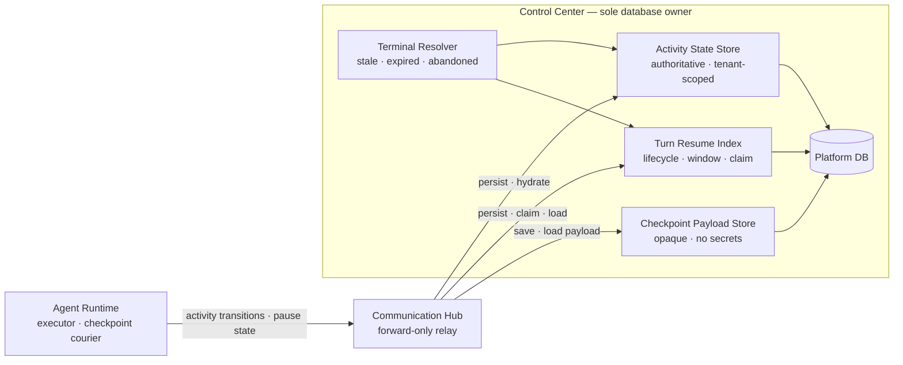
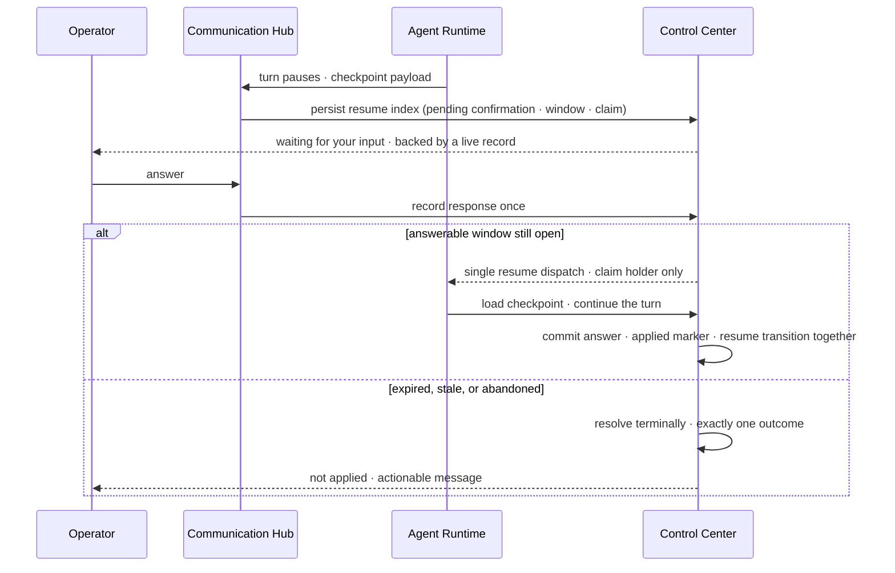

# Control Center — Conversations & Durable Turns

[← Control Center Architecture](architecture.md) · [System Overview](../../system-overview.md)

Control Center owns the lifecycle of every conversational turn; Agent Runtime executes it and Communication Hub transports it. Nothing about a turn's state depends on the process that happens to be serving it, so a pause survives a restart, failover, or instance replacement.

## Conversation Intervention Persistence

- **Conversation Intervention Turns**: Extension of `ConversationTurn` persistence to support `intervene_request` and `intervene_response` turn types. Stores intervention type (approval/choice/text), prompt text, available options, operator identity, response value, and timestamp. Turns are persisted in chronological order within the conversation stream for audit traceability.
- **Intervene Request Store**: Extended to accept and persist conversation context fields (`conversation_session_id`, `delegation_depth`) on `InterveneRequest`. Automatically creates paired `intervene_response` conversation turns when responses are submitted to conversation-scoped requests. Non-conversational flow (no `conversation_session_id`) is unchanged.
- **Conversation-only interventions**: requests raised inside a conversational turn (no execution job behind them) are first-class — the job reference is optional and the conversation session carries the context. Replays are idempotent: a repeated pending request is returned de-duplicated, and an already-answered request returns the stored operator response instead of prompting again.
- **Activity state and resume index**: a conversation's *current activity* is a Control Center-owned record distinct from the session's coarse lifecycle status, and each paused turn has a **resume index** entry beside it (pending confirmation, validity window, claim holder, terminal outcome) plus the opaque **checkpoint payload**. `waiting_for_input` is only displayed while a live resume record backs it, and the answerable window is tenant policy.

## Conversational Turn Supervision & Durable Resume

- **Activity State Store** — what the assistant is doing right now, written only through Control Center's internal surface. Holds status only, never tokens or credentials.
- **Turn Resume Index** — which turn is paused, the pending confirmation, the answerable window, which instance holds the claim, and the single terminal outcome. It is what makes "shown as waiting" structurally equal to "actually answerable".
- **Checkpoint Payload Store** — the durable paused-turn payload, written and read only through the internal API, purged when the turn reaches a terminal state.
- **Terminal Resolver** — closes work that can no longer be continued: a stale working state (heartbeat stopped while thinking, calling a tool, or delegating) resolves as an unexpected termination rather than a timeout, an expired window expires the linked confirmation, and a resolved turn writes exactly one outcome. A dead confirmation is folded read-only in the interface so it is never offered as actionable.

Confirmed writes apply at most once: the answer, the idempotency marker, and the resume transition commit together, and duplicate operator responses short-circuit to the stored outcome instead of re-dispatching.

### Answerable Window vs. Intervention Timeout

| Bound | Scope | Meaning |
|---|---|---|
| **Resume answerable window** | Tenant policy, platform default 15 minutes | How long a durable pause stays answerable. The resume record's expiry mirrors the pending intervention, and an answer arriving later resolves the turn terminally as expired. |
| **Conversational intervention timeout** (240 s default) | Legacy in-process pause fallback only | The in-process re-arm bound while an approval is pending, kept below the Communication Hub turn watchdog. It does not size a durable pause — the answerable window does. |

### Intervention Flow

### Terminal Outcomes

| Outcome | Trigger |
|---|---|
| **Approved and applied** | The operator confirmed inside the window; the write applied exactly once, with its marker and resume transition committed together |
| **Denied** | The operator rejected the confirmation; nothing was written |
| **Expired** | The window closed before an answer; the linked confirmation expires with the record and folds read-only |
| **Unexpected termination** | The heartbeat stopped while the turn was working, or the claim was abandoned — reported as a failure, never as "waiting for input" |

Related: delegation event persistence and intervention re-surfacing for task sessions are covered in [Control Center Architecture](architecture.md#task-delegation-event-persistence); the cross-service turn lifecycle is in [Agent Lifecycle](../agent-lifecycle.md).
