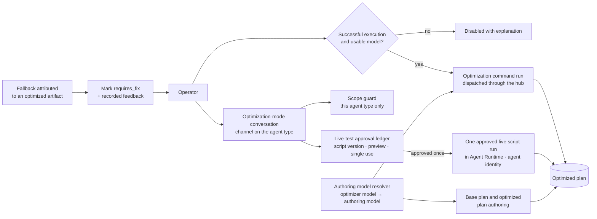
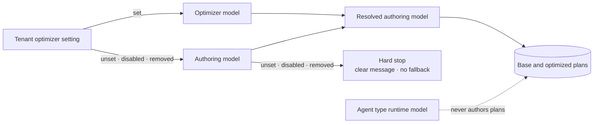
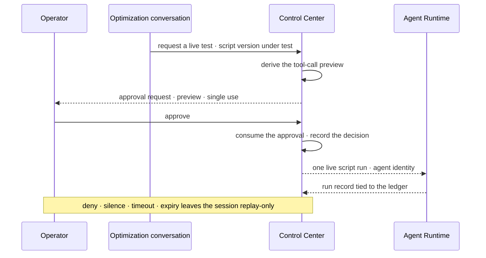

# Control Center — Optimization, Authoring Models & Plans

[← Control Center Architecture](architecture.md) · [System Overview](../../system-overview.md)

Optimization is one gated action plus an optional human-gated conversation, both on the agent type itself — never a separate agent, identity, or role.

## Optimize Gate, Authoring Models & Optimization Mode

- **Separated actions** — Run never optimizes. Optimize is its own trigger with a dual precondition (at least one successful execution and a usable model); generation of a plan is explicit-only and unavailable for conversational agent types.
- **Authoring model resolver** — one tenant-scoped setting serves Skill/SOP workflow generation, implementation plans, and optimized plans. Unset, disabled, or removed is a hard stop with a clear message and no fallback model; the agent type's runtime model never authors plans.
- **Optimizer model resolution** — a tenant-scoped optimizer setting that falls back to the authoring model when unset. It is never the agent's runtime model, and a disabled selection is a "not configured" state rather than a substitution.
- **Optimization mode** — a conversation channel on the agent type. The executor routes it to the conversational loop whatever the agent type's input type, the optimization mission replaces the business instruction and skills only for those turns, and the scope guard limits work to that agent type's plan, scripts, and execution history. Normal business runs are unaffected.
- **Live-test approval ledger** — records the script version under test, a server-derived tool-call preview, the operator decision, and the single script run record, tied to tenant, agent type, and conversation. Approval is single-use and audited; deny, silence, timeout, or expiry leaves the session replay-only. The ledger grants no new authority — an approved live script cannot exceed the agent type's existing grants.
- **Requires-fix flagging** — when a fallback is attributed to an optimized artifact, Control Center marks the plan `requires_fix`, appends feedback, and the plan surface alerts the operator. A requires-fix plan is never re-served as if healthy, and no unattended re-optimization runs.

### Which Model Authors a Plan

### Live-Test Approval (Single Use)

## Script Registry, Optimized Plans & LLM Mock Recordings

Control Center persists the Software 3.0 script framework — the script registry (draft → verified → compiled → retired lifecycle, sandbox validation), the `OptimizedImplementationPlan` compositions authored by the separated Optimize action and its optimization-mode conversations, `CommandPrompt` mission storage, per-execution records, and `LLMMockRecording` test data (written only in test/recording modes). Re-optimization never reopens a plan — a new one is authored and the prior one is retired. Its REST APIs serve the registry to Agent Runtime exclusively over mTLS; its internal recording endpoint stores mock LLM interactions (prompt + response + usage only). The semantic-bridge endpoint is served by the mock layer in test modes, so model-backed script steps run zero-LLM in tests. See [Sandboxed Scripting](../sandboxed-scripting.md).

### Plan Status

| Status | Meaning |
|---|---|
| `generating` | Authoring in progress |
| `ready` | Plan authored and usable |
| `needs_feedback` | Authored but awaiting operator feedback |
| `failed` | No usable plan was produced |
| `requires_fix` | A fallback was attributed to the plan: feedback recorded and the operator alerted; never re-served as healthy |
| `retired` | Superseded by a newly authored plan; kept for history, never reopened |

The optimizer persists the first three outcomes; `requires_fix` is set by Control Center when a fallback is attributed to the plan; `retired` records supersession.
