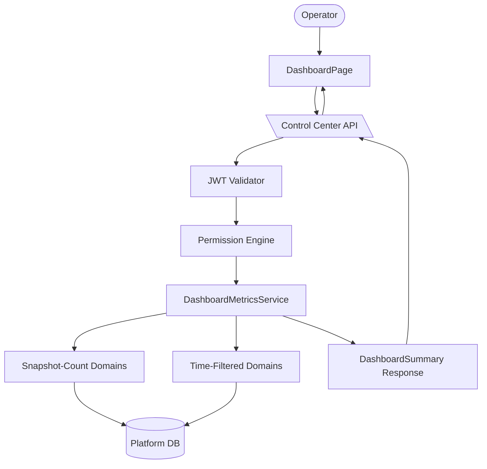
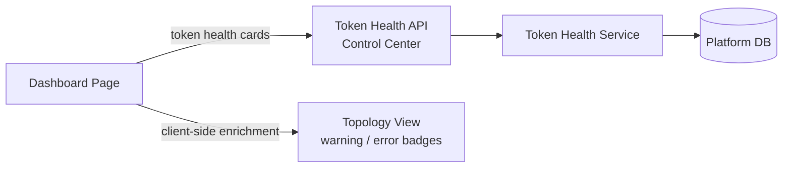

# Dashboard Operational Metrics

The dashboard module provides an operational metrics overview, aggregating counts across multiple data domains into a single summary endpoint. Each data domain is individually permission-guarded, and the UI renders permission-denied placeholders rather than hiding cards.

## Token Health Cards

The dashboard also surfaces **token health** for agent identities and MCP sessions, powered by the Control Center Token Health Service (the sole DB reader of token metadata). Cards show counts per state (`healthy` / `expiring-within-7-days` / `expired`) with click-through to identity / MCP session pages for refresh or re-auth. The same token-health states are consumed client-side to enrich the **topology view** with warning/error badges per container.

## Snapshot-Count Domains

Queried without a time filter — returns current state counts:

- Agent Types (with active/running breakdown)
- Agent Identities
- Agent Roles
- MCP Servers
- Model Configurations (enabled only)
- Active Schedules
- Pending Intervention Requests

## Time-Filtered Domains

Queried with a `start_time` / `end_time` range (defaults to last 24 hours):

- Agent Executions (completed/failed breakdown)
- Guardrail Threshold Breach Events
- Execution Log Failures
- Model Usage Posture Breaches

## Permission Model

| Card | Required Permission |
|------|-------------------|
| Agent Types | `RT_AGENT` (read) |
| Agent Executions | `RT_AGENT` (read) |
| Pending Interventions | `RT_AGENT_HUMAN_INTERVENTION` (read) |
| Model Configurations | `RT_AGENT_MODEL_CONFIGS` (read) |
| Model Usage Posture Breaches | `RT_AGENT_MODEL_CONFIGS` (read) |
| Active Schedules | `RT_AGENT_SCHEDULES` (read) |
| Agent Identities | `RT_AGENT_IDENTITIES` (read) |
| Agent Roles | `RT_AGENT_ROLES` (read) |
| MCP Servers | `RT_INTEGRATION_MCP_HUB` (read) |
| Guardrail Breach Events | `RT_AGENT_TRAILS` (read) |

## Scripted-Run Cost Reporting

For scripted (Software 3.0) runs, `tokens_saved` is **measured** against the
reference LLM execution's real token usage — not estimated — so cost
reporting reflects actual avoidance. Script execution logs are humanized
one-liners (step name, what ran, natural-language outcome summary) instead
of truncated JSON blobs; sandbox violations and cap terminations appear as
first-class events with a one-line reason.
