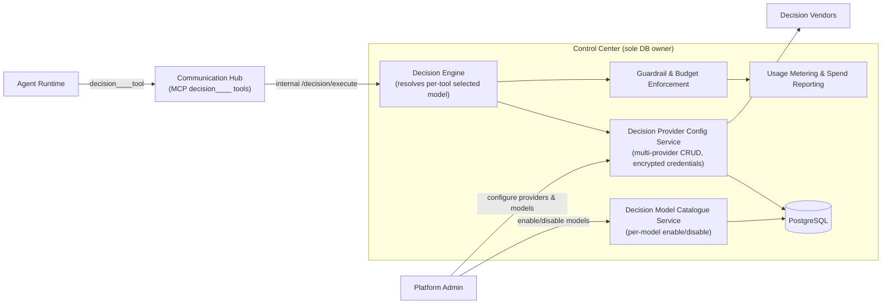
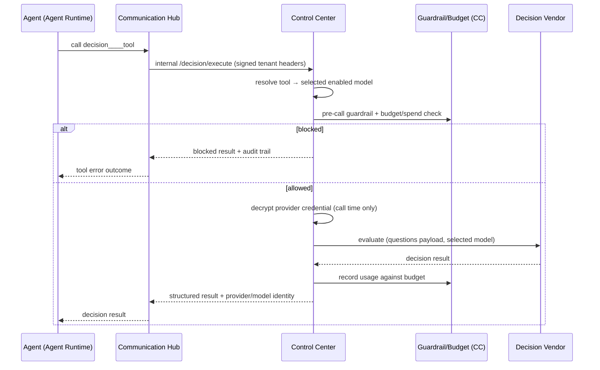
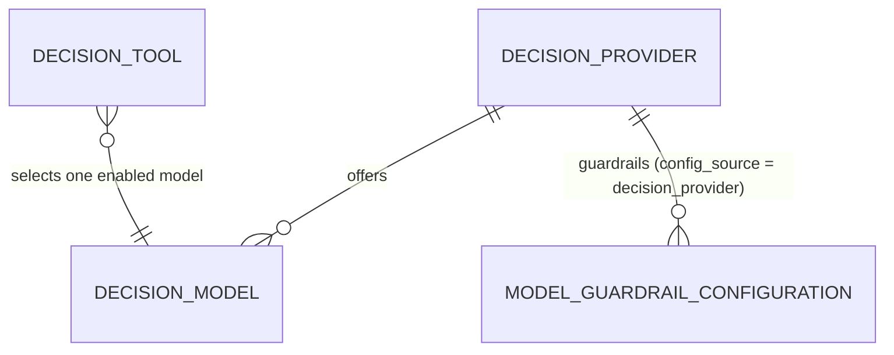

# Decision Model Providers Architecture

## Overview

Decision Model Providers generalise the former single "System One Provider" into multiple vendors, each with its own catalogue of decision models. The design mirrors the LLM [Model Configuration](../model-config.md) pattern: administrators manage providers and their enabled models centrally in Control Center; each Decision Tool carries a reference to one enabled model, resolved at execution time. Control Center is the only DB-connected service — Agent Runtime and Communication Hub never see credentials or query the database, and decision execution always routes through Control Center internal endpoints over signed tenant headers.

## Component Architecture

## Key Properties

- **Multi-provider, multi-model** — one provider entity per vendor; each provider holds an encrypted credential (write-only, never returned on read) and a vendor catalogue with per-model enable/disable.
- **Per-tool model selection** — each Decision Tool stores a reference to one enabled Decision Model; deletion of a provider/model is blocked while referenced by any tool.
- **Full guardrail/budget coverage** — decision evaluations pass the same pre-call checks as regular agent model calls. Decision-provider guardrails reuse `model_guardrail_configurations` with a `config_source` discriminator (`decision_provider`) plus a `decision_provider_id` FK, enforced by the decision pre-call path in Control Center before any vendor call.
- **Usage & spend reporting** — decision model usage is metered into the same pipeline as regular LLM usage.
- **Auditability** — execution responses and logs include provider/model identity.
- **Segregation respected** — configuration and credential decryption are CC-only; agents receive only structured decision results.

## Execution Flow

## Data Model (business entities)

- **Decision Provider** — vendor configuration (provider type, endpoint, encrypted credential). Migrated from the former single-provider configuration via an idempotent one-time Alembic migration.
- **Decision Model** — a model within a provider's catalogue; can be individually enabled or disabled.
- **Decision Tool** — references exactly one enabled decision model; referential integrity prevents deleting models still in use.
- **Guardrail configuration** — shared `model_guardrail_configurations` store, discriminated by `config_source = decision_provider` and bound to the owning provider.
