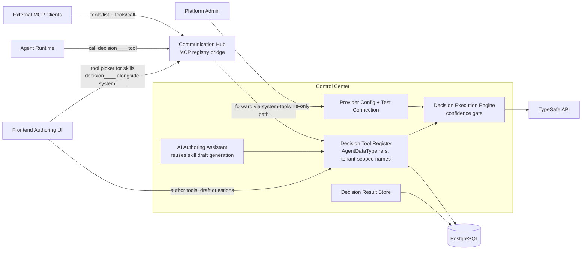
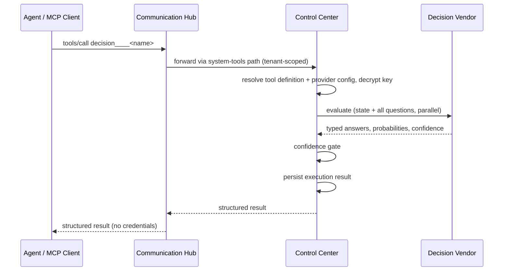
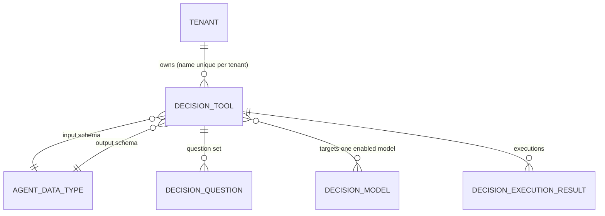

# Decision Tools Architecture

## Overview

Decision tools are user-definable decision-making modules that behave exactly like Parthenon's built-in system tools. They are the second decision-making pathway alongside LLM skills — a skill, an agent, or an external MCP client invokes a decision tool instead of routing the judgment to an LLM. Decision tools resolve through the same system-tool registry, naming convention (`decision____<name>`, four-underscore separator shared with `system____`), permission model, and grants as system tools. Skills themselves are unchanged. All decision-tool records, lookups, grants, and invocations are tenant-contained: names are unique per tenant, and `decision` is a reserved MCP server slug alongside `system`. Provider configuration and execution live in Control Center; for the provider/model side, see [Decision Models Architecture](../decision-models/architecture.md).

## Component Architecture

## Key Properties

- **Tool registry** — CRUD for decision tools: question sets (Choice / Score / Noul), state preset, and input/output references to existing Agent Data Type records (no ad-hoc schemas). Definitions are validated, and the tool description is auto-generated. Authoring is gated on a configured decision provider.
- **Tenant containment** — tool names are unique per tenant; identical names in different tenants never collide. The `decision` MCP server slug is reserved so no external MCP server can shadow the namespace.
- **Authoring assistance** — the authoring form detects backtick-quoted state placeholders in question instructions and suggests state mappings; an AI-assisted endpoint (the same generation mechanism behind the skill editor) drafts questions and state mapping from the tool description and chosen data types.
- **Execution engine** — resolve tool → apply state preset → dispatch all questions in one parallel evaluation → normalize typed answers → confidence gate (high = auto, medium = confirm, low = escalate).
- **Result storage** — every execution is persisted (tool, state snapshot, answers, probabilities, confidence, gate outcome) and auditable like existing tool executions.
- **Segregation respected** — Control Center is the only component that decrypts the provider key (call time only, never returned by any API) and calls the external vendor; Communication Hub brokers only; agents receive structured answers, never credentials.

## Invocation Flow

## Data Model (business entities)

- **Decision Tool** — tenant-scoped tool module with auto-generated description; grantable like any system tool.
- **Decision Question** — Choice / Score / Noul question with instructions, criteria, and state placeholders.
- **Decision Execution Result** — auditable record of one invocation (answers, probabilities, confidence, gate outcome).
- **Skills are unchanged** — skill definitions reference decision tools through the existing tool binding, listed as `decision____<name>` in the skill-editor tool picker.
