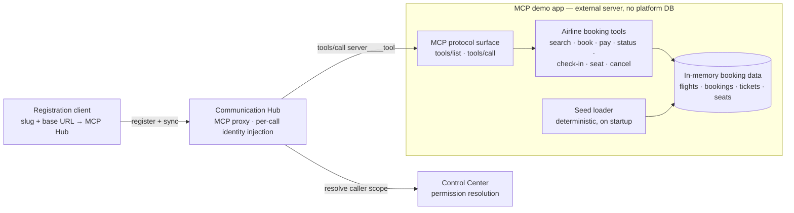

# MCP Demo App (Airline Booking Scenario)

The MCP demo app is a **standalone external MCP server** used to demonstrate and validate the platform end to end. It is not one of the three platform services: it has no database, no identity tokens, and no privileged path. It registers with the MCP Hub exactly as a third-party server would, and the scenario state it holds is entirely its own.

## Components

- **MCP protocol surface** — the same tool handling as any registered server; the airline tools dispatch instead of the original greeting tools.
- **Airline booking tools** — search flights, book ticket, generate payment link, check ticket status, check in passenger, select seat, cancel booking. Write and destructive tools are reached only through the platform's confirm-before-write approval.
- **Seed loader and in-memory store** — minimal fictional flights, bookings, tickets, seat map, and payment links, loaded deterministically at startup, so a restart is a predictable reset. Nothing in this state is a platform system of record.

## Registration and Tool Sync

1. The app registers its **slug and base URL** with the MCP Hub, which creates the server record for the calling tenant.
2. A tool sync discovers the exposed tools and registers them under the `server____tool` namespace, tenant-stamped at resolution time.
3. Tool access stays deny-by-default: roles and skills must be granted the individual tools, so a demo role can be shown an access-denied result for a tool it was not granted.

## Position in the Platform

| Aspect | Behavior |
|---|---|
| Execution | Agents and scripts reach the demo app only from Agent Runtime, via Communication Hub |
| Identity | Communication Hub injects the resolved identity per call; the demo app receives identity context and never tokens or credentials |
| Data | Booking state lives only in the demo app process — no Parthenon database writes |
| Scenario driver | The same scenario runs from the platform chat surface and from the agent client demo app |
| Optimization showcase | The multi-step check-in capability is the canonical scripted/optimized plan: zero-LLM sandbox execution in Agent Runtime consuming these same tools |

See [MCP Hub Architecture](../mcp-hub/architecture.md) for registration, slug namespacing, and permission filtering, and [Sandboxed Scripting](../sandboxed-scripting.md) for the scripted path.
