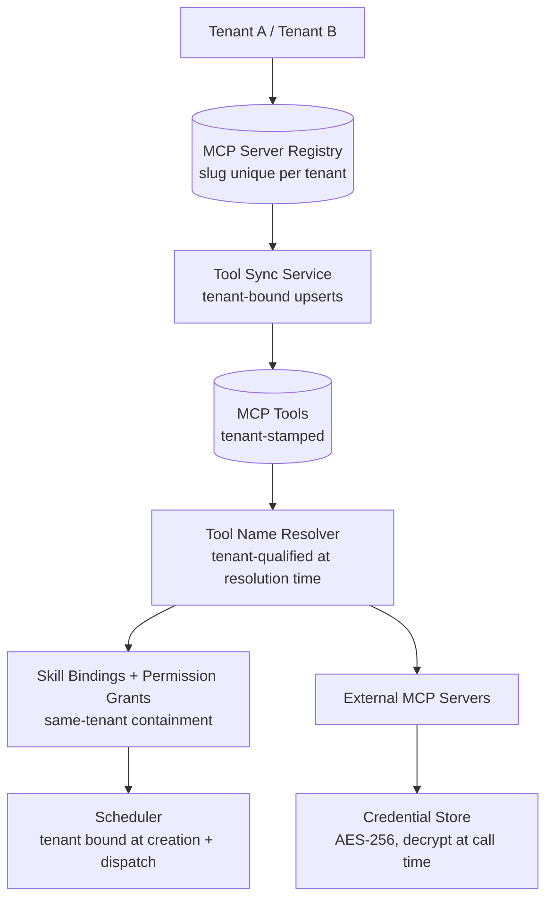

# MCP Hub Architecture

## Overview

The MCP Hub (inside Control Center) is the registry, credential store, and proxy for all registered MCP tool servers. Every registered server has a **slug that is unique per tenant** — the business identity is `(tenant_id, slug)`, not a platform-wide slug. All tools synced from a server are stamped with the server's tenant (`McpTool.tenant_id`), so a tool exists only inside its owning tenant's namespace.

## Per-Tenant Slug & Tool Namespace

- A slug collision across tenants is normal: tenant A and tenant B may each register an MCP server with slug `supabase`. Lookups are always `(tenant, slug)`; the other tenant's row is invisible to resolution.
- Tool sync (`ToolSyncService`) upserts tools under the owning tenant's namespace with a denormalized tenant binding on each tool row.
- The **wire format is unchanged**: `server____tool` and `agent____<slug>` are the names agents and MCP clients see. Tenant qualification happens **at resolution time only** — the slug component is matched against the calling tenant's own registry. Existing permission grants and skill bindings that reference old global tool names keep working.
- Skill → MCP tool bindings and `ToolPermission` grants resolve only against tools of the **same tenant**; a grant in tenant A never authorizes tenant B's same-named tool.

## Reserved Namespaces

The `system` and `decision` server names are reserved namespaces (`RESERVED_SERVER_NAMES`) and are tenant-neutral in the wire format but resolved within the caller's tenant:

- **`system____*`** — platform system tools (`save_data`, `get_data`, `get_output`, `query_result`, `send_notification`, `get_recipient_group`, …), routed to CC internal endpoints.
- **`decision____*`** — decision tools. These are **virtual bindings with no `mcp_tools` rows**: they are registered via skill bindings against the tenant's configured decision provider. In AR, the tool-routing layer classifies `decision____` names before MCP proxying and dispatches them to the decision-tool service, which resolves data types and execution strictly within the calling tenant (exact `tenant_id` match; the old `IS NULL OR own` shared-slot pattern is removed). Decision-provider vendor differences are abstracted behind the Control Center multi-provider client factory, so provider backends are selected per resolved tenant, not hard-wired.

## A2A Delegation Naming

`agent____<slug>` delegation targets are resolved strictly by `(tenant, name)` at CC (`prepare_a2a_request`) and CH `/internal/a2a` forwarding. Name collisions across tenants never route cross-tenant.

## Scheduler Tenant Binding

Scheduled jobs carry a mandatory `tenant_id` at creation (NULL is a hard error). Dispatch resolves a single owning tenant — no `agent_type.tenant_id` fallback — and the job runs fully within that tenant's context: tenant scoping, quotas (consulted at dispatch time in CC), and signed tenant headers on the downstream execution chain. See [Scheduling Architecture](../scheduling/architecture.md).

## Tool Execution Chain

Tool invocation follows the existing Skill Engine → MCP Hub → External MCP Server chain, with the calling tenant's context carried end to end on signed internal headers. Session types (named encrypted-credential sessions vs. passthrough agent-JWT) are unchanged; identity tokens are resolved by Control Center within the tenant's scope only. See [Tool Execution](../tool-execution.md) for the call sequences.
