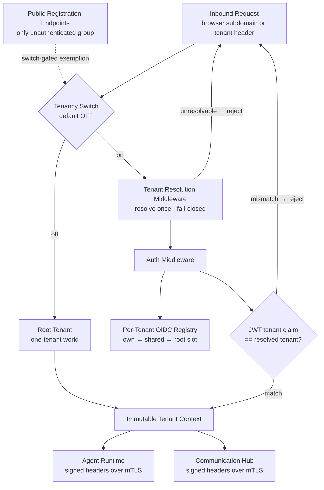
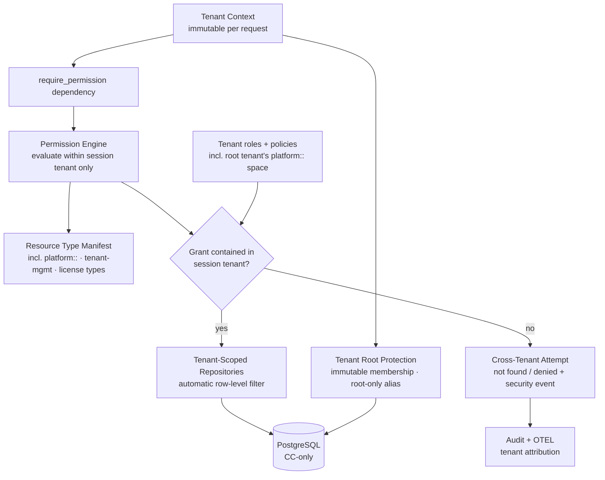
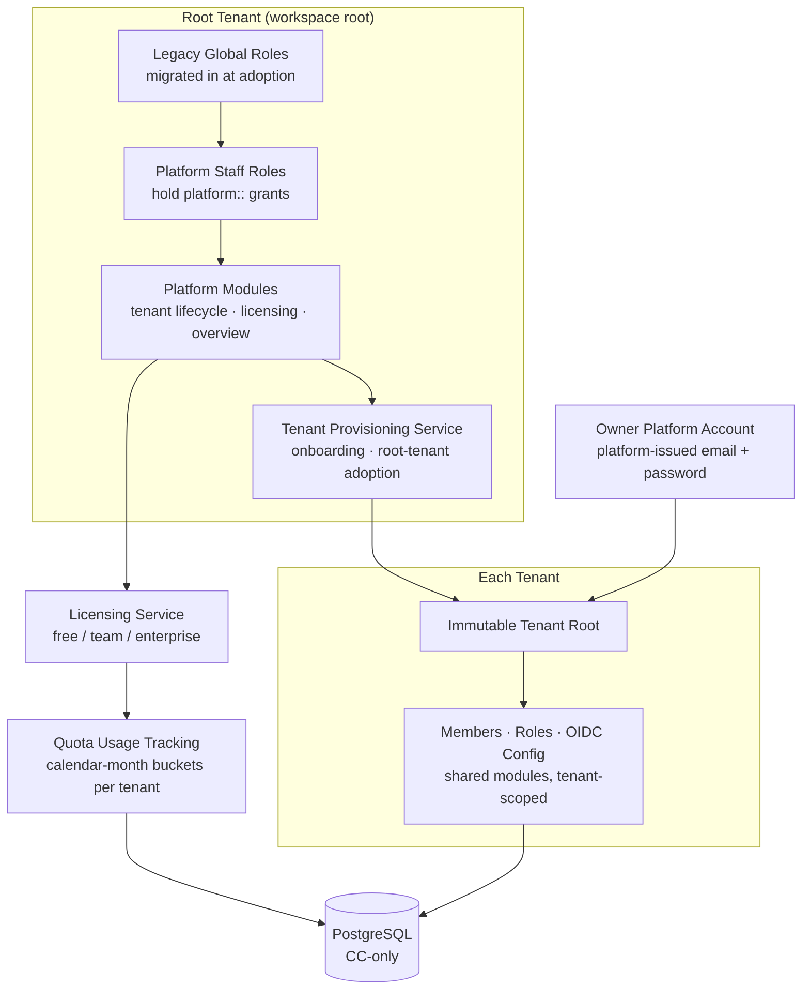

# Multi-Tenancy Architecture

## Overview

Multi-tenancy turns the single-tenant deployment into a shared platform serving many organizations with hard logical isolation. Key invariants:

- **Root tenant = platform** — the workspace `root` is a tenant like any other (not a separate plane); it hosts platform staff, holds the migrated legacy global roles, and is the home of all `platform::` permission types. When the tenancy switch is off, the deployment resolves to the root tenant — a one-tenant world with legacy behavior preserved.
- **Single resolution point** — tenant context is established exactly once per request in Control Center, from a verified source (tenant address subdomain, or tenant header for API/MCP clients); fail-closed in multi-tenant mode.
- **Control Center is the sole database gateway** — every read and write (including quota usage counting) passes through tenant-scoped repositories; no other service touches the database.
- **Read-only propagation** — Agent Runtime and Communication Hub receive a signed, immutable tenant context over the existing mTLS channels; no new trust paths.
- **Quota governance** — license tiers (free / team / enterprise) with limits enforced only in Control Center; over-quota actions are refused there and never dispatched.

## Tenant Resolution and Token Validation

Tenant context flows through a single pipeline: resolve → validate → bind → propagate. Any mismatch between the resolved tenant and the token's tenant claim is a rejection; unresolvable tenants are rejected before reaching any feature logic. When the switch is off, resolution is bypassed and everything binds to the root tenant (the switch-gated public registration group is the only exemption).

Sign-in uses a single unified topology: the workspace address routes to the tenant's OIDC provider or the platform-issued password path; signing in at the root workspace with platform roles leads to the platform console; super-admin break-glass remains available at the root workspace sign-in. A tenant picker appears only for users in multiple organizations — one session = one tenant.

## Permission Containment and Row-Level Scoping

Permissions are evaluated **only within the session's resolved tenant** — the containment invariant. The permission engine has no global tenant-less role collection; legacy global roles (e.g., legacy `system_admin`) migrated into the root tenant as ordinary tenant roles at adoption. Cross-tenant protection is layered: session tenant + row-level scoping at the sole DB gateway + containment. Tenant root membership is immutable — no actor can demote or remove it; alias editing is root-only. Access to platform modules is granted purely by containment (session tenant is root **and** `platform::` grants held in the root tenant's role space) — no separate membership gate.

## Root Tenant Platform Model

The root tenant is the platform plane implemented *as a tenant*. Platform modules (tenant lifecycle, licensing, tenant overview) are gated by `platform::` resource types that exist only in the root tenant's role/policy space — a tenant user, even a tenant root, can never hold them because their tenant's role space contains none. Platform surfaces expose tenant metadata only, never tenant business data.

## Self-Serve Registration and Licensing

The public registration endpoint group (the only unauthenticated group, active only with the tenancy switch on, with basic throttling) atomically creates the tenant, the owner's platform-issued account, and the tenant root membership. Duplicate emails and users who already own a tenant (one owned tenant per user) are rejected with clear messages and no partial data. Quota gates sit at three existing integration points: auth middleware/request dependencies, tenant APIs (user invitation, agent type creation), and execution submission — including the scheduler, which consults quota at dispatch time. Blocked actions return structured feedback (tier / limit / usage / upgrade path); quota-exhaustion events are audited and OTEL-attributed, visible to the platform admin.

## Integration Summary

| Concern | Mechanism |
|---|---|
| Tenant resolution | Address subdomain (browser) or tenant header (API/MCP), once per request, fail-closed |
| Token validation | Per-tenant OIDC registry (own → shared → root slot); JWT tenant claim must match resolved tenant |
| Data isolation | Tenant-scoped repositories at the sole DB gateway — automatic row-level filtering |
| Permission | Containment: grants evaluated only within the session tenant; no global roles |
| AR/CH propagation | Signed immutable tenant headers over existing mTLS; no new trust paths |
| MCP API keys | Issued per tenant; validation binds the session to that tenant |
| A2A messaging | Broker never routes across tenants; pairs must share the tenant context |
| Quota | Single decision point in CC; scheduler consults at dispatch; usage never refunded |
| Observability | Tenant attribution on all traces, logs, and audit events; cross-tenant attempts are security events |
