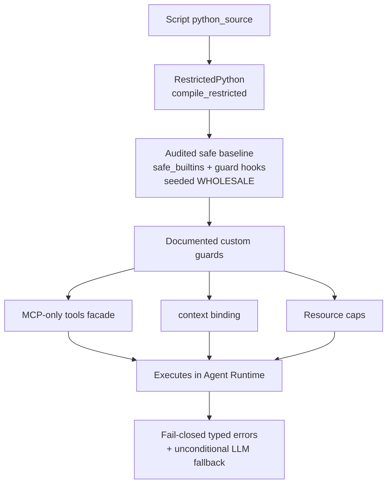
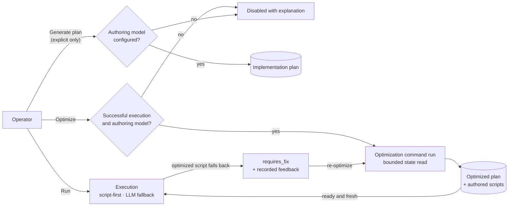
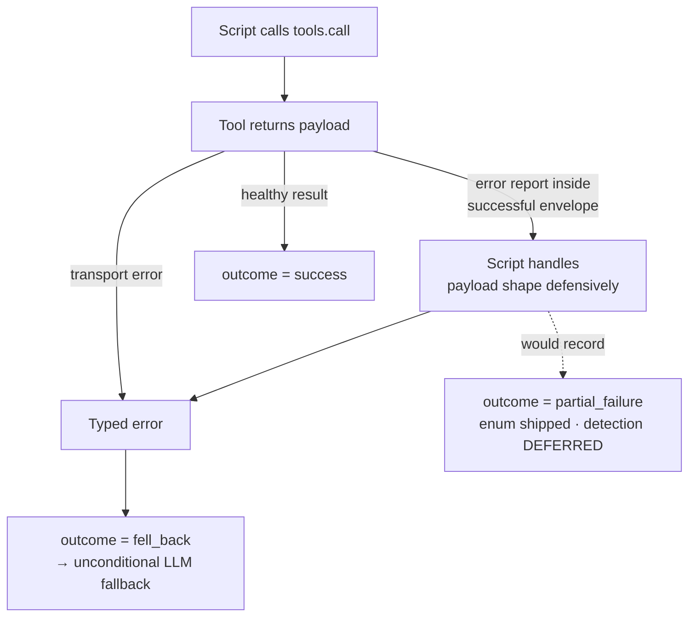

# Sandboxed Scripting & LLM Mocking (Software 3.0 — Phase 2)

Software 3.0 agent workflows can be executed as **sandboxed, model-authored
Python scripts** in Agent Runtime, with a first-class **LLM Mock Layer** for
zero-LLM test runs. This module documents the sandboxed execution model, the
model-authored composition flow, and the mock layer.

## Sandboxed Script Engine (Agent Runtime)

Model-authored script source (`ScriptVersion.python_source`) executes in a
hardened, fail-closed sandbox built on
[RestrictedPython](https://github.com/zopefoundation/RestrictedPython)
(`backend/app/agent_runtime/scripts/sandbox.py`):

- **Compile-time restriction** — `compile_restricted_exec`; disallowed
  constructs fail closed with a typed `SandboxCompileError` before anything
  runs.
- **Baseline-seeded runtime (audited wholesale)** — runtime globals are
  seeded wholesale from RestrictedPython's own audited `safe_builtins`
  baseline (plus its required guard hooks), not assembled
  construct-by-construct. This is
  what makes ordinary Python work inside the sandbox: tuple unpacking
  (`_unpack_sequence_`) and augmented assignment (`_inplacevar_`) come from
  the baseline itself, so valid business logic no longer fails on standard
  language constructs. The modules `json`, `math`, and `statistics` are
  pre-bound; there is **no `import` statement**, no
  `open`/`eval`/`exec`/`compile`/`__import__`. Filesystem, network, database,
  and subprocess access all fail closed (`SandboxViolationError`).
- **Documented custom guards layered on the baseline** — nothing is patched
  into the baseline ad hoc; each guard below is part of the capability
  contract and is covered by a test:
  - **MCP-only tools facade (egress)** — the script's ONLY external binding
    is the injected `tools` facade (`SandboxToolFacade`), a thin sync
    wrapper over the session-bound `CommHubToolClient`: same mTLS path, dual
    identities, per-call token injection by Communication Hub,
    `provenance=script` tagging. Scripts never hold credentials.
  - **Context binding** — `context` is bound read-only from the workflow
    inputs and is the only way data enters the script; it carries no
    credentials or identity tokens.
  - **Resource caps (N1)** — per-version caps (`cpu_limit_seconds`,
    `memory_limit_mb`, `wall_time_limit_seconds`) with platform defaults
    when null. Wall-time is enforced with a daemon worker thread + join
    timeout (safe abandonment: the request/event loop stays healthy); memory
    via `resource.RLIMIT_AS` around execution where the platform supports
    it; the CPU budget is enforced through the wall-time cap (in-process
    sandboxing cannot signal-kill one thread without risking the service
    process). Breaches raise `ResourceLimitExceededError` with
    `sandbox_termination=True` and a one-line human-readable detail.

One audited baseline replaces incremental guard-hook patching. Any future
guard must be added to the capability contract and given a test — the
baseline itself is never edited piecemeal.

Script contract: the source defines `run(context, tools)` and returns a
JSON-able dict.

## Model-authored composition (two-layer plan model)

The base implementation plan stays a plain high-level step list. The
workflow composition is authored by a **separate Optimize action** — never a
mode of Run. A normal run uses the agent's own system and skill instructions
on the agent type's runtime model and never becomes an optimization mission.

**Authoring happens on one workspace model, on request only.** Every
authoring path — Skill/SOP workflow generation, implementation plans, and
optimized plans — resolves the tenant's **authoring model** setting on
Control Center; the agent type's runtime model never authors plans, so a
cheap runtime model cannot cap plan quality. When the setting is unset,
disabled, or removed, generation and Optimize are unavailable with a clear
message and **no fallback model**. Nothing is authored on agent create or
update, on a configuration change, or on a schedule — the Plan Preview is an
explicit Generate action. Conversational agent types have no plan or
optimization surface.

**Bounded, realistic verification.** The optimization run reads the agent's
current plan and a bounded, latest-first window of execution logs, authors
the composition (sandboxed Python script segments, LLM bridges, decision
steps, and the `fully_scripted` mark), and verifies **script syntax plus
correct tool invocation** — not identical results — with an explicit
high-confidence stop rule. On success it persists an
**`OptimizedImplementationPlan`** (a separate entity from the base
`AgentPlan`).

**Plan status and requires-fix.** Status spans `generating`, `ready`,
`needs_feedback`, `failed`, `requires_fix`, and `retired`. A `ready` plan
whose later execution falls back is marked **`requires_fix`** with
auto-recorded feedback: it is never re-served as healthy, and execution stays
on the model-driven path. Re-optimization never reopens a plan — a new plan is
authored and the prior one is retained as `retired`. No unattended
re-optimization runs.

**Conversational optimization.** The same flow is also reachable as an
**optimization-mode conversation on the agent type itself** — no separate
optimizer agent, identity, or role: the session *is* the agent type, so its
role and tool grants are inherently the scope and can never be widened. The
operator sees activity, can be asked what is missing, and replay against
recorded reference data stays the default. When replay cannot prove a script,
the only escape is a **single explicitly approved live test**: one saved
script version runs once in the sandbox under the agent's own identity, and
the approval is consumed in Control Center so no standing live access can be
inherited. Deny, silence, timeout, or expiry leaves the session replay-only.

The shipped Optimized Plan / Scripts UI is captured as an interactive
prototype in [docs/master/ux/prototype/](../../ux/prototype/index.html) — that
prototype, not an aspirational mock, is the reference for this module's UX.

The Script Compiler
(`backend/app/agent_runtime/scripts/compiler.py`) is a **validator /
normalizer** of that model-authored Python — RestrictedPython compile check,
AST safety scan (no imports, no I/O calls, no dunder traversal),
secret-shape guard (SEC3), resource-cap annotations. Validation failure
keeps the candidate in draft with a recorded `sandbox_validation_reason`.
No step is ever auto-appended — the previous hardcoded
`semantic____render` append was removed.

**Serving rule (freshness gate):** the Script-First Dispatcher serves the
optimized composition only while it is ready, fresh, and **not** marked
`requires_fix`: `fully_scripted` → zero-LLM script; otherwise the scripts are
exposed as invocable tools and the LLM orchestrates. An absent, stale,
requires-fix, or failed optimized plan falls back to the base plan's LLM
path.

## Execution, fallback & accounting

- The Script-First Dispatcher runs `python_source` versions in the sandbox
  (whole-script path) or authored `script_segment` steps inside step graphs;
  every tool call flows MCP-only through the injected client.
- Sandbox violations and cap terminations are **unconditional LLM fallback
  triggers** (`sandbox_violation`, `resource_limit_exceeded`) recorded on
  `FallbackEvent` — a run never fails solely because a script failed.
- Script execution logs are **humanized one-liners** (step name, what ran,
  natural-language outcome summary) — no truncated JSON blobs.
- `tokens_saved_actual` is **measured** against the reference LLM run's real
  token usage when known; `tokens_saved_estimate` remains only on
  historical rows.

### Outcome semantics — `partial_failure` (recorded, not auto-detected)

The script-execution outcome enum carries four values: `success`,
`validation_failure`, `fell_back`, and `partial_failure`.

`partial_failure` exists so that a semantic tool failure is *representable*
on the execution record: a tool can return an upstream error report inside a
**successful** transport envelope, and such a run must not be recorded as
`success`. **What shipped is the outcome value itself.** Automatic
semantic-error detection (inspecting successful envelopes for error reports)
and the fallback / repair / re-optimization reactions were **explicitly
deferred by product decision** — no code path writes `partial_failure` today.

The accepted mitigation is defensive script authoring: model-authored scripts
inspect the payload they receive and raise or branch on an error report
rather than assuming a happy shape. A raised script error is a script
failure, which already triggers the unconditional LLM fallback — so the
reaction path is preserved without the detector.

`outcome = partial_failure` is drawn as a **dashed** branch on purpose: the
value is part of the contract, but nothing populates it yet. When detection
is implemented, the fallback / repair / re-optimization reactions attach
there.

## LLM Mock Layer

A deterministic mock provider
(`backend/app/services/agents/llm_mock_provider.py`) is registered in the
model dispatch layer (`LangChainModelFactory`). Selected via configuration —
test environments only; production default is off:

| Env var | Values | Purpose |
|---|---|---|
| `LLM_MOCK_MODE` | `off` (default) / `scripted` / `record` / `replay` | Mock layer selection; invalid values fail fast |
| `LLM_MOCK_SCRIPTED_RESPONSES` | inline JSON or `@/path/file.json` | Scripted match/response rules |
| `LLM_MOCK_RECORDINGS_FILE` | JSON file path | Record/replay backing store |

- **scripted** — deterministic hand-authored responses keyed by prompt
  substring; unmatched prompts fail loudly.
- **record** — captures request/response/usage into `LLMMockRecording`
  rows via the CC internal endpoint `/internal/llm-mock/recordings`
  (mTLS service certs; AR never touches the DB). Payloads carry prompt +
  response + usage only — never API keys or identity tokens (rejected
  server-side).
- **replay** — deterministic replay keyed by `recording_key` (SHA-256 of
  kind + model + serialized messages); unmatched calls fail loudly.

The CC semantic-bridge endpoint is served by the same mock layer in mock
modes, so model-backed script steps run zero-LLM in tests. Prompt-assertion
helpers (`assert_prompt_contains`, `assert_prompt_structure`) support
deterministic test assertions against recorded request payloads.

## Compliance

Segregated services (sandbox and mock layer are in-process AR components;
recordings persist through a CC internal endpoint); scripts run only in AR;
only CC connects to PostgreSQL; scripts receive no credentials; scripts'
only egress is the injected MCP client.

Optimization adds no privilege surface: plan authoring, the optimizer and
authoring model settings, the requires-fix flag, and the single-use live-test
approval ledger all live in Control Center, while Agent Runtime receives only
model and mission identifiers. An approved live test is one sandbox run of one
approved script version under the agent type's own identity and existing
grants — it grants no new tools, no credential, and no standing access.
