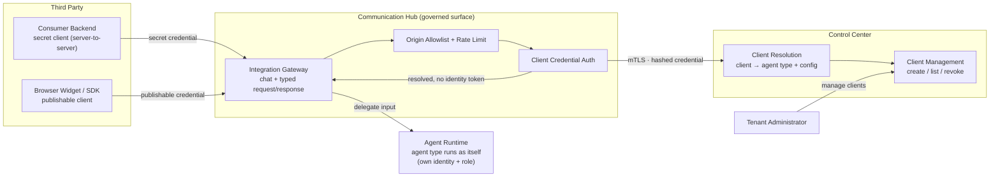

# Third-Party Agent Integration Architecture

Third parties consume an agent type's *input interface* through the Communication Hub governed surface using **client credentials** — a primitive distinct from API keys. A client is bound to one agent type and is **not an identity**: it yields no agent identity token, cannot reach the MCP hub, and cannot impersonate an agent. The invoked agent type always runs with its own identity + role as configured.

## Client Model and Credential Types

## Key Properties

- **Two credential types** — `secret` (server-to-server, may carry an optional end-user token held CH-side) and `publishable` (browser-safe; protected by per-client origin allowlist + rate limit instead of secrecy).
- **No identity forwarding** — a client credential resolves to `(client → agent type + config)` only; no agent identity token is issued or forwarded on any client path.
- **Governed surface only** — all third-party traffic enters through the Communication Hub; client lifecycle (create / list / revoke) is owned by Control Center and tenant-scoped.
