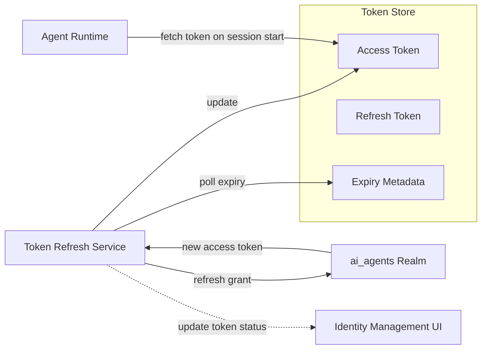
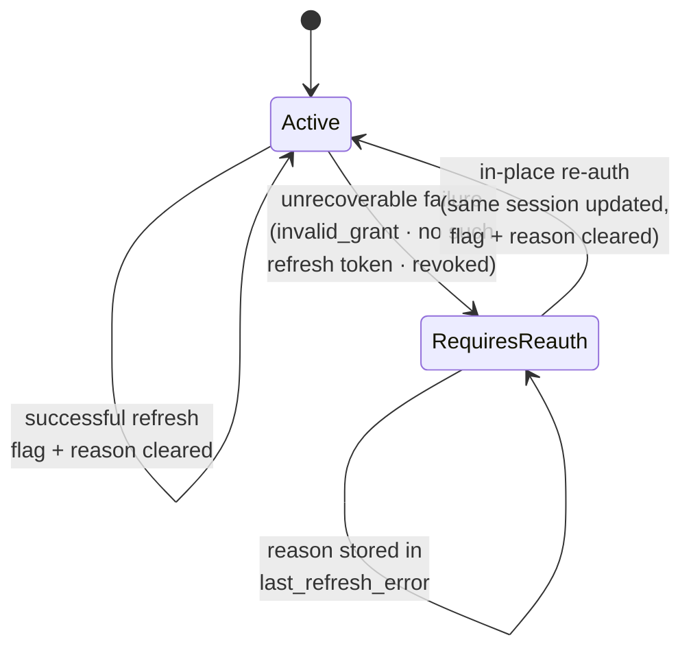
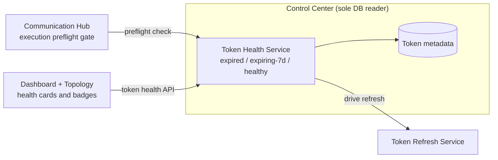

# Token Refresh Service

## Overview

The Token Refresh Service is a background service that keeps agent access tokens valid without requiring administrator intervention. It monitors token expiry in the Token Store and proactively refreshes access tokens against the `ai_agents` realm using stored refresh tokens, before the access token expires. If a refresh token has itself expired, the service marks the identity as requiring re-authentication and surfaces the status in the management UI.

## Component Architecture

## Responsibilities

- **Expiry monitoring** — Polls token expiry metadata at a configured cadence; flags tokens that are expiring soon
- **Proactive refresh** — Issues OAuth 2.0 refresh token grants against the `ai_agents` realm before the access token expires
- **Token Store update** — Writes the new encrypted access token back to the Token Store; the expiry timestamp is updated accordingly
- **Failure handling** — Refresh failures are split by recoverability. A
  **transient** failure (network, 5xx, rate limit) is retried without
  touching session health. An **unrecoverable** failure (refresh token
  expired or revoked) sets `requires_reauth` + `last_refresh_error` on the
  affected MCP session and stops refreshing it until the user re-authenticates
  in place. For agent identity tokens the identity status becomes `expired`.
- **Status surfacing** — Token status (`valid` / `expiring_soon` / `expired`) is surfaced in the Identity Management UI, enabling admins to act before sessions fail

## Token Lifecycle States

| State | Meaning | Action |
|---|---|---|
| **valid** | Access token is current; no action needed | Refresh Service monitors expiry |
| **expiring_soon** | Access token is within the refresh window | Refresh Service issues refresh grant |
| **expired** | Refresh token is expired or revoked | Admin must re-authenticate via OAuth sign-in |

## MCP Session Re-Auth State (`requires_reauth`)

OAuth credentials for an MCP session can fail to refresh for two very
different reasons, and treating them alike is what stranded agents silently.
The session therefore carries a health pair: a boolean **`requires_reauth`**
and the stored failure reason **`last_refresh_error`**. Detection lives in
the refresh path; the Token Health Service classification below is a
separate, read-only view.

- **Active** — the normal state. Access tokens refresh on schedule. A
  **transient** failure (network error, 5xx, rate limit) leaves the session
  Active and is simply retried on the next cycle; it never sets the flag.
- **RequiresReauth** — entered only on an **unrecoverable** refresh failure:
  the identity provider reports the refresh token itself is no longer usable
  (e.g. `invalid_grant`, "No such refresh token found", revoked). The failure
  text is stored in `last_refresh_error` so the *reason* survives, and the
  session is surfaced in the MCP Hub session UI as **"Needs
  re-authentication"** — an error-state token badge whose tooltip carries the
  stored reason, alongside the re-authenticate action.
- **Recovery** — the user re-authenticates **in place**: the *same* session
  row is updated with the new token pair, `requires_reauth` returns to false
  and `last_refresh_error` is cleared — no session re-creation, no
  reconfiguration. Any later successful refresh also clears both fields.

The blast radius is a single session: other sessions, other servers, and
unrelated identities are untouched, and an ordinary transient failure stays
invisible to the user.

## Expiry Classification (Token Health Service)

The **Token Health Service** (Control Center) is the single owner of token expiry state. It computes an expiry classification per identity token and per MCP session directly from the token metadata the Token Store already holds — Control Center remains the only database-connected service, and no new deployable is introduced.

| State | Meaning | Downstream effect |
|---|---|---|
| `healthy` | Token valid, outside the 7-day window | Execution preflight proceeds |
| `expiring-within-7-days` | Token valid today but expiring soon | Execution proceeds **with a warning**; surfaced on dashboard + topology |
| `expired` | Token (or refresh token) no longer usable | Execution **blocked** at the Communication Hub preflight gate |

## Re-Authentication

When a refresh token is expired, an administrator re-authenticates by completing an OAuth sign-in to the agent user account in the `ai_agents` realm. The Platform API exchanges the authorization code for a new access and refresh token pair and stores them in the Token Store. The Token Refresh Service resumes normal monitoring once a valid refresh token is available. See [Identity](identity.md) for the dual-realm topology.
